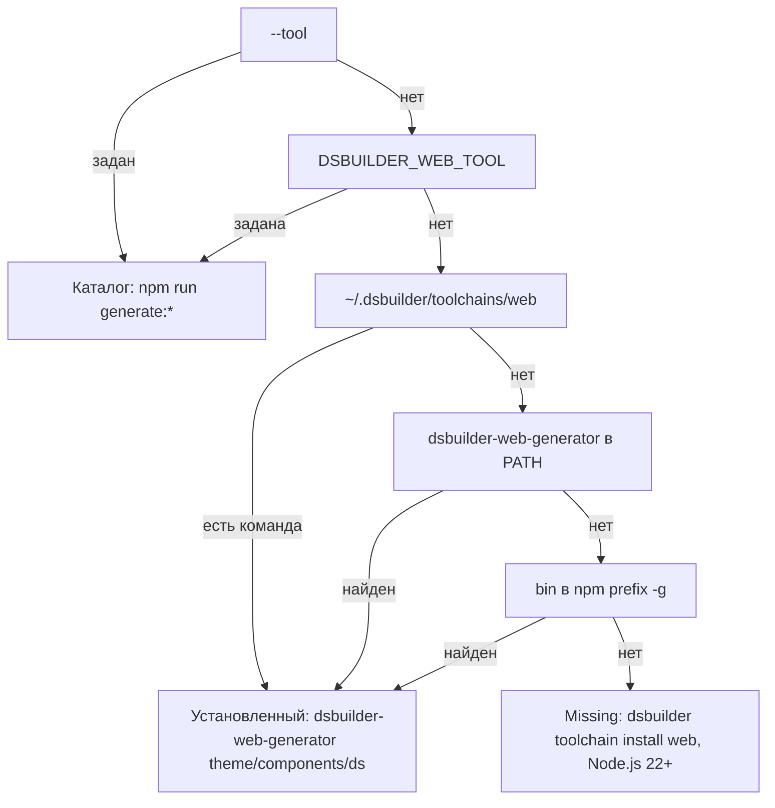

## Context

После выпуска дистрибутивов `dsbuilder` (#143) web-платформа осталась единственной, которой нужен клон
репозитория:

- делегат `web` (`frontend-kt/platform-web`) находит генератор только по `--tool` или
  `DSBUILDER_WEB_TOOL` и запускает `npm run generate:*` в каталоге `js/cli`;
- генератор требует `NPM_PACKAGE_SCOPE` (`js/cli/src/generator/utils/index.ts` падает без неё), а
  скрипты подхватывают её из `js/.env`;
- `js/cli` нельзя опубликовать как есть: в `package.json` нет `version`, `bin` и `files`, все зависимости
  лежат в `devDependencies`, код запускается через `tsx` из `src/*.ts`;
- установщика toolchain `web` нет, а установщики CLI ставят только `dsbuilder` и вложенный iOS CLI.

Код генератора самодостаточен: относительные импорты не выходят за пределы `js/cli`, шаблоны и
заготовка пакета читаются через `import.meta.dirname`. Поэтому пакет можно публиковать без
переноса кода.

## Goals / Non-Goals

**Goals:**

- React-генерация работает после установки `dsbuilder` из релиза без клона репозитория и без
  переменных окружения.
- `NPM_PACKAGE_SCOPE` необязательна (`@sddsjs` по умолчанию) и переопределяется одинаково во всех
  способах запуска.
- Работа из репозитория (`--tool`, `DSBUILDER_WEB_TOOL`, `npm run generate:*`) не меняется.

**Non-Goals:**

- Согласование версий `dsbuilder` и генератора: ставится последняя версия, проверки совместимости нет.
- Компиляция генератора в JavaScript и уменьшение размера пакета.
- Установка Node.js установщиками `dsbuilder`.
- `generate:api-meta` и `import:plasma` в исполняемом файле: это инструменты разработчиков
  репозитория.

## Decisions

### Пакет и исполняемый файл

Пакет переименовывается в `@sddsjs/design-system-builder-generator` (старое имя в npm не публиковалось)
и объявляет `bin: { "dsbuilder-web-generator": "bin/dsbuilder-web-generator.js" }`. Точка входа —
небольшой JavaScript-файл: он регистрирует загрузчик `tsx` и передаёт управление существующим `main()`
из `src/theme.ts`, `src/components.ts` и `src/ds.ts` по подкоманде. Для этого точки входа экспортируют
`main(argv)` и запускают её сами только при прямом вызове, чтобы `npm run generate:*` работал как раньше.

`tsx`, `@salutejs/plasma-new-hope`, `@salutejs/plasma-tokens-utils`, `fs-extra`, `typescript` и прочие
модули, которые генератор импортирует при работе, переносятся в `dependencies`. В `devDependencies`
остаётся то, что нужно только тестам, проверке типов и сборке сгенерированного пакета в тестах.
Поле `files` ограничивает пакет каталогами `bin` и `src` без тестов, `engines.node` — `>=22`.

Рассмотренные варианты:

- *Компиляция в JavaScript через `tsc`.* Отклонено: генератор читает шаблоны и `constants` рядом с
  исходниками через `import.meta.dirname`, а тесты и `npm run` работают с `.ts`. Пришлось бы копировать
  ресурсы и поддерживать две раскладки.
- *Встроенное удаление типов Node.js.* Отклонено: `import-plasma-component.ts` использует параметры
  конструктора с модификаторами, которые Node не поддерживает без трансформации; `tsx` уже проверен
  на этом коде.

### Scope генерируемого пакета

`NPM_PACKAGE_SCOPE` читается так же, но пустое или отсутствующее значение даёт `@sddsjs`. Значение
проверяется по правилам npm (`@` и допустимые символы) до записи файлов. Отдельный флаг командной
строки не вводится: переменная окружения одинаково работает для `npm run`, `dsbuilder-web-generator`
и `dsbuilder` (делегат передаёт окружение родителя процессу генератора). `js/.env` остаётся
необязательным источником для работы из репозитория.

Как пользователь переопределяет scope:

```bash
NPM_PACKAGE_SCOPE=@acme dsbuilder ds generate --platform react -- --package --name brand
```

```powershell
$env:NPM_PACKAGE_SCOPE = '@acme'; dsbuilder ds generate --platform react -- --package --name brand
```

### Поиск генератора делегатом



Явный путь важнее глобальной установки, а неверный явный путь — ошибка без перехода к глобальной
установке: иначе разработчик молча получит другую версию генератора. Поиск в `npm prefix -g` нужен
для окружений, где каталог глобальных команд npm не добавлен в `PATH`; это короткий запуск с захватом
вывода, он выполняется только если в `PATH` ничего не нашлось. На Windows ищутся
`dsbuilder-web-generator.cmd` и каталог prefix без `bin`.

Аргументы в обоих режимах одинаковы: `--sdds`, `--out` и передаваемые дальше. Отличается только
команда и рабочий каталог: для глобального режима это рабочая копия проекта.

### Установщик toolchain `web`

`WebToolchainInstaller` в `platform-web` реализует существующий порт `ToolchainInstaller`:
`npm install --global --prefix ~/.dsbuilder/toolchains/web <spec>`, где `<spec>` —
`@sddsjs/design-system-builder-generator@latest`, `@<version>` или путь из `--from`. С `--prefix` npm кладёт
пакет в `<prefix>/lib/node_modules` и команду в `<prefix>/bin` (на Windows — `<prefix>\node_modules` и
`<prefix>\*.cmd`), то есть ведёт себя как глобальная установка, но в каталоге пользователя. После установки
версия читается из `dsbuilder-web-generator --version`. Версиями управляет npm, каталога `current` нет;
повторная установка заменяет пакет. Домашний каталог берётся из `HOME`, на Windows — из `USERPROFILE`.

Сначала генератор ставился в глобальный prefix npm (`npm install -g`). На первой же ручной проверке это не
сработало: у Node.js из официального установщика и у `n` глобальный каталог `/usr/local/lib/node_modules`
принадлежит root, и npm падает с `EACCES`. Требовать от пользователя `sudo` или `npm config set prefix`
нельзя, поэтому генератор ставится в каталог, которым `dsbuilder` уже владеет. Генератор из глобального npm
по-прежнему находится, если пользователь поставил его сам.

Рассмотренный вариант — версионные каталоги `~/.dsbuilder/toolchains/web/<version>` с `current`, как у iOS.
Отклонён: npm сам ведёт версию пакета в prefix, а отдельный каталог на версию дублировал бы зависимости.

### Установщики дистрибутивов

`install-unix-common.sh` и `install-windows-cli.ps1` после успешной установки CLI (и iOS CLI) вызывают
установленный `dsbuilder toolchain install web`. Шаг выполняется вне транзакции установки CLI: его
ошибка не откатывает CLI, а печатает предупреждение и команду повтора, код возврата остаётся 0.
Без `npm` в `PATH` шаг пропускается с предупреждением о Node.js 22+. Флаги `--without-web` и
`-WithoutWeb` отключают шаг; сетевые установщики передают их локальному установщику, как
`--without-ios`. В smoke-проверках релизного workflow установка идёт с `--without-web`, а сам шаг
проверяется тестами установщиков с поддельным `npm`.

### Публикация в npm

Пакет публикует вручную владелец scope `@salutejs`: поднимает `version` в `package.json` и выполняет
`npm publish` в `js/cli`. Скрипт `prepublishOnly` запускает проверку типов и тесты, `publishConfig.access`
равен `public`, поэтому дополнительные флаги не нужны. Автоматическая публикация из CI не вводится:
публикацию выполняет конкретный человек, и токен npm в секретах репозитория не нужен. Версии
генератора не связаны с тегами `cli-v*`.

## Программное проектирование

```kotlin
// platform-web
internal sealed interface WebTool {
    data class Directory(val path: String, val npm: String) : WebTool
    data class Global(val executable: String) : WebTool
}

internal class WebToolLocator(
    fileSystem: WorkspaceFileSystem,
    environmentReader: EnvironmentReader,
    processRunner: ProcessRunner,
) {
    fun locate(override: String?): WebToolLookup
    fun locateNpm(): String?
}

internal sealed interface WebToolLookup {
    data class Found(val tool: WebTool) : WebToolLookup
    data class Missing(val hint: String) : WebToolLookup
}

public class WebToolchainInstaller internal constructor(
    processRunner: ProcessRunner,
    locator: WebToolLocator,
) : ToolchainInstaller {
    override val toolchain: ToolchainId // "web"
    override fun install(request: ToolchainInstallRequest): ToolchainInstallResult
}
```

`WebNpmDelegate` получает `WebTool` от локатора и строит `ProcessRequest` по его виду; `doctor` для
`Global` запускает `--version` с захватом вывода. Установщик регистрируется в `toolchainInstallers()`
composition root `:cli` для всех платформ, где зарегистрирован делегат `web`.

```ts
// js/cli
export const DEFAULT_NPM_PACKAGE_SCOPE = '@sddsjs';
export function resolveNpmPackageScope(env: NodeJS.ProcessEnv): string; // проверка формата
export async function main(argv: string[]): Promise<void>; // в theme.ts, components.ts, ds.ts
```

## Risks / Trade-offs

- [Пакет ещё не опубликован, когда выходит CLI] → публикация генератора идёт до выпуска CLI; без пакета
  установщики CLI печатают предупреждение, CLI работает.
- [Глобальный prefix npm принадлежит root (Node.js из официального установщика, `n`)] → генератор ставится в
  `~/.dsbuilder/toolchains/web`, глобальный prefix не используется.
- [Команда `dsbuilder-web-generator` не попадает в `PATH` пользователя] → она нужна `dsbuilder`, который
  знает путь; для ручного запуска её путь печатает `dsbuilder toolchain install web`.
- [Последняя версия генератора несовместима с установленным `dsbuilder`] → аргументы делегата
  стабильны (`--sdds`, `--out`), а пользователь может закрепить версию через
  `dsbuilder toolchain install web --version`.
- [Пакет тяжёлый из-за `@salutejs/plasma-new-hope` и `typescript`] → приемлемо: те же зависимости уже
  ставятся при работе из репозитория; уменьшение размера вне рамок изменения.
- [Установка CLI начинает ходить в сеть] → шаг необязательный, отключается флагом и не влияет на код
  возврата.

## План проверки и развёртывания

- Локально: `npm run typecheck && npm test` в `js/cli`, включая тесты scope по умолчанию и точки входа;
  `npm pack` и установка архива в отдельный prefix с запуском `dsbuilder-web-generator ds` на
  `.sdds` из тестовых данных; `./gradlew build` в `frontend-kt`; тесты установщиков
  (`:cli:distributionTests`) с поддельным `npm`.
- До выпуска: владелец scope вручную публикует версию `0.1.0`, проверяет, что
  `npm install -g @sddsjs/design-system-builder-generator` ставит команду, и только затем выпускается CLI,
  который её устанавливает.
