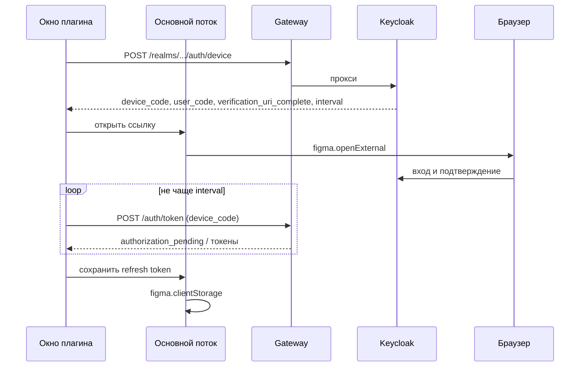
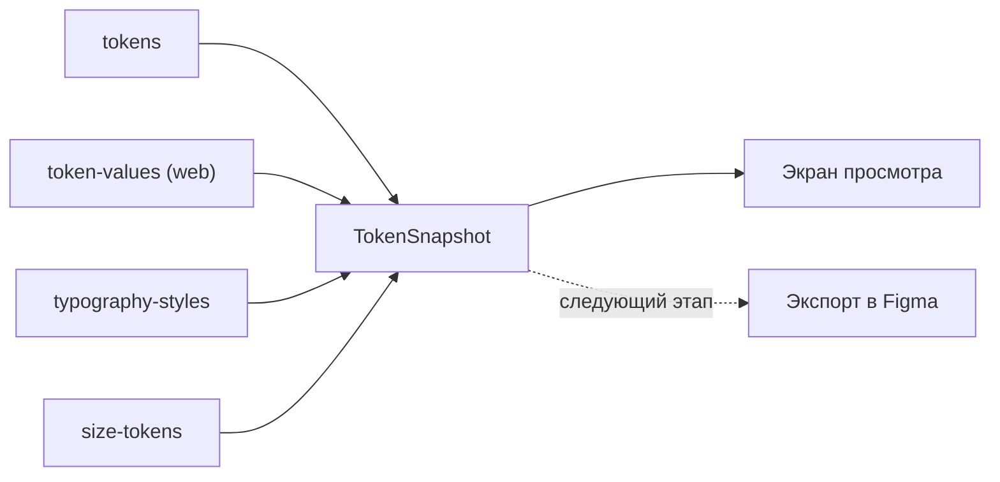

## Контекст

Токены живут в DS Builder, а дизайнеры работают в Figma. В `frontend-kt/plugins/android-studio` уже есть просмотр токенов в IDE: вход в браузере, шаги проект → дизайн-система → тема, вкладки по типам, поиск, переключатель Light и Dark. Эти сценарии переносятся, а реализация — нет: плагин Figma работает иначе.

Ограничения Figma:

- код делится на основной поток (песочница без браузерных API, доступ к файлу и `figma.clientStorage`) и окно UI в iframe; связь — только сообщениями;
- iframe имеет origin `null`, сервер должен разрешить его в CORS;
- домены перечисляются в `networkAccess` манифеста;
- loopback-адрес и пользовательские схемы для OAuth-редиректа недоступны, поэтому вход Android Studio (PKCE на `127.0.0.1`) здесь не работает.

Состояние DS Builder:

- Gateway проксирует `/auth/**` в Keycloak: endpoint устройства уже доступен, новый маршрут не нужен. CORS разрешает ровно один `OIDC_WEB_ORIGIN`, origin `null` отклоняется.
- Токены читаются отдельными ответами: определения `design-systems/{id}/tokens`, значения `tenants/{id}/token-values`, типографика `typography-styles`, размеры `size-tokens`. Все принимают `versionId`. Единого снимка темы нет.

Плагин приватный, для организации: Community и её проверка не рассматриваются.

## Цели / Вне целей

**Цели:**

- вход пользователя DS Builder из Figma, сессия переживает перезапуск;
- выбор проекта, дизайн-системы, темы и версии;
- просмотр токенов только для чтения;
- слой чтения и разбор значений, которые без переделки использует экспорт.

**Вне целей:**

- запись в файл Figma и изменение данных DS Builder;
- ключи проекта как способ входа;
- новые маршруты чтения в `ds-service`, снимок темы одним запросом;
- значения платформ iOS и Android;
- тестовые стенды как адреса сервера.

## Следующий этап: экспорт токенов в Figma

Экспорт — отдельное изменение сразу после этого. Что в нём будет:

| Токены | Объект Figma |
|---|---|
| цвета | Variables `COLOR`, режимы Light и Dark |
| радиусы, отступы | Variables `FLOAT` |
| типографика | Text Styles, поля привязаны к переменным |
| тени | Effect Styles |
| градиенты | Paint Styles |

Там же решаются: одна коллекция на тему или режимы по темам (зависит от лимита режимов тарифа), связь токена с объектом для повторного экспорта, предпросмотр изменений, отчёт о пропущенном (шрифта нет в файле — `loadFontAsync` не загружает шрифты из сети).

Что закладывается сейчас:

- модель `TokenSnapshot` — разобранные значения темы в одном виде для экрана и экспорта;
- типизированный обмен сообщениями окна и основного потока: экспорт добавляет команды, а не канал;
- `documentAccess: dynamic-page` в манифесте, как требует Figma для новых плагинов, чтобы экспорт сразу использовал асинхронный API;
- чтение через выбранную границу версии: экспорт опубликованной версии не требует нового кода.

## Решения

### Приложение на TypeScript в `js/apps/figma-plugin`

Плагин Figma — это JavaScript в песочнице и HTML в iframe. Отдельное приложение со своим `package.json`, как `preview-web-plugin`; npm workspaces не вводятся.

`AGENTS.md` направляет новую клиентскую архитектуру в `frontend-kt`, поэтому отступление от него зафиксировано в следующем разделе.

Стек: React 18 и TypeScript, как в остальном `js/`. Plasma не используется: окно 400 px должно выглядеть как интерфейс Figma, цвета берутся из переменных `--figma-color-*` (`themeColors: true`). Окно собирается в один HTML через `vite-plugin-singlefile`, потому что Figma загружает только его.

Общего TS-пакета нет. Разбор значений пишется заново в приложении: код `apps/client` тянет `@salutejs/*` и активную палитру, а значения приходят уже разрешёнными.

### Окно на React, Compose Multiplatform — возможное развитие

Рассматривался интерфейс на Compose Multiplatform через Kotlin/Wasm. Вариант реальный: `sdds-uikit-compose`, `sdds-serv-compose` и `sdds-icons-compose` публикуются со сборками `wasm-js` на Compose 1.8.2, той же версии, что в `frontend-kt`, а экраны плагина Android Studio (около 1700 строк) почти не зависят от IDE. Он дал бы компоненты SDDS и общие экраны с IDE.

Сейчас он не выбран по четырём причинам:

- **Работа в Figma не подтверждена.** Документация Figma не описывает wasm в окне плагина. Неизвестно, поддерживает ли движок Figma desktop WasmGC и запустится ли модуль из однофайлового `ui.html`. Основной риск первой задачи — вход и сеть из песочницы, и добавлять к нему второй неизвестный риск нельзя.
- **Нужен рефакторинг общих модулей.** Экраны надо вынести из JVM-модуля, а `core-network`, `core-auth` и клиенты чтения получают цель `wasmJs` и развязку от `core-application`, `core-process`, `core-workspace`. Это затрагивает CLI, MCP и плагин Android Studio и несоразмерно задаче просмотра токенов.
- **Зрелость.** Compose для web стал бетой только в 1.9.0, а в проекте 1.8.2; нужно ещё и обновление версии.
- **Размер и вид окна.** Размер плагина и время запуска с движком рисования не измерены. Интерфейс рисуется на canvas, поэтому переменные `--figma-color-*` и обычный CSS не работают.

Основной поток остаётся на TS при любом выборе окна: `figma.*` и `clientStorage` доступны только там, а на wasm в песочнице рассчитывать нельзя.

Отказ не окончательный. Окно отделено от основного потока протоколом сообщений, поэтому клиент Keycloak, CORS, манифест, основной поток и будущий экспорт не зависят от технологии окна. При переходе заменяются только экраны, клиент API и разбор значений.

После этого изменения выполняется короткая проверка: минимальное окно Compose/Wasm с компонентом SDDS, импортированное в Figma desktop, с замером размера и времени запуска. Перевод окна обсуждается, если окно запускается, размер и запуск приемлемы, а поддержка общих экранов с IDE оправдывает рефакторинг модулей.

Kotlin/JS без Compose не рассматривается: он экономит только клиент API и обновление токена, а требует той же развязки модулей, браузерной сборки и экспортируемого слоя для TS.

### Вход: Device Authorization Grant



Keycloak поддерживает этот поток сам: со стороны DS Builder нужны только клиент и CORS. В Android Studio его отклонили лишь из-за лишнего шага в браузере, когда loopback был доступен; здесь loopback недоступен, а ссылка `verification_uri_complete` уже содержит код, вводить его вручную не нужно.

Отвергнуто:

- **Свой обмен на gateway** (схема из документации Figma с разовыми ключами): новый серверный код, хранение токенов на gateway, состояние между экземплярами. Даёт только экономию экрана подтверждения.
- **Ключ проекта:** не вход — один проект, ручная вставка, срок 30 дней, `GET /api/projects` недоступен.

Клиент отдельный (`dsbuilder-figma-plugin`): отзывается независимо, и у `dsbuilder-studio-plugin` не появляется лишний поток. Поведение при сетевой ошибке обновления берётся у CLI (сессия сохраняется), а не у IDE, где она сбрасывается.

### CORS: origin `null` только на вход и чтение

Origin `null` имеет любой sandbox-iframe, поэтому разрешение узкое: новая настройка `OIDC_PLUGIN_ORIGINS` и правило «`POST` на endpoint входа, `GET` на `/api/projects/**`». В `Access-Control-Allow-Methods` для такого origin попадает только разрешённый метод: иначе браузер закэширует весь список на адрес и отправит запись без нового preflight.

Это граница браузера, а не авторизации: токен плагина несёт права пользователя, и режим только для чтения держится на клиенте. Клиент API плагина содержит только `GET`.

Риск низкий: API авторизуется заголовком `Authorization`, а не cookie, и `Access-Control-Allow-Credentials` не выставляется, поэтому чужая страница без токена ничего не получит. Ответ `Access-Control-Allow-Origin: null` браузер принимает для iframe с origin `null` и, в отличие от `*`, не открывает API остальным сайтам. Документация Figma называет только `*`, поэтому это проверяется на первом запуске; запасной вариант — `*` на тех же путях.

Отвергнуто: `Access-Control-Allow-Origin: *` на всём API — лишнее расширение; размещение окна плагина на нашем домене — нужен отдельный хостинг, а при его недоступности плагин не откроется.

### Сетевые запросы — из окна плагина

Запросы к API идут из iframe, основной поток только хранит токены, открывает браузер и позже пишет в файл. Документация Figma противоречива насчёт `fetch` в основном потоке, а окно — обычный браузерный контекст, который тестируется без Figma.

### Чтение и `TokenSnapshot`

Экран читает по разделам параллельно на одной границе версии:



Значения берутся разрешёнными из `tenants/{id}/token-values`, а не из глобальной `/ds/palette`, как в плагине Android Studio: такое раскрытие давало неверные цвета. Типографика и размеры читаются готовыми маршрутами в px, разбор rem не нужен.

Снимок темы одним маршрутом в `ds-service` не делается: четыре параллельных чтения достаточны, а контракт снимка лучше проектировать вместе с экспортом.

## Программное проектирование

```ts
// src/shared/messages.ts — обмен окна и основного потока
type UiToMain =
    | { type: 'storage:get'; requestId: string; key: StorageKey }
    | { type: 'storage:set'; requestId: string; key: StorageKey; value: string }
    | { type: 'storage:delete'; requestId: string; key: StorageKey }
    | { type: 'open-external'; url: string };
type MainToUi = { type: 'storage:result'; requestId: string; value: string | null };

// src/ui/auth/deviceFlow.ts
interface DeviceAuthorization {
    deviceCode: string; userCode: string; verificationUriComplete: string;
    intervalSeconds: number; expiresInSeconds: number;
}
function requestDeviceCode(http: Http): Promise<DeviceAuthorization>;
function pollForTokens(http: Http, device: DeviceAuthorization, signal: AbortSignal): Promise<TokenPair>;

// src/ui/auth/session.ts
interface Session {
    restore(): Promise<boolean>;
    signIn(tokens: TokenPair): Promise<void>;
    accessToken(): string | null;
    refresh(): Promise<string>;      // одно обновление на всех ожидающих
    signOut(): Promise<void>;
}

// src/ui/api/dsBuilderApi.ts — 401 → одно обновление → один повтор
interface DsBuilderApi {
    projects(): Promise<Project[]>;
    designSystems(projectId: string): Promise<DesignSystem[]>;
    versions(context: DesignSystemContext): Promise<Version[]>;
    tenants(context: DesignSystemContext): Promise<Tenant[]>;
    snapshot(context: TenantContext, versionId: string | null, signal: AbortSignal): Promise<TokenSnapshot>;
}

// src/ui/tokens/snapshot.ts
interface TokenSnapshot {
    colors: ColorToken[];          // group, name, light, dark; значение: цвет, градиент или нераспознанное
    typography: TypographyGroup[]; // экраны, группы, стили в px
    radii: SizeToken[]; spacing: SizeToken[]; shadows: ShadowToken[];
}
```

Основной поток `src/main/code.ts` не знает об API и OAuth: только хранилище, внешний браузер и размер окна. Логика входа и разбора — чистые функции, которые тестируются `vitest` без Figma.

Gateway: `GatewayConfiguration.pluginOrigins: Set<String>` и правило в `GatewayRequestHandler.cors`, вынесенное в отдельную чистую функцию, проверяемую по методу и пути.

## Риски / Компромиссы

- **Срок сессии.** Обычный refresh token живёт 30 минут простоя, этого мало для плагина, который открывают эпизодически → плагин запрашивает `offline_access`: сессия живёт 30 дней простоя (`offlineSessionIdleTimeout`), верхней границы нет (`offlineSessionMaxLifespanEnabled=false`). Если плагин открывают регулярно, повторный вход не потребуется, пока пользователь не выйдет или администратор не отзовёт сессию.
- **Право на офлайн-сессию.** Keycloak выдаёт офлайн-токен только пользователю с ролью `offline_access`. Она входит в роль по умолчанию, но импортированные пользователи роль по умолчанию не получают, и вход завершается `not_allowed` уже после подтверждения в браузере → `offline_access` входит в составную роль `user`: в `dsbuilder-realm.json` и идемпотентной командой в `bootstrap-production-keycloak.sh`, поэтому уже заведённых пользователей перебирать не нужно. Пользователю без роли плагин сообщает, что нужно обратиться к администратору.
- **Экран подтверждения.** Страницы устройства в теме `dsbuilder` могут выглядеть неоформленно → проверка на стенде; при необходимости дорабатывается тема отдельно.
- **Подмена кода устройства.** Пользователя могут уговорить подтвердить чужой код → плагин показывает `user_code` для сверки, код живёт недолго.
- **`fetch` к localhost в Figma desktop.** Возможны ограничения смешанного содержимого → `devAllowedDomains`, внешняя проверка на первом запуске.
- **`clientStorage` не шифруется** и лежит в браузерном хранилище Figma, а токен в нём долгоживущий → хранится только refresh token, доступен только этому плагину и пользователю; выход удаляет его и отзывает офлайн-сессию на сервере.
- **Базовые значения strictacode обновлены в этом изменении с явного разрешения разработчика**, хотя обычно они не меняются ради прохождения проверки. `javascript-client` (плотность 10.02 → 10.57), `javascript-cli` (оценка 26 → 37, RP 41 → 49) и `frontend` (плотность 9.62 → 9.85, RP 59 → 60) разошлись с базой ещё в dev: чистый `origin/dev` даёт те же цифры, а код этих контуров здесь не менялся, кроме контрактного теста → новые значения фиксируют состояние dev и ничего не говорят о качестве плагина; рост метрик CLI остаётся отдельным вопросом.
- **strictacode не охватывает новое приложение**, как и `preview-web-plugin`: его подключение требует правки защищённого `.verification/config` → вне этого изменения.

## План развёртывания

1. Выкатить gateway и клиент Keycloak: `docker-compose.prod.yml` задаёт `OIDC_PLUGIN_ORIGINS=null` по умолчанию; значение можно переопределить в окружении.
2. Опубликовать плагин приватно в организации Figma; `id` из Figma записывается в манифест.

Откат: снять публикацию и убрать настройку; данные не меняются.

## Открытые вопросы

- Лимит режимов тарифа организации в Figma — нужен к следующему этапу.
