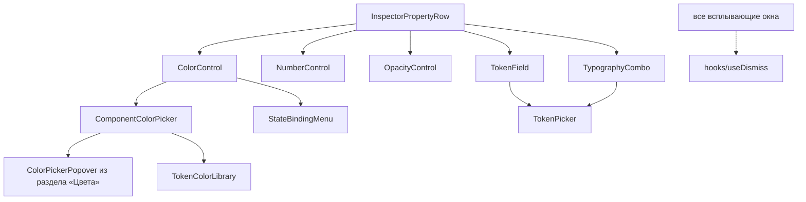
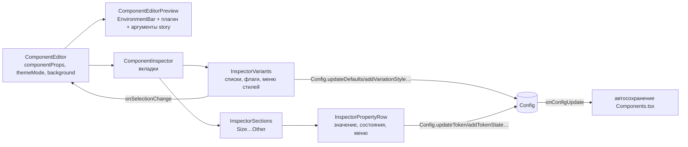

## Context

`ComponentEditor` сейчас собирает три независимые части:

- `ComponentEditorSetup` — список вариаций (включая «Инварианты») и список стилей выбранной вариации.
- `ComponentEditorProperties` — свойства одной пары «вариация → стиль» или инвариантов, сгруппированные по типу.
- `ComponentEditorPreview` — превью-плагин в iframe. Под ним переключатели вариаций (`renderDynamicProps`), сегмент «Режим», выбор «На фоне» и панель аргументов story.

Состояние распадается на две части. Сочетание для превью хранится в `componentProps` (`useComponentData`) — это отображение «имя вариации → id стиля». Редактируемая пара хранится отдельно, в `selectedVariation` и `selectedStyle`.

Правки идут через методы `Config` (`updateToken`, `addToken`, `removeToken`, `add|update|removeTokenState`, `updateDefaults`, `removeDefault`, `addVariationStyle`, `removeVariationStyle`) и `onConfigUpdate`. Затем автосохранение `Components.tsx` (`TokenAutosaveQueue`) вычисляет разницу мет и вызывает операции `ds-service`. Этот путь не меняется.

Боковая панель компонентов из прошлой задачи уже задаёт визуальный язык раздела: обычный CSS в `styles/*.css`, глифы `TyGlyph`, ширина через `usePanelWidth`. Инспектор строится так же.

## Goals / Non-Goals

**Goals:**

- Одно сочетание вариаций задаёт и превью, и редактируемые свойства.
- Свойства сочетания видны вместе, разложены по смысловым секциям, у каждого видно, откуда оно взято.
- Правка точно попадает в источник значения.
- Раскладка готова принять следующие задачи: блок аргументов story в инспекторе и вкладку «Структура».

**Non-Goals:**

- Вкладка «Структура» и перенос аргументов story.
- Выбор и управление конфигурациями компонента. Как и прежде, редактируется первая конфигурация, то есть конфигурация по умолчанию (требование «First appearance is edited» не меняется). Работа с конфигурациями — в задаче вкладки «Структура».
- Контролы прототипа без места хранения в модели компонента: Fixed/Fill/Hug, ручная типографика и выравнивание, граница холста, слои эффектов, отступы по сторонам и углы, токены прозрачности и размеров, порядок состояний. В данных размеры — всегда числа без токенов, поэтому строки вида `0 14` и привязки размеров к токенам превью не поймёт.
- Изменения `Config`, автосохранения, payload превью и бэкенда.

## Decisions

### Сочетание — единственное состояние выбора

Отдельные `selectedVariation` и `selectedStyle` уходят. Выбор задаёт только `componentProps` (`{ [имя вариации]: id стиля }`), начальное значение по-прежнему даёт `useComponentData`.

Инспектор выводит из этого сочетания список источников:

1. инварианты;
2. для каждой вариации в сочетании — выбранный стиль.

Флаг вне сочетания (выключен) источником не считается.

Альтернатива — оставить отдельную редактируемую пару и подсвечивать её в «Variants». Отклонена: остаётся та же рассинхронизация «вижу одно, правлю другое», которую задача и устраняет.

### Строка свойства знает свой источник

```ts
type PropertySource =
    | { kind: 'invariant' }
    | { kind: 'style'; variationID: string; variationName: string; styleID: string; styleName: string };

interface InspectorProperty {
    prop: PropUnion;
    source: PropertySource;
    section: InspectorSection;
}

type InspectorSection = 'Size' | 'Layout' | 'Color' | 'Text' | 'Appearance' | 'Effects' | 'Other';

function collectSourceProperties(config: Config, selection: Record<string, string>): InspectorProperty[];
function propertySection(prop: PropUnion): InspectorSection | undefined; // undefined — свойство не показывается (`value`)
function allowedSourceProperties(
    config: Config, api: ComponentAPI[], variations: ComponentVariation[], selection: Record<string, string>,
): { item: ComponentAPI; source: PropertySource; section: InspectorSection }[];
```

`source` переводится в аргументы методов `Config`:

- `invariant` → `variationID = undefined`;
- `style` → `(variationID, styleID)`.

Это ровно те аргументы, которые сейчас получает `ComponentEditorProperties`. Поэтому запись и автосохранение остаются прежними.

Если одно свойство API задано в нескольких источниках, показываются все строки, каждая со своей меткой. Свойства не объединяются, чтобы правка не попала не туда.

`getAllowedProps` и `getPropsByVariation` переиспользуются для каждого источника. Результат фильтруется по секции.

### Секции по типу и имени

Классификация — чистая функция `propertySection` по `PropType` и имени свойства. Правила совпадают с таблицей в спецификации. Это упрощённая версия правил исходной раскладки: в нашей модели есть явный `PropType`, поэтому угадывать тип по значению не нужно.

Правила повторяют `propertySection` исходной раскладки, но опираются на наш `PropType`. В исходной раскладке тип приходилось угадывать по значению.

Строка рисуется контролом по типу:

| Тип | Контрол |
|---|---|
| `color` | `ColorControl` с пикером цвета и меню состояний |
| `float`/`dimension` с `opacity` или `alpha` | `OpacityControl` |
| `dimension`, `float`, `integer` | `NumberControl` |
| `shape`, `shadow` | `TokenField` с `TokenPicker` |
| `typography` | `TypographyCombo` |
| `component_style`, `icon`, `boolean` | поле только для чтения в дополнительной группе |

Строки меню «Сбросить» и «Удалить свойство» уходят: в исходной раскладке их нет.

### Переиспользуемые контролы инспектора

Контролы живут в `src/features/InspectorControls/`, а не в странице компонентов. Они не знают о `Config`: получают значение и списки токенов пропсами и отдают изменения колбэками. Связь с моделью и источником остаётся в `InspectorPropertyRow`.



- `useDismiss(ref, open, onClose, { except? })` — закрытие по клику снаружи и `Escape` с возвратом фокуса. Хук общий: на него переходят `WorkbenchMenu` и новые контролы. Копии хука в других разделах не трогаем.
- `ColorPickerPopover` раздела «Цвета» получает необязательный слот `library`, который заменяет вкладку «Library». Без слота раздел «Цвета» работает как прежде. Значение передаётся с `paint: null`, поэтому переключатель градиента недоступен.
- `TokenColorLibrary` — библиотека токенов прототипа:
  - группа — первый сегмент имени токена (`text`, `surface`, `outline`, `background`, `overlay`), подписанный как в прототипе;
  - подгруппа — General, Accent или Status по имени токена;
  - «Токены сабтем» показывает токены `onDark`, `onLight`, `inverse` (второй сегмент имени); без флажка видны только `default`;
  - флажок и вид сетки или списка хранятся в `localStorage` (`sdds-color-library-preferences`).
- `TokenPicker` — всплывающий список с поиском и плоским списком; один компонент для форм, теней и типографики.
- `WorkbenchMenu` перестилизуется под меню окружения прототипа и остаётся общим меню рабочего места.

Списки токенов строятся из `Theme`, как и раньше (`inspectorTokens.ts`), но отдают данные, а не разметку: `{ name, label, color?, preview? }`.

### Стили

- `styles/color-picker.css` — правила `.color-picker-popover`, `.cp-*` и `.alpha-swatch` без привязки к корню страницы. Селекторы обёрнуты в `:where()`, поэтому их специфичность нулевая: копии в `color-tokens.css` и `size-tokens.css` продолжают побеждать на своих страницах, и там ничего не меняется. Затем копии убраны: правила пикера живут только в `color-picker.css` под префиксом `:is(.color-tokens-screen, .size-tokens-screen, .component-workbench)` (или без `.size-tokens-screen`, если у «Размеров» своя версия правила), который сохраняет специфичность исходных правил страниц; на страницах остались только их особенности (положение окна, адаптивные правки). Неизменность «Цветов» и «Размеров» проверена сравнением computed-стилей разметки пикера до и после.
- `styles/inspector-controls.css` — классы контролов из прототипа (`component-color-control`, `component-number-control`, `component-token-picker`, `component-binding-*`, `component-typography-*`, `component-variation-*`) с итоговыми значениями каскада прототипа.
- `styles/component-editor.css` — раскладка рабочего места, инспектора и секций.

### Структура компонентов



- `ComponentEditor` хранит сочетание, тему и фон и раскладывает колонки «превью | инспектор».
- `ComponentEditorPreview` больше не рисует переключатели вариаций, «Режим» и «На фоне». Он получает их значения пропсами и рисует сверху `PreviewEnvironmentBar`.
- Выбор рендерера («Renderer», только при нескольких вариантах) переезжает в ту же панель окружения отдельным меню.
- Новые файлы лежат в `pages/components/features/ComponentInspector/`. `ComponentEditorSetup` и `ComponentEditorProperties` удаляются.

### Панель окружения

- Заголовок вычисляется из сочетания: `size`, затем `view`, затем остальные вариации со стилями; `size` заглавными, остальные стили с заглавной буквы; флаги пропускаются.
- Меню платформы:
  - получает списки web- и Compose-компонентов из `Components.tsx`;
  - строит маршрут через `toComponentRoute(platform, name)`;
  - пункт без компонента на платформе недоступен.
- Меню фона хранит прежний `backgroundList`.
- Переключатель темы хранит прежний `modeList`.

Меню реализуются как в панели компонентов: кнопка с глифом и всплывающий список, закрытие по `Escape` и клику снаружи.

### Внешний вид

- Размеры, цвета и отступы — итоговые значения каскада прототипа (`styles.css` и `builder-ui-tokens.css`).
- Недостающие глифы добавляются в `TyGlyph`: `sun`, `moon`, `more`, `check`, `unlink`, `opacity`, `radius`, `shadow`, `delete`, `swatch-grid`, `menu`, `filter`. Это SVG того же набора `UI_GLYPHS` прототипа.
- Ширина инспектора задаётся через `usePanelWidth({ storageKey: 'ds_components_panel', side: 'right', limits: { min: 280, max: 560, initial: 440 } })`.

### Временное меню стилей

Действия над стилями — по умолчанию, добавить, удалить — переносятся из `ComponentEditorSetup` в меню «⋯» у строки вариации. Вкладка «Структура» в следующей задаче заберёт их себе, а меню будет удалено. Флаги меню не получают: у них один стиль `true`.

После удаления выбранного стиля сочетание пересчитывается:

1. стиль по умолчанию вариации;
2. иначе первый стиль;
3. если стилей не осталось — вариация уходит из сочетания.

## Risks / Trade-offs

- **[Много строк у больших компонентов]** У сочетания свойств больше, чем у одного стиля. → Секции сворачиваются, пустые секции скрыты, метка источника короткая.
- **[Свойство в нескольких источниках]** Две строки с одним именем могут запутать. → Метка источника обязательна, а порядок строк в секции — инварианты, затем вариации в порядке «Variants».
- **[Тесты на прежнюю раскладку]** `ComponentEditorPreview*.test.tsx`, `ComponentsAutosave`, `ComponentsStyleAutosave.integration` ищут прежние элементы. → Тесты переписываются на новые подписи и роли. Проверка автосохранения остаётся по сути той же: правка в инспекторе приводит к той же мутации.
- **[Временное меню стилей]** Это осознанный долг до вкладки «Структура». Без него задача отняла бы у пользователя добавление и удаление стилей.

## Программное проектирование

```ts
// pages/components/features/ComponentInspector
export const ComponentInspector: (props: {
    config: Config;
    designSystem: DesignSystem;
    theme: Theme;
    updated: object;
    selection: Record<string, string>;
    onSelectionChange: (variationName: string, styleID: string | undefined) => void;
    onConfigUpdate: () => void;
}) => JSX.Element;

// pages/components/features/ComponentEditorPreview
export const PreviewEnvironmentBar: (props: {
    title: string;
    platform: 'web' | 'compose';
    platforms: { platform: 'web' | 'compose'; route?: string }[];
    background: SelectButtonItem;
    onBackgroundChange: (item: SelectButtonItem) => void;
    themeMode: SegmentButtonItem;
    onThemeModeChange: (item: SegmentButtonItem) => void;
    renderer?: { items: SegmentButtonItem[]; selected: SegmentButtonItem; onSelect: (item: SegmentButtonItem) => void };
}) => JSX.Element;

export function combinationTitle(config: Config, selection: Record<string, string>): string;
```

## План проверки и развёртывания

- Модульные тесты для `propertySection`, `collectSourceProperties`, `allowedSourceProperties` и `combinationTitle`.
- Тесты редактора:
  - выбор стиля в «Variants» меняет payload превью и строки секций;
  - правка цвета вызывает `updateToken` с источником строки и даёт мутацию автосохранения;
  - меню платформы ведёт на маршрут Compose;
  - флаг выключается.
- `cd js && npm run build` и тесты клиента.
- Ручная проверка на локальном стеке: `Chip` и `Button` на Web, один Compose-компонент.
- Выкладка обычная, вместе с клиентом. Флаг `isComponentEditorEnabled` по-прежнему закрывает раздел целиком.
