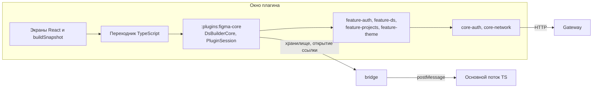
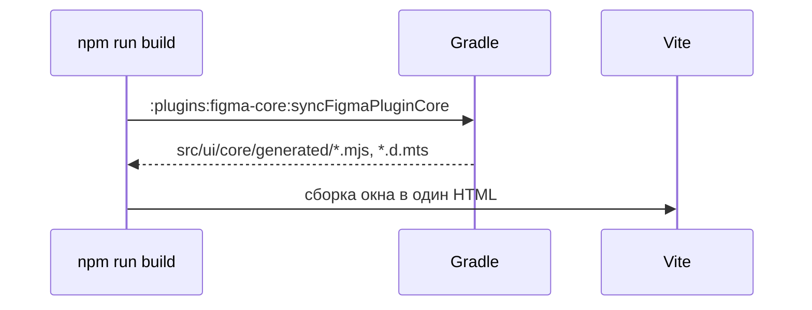

## Контекст

Первый этап плагина написан на React и TypeScript вместе с клиентом API. Решение архива `add-figma-tokens-plugin` исключало Kotlin/JS: считалось, что он экономит только клиент API и обновление токена. Это изменение пересматривает то решение: цель не экономия строк, а одна интеграция с бэкендом на всех клиентах.

Что показала проверка в ветке `spike/figma-kotlin-js`:

- модули `core-*` и `feature-*` уже собираются в Kotlin/JS для `:mcp-node`, браузерная сборка подключает их как обычные зависимости, правки в них не нужны;
- HTTP-движок Ktor `Js` работает в окне Figma с origin `null`;
- `ui.html` — 695 КиБ, в gzip 218 КиБ.

Проверка оставила пробелы, которые закрывает это изменение: пути токенов и повтор после `401` оставались в TypeScript, а вход был написан прямо в обёртке.

## Цели / Вне целей

**Цели:**

- все запросы окна плагина к gateway выполняются общим Kotlin-кодом;
- новое поведение появляется в общих модулях и доступно другим клиентам;
- поведение плагина для пользователя не меняется.

**Вне целей:**

- экраны на Compose: вариант с Wasm отклонён, `ui.html` весил 7,15 МиБ, а ввод на canvas не был проверен;
- экспорт в Figma и плагин Pixso. Они будут опираться на этот модуль, но здесь не делаются;
- код основного потока: `figma.*` и `clientStorage` доступны только в песочнице, он остаётся на TypeScript.

## Архитектура



`:plugins:figma-core` — composition root, как `:mcp-node`: он собирает общие клиенты и не содержит бизнес-логики, кроме сессии плагина. Направление зависимостей из `frontend-kt/AGENTS.md` не меняется: `core-*` и `feature-*` ничего не знают о плагине.

## Решения

### Граница Kotlin и TypeScript

Kotlin владеет адресами, параметрами, разбором ответов, токенами и повторами. TypeScript вызывает методы API и показывает данные.

`buildSnapshot` и `parsePaint` остаются в TypeScript: они готовят значения для показа и CSS, а не работают с бэкендом. Экспорт решит отдельно, нужен ли ему общий разбор.

### API для TypeScript

Методы экспортируются через `@JsExport`, возвращают `Promise` со строкой JSON и принимают необязательный `AbortSignal`. JSON выбран потому, что значения токенов разнородны, а экспорт типов Kotlin коллекций в JS неудобен и не даёт простых объектов. Типы ответов остаются в `api/types.ts`.

Отказ приходит как экспортируемый `CoreFailure` с полями `kind` и `code`. Переходник переводит его в `ApiError` и сообщения экранов. Тексты экранов сохраняются, кроме одного случая: сбой сервера при входе теперь показывается как «Сервер DS Builder недоступен» без кода ответа.

Движок Ktor для JS сообщает о сбое сети через `kotlin.Error`, который не наследует `Exception`, поэтому общие `catch` его не видят. `CoreRuntime` переводит такую ошибку в обычное исключение на уровне `HttpClient`.

Альтернатива — отдельный пакет с обёртками на каждый тип — отклонена: для шести чтений это лишний слой.

### Вход и код отказа OAuth

- `core-auth`: порт `DeviceAuthorizationClient`; `TokenExchangeException` получает необязательный `oauthError`.
- `core-network`: `KtorDeviceAuthorizationClient`; `KtorTokenExchangeClient` разбирает тело отказа и различает отказ OAuth и сбой сервера.
- `feature-auth`, `commonMain`: `DeviceLoginFlow` с опросом по RFC 8628.

`RefreshUserSessionUseCase` не используется: он сбрасывает сессию на любой ошибке, а плагин при сбое сети сессию сохраняет. Сессия вызывает `TokenExchangeClient.refresh` напрямую.

Выход идёт через тот же порт и ограничен 5 секундами, как сейчас.

### Сессия плагина

Существующий `RefreshTokenStore` синхронный, а `clientStorage` асинхронный. Поэтому `PluginSession` живёт в `:plugins:figma-core` и использует свой порт `SessionStorage` с `suspend`-методами. Если похожая сессия понадобится другому клиенту, её можно будет вынести в `feature-auth`.

Сессия переносит поведение `session.ts` целиком: одно обновление на все одновременные запросы, очередь записи и удаления, счётчик поколений и завершение сессии на `invalid_grant` и `not_allowed`. Тесты из `auth.test.ts` переносятся вместе с ней, включая случай выхода во время записи из ревью.

### Клиент токенов темы

В `feature-ds` появляются порт `ThemeTokensClient` и реализация `HttpThemeTokensClient` для списка версий и маршрутов `tokens`, `token-values`, `typography-styles` и `size-tokens` с параметром `versionId`. Ответы передаются как `JsonElement` в существующем `ModelReadResult`: у значений токенов нет единой схемы, а типы экранов уже описаны в `api/types.ts`. `ReadDesignSystemModelUseCase` и `DiscoverDesignSystemVersionsUseCase` не подходят: они читают постранично, привязаны к сессии CLI, а значения темы и размеры в них не поддержаны.

Проекты, дизайн-системы и темы читаются существующими клиентами. `HttpDesignSystemTenantsClient` подставляет `id` вместо пустого имени, а экран показывает «Тема без названия», поэтому `DesignSystemTenant` получает признак `named`.

### Статус отказа

Общие клиенты сворачивают HTTP-статус в свои коды, а у `HttpDesignSystemTenantsClient` нет отдельного кода для `403`. Чтобы экраны показывали прежние сообщения, `DsBuilderCore` оборачивает `AuthenticatedHttpClientFactory` и запоминает статус последнего отказа. Общие клиенты для этого не меняются, а статус `401` запускает повтор.

### Сборка и доставка в плагин



Результат Gradle лежит в `src/ui/core/generated`, он в `.gitignore`. Vite встраивает его в `ui.html`, поэтому требования к манифесту и упаковке не меняются.

Альтернативы:

- хранить результат в Git: отклонено, он будет расходиться с Kotlin-кодом;
- публиковать npm-пакет: отклонено, версии и публикация лишние для кода внутри одного репозитория.

## Программное проектирование

```kotlin
// core-auth
public interface DeviceAuthorizationClient {
    public suspend fun requestDeviceCode(clientId: String, scope: String): DeviceAuthorization
    public suspend fun exchangeDeviceCode(clientId: String, deviceCode: String): TokenExchangeResult
    public suspend fun logout(clientId: String, refreshToken: String)
}

public class TokenExchangeException(message: String, public val oauthError: String? = null) : Exception(message)

// feature-auth, commonMain
public class DeviceLoginFlow(client: DeviceAuthorizationClient, clientId: String) {
    public suspend fun start(): DeviceAuthorization
    public suspend fun awaitTokens(device: DeviceAuthorization): TokenExchangeResult
}

// feature-ds
public interface ThemeTokensClient {
    public suspend fun versions(
        apiUrl: String,
        credential: BackendCredential,
        projectId: String,
        designSystemId: String,
    ): ModelReadResult

    public suspend fun tokens(
        apiUrl: String,
        credential: BackendCredential,
        context: ThemeContext,
        versionId: String?,
    ): ModelReadResult
}

// :plugins:figma-core
internal interface SessionStorage {
    suspend fun get(): String?
    suspend fun set(refreshToken: String)
    suspend fun delete()
}

internal class PluginSession(storage: SessionStorage, /* клиенты входа */) {
    suspend fun restore(): Boolean
    suspend fun signIn(tokens: TokenExchangeResult)
    suspend fun signOut()
    suspend fun <T> authorized(call: suspend (BackendCredential.Bearer) -> T): T
}

@JsExport
public class DsBuilderCore(config: CoreConfig, host: PluginHost) {
    public fun restore(): Promise<Boolean>
    public fun startLogin(): Promise<String>
    public fun completeLogin(signal: AbortSignal?): Promise<Unit>
    public fun signOut(): Promise<Unit>
    public fun onSessionExpired(listener: () -> Unit)
    public fun projects(signal: AbortSignal?): Promise<String>
    public fun designSystems(projectId: String, signal: AbortSignal?): Promise<String>
    public fun tenants(projectId: String, designSystemId: String, signal: AbortSignal?): Promise<String>
    public fun versions(projectId: String, designSystemId: String, signal: AbortSignal?): Promise<String>
    public fun themeTokens(context: String, versionId: String?, signal: AbortSignal?): Promise<String>
}
```

## Риски / Компромиссы

- [Изменение в `core-*` может сломать плагин, а контур `javascript` в `tools/verify` запускается только на изменения в `js`] → основная логика покрыта Kotlin-тестами контура `frontend-kotlin`; `validate-js.yml` реагирует на используемые модули. `.verification/config` не меняется: он защищён.
- [Сборка плагина теперь требует JDK и Gradle] → один общий скрипт для локальной сборки и CI; в CI кешируется Gradle.
- [Размер `ui.html` растёт в 4 раза] → рост согласован, задача фиксирует измерение; порог 800 КиБ ловит случайное подключение лишних модулей.
- [Перенос сессии может вернуть уже исправленную гонку] → тесты переносятся до удаления кода на TypeScript.
- [#148 становится больше] → решение команды: это изменение идёт в тот же PR.
- [Метрики Strictacode вырастут] → `frontend.json` меняется только с явного разрешения разработчика.

## План миграции

Изменение остаётся внутри плагина и общих модулей, API и развёртывание не меняются. Сохранённые refresh token остаются действительными: ключ `clientStorage` не меняется. Откат — возврат коммита, данные не затрагиваются.
