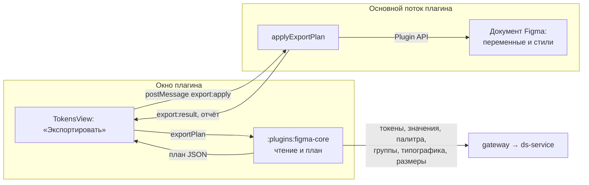

## Контекст

Плагин Figma уже входит в DS Builder, выбирает проект, дизайн-систему, тему и версию и показывает токены. Весь обмен с бэкендом идёт через общий модуль `:plugins:figma-core` на Kotlin/JS, окно на React только показывает результат. Основной поток плагина имеет доступ к `figma.*`, но не к сети; окно имеет сеть, но не имеет доступа к документу.

Образцом структуры выбран файл `DS BUILDER | STYLES`. В нём шесть коллекций переменных:

| Коллекция | Режимы | Содержимое |
|---|---|---|
| `00. Palette` | один | шкалы цветов по ступеням |
| `01. Theme` | Light, Dark | цвета всех контекстов, ссылки на палитру |
| `02. SubTheme` | Default, onDark, onLight, Inverse | цвета без контекста, ссылки на тему |
| `03. Typography` | Large, Medium, Small экраны | размер, высота строки, межбуквенный интервал, насыщенность, семейство |
| `04. Numbers` | один | скругления |
| `05. Spacing` | один | отступы |

Плюс текстовые стили с привязкой к переменным типографики и стили эффектов для теней.

Данные DS Builder уже совпадают с этой структурой по смыслу. Цветовой токен называется `<группа>.<контекст>.<имя>[-состояние]`, значения разделены по режимам Light и Dark, у токена есть группа токенов с подписью, например корневая «Surfaces» и вложенная «Accent / Transparent». Значения web приходят из `tenants/{id}/token-values` уже раскрытыми в HEX, а исходная ссылка на палитру — в `paletteRef`, например `[general.gray.900][0.16]`.

## Цели / Вне целей

**Цели:**

- экспорт выбранной темы и версии в переменные и стили Figma со структурой образца;
- ссылки темы на палитру и подтем на тему, переключение режимов фрейма;
- повторный экспорт обновляет созданное ранее и не плодит дубликаты;
- отчёт о результате, понятный дизайнеру.

**Вне целей:**

- импорт из Figma в DS Builder;
- состояния `-hover`, `-active`, `-brightness`: в образце их нет;
- витрины на холсте (страницы Colors и Preview образца);
- удаление переменных, которых больше нет в теме;
- значения платформ ios и android.

## Решения

### План строит Kotlin, применяет основной поток



Модуль `:plugins:figma-core` читает шесть разделов темы на одной границе версии и превращает их в план: коллекции, режимы, переменные со значениями и ссылками, стили. Окно передаёт план основному потоку сообщением, основной поток применяет его через Plugin API и возвращает отчёт.

Правила соответствия — это логика продукта, их нужно разделять с будущими клиентами (Pixso, другие плагины), поэтому они в Kotlin. Основной поток остаётся тонким исполнителем: он не знает об именах DS Builder, только о плане. Альтернативы: строить план на TypeScript в окне — нарушает требование единой интеграции в Kotlin; строить его в основном потоке — у основного потока нет сети, а Kotlin-модуль собран для окна.

### Имена и коллекции

Имя переменной темы собирается из подписей групп токенов, а не из жёсткой таблицы, поэтому новые группы дизайн-системы попадают в Figma без изменения кода.

| Часть | Источник | Пример |
|---|---|---|
| корень | подпись корневой группы, `" & "` сжимается до `"&"` | `Text&Icons`, `Surfaces`, `BG` |
| контекст | второй сегмент имени | `default` → `Default`, `on-dark` → `onDark`, `inverse` → `Inverse`; у `background` — `dark` → `onDark`, `light` → `onLight`, а `default` опускается |
| категория | подпись вложенной группы, разбитая по `/`; подпись `Default` опускается | `Accent/Transparent` |
| имя | последний сегмент в PascalCase; у составной категории первое слово, совпадающее с её последней частью, отбрасывается | `transparent-accent` в «Accent / Transparent» → `Accent`, `accent-minor` в «Accent» → `AccentMinor` |

Итог для `surface.on-dark.transparent-accent`: в `01. Theme` — `Surfaces/onDark/Accent/Transparent/Accent`, в `02. SubTheme` — `Surfaces/Accent/Transparent/Accent` со значением режима onDark, ссылающимся на переменную темы. Если у токена нет контекста подтемы, режим подтемы ссылается на контекст `Default`.

Палитра: `<подпись группы палитры>/<имя шкалы>/<ступень>`, например `Accent/Green/800`. Подпись группы нужна, потому что одна шкала (`general.green`) может быть в разных группах с разными значениями. Если две шкалы группы называются одинаково (`general.green` и `additional.h130` — обе «Green»), к имени шкалы добавляется слот: `Accent/Green (additional.h130)/500`. Остальные повторы имени внутри коллекции план пропускает с причиной.

Типографика: группа `display`, `header`, `body`, `text` → `Display`, `Header`, `Body`, `Text`; имя стиля `H1` для `h1`, иначе группа плюс размер в верхнем регистре (`BodyL`, `TextXS`); вариант `normal`, `medium`, `bold` → `N`, `M`, `B`. Переменные `Header/H1 B/Font Size`, `…/Line Height`, `…/Letter Spacing`, `…/Font Weight` с режимами экранов `screen-l`, `screen-m`, `screen-s` → Large, Medium, Small; семейства — строковые `FontFamily/<Имя>` со значением шрифта. Текстовый стиль `Header/H1 B` привязан к этим переменным.

Размеры: `04. Numbers` — `CornerRadius/<хвост имени>` (`round.m` → `CornerRadius/m`), полное скругление — 9999; `05. Spacing` — `Spacing/<хвост имени>`. Тени — стили эффектов `Shadows/<сегменты имени>`, например `Shadows/Down/Soft/S`.

Режимы называются `Light` и `Dark` без эмодзи образца: эмодзи не несут структуры, а имена режимов видны в коде дизайнеров.

### Ссылки на палитру

Значение режима темы становится ссылкой, если у значения есть `paletteRef` и в палитре темы есть ступень этой шкалы в группе палитры, к которой привязан токен (`ThemePalette.tokens`). Прозрачность ссылки передаётся как составной цвет Figma `{ color: alias, opacity }`, где прозрачность в процентах. В остальных случаях значение записывается цветом RGBA из HEX. Так структура совпадает с образцом там, где DS Builder знает ссылку, и не выдумывает её там, где значение задано вручную.

### Что экспортируется

- Только включённые токены (`enabled`). Состояния не экспортируются и считаются в отчёте пропущенными.
- Токен `gradient` со сплошными значениями в обоих режимах экспортируется переменной. Если хотя бы в одном режиме значение — градиент, токен становится парой стилей заливки `Light/<имя темы>` и `Dark/<имя темы>`: переменная Figma не хранит градиент. CSS `linear-gradient` переводится в `GRADIENT_LINEAR` с углом и стопами, сплошной слой — в `SOLID`. Нераспознанное значение пропускается с причиной.
- Тени — стили эффектов `DROP_SHADOW` со слоями из web.

### Повторный экспорт и ключи

Каждая коллекция, переменная и стиль получают общий ключ плагина `setSharedPluginData("dsbuilder", "key", …)`: роль коллекции, `id` токена или адрес ступени палитры. При повторном экспорте объект ищется по ключу, затем имя, значения, области применения и привязки перезаписываются. Общие, а не личные данные плагина выбраны потому, что их может читать и обновлять любой инструмент DS Builder, а личные данные недоступны в некоторых средах выполнения Figma. Ключ не секретен.

Объекты с ключом DS Builder, которых нет в плане, не удаляются: к ним могут быть привязаны макеты. Отчёт перечисляет их число как устаревшие.

Имена переменных в коллекции Figma уникальны. Поэтому переменные плана, которые меняют имя, сначала получают временные имена: так два токена могут обменяться именами. Если нужное имя держит устаревшая переменная DS Builder, она получает пометку «(устарело)» и остаётся для привязанных слоёв; чужую переменную экспорт не трогает и пропускает свою с причиной. Ключ подтемы — `id` токена контекста `default` (без него — первого найденного контекста), а не имя, поэтому переименование токена обновляет ту же переменную.

Основной поток выполняет экспорты по очереди: два одновременных прохода прочитали бы пустой файл и создали бы по набору коллекций. Окно на время экспорта блокирует повторное нажатие и смену версии.

### Ошибки и частичная запись

Запись не транзакционна. Коллекции и режимы создаются раньше переменных, поэтому отказ тарифа не оставляет переменных без значений. Если Figma отказывает (например, тариф не разрешает второй режим — на Starter один режим на коллекцию), основной поток прекращает запись и возвращает понятную причину, а уже созданное остаётся. Повторный экспорт после исправления причины безопасен благодаря ключам. Нет прав на редактирование — Figma не запустит плагин в режиме записи, окно покажет ошибку из основного потока.

Шрифт, которого нет в Figma, не мешает переменным: текстовый стиль такого семейства пропускается с причиной «шрифт не найден».

## Программное проектирование

Kotlin, `:plugins:figma-core`:

```kotlin
// feature-ds: чтение всех разделов на одной границе версии.
public interface ThemeTokensClient {
    public suspend fun exportSource(
        apiUrl: String,
        credential: BackendCredential,
        context: ThemeContext,
        versionId: String?,
    ): ModelReadResult // объект tokens, values, typography, sizes, palette, groups
}

// figma-core: чистое построение плана из ответа бэкенда.
internal object FigmaExportPlanner {
    fun plan(source: JsonObject, theme: ExportThemeInfo): FigmaExportPlan
}

// Сериализуется явным toJson(): модуль не подключает плагин kotlinx.serialization.
internal data class FigmaExportPlan(
    val source: ExportThemeInfo,
    val collections: List<PlanCollection>,
    val textStyles: List<PlanTextStyle>,
    val effectStyles: List<PlanEffectStyle>,
    val paintStyles: List<PlanPaintStyle>,
    val skipped: List<PlanSkip>,
    val omittedStates: Int,
    val omittedDisabled: Int,
) {
    fun toJson(): JsonObject
}

@JsExport public class DsBuilderCore {
    public fun exportPlan(
        projectId: String,
        designSystemId: String,
        tenantId: String,
        versionId: String?,
        themeName: String,
        signal: CoreSignal?,
    ): Promise<String>
}
```

TypeScript, `js/apps/figma-plugin`:

```ts
// shared/exportPlan.ts — тот же контракт, что FigmaExportPlan.
export interface ExportPlan { source: ExportSource; collections: PlanCollection[]; textStyles: PlanTextStyle[];
    effectStyles: PlanEffectStyle[]; paintStyles: PlanPaintStyle[]; skipped: PlanSkip[];
    omitted: { states: number; disabled: number } }
export type PlanColorValue =
    | { kind: 'color'; r: number; g: number; b: number; a: number }
    | { kind: 'alias'; key: string; opacity?: number };

// main/applyExportPlan.ts — запись в документ.
export const applyExportPlan: (plan: ExportPlan, figma: ExportFigmaApi) => Promise<ExportReport>;

export interface ExportReport {
    source: ExportSource; created: Counts; updated: Counts; stale: Counts;
    skipped: PlanSkip[]; omitted: { states: number; disabled: number }; failure?: string;
}
```

Сообщения: окно → основной поток `{ type: 'export:apply', requestId, plan }`, ответ `{ type: 'export:result', requestId, report }`.

## Риски / Компромиссы

- [Ограничение тарифа на режимы] → проверка до записи значений: сбой первого `addMode` прерывает экспорт с причиной.
- [Большой план, сотни переменных] → значения пишутся одним проходом; ссылки разрешаются после создания всех переменных коллекции, сначала палитра, затем тема и подтема.
- [Шрифты DS Builder не установлены у дизайнера] → переменные создаются всегда, пропускаются только стили с причиной.
- [Пользователь экспортирует другую тему в тот же файл] → ключи по `id` токена общие для тем дизайн-системы, поэтому значения перезапишутся темой, выбранной последней; отчёт называет тему и версию.
- [Экспорт другой дизайн-системы в тот же файл] → ключи коллекций общие, поэтому переменные новой дизайн-системы лягут в те же коллекции, а прежние станут устаревшими с пометкой «(устарело)». Один файл Figma — одна дизайн-система; README говорит об этом.
- [Ключ подтемы меняется, если токен контекста `default` перестал экспортироваться] → создаётся новая переменная подтемы, старая остаётся устаревшей с привязанными слоями. Случай редкий: токен контекста `default` обязателен в семействе цветов DS Builder.
- [Сессия истекла во время экспорта] → окно возвращается ко входу, отчёт теряется, а запись в основном потоке завершается. Повторный экспорт после входа безопасен и покажет итог.
- [Расхождение имени с образцом] → правила имён собраны в одном месте Kotlin и покрыты тестами на примерах образца.

## План проверки и развёртывания

Автоматически: тесты планировщика Kotlin на данных темы, тесты записи плана на поддельном API Figma, тесты экранов. Вручную перед архивом: экспорт локальной темы в файл Figma на тарифе с несколькими режимами, сверка коллекций и режимов с образцом, переключение темы и подтемы у фрейма, повторный экспорт без дубликатов.
