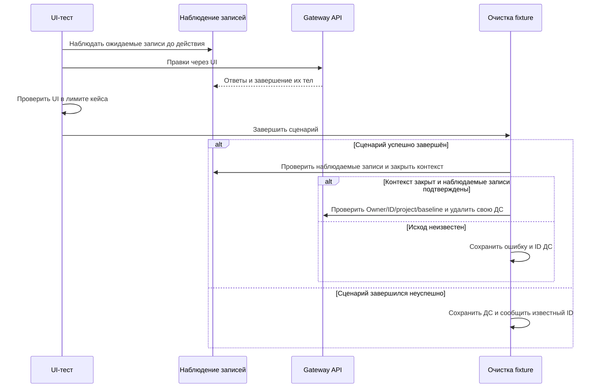

# Устройство первой волны UI E2E

## Контекст

Мотивация и десять Jira-кейсов перечислены в [proposal.md](./proposal.md).
Коммит `5a2525b7` даёт Owner-сессию, отдельную ДС каждого сценария,
публикации подготовки, страницы журнала/версий и запуск собранного UI на 4173.
Существующий `PendingMutation` допускает одно наблюдение на тест; T560 и T750
требуют учёта нескольких записей. Данные из экспортированного Excel ссылаются
на отсутствующий лист «Данные и источники», поэтому точный состав fixtures
нужно подтвердить на текущих API и UI до реализации.

## Цели и границы

Сохраняем все проверки кейсов, независимость сценариев и реальное поведение
браузера. UI/API продукта, роли, конфигурация Docker, зависимости, общий бюджет
UI и таймауты сохранения/очистки не меняются. Готовность цветового редактора
получает отдельный согласованный предел30s вместо наследования action15s. Браузеры первой волны работают как Owner; Editor и Viewer
относятся ко второй волне. T768, T566 и остальные текущие сценарии сохраняются.

## Решения

### Два уровня планирования

`tests/ROADMAP.md` хранит реализованный этап из 10 тестов, порядок новых волн
по 10 кейсов и приоритеты. Этот `tasks.md` — единственный
источник отметок выполнения первой волны. У остальных волн пока нет отдельного
Change. Следующая волна оформляется перед её реализацией с учётом результатов
предыдущей; все 161 кейс не превращаются в один большой набор задач.

Основная классификация — раздел продукта из названия кейса. Цель проверки
описывается в roadmap. Метки `@critical`, `@rbac` и другие новые наборы здесь
не вводятся: это отдельное решение, а существующий `@smoke` сохраняется.

### Небольшие независимые блоки

Порядок: T784+T791 → T647+T560 → T782+T776 → T604 → T742+T750 → T793.
T782 и T604 добавлены при переходе к волнам по 10: они используют тот же
фундамент цветов/палитры/журнала и не требуют ролевой инфраструктуры второй волны.
Общая подготовка переиспользуется кодом fixtures, а не результатом предыдущего
теста. Новые Page Objects создаются по фактически исследованным экранам:
ColorEditorPage, PalettePage и SizesPage; для T793 достаточно добавить точное
чтение/проверку запретов типографики. Полное редактирование типографики остаётся
во второй волне.

Page Objects содержат семантические локаторы, действия и готовность экрана.
Проверки результата остаются в spec. API-helper отвечает только за конкретные
публичные операции подготовки/чтения, fixture — за ресурсы и очистку.
Универсальные страницы и обёртки без самостоятельной ответственности не нужны.

### Явные данные и сохранённые границы

Каждый сценарий получает собственную ДС и таблицу исходных значений. Имена
textAccent/textPromoMinor и путь Accent/Green/Hue130 разрешаются в точные ID
подготовленных определений; выбор первого похожего токена запрещён.

Для T791/T647 готовится опубликованная 0.1.0 и ровно нужная сохранённая правка.
Для T793 исторические и черновые значения в четырёх разделах намеренно
различаются, чтобы чтение черновика под видом публикации не прошло проверку.
Подготовка использует публичные API и актуальные ревизии, без прямой записи БД
и повторов мутаций. Если требуемые данные невозможно подготовить этим способом,
это блокер конкретного кейса, который сначала обсуждается с пользователем.

Для T782 исходный Light связан с Accent Green #500: после прямого HEX ссылка
снята, после выбора Accent Blue #500 сохранена новая ссылка, в том числе после
reload. Для T604 известны исходный HEX Accent Green #500 и соседние ступени:
после правки журнал содержит до/после с образцами, адресный откат восстанавливает
исходный HEX после reload без изменения соседей и других групп.

### Подтверждённая подготовка последних четырёх кейсов

T604 использует явный исходный HEX #197844, опубликованный до проверяемой правки.
В браузере подтверждены оба образца, действие отмены записи и возврат палитры.
У размеров подтверждены PUT /size-tokens/{tokenId}/value и статусы «Сохранение…»
и «Сохранено». Плитка отступа выводит число, CSS --gap задаёт размер в px.
Тень Down Hard M изменяется четырьмя последовательными подтверждениями полей.

T793 публикует исходную тему и готовит отличимые черновые значения публичными API.
Исторический режим определяется versionId. В цветах подтверждены disabled-поля,
в палитре отсутствует кнопка правки, в типографике и тенях отключены поля.
Журнал и история читаются в UI. Подготовка T604 и T793 ограничена отдельным
бюджетом 120 секунд. Лимит 10 секунд применяется к проверяемым сохранениям.

### Отдельный бюджет API-подготовки T560

В пользовательском прогоне06.11 API-подготовка двух тем заняла около48s общего
бюджета90s. После двух успешных UI-сохранений последнее открытие темы было
прервано общим таймаутом. Для T560 fixture `twoThemes` создаёт и заполняет обе
темы в собственном ограниченном бюджете120s; `initialTheme` и `colorData`
возвращают уже подготовленные данные без дополнительных запросов. Подготовка
не зависит от этих aliases, поэтому цикла зависимостей нет.

UI90s, action15s, navigation20s, save10s и существующая очистка сохраняются.
Остальные сценарии продолжают использовать прежние fixtures. Никаких повторов
мутаций, sleeps, восстановительных reload и изменений приложения не добавляется.
Это устраняет конкуренцию подготовки и UI за один бюджет, но не исправляет
отдельное предыдущее зависание GET /tokens или медленные повторные GET tenant.
Пять целевых запусков без retries выполняет пользователь; до результата исправление
не считается подтверждённой стабилизацией.

### Явное ожидание готовности цветового редактора

После отделения подготовки пользовательский T560 завершился за27,8s ошибкой
ожидания редактора15s при переходе в B. Запрос определений gradient оставался
pending13,6s; причина его незавершения пока не установлена. Пользователь согласовал
проверку с отдельным пределом готовности30s в ColorEditorPage.open/switchTheme/reload.
Все три waitFor используют одну константу colorEditorReadyTimeoutMs. Условие
готовности сохраняется; ожидание завершается сразу при появлении элемента.

Общий UI90s, action15s, navigation20s, сохранение10s и cleanup прежние. Sleeps,
retries и восстановительные reload не добавляются. Это ограниченное изменение
бюджета готовности, а не подтверждённое устранение сетевого зависания. Прогоны
выполняет пользователь; при повторном pending необходима сетевая диагностика.

### Несколько записей перед очисткой

Расширяем существующий `PendingMutation` учётом нескольких наблюдений,
сохраняя его открытый контракт для текущих тестов. Простой список завершений
предпочтительнее отдельного постоянного журнала, менеджера ресурсов или нового
движка повторов. Каждую ожидаемую запись наблюдаем до UI-действия; объём и адреса
реальных запросов сначала подтверждаются исследованием.

```typescript
class PendingMutation {
    run(
        matches: (response: Response) => boolean,
        action: () => Promise<void>,
        label: string,
        responseTimeoutMs?: number,
    ): Promise<Response>;
    waitBeforeCleanup(systemId: string): Promise<void>;
}
```

API-записи подготовки внутри своей ДС учитываются тем же барьером. Сессия
подготовки регистрирует мутацию до отправки и ждёт полное тело ответа в
пределах таймаута запроса. Полный HTTP-ответ с отказом подтверждает завершение
запроса и сохраняет ошибку операции. Очистка требует успешного сценария.
Если ответа целиком нет, DELETE запрещён. При начале
очистки барьер закрывается для новых записей, включая продолжение fixture
после её таймаута.

Наблюдатель браузера учитывает POST, PUT, PATCH и DELETE, о которых сообщает
Playwright в области API тестового проекта. Это защищает очистку и при неожиданной
мутации опубликованного снимка или повторной отправке ожидаемого запроса.
Фикстура учитывает каждый наблюдаемый запрос один раз. Автоматическая очистка
выполняется после обычного успешного завершения сценария с предусмотренными
проверками сохранения. При ошибке, пропуске или прерывании ДС сохраняется, а
известный ID добавляется в отчёт. Для успешного сценария фикстура дожидается
полных ответов, закрывает тестовый контекст и проверяет наблюдаемые записи,
начавшиеся во время закрытия. Playwright может пропустить фоновый запрос с
`keepalive` при навигации. Поэтому очистка успешного сценария опирается на
его проверки сохранения и подтверждённые сетевые события.

Действия выполняются последовательно. Если одна правка порождает несколько
записей или отложенную очередь, наблюдение должно покрывать все эти записи,
а UI должен подтвердить завершение очереди. Ожидание одного ответа не
объявляется подтверждением всей операции.

Пользовательское ожидание и завершение операции до очистки разделены.
Исходный лимит 10 секунд в новых кейсах сохраняется; прежние 15 секунд T768
не переносятся на них автоматически. На подтверждение завершения записей и
закрытие контекста действует общий бюджет 60 секунд с начала очистки.
Неизвестный исход блокирует DELETE, но не скрывает исходную ошибку теста.



Проверки Owner, нового ID, своего проекта, нетехнической ДС, GET404 после
удаления и неизменного baseline сохраняются. Общие fixture-бюджеты не растут
автоматически: если подготовка и очистка не укладываются, сначала разбирается
конкретный расход времени. Фиксированные паузы, восстановительный reload,
подмена успешных ответов и retries теста отсутствуют.

## Согласованные уточнения T776

06.11.2026 пользователь подтвердил текущую модель правки ступени:
после ввода HEX нужно нажать «Применить». Enter меняет локальный ввод,
но не отправляет PATCH. Для первого переопределения брендовой ступени журнал
показывает «Было: Не задано», поскольку явной записи ещё нет. Это ожидаемое
поведение; исходный разрешённый HEX отдельно подтверждается в инспекторе.
Остальные проверки T776 сохраняются, продуктовый код и API не меняются.

## Риски и ограничения

- Ожидаемый текст «Сохранено» отличается от общего индикатора текущего UI.
  Перед реализацией подтверждаем видимый признак той же стадии сохранения;
  предметная проверка записи и reload остаётся обязательной.
- Названия теней и структура палитры менялись в PR144. Проверяем путь к
  подготовленной сущности и её ID, не воспроизводим старое создание четырёх теней.
- T793 охватывает четыре раздела. Он выполняется последним, когда уже готовы
  чтения цветов, палитры и размеров; объём не сокращается до одного токена.
- Смена общих helpers может затронуть текущие десять сценариев. После такой
  правки проверяются все их потребители, даже если текущий блок содержит два кейса.

## Проверка и готовность

Перед написанием кода обязательны браузерное исследование и точные исходные
данные. На блок выполняются types/format и целевые тесты. Каждый новый кейс
подтверждается 3–5 независимыми успешными выполнениями без retries и с корректной
очисткой; уже сохранённые прогоны приёмки учитываются и не повторяются заново
только ради закрытия волны.

В конце волны: один общий Product E2E-прогон накопленного набора, независимое
review и Strictacode compare с неизменными baseline/policy. Общие FAST/FULL
выполняются отдельным согласованным этапом; ограничение пользователя не обходится.
До закрытия обязательных gates Change не архивируется. Каждому результату
сохраняются команда, исходный коммит, число тестов и ошибки очистки, без секретов.

Кейс готов, когда выполнены все его согласованные assertions, целевые прогоны,
очистка и относящиеся к нему проверки. Волна готова после завершения всех
задач и итогового review. Commit и push требуют отдельного запроса.
