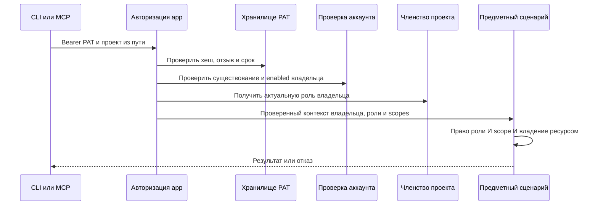

# Проектное решение

## Контекст

Мотивация описана в `proposal.md`. Сейчас проектный ключ содержит `projectId`, а backend проверяет его scopes независимо от пользователя. `authorization-core` разделяет пользователей и проектные ключи. Монолит `app` связывает авторизацию через `InProcessProjectKey`; изменения только HTTP-адаптера недостаточно. CLI/MCP имеют общий выбор учётных данных, но `ContextResolver` связывает явную ссылку с принудительной OAuth-сессией или `project-key-env`.

## Цели и границы

PAT представляет пользователя во всех доступных ему проектах. Для каждой операции нужны актуальное право пользователя и соответствующий scope. Интерфейс управления сохраняет существующее оформление. Контекст проекта не выбирает способ авторизации.

PAT сохраняет актуальные права владельца, включая глобальную роль администратора, но всегда ограничен выбранными scopes. Служебная роль публикации preview-плагинов и выпуск других PAT через PAT недоступны. PKCE и service account для административных операций сохраняются. Новый модуль не требует отдельного сервиса, порта или внешней библиотеки.

## Архитектура и переиспользование

Хранение PAT и пользовательские настройки размещаются в новом backend-модуле `feature-user-settings`, подключённом к существующему монолиту `app`. Модуль владеет доменной моделью PAT, пользовательским API, прикладными сценариями, портами, адаптерами хранения и Keycloak, DI. Отдельный процесс или сервис не создаётся. `projects-service/feature-projects` сохраняет владение проектами и членством; модуль настроек от него не зависит. Авторизация координирует проверку PAT и получение доступа к проекту через прикладные интерфейсы. Вместо переноса всей инфраструктуры проектов переиспользуются существующие общие инфраструктурные модули; криптографический адаптер переносится в модуль настроек после удаления прежних ключей.

Слои сохраняются: `domain` содержит PAT и его состояния; `application` — сценарии и порты репозитория, криптографии и действительности аккаунта; `data` — Exposed, SHA-256 с совместимой проверкой PBKDF2 и Keycloak; `presentation` — DTO и маршруты; `di` — связывание. Конфигурация криптографии передаётся через прикладные параметры, без зависимости `application` от конкретной конфигурации `data`.

Переиспользуются генерация случайного секрета, сравнение хеша, однократная выдача, проверки срока/отзыва и метаданные использования. Для новых 256-битных секретов используется SHA-256; прежние PBKDF2-хеши остаются проверяемыми. Проверки Owner/Maintainer и проектное владение ключом заменяются проверкой текущего владельца PAT.

## Данные и API

Новая таблица `personal_access_tokens`: `id`, `user_id`, `name`, `scopes`, `secret_hash`, `expires_at`, `revoked_at`, `last_used_at`, `created_at`, `updated_at`; индекс по `user_id`. `project_id` отсутствует. Пользователь идентифицируется стабильным Keycloak subject; внешний ключ на локальную таблицу пользователей не предполагается. Прежние Flyway-миграции не переписываются.

Формат секрета: `dsb_pat_<uuid>_<random>`. Префикс позволяет однозначно отличить PAT от JWT без попытки использовать невалидный PAT как OAuth-токен. Секрет хранится только в виде хеша и возвращается только в ответе создания.

Публичные маршруты:

| Метод и путь | Запрос | Ответ |
|---|---|---|
| `GET /api/settings/personal-access-tokens` | OAuth-сессия | `200`, список метаданных владельца |
| `POST /api/settings/personal-access-tokens` | `{name, scopes, ttlSeconds}` | `201`, `{token, secret}` |
| `DELETE /api/settings/personal-access-tokens/{id}` | OAuth-сессия | `200`, метаданные отозванного PAT |
| `GET /api/settings/personal-access-tokens/scopes` | OAuth-сессия | `200`, `{scopes: [{id, title, description}]}` |

Метаданные: `id`, `name`, `scopes`, `createdAt`, `expiresAt`, `revokedAt`, `lastUsedAt`; без хеша и секрета. `userId` не принимается из запроса. Чужой или отсутствующий идентификатор возвращает `404`. Повторный отзыв своего токена возвращает отозванные метаданные. Невалидное имя, пустые/неизвестные scopes и неположительный TTL дают `400`. Имя после обрезки пробелов — 1–80 символов; TTL по умолчанию 90 дней, UI предлагает 30, 90 и 365 дней.

Управление требует пользовательского OAuth-контекста; PAT и service account получают отказ. Управлять своими PAT может пользователь без проектов и без роли Owner/Maintainer. Каталог scopes берётся из единой политики, включает существующие предметные scopes и `documentation:read/write`, но исключает управление PAT и глобальные административные операции. UI использует тот же каталог через `GET /api/settings/personal-access-tokens/scopes` под OAuth.

## Допустимые полномочия PAT

Сохраняется точное множество `projectKeyScopes` действующей `authorization/policy.json`, перечисленное ниже. Переименование поля политики в PAT не расширяет этот набор; при реализации обновляются согласованно `authorization/policy.json`, его JSON Schema, данные проверки соответствия и потребители `authorization-core`.

- `projects:read`
- `members:read`
- `design-systems:read`
- `design-systems:write`
- `design-systems:delete`
- `tenants:read`
- `tenants:write`
- `tenants:delete`
- `tenants:subthemes:read`
- `tenants:subthemes:write`
- `tenants:subthemes:delete`
- `tokens:read`
- `tokens:write`
- `tokens:delete`
- `tokens:group:read`
- `tokens:group:write`
- `tokens:group:delete`
- `tokens:subgroup:read`
- `tokens:subgroup:write`
- `tokens:subgroup:delete`
- `components:read`
- `components:write`
- `components:delete`
- `components:variations:read`
- `components:variations:write`
- `components:variations:delete`
- `documentation:read`
- `documentation:write`

`project:read`, `project:update_metadata`, `project:archive`, `project:restore`, `members:add`, `members:remove`, `members:change_role`, `access_keys:*`, управление PAT и глобальные административные разрешения не добавляются в каталог. `GET /api/projects/{projectId}` сохраняет разрешение `projects:read` для PAT; чтение участников требует `members:read`. Изменение метаданных, архивирование/восстановление проекта и управление участниками с PAT всегда возвращают `403`, даже если роль владельца позволяет действие. Прежние специальные запреты проектных ключей переводятся в явно заданные ограничения PAT.

## Контракт каталога scopes

Маршрут каталога возвращает `200 application/json` с DTO `{scopes: [{id: string, title: string, description: string}]}`. `id` — точный идентификатор permission; `title` — непустая русская подпись, `description` — непустое русское описание разрешённого действия. Элементы уникальны по `id` и отсортированы по нему лексикографически. UI отправляет выбранные `id` в `scopes` запроса создания без преобразований.

Идентификаторы берутся только из единой политики авторизации; подписи и описания — из общего серверного представления каталога, без отдельного клиентского списка. Множество `scopes[].id` ответа в точности равно допустимому множеству создания PAT. Если для разрешения нет описания, это ошибка конфигурации, а не основание молча исключить его из UI. Неизвестный scope отклоняется целиком с `400`, без частичного создания токена. Недействительная/отсутствующая OAuth-сессия даёт `401`, PAT или service account — `403`.

## Авторизация

PAT передаётся как `Authorization: Bearer <PAT>`, но имеет отдельный тип в клиенте и отдельный проверенный контекст backend. Контекст содержит `actorType=personal_access_token`, `userId` владельца, `tokenId`, целевой `projectId`, актуальную роль и выбранные scopes. Внешние одноимённые заголовки удаляются; в межмодульных вызовах используется тот же нормализованный контекст. Для HTTP-представления добавляется `X-Personal-Access-Token-Id`, используются `X-Project-Scopes`, `X-User-Id`, `X-Project-Role`; `X-System-Admin` с актуальным проверенным значением владельца.



`PolicyEvaluator` для PAT сначала проверяет обязательный scope, затем актуальное право владельца: grants проектной роли либо глобальный административный доступ. Администратор может обращаться к проектам без членства, но не может обойти scopes PAT. Идентификатор автора — userId, идентификатор PAT хранится отдельно. Предметные ограничения владения ресурсом целевым проектом и архивного состояния сохраняются.

Роль проверяется на каждом запросе без кеширования положительного доступа между запросами. Снятие членства и понижение роли влияют на следующий запрос. Добавление пользователя в новый проект позволяет тому же PAT работать в нём в пределах scopes.

Аккаунт и актуальные глобальные роли проверяются через прикладной порт с адаптером Keycloak по стабильному subject. Удалённый или отключённый аккаунт даёт `401`; недоступность проверки даёт `503`, без допуска. Сведения аккаунта и глобальные роли кешируются на 30 секунд с начала загрузки, без продления TTL при чтении. После истечения требуется успешная загрузка; при ошибке возвращается 503. Одновременные запросы одного пользователя объединяются. Максимальное окно задержки блокировки аккаунта или снятия административной роли — 30 секунд.

Невалидный, истёкший или отозванный PAT даёт `401`; недостаточный scope, недостаточная роль или отсутствие членства у обычного пользователя — `403`. Актуальный глобальный администратор получает доступ к проекту без членства, но только в пределах PAT scopes. Статус аккаунта и глобальные роли читаются из проверенного ответа Keycloak с кешем не более 30 секунд; снятие административной роли влияет после истечения кеша. `404` для отсутствующего/чужого предметного ресурса сохраняется.

Первая версия разрешает PAT предметные проектные маршруты в пределах сохранённого каталога scopes и `GET /api/projects`, ограниченный доступными владельцу проектами и scope `projects:read`. Остальные внепроектные операции, включая создание проектов, поиск пользователей, управление PAT и административные маршруты, требуют прежние OAuth/service account. Для списка проектов администратор видит все проекты только при наличии projects:read в PAT.

## Программное проектирование

Ниже целевые прикладные контракты; DTO и модели хранения остаются отдельными.

```kotlin
interface PersonalAccessTokenRepository {
    suspend fun find(id: String): PersonalAccessToken?
    suspend fun list(userId: String): List<PersonalAccessToken>
    suspend fun create(token: PersonalAccessToken): PersonalAccessToken
    suspend fun revoke(userId: String, id: String, at: Instant): PersonalAccessToken?
    suspend fun markUsed(id: String, at: Instant)
}
interface AccountStatusReader {
    suspend fun read(userId: String): AccountIdentityResult
}
interface PersonalAccessTokenVerifier {
    suspend fun verify(secret: String): PersonalAccessTokenVerification
}
```

Проверка PAT возвращает владельца, идентификатор и scopes, а проектная авторизация отдельно получает актуальную роль. `authorization-core` остаётся чистым вычислителем без Keycloak/Exposed/Ktor. Все потребители проверенного контекста должны понимать новый тип, включая локальные преобразования в проектах и документации.

## CLI и MCP

Вводятся `BackendCredential.PersonalAccessToken`, безопасный тип диагностики PAT и ошибка `PAT_INVALID`. PAT и OAuth оба используют Bearer на проводе, но обновление и удаление OAuth-сессии разрешены только для типа пользовательской OAuth-сессии. `401` PAT не вызывает повтор, refresh или смену учётных данных; `403` возвращается без повтора.

Сохраняются `--api-key`, `--api-key-env` и `DSBUILDER_API_KEY`: теперь их значения представляют PAT. Новые флаги и стандартная переменная с именем PAT не вводятся. Удаляются только `--project-key-env`, тип `project-key-env` и транспортный тип `ProjectKey`; старые проектные секреты отвергаются сервером. `init --api-key-env` сохраняет имя переменной без секрета.

Режим `auto`: непустой `--api-key`, затем значение настроенного `credential.name`, затем `DSBUILDER_API_KEY`, затем OAuth-сессия. Для каждого имени сначала окружение процесса, затем `.env` выбранного локального проекта. Пустые значения пропускаются. Явная ссылка не читает `.sdds`/`.env` постороннего локального контекста: для неё доступны `--api-key`, `DSBUILDER_API_KEY` процесса и OAuth-сессия.

Локальная конфигурация поддерживает `credential.type=auto|user-session|pat-env`; `pat-env` требует PAT без перехода на сессию, `user-session` использует только OAuth. Значение `credential.name` по умолчанию — `DSBUILDER_API_KEY`; секрет не сериализуется. Прежний `env` читается как `auto` с указанным именем, прежний `project-key-env` требует явного обновления конфигурации. В `auto` порядок одинаков независимо от источника контекста, но явная ссылка не наследует настройки авторизации чужого проекта.

MCP использует общий resolver и типизированный HTTP-слой, PAT берётся из окружения процесса сервера; новые параметры с секретами в схемы tools не добавляются. Ссылки по-прежнему задают контекст отдельного вызова. Административные сценарии с принудительным OAuth/service account не переключаются на PAT.

## Интерфейс

В меню аватара между сведениями пользователя и выходом добавляется «Настройки». Маршрут `/settings?section=personal-access-token` использует `SettingsFrame` и существующие стили настроек дизайн-системы: rail, заголовок, боковая навигация и область содержания. Единственный раздел — `Personal Access Token`. Экран работает без проекта, сохраняет переход назад и доступен по прямой ссылке после входа.

Панель переносится из `ProjectSettingsPage`: те же список, окно создания, поля, scopes, выбор срока, кнопки, копирование и однократный показ. Проектные тексты заменяются персональными; счётчик и состояние истечения вычисляются корректно, истёкший токен не показывается активным. При смене пользователя кеш и показанный секрет очищаются. Настройки проекта/дизайн-системы больше не содержат управление ключами.

## Миграция и совместимость

Параметры API key и стандартная переменная окружения сохраняются, но принимают только PAT; схема ProjectKey удаляется. Новая Flyway-миграция создаёт таблицу PAT; отдельная миграция владельца проектных данных отзывает прежние проектные ключи. Прежние маршруты управления удаляются (404), старые секреты отвергаются (401) во всех схемах. Автоматического преобразования ключей в PAT нет.

Backend, веб-клиент и CLI выпускаются согласованно. Старую таблицу можно сохранить как недоступные отозванные данные на этом этапе; новая реализация не читает её при аутентификации. Откат к старому приложению не восстанавливает отозванные ключи; повторный выпуск PAT после отката потребует возврата новой версии. Прежние миграции и исторические nginx-конфигурации не меняются.

## Риски и компромиссы

- Пропущенный локальный разбор actor может потерять scopes → проверить все потребители и сквозные запросы к проектам, DS и документации.
- Особые административные обходы могут расширить PAT → отдельный тип principal, актуальный глобальный флаг при обязательной проверке scopes и отрицательные тесты.
- Новые секреты используют SHA-256, прежние PBKDF2 остаются проверяемыми. last_used_at обновляется не чаще раза в минуту, отзыв и истечение проверяются каждый запрос. Кеш Keycloak ограничен 30 секундами без stale fallback.
- Разрыв CI после отключения старых ключей → документировать создание PAT и замену переменных до выпуска.

## Проверки и выпуск

Локально: тесты жизненного цикла, репозиториев, криптографии, маршрутов/OpenAPI, матрицы ролей/scopes, контекста и CLI/MCP; затем FAST, независимое review и FULL по репозиторному workflow. Проверки охватывают Gradle build/test/detekt/spotlessCheck, npm build и клиентские/CLI тесты через зарегистрированные контуры.

До архивирования требуется внешний локальный контур PostgreSQL + Keycloak + app + веб-клиент: создать PAT, проверить два проекта с разными ролями, сменить роль/членство, отключить владельца, отозвать и дождаться истечения короткого тестового PAT; проверить CLI с конфигурацией и ссылкой, MCP и отказ старого ключа. Нужны HTTP-коды, результаты команд и снимки UI без секретов. Отсутствие окружения не считается прохождением.

После выпуска наблюдать ошибки авторизации и задержку проверки аккаунта без журналирования Authorization, PAT или хешей. Это наблюдение не заменяет обязательную проверку до архивирования.

## Подключение модуля пользовательских настроек

`feature-user-settings` регистрируется в backend Gradle-сборке и DI монолита по существующим соглашениям. Его `presentation -> application -> domain`, адаптеры `data` и связывание `di` следуют общим правилам backend. Монолит получает только публичный прикладной контракт проверки PAT; внутренние модели хранения не пересекают границу модуля. Между feature-модулями проектов и настроек прямой зависимости нет.

Миграции PAT принадлежат новому модулю и подключаются к существующей базе через явный путь Flyway; версия миграции должна быть уникальна в общем наборе. Отзыв старых ключей остаётся миграцией проектов. Порядок запуска: применение обоих наборов миграций до readiness, затем регистрация API и авторизации. Тесты проверяют обнаружение миграций в собранном app, отсутствие конфликтов версий и применение на существующей базе.

## Согласование с обнаружением контекста в актуальном dev

Интерактивный init сохраняет меню проектов и систем, выбор платформ, прокрутку, пропуск явно заданных ID, отмену, восстановление терминала и явный режим без сетевых запросов. Обнаружение проектов и систем в CLI/MCP использует общий выбор PAT/OAuth: явный --api-key, настроенное имя окружения (для init --api-key-env), DSBUILDER_API_KEY, затем OAuth-сессию. Для обнаружения без workspace окружение берётся из процесса, без неявного чтения чужого .env. projects_list требует projects:read, design_systems_list требует design-systems:read и доступ владельца к проекту. Отклонённый PAT возвращает PAT_INVALID/403 без смены учётных данных.

Новый UserSessionAccess нельзя просто глобально переключить на auto: он обслуживает и IDE. CLI/MCP предоставляют каталогам стратегию общего выбора учётных данных, IDE — явно выбранную OAuth-сессию. Внедрение выполняется через общий порт учётных данных в разрешённом core-модуле; feature-projects сохраняет существующие ограничения зависимостей и не получает зависимость от core-application. Composition roots связывают стратегию и provider. Типизированные ошибки каталогов и их преобразования поддерживают PAT_INVALID и BACKEND_UNAVAILABLE.

Оба режима init сохраняют credential.type=auto, credential.name=DSBUILDER_API_KEY либо имя из --api-key-env. Выбор OAuth для текущего интерактивного запроса не фиксирует user-session в создаваемом файле. Пользовательские конфигурации с принудительными user-session/pat-env не переписываются. При отсутствии PAT и сессии мастер предлагает auth login, не запускает вход скрыто и не создаёт конфигурацию.
