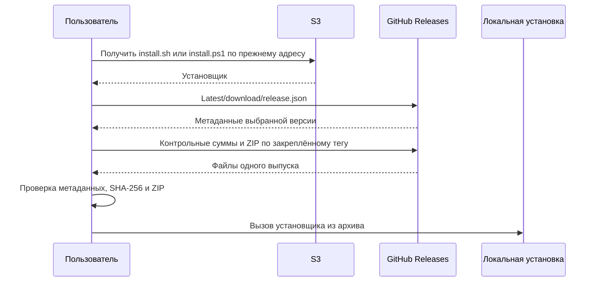

## Контекст

`release.py` валидирует четыре ZIP, формирует `release.json` и `SHA256SUMS`, публикует выпуск в S3 и обновляет `stable.json`. GitHub получает только JVM ZIP. Сетевые установщики уже проверяют контрольные суммы и содержимое ZIP, но запрещают перенаправления. Основная ветка GitHub — `dev`, хотя текущая доставка stable обращается к `master`.

## Цели и границы

Сохранить существующие публичные адреса `install.sh` и `install.ps1` в S3; перенести архивы и метаданные в GitHub Releases; выбирать стабильный выпуск через Latest без `stable.json`. Сохранить существующие четыре формата, локальную установку, вложенный iOS CLI и флаги отказа от установки инструментов.

Нативные Linux/Windows arm64, изменение Kotlin-архитектуры и автоматическое удаление старых S3-объектов не входят в изменение. Linux автоматически получает JVM-дистрибутив при наличии Java 17+, macOS — нативный архив, Windows — только x64. Это изменение выбора Linux явно отражается в спецификации.

## Решения

### Единый релизный процесс

Релизный процесс по точному существующему тегу `cli-vX.Y.Z` собирает и проверяет четыре дистрибутива, включая запуск на каждой поддерживаемой платформе. Затем создаёт или продолжает черновик GitHub Release, загружает четыре ZIP, `SHA256SUMS`, `release.json`, повторно скачивает и проверяет комплект и лишь после этого публикует выпуск. Имена архивов сохраняются, особенно `dsbuilder-cli-jvm.zip`, используемый внешним CI. Скрипты установки в комплект релиза не входят: их постоянная точка доставки — S3.

Тот же релизный процесс после проверки полного GitHub-комплекта перезаписывает два установщика из исходников выбранного тега CLI в S3, используя существующие AWS secrets и `CLI_S3_PREFIX`. Он проверяет чтением загруженные байты и сохраняет текущие ключи `<prefix>/install.sh` и `<prefix>/install.ps1`; версионных копий скриптов не создаёт. Этот шаг выполняется и при повторе опубликованного тега. Скрипты не закрепляют версию своего тега: по умолчанию они всегда разрешают GitHub Latest. Публикация нового выпуска и продвижение Latest выполняются после проверки S3-скриптов. При сбое S3 запуск завершается ошибкой и не меняет Latest; повтор снова загружает оба скрипта. Запись пары S3-объектов не атомарна: временное смешение ревизий допустимо, поскольку обе используют общий контракт GitHub Releases.

Отдельная публикация скриптов из `dev` отвергнута: обновление установщиков должно входить в выпуск CLI. Повтор старого тега намеренно может вернуть старую ревизию скриптов; это согласованная семантика перезаписи, а выбор стабильного CLI остаётся за Latest. Полный отказ от S3 отвергнут по требованию сохранить адреса установки.

### Latest и повторные запуски

GitHub Latest — единственный указатель стабильной версии. Он резервируется для стабильных релизов CLI этого репозитория. Новый полный выпуск становится Latest, если текущего указателя нет или его версия ниже; сравнение числовое по тройке SemVer. Повтор старого тега не меняет Latest. Для сравнения с прежним Latest читается только его тег: отсутствие или повреждение его файлов не блокирует новый выпуск. Полный комплект текущего публикуемого тега проверяется обязательно. Неожиданный Latest без корректного тега CLI — ошибка, требующая исправления оператором, а не повод угадывать выпуск.

Автоматические публикации сериализуются одной группой GitHub Actions без отмены выполняющегося запуска. Ручное переключение Latest, в том числе откат, выполняется через интерфейс GitHub Releases: оператор выбирает ранее опубликованный стабильный CLI-релиз. Отдельный workflow и команда доставки CLI для этого не нужны; пересборка и обновление S3 не выполняются. Комплект проверен при публикации, но дополнительной автоматической проверки при ручном переключении нет. Проверки метаданных и SHA-256 при установке сохраняются. Ручное действие в интерфейсе не входит в группу сериализации GitHub Actions; его следует выполнять вне активной публикации, чтобы последующее автоматическое продвижение нового выпуска не отменило выбор оператора.

Повтор черновика может заменить его неполный комплект, после чего обязан проверить весь выпуск. Повтор опубликованного релиза проверяет его внутреннюю согласованность без замены файлов в GitHub и повторно перезаписывает оба S3-установщика из выбранного тега; новые байты архивов требуют нового тега. Это совместимо с неизменяемыми релизами и исключает кратковременное смешение опубликованных файлов. Повторная сборка не обязана дать побайтово одинаковый ZIP, поэтому она не является основанием для замены опубликованного файла.

### Выбор версии и загрузка

Без `--version` / `-Version` установщик один раз скачивает `https://github.com/salute-developers/design-system-builder/releases/latest/download/release.json`. Проверяет схему и `version: X.Y.Z`, затем закрепляет `cli-vX.Y.Z`. С явной версией сразу читает метаданные по `/releases/download/cli-vX.Y.Z/release.json`. Последующие обращения идут только по закреплённому тегу; если Latest сменился, текущая установка остаётся на выбранном выпуске.

`release.json` сохраняет `schemaVersion: 1`, `version`, `iosCliReleaseTag`, `artifacts` с четырьмя записями `{file, sha256}`. Установщик проверяет допустимую версию, фиксированные имена файлов, единственную запись выбранной платформы и SHA-256; значение из манифеста согласуется с `SHA256SUMS` того же тега. Скачивание ZIP завершается проверкой фактической SHA-256 и безопасной распаковкой до изменения установленного CLI. Внешние зависимости вроде `gh`, `jq` или Python для пользователя не добавляются.

`CLI_DOWNLOAD_BASE_URL` обозначает публичный S3-корень только в примерах скачивания установщиков: подготовка скриптов и релизный процесс не требуют этой переменной. Адрес и ключи объектов S3 не меняются. Репозиторий GitHub берётся из `GITHUB_REPOSITORY` (по умолчанию `salute-developers/design-system-builder`) через общий валидатор подготовки и GitHub-адаптера и фиксируется в подготовленных установщиках; для тестов используется отдельный `CLI_RELEASE_BASE_URL` с HTTPS-корнем репозитория, а HTTP разрешён только на loopback. Старое переопределение корня архивов через `CLI_DOWNLOAD_BASE_URL` выводится из эксплуатации и объясняется в документации.

### Перенаправления и ошибки

Для загрузки с GitHub нужны HTTPS-перенаправления. Клиенты разрешают до пяти переходов с запретом понижения до HTTP; loopback HTTP остаётся только для локальных проверок. Сохраняются конечные таймауты и ограниченные повторы. Установка публичная, без токенов и backend API. URL из произвольных полей манифеста не исполняются: путь собирается из доверенного корня, проверенной версии и фиксированного имени архива.

Отсутствующий Latest, HTTP 404, недопустимый манифест, превышение переходов, несовпадение сумм и неподдерживаемая платформа завершаются понятной ошибкой до локальных изменений. GitHub недоступен — установка завершается ошибкой, без возврата к S3-дистрибутивам. Windows arm64/32-bit отвергаются, в том числе при эмуляции x64; на macOS под Rosetta учитывается архитектура машины, чтобы выбрать arm64.

## Риски и компромиссы

- Latest общий для монорепозитория: другие публикации обязаны использовать `--latest=false`; установщик проверяет метаданные CLI и не подбирает альтернативный выпуск молча.
- SHA-256 защищает целостность доставки; подпись релизов не добавляется этим изменением.
- Реальные текущие значения публичного S3-корня находятся в конфигурации окружения, а не в Git. При выпуске необходимо подтвердить сохранение адресов по существующим vars без придумывания нового URL.
- Linux по умолчанию требует Java 17+; автоматическая установка Java и новые нативные цели исключены.

## Проверка и развёртывание

Локально: тесты подготовки/публикации с поддельным GitHub API, HTTP-сервер с перенаправлениями и сменой Latest, shell/PowerShell-контракты и проверки безопасности ZIP. MinIO-интеграция сохраняется в суженном виде: проверяет только публикацию и повторную загрузку двух скриптов, прежние ключи, частичный сбой и отсутствие записи архивов/stable. Необходимый Docker при отсутствии должен давать ошибку. FAST и FULL через `tools/verify`, включая frontend Gradle build, тесты, detekt, spotlessCheck и Strictacode compare; независимое review по общему процессу.

До архивирования внешняя проверка без публикации: прочитать реальный GitHub Release plasma-ios, уже используемый текущим workflow, скачать небольшой ассет с SHA-256 из API во временный каталог и проверить реальную HTTPS-цепочку обоими доступными Unix-загрузчиками; записать URL без подписанных параметров, коды, домены переходов и совпадение digest. Команды: `gh api repos/salute-developers/plasma-ios/releases/tags/<ios-cli-release.txt>`; `curl --fail --location --max-redirs 5 --proto '=https' --proto-redir '=https' <browser_download_url> -o <tmp>/asset.zip`; аналогичный `wget --https-only --max-redirect=5`; SHA-256 сравнить с `.assets[].digest`. Отсутствие доступа или digest не является успехом. Windows PowerShell проходит реальные загрузки в отдельной проверке Windows; CI-запуск фиксируется как наблюдение после публикации изменения, а локальные контракты обязательны до неё.

После слияния выполнить первый релизный запуск CLI: проверить полный комплект в черновике GitHub, перезаписать и проверить S3-установщики, затем опубликовать выпуск и назначить Latest. При первом переходе до назначения Latest новые установщики могут временно сообщать об отсутствии стабильного выпуска; при последующих релизах они продолжают устанавливать прежний Latest. После обновления проверить прежние публичные URL обоих скриптов, Latest, явную версию и установку на матрице macOS/Windows/Linux. Реальные публикации требуют отдельного явного запроса и не являются блокирующими задачами до архивирования.

Удалить исходный `stable.json` и workflow синхронизации; старые объекты S3 оставить для уже скачанных установщиков. Новые процессы их не читают и не обновляют. При ошибке нового выпуска переключить Latest на предыдущий полный GitHub-релиз; для ошибки установщика вернуть предыдущую совместимую ревизию двух S3-скриптов. Возврат к старому S3-установщику возможен лишь пока его старый выпуск доступен в S3.
