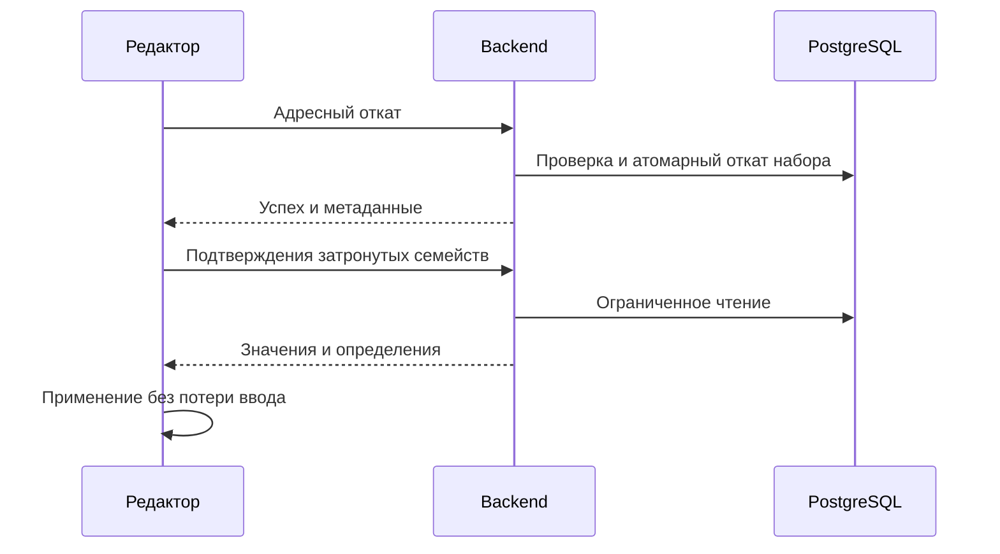

# Устранение повторной работы с темой

## Контекст и границы

Основание — proposal.md, HAR и коррелированные логи от 12 ноября 2026. Сохранение 36 значений даёт 850 JDBC-вызовов. После отката token-values занимает 5034 мс, включая 1903 мс JDBC и 2560 мс прочего времени транзакции. Последнее не является доказанным временем CPU.

Сохраняются авторизация, RLS, исторические границы, атомарность, предметные редакции и действующая форма ответов. Не вводится глобальный кеш. Размер пула, индексы и общая стратегия latest-revision не меняются без отдельного подтверждения.

## Решения

### Раскрытие значений

Доменный TenantPaletteValueResolver строит индексы по состоянию палитры и определениям. Приоритеты группы, источника, ступеней, прозрачности и неизвестных ссылок совпадают с ThemePaletteResolver. TokenValuePublisher не строит полную ThemePalette. Для полной палитры связи группируются по группе, слоту и ступени один раз. Уже прочитанные значения, имена и типы передаются в снимок раскрытия; повторные чтения определений и значений не нужны. Для нормализуемых имён, которые требуют полного контекста, остаётся прежний путь. Уже проверенная тема передаётся helper чтения явно в пределах той же транзакции; остальные потребители сохраняют собственную проверку. Разобранный JSON переиспользуется до DTO; совместимые строковые поля остальных потребителей сохраняются на время перевода.

### Уточнение чтения по фазовым измерениям

Актуальные ревизии значений продолжают выбираться индексным LATERAL: на одинаковом снимке DISTINCT ON и группировка медленнее на заполненных границах. Технические редакции широкого раздела читаются узкой проекцией через соединение с устойчивыми адресами выбранной темы и фильтром выбранных токенов, без обратной передачи тысяч UUID значений. Для небольшого среза до 200 определений номера редакций читаются по точным ID уже найденных значений: широкий JOIN на заполненном журнале замедлял типографику. Лишние технические редакции не расширяют предметный ответ. Общий helper возвращает только используемые идентификатор и номер редакции.

Значения и снимок палитры полностью материализуются в одной readOnly-транзакции. Построение индекса resolver и чистое раскрытие выполняются после её завершения, с сохранением readContext, readPage и mutationMetadata. Снимок не читается, если среди возвращаемых значений нет ссылок соответствующих типов; платформенная форма без ссылок по-прежнему нормализуется. Это уменьшает удержание соединения, но не устраняет стоимость самого преобразования из HTTP-времени.

### Пакетная запись

Контекст, черновик и семейство разрешаются один раз. Текущие значения и устойчивые адреса читаются набором; блокировки берутся до сравнения в общем порядке. Каждая запись несёт собственные baseRevision и пути: объединять разные основания в общий SQL-контекст запрещено. Используется существующий протокол триггеров и блокировок, при необходимости пакет делится по совместимым основаниям. Уникальность новых адресов обрабатывается под блокировками. Неизменённые значения пропускаются; тип пересчитывается один раз по всем темам. Кеш readOnly в запись не переносится.

### Адресная сверка

После отката известных значений клиент читает подтверждения затронутых токенов и определения семейств: производный тип может измениться. Ограниченный фильтр идентификаторов сочетается с версией, типами и темой; старый запрос без фильтра сохраняет поведение. DTO, OpenAPI, контрактные проверки и клиент обновляются вместе. Изменения применяются через существующие поколения чтений и защиту ввода. Зависимости палитры и превью обновляются явно; структурные изменения и неизвестный результат используют безопасную общую сверку.

HTTP/1.1 допускает ограниченную начальную строку 16 КиБ в монолите и самостоятельном запуске DS, чтобы публичный фильтр 200 UUID с кодированными разделителями и остальными фильтрами доходил до маршрута. Авторизация сохраняется. Слияние удаляет старые ключи только соответствующего определения и типа, не очищая совпадающие имена соседних типов. Признак неизвестного результата сохраняется от обеих точек отката до сессии; он исключает адресный путь, а повтор после ошибки выполняет только чтение. Адресный путь использует штатный предикат очереди до GET и перед применением.

Для GET сравнивается специализированная проекция с преобразованием JDBC-строк напрямую в модель приложения, без промежуточных ResultRow. Она переиспользует тот же выбор границы и LATERAL; область владельца, активные определения и удаление проверяются до выдачи. Остальные читатели и записывающие операции сохраняют прежний mapper. Технические редакции ограничиваются выбранными токенами и темой, в том числе при редком типе; решение оценивается также на заполненных редакциях.



### Подтверждения и защита чтения

Допустимость цветового чтения проверяется одним правилом active/idle/saved и номером активности до/после GET, затем повторно перед применением runtime. Неизвестный исход команды по-прежнему исключает адресный путь. Подтверждения ACK проверяются по положительным условиям существования определения, полноты, редакций и допустимости смены типа. Шесть ожидаемых адресов цвета индексируются один раз на проверку; структурный ACK переиспользует индексы определений и затронутых ID вместо повторных поисков. Метаданные при смене типа и переименовании ограничены парой исходный тип/имя: соседний shape с совпадающим модальным именем сохраняется.

### Связи и журнал

Связи палитры формируются отдельно от представления групп и растяжек; инспектор читает общую область один раз и фильтрует выбранную группу локально, сохраняя наложение неподтверждённых данных.

Журнал сначала определяет типы с кандидатами. Родительские темы описываются набором с переиспользованием между порциями. Для отметок значения ограничиваются выбранной темой до подробного сравнения. Страница сохраняет существующие пределы вычисления и порядок; повторное разрешение границы и сортировки устраняются. Совместный ответ страницы и сводки по-прежнему сравнивает весь необходимый набор: перенос LIMIT до правил видимости дал бы неверный счётчик. Отдельная SQL-пагинация подробностей не вводится без нового алгоритма сводки. Счётчик сохраняет разделение пользовательских полей и скрытые создания; COUNT строк ревизий не заменяет его.

### Диагностика

Используются ds_transaction и correlationId. Снимки существующих счётчиков пула перед получением соединения и после него включаются в закрытые эксплуатационные логи при DS_QUERY_DIAGNOSTICS=true. Новый HTTP-маршрут не нужен: это сохраняет публичную границу монолита. Снимки не атомарны и не заменяют непрерывный мониторинг. connectionMs включает ожидание и создание соединения, поэтому само по себе не обосновывает изменение пула.

### Очередь первичного чтения редактора

`readEditor` ограничивает число выполняющихся HTTP-чтений четырьмя. Свободное место передаётся следующему чтению сразу после завершения или ошибки; ожидание повторной попытки не удерживает место. Данные открытого раздела имеют приоритет над сводкой/отметками журнала и шаблонами компонентов. Отмена последнего владельца удаляет ожидающее чтение, дедупликация и поколения сессии сохраняются.

Начальный запас 16 разрешений допускает загрузку редактора из 14 чтений без искусственной паузы между стартами; длительный поток пополняется со скоростью 8/с. Это оставляет запас относительно gateway `10r/s, burst=20, nodelay`, не отменяя защиту при нескольких вкладках и повторы 429/503. Ограничение только параллелизма без ограничения постоянного потока отвергнуто: быстрые ответы могли бы исчерпать gateway burst. Проверки доступности раздела компонентов и повторное чтение темы пока сохраняются: перенос либо переиспользование требуют отдельного подтверждения актуальности курсора, а измеренный основной дефект устраняется очередью.

## Программное проектирование

```kotlin
class TenantPaletteValueResolver(state: TenantPaletteState, tokens: List<PaletteTokenRef>) {
    fun resolve(tokenName: String, reference: PaletteReference): String?
}
```

Resolver размещается в domain; координация — application, SQL и блокировки — data, DTO и диагностика — presentation, подключение — di. Новых зависимостей не требуется. Существующие миграции не редактируются.

## Риски

- Разные основания и пути → индивидуальные предупреждения обычной записи; ошибки валидации отменяют пакет. Не переносить DRAFT_CHANGE_STALE отката в обычное сохранение.
- Расхождение с полной палитрой → сравнительные тесты источников, ступеней, прозрачности и исторических версий.
- Устаревшие подтверждения → поколения чтений и защита неподтверждённого ввода.
- Изменение фильтров → совместимое расширение OpenAPI с прежним поведением без фильтра.

## Критерии результата

Во время реализации допускаются только узкие проверки и целевые сравнительные прогоны. Общие проверки workflow выполняются после получения результата и не дублируются в tasks.md.

На одном наборе не менее 6600 цветовых значений с одинаковыми ресурсами сравнить актуальный dev и реализацию: сохранение 36 значений, чтение цветов, откат 72 значений вместе со сверкой, связи, сводку, страницу и отметки журнала. Сверить нормализованные ответы и ошибки. Цели: снижение медиан сохранения, token-values и отката со сверкой минимум на 30%; одна загрузка связей, отсутствие полной загрузки значений после адресного отката. JDBC-count — диагностический показатель, не самоцель. Остальные затронутые чтения не ухудшают медиану более чем на 10%. Сохранить ресурсы, число повторов, медианы, объём ответа и счётчики. Нестабильный прогон не считается доказательством. Наблюдение dev после выпуска не подменяется локальным результатом.
