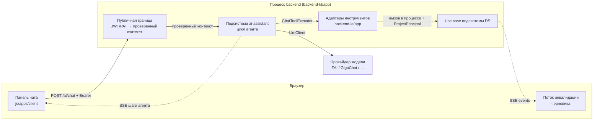
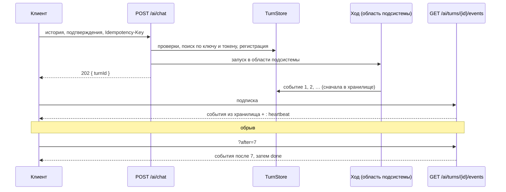

## Контекст

- Публичный backend — один JVM-процесс `backend-kt/app` (возможность `backend-monolith-runtime`). Он проверяет JWT или PAT, строит проверенный контекст запроса и передаёт его подсистемам: DS, проектам, документации, согласиям. Ограничения частоты по IP задаёт внешняя инфраструктура, а не монолит.
- `frontend-kt/mcp-server-core` содержит 61 инструмент: 31 на чтение и 30 на запись. Это клиентский вход для внешних агентов: его use case из `feature-*` разрешают локальный контекст, адрес API и учётные данные и ходят в публичный API `/api/projects/{projectId}/...`. Внутри монолита, который уже получил проверенный контекст, эта инфраструктура не нужна.
- Прикладные операции ds-service не зависят от транспорта. Use case принимает `DsRequestContext` (участник проекта `ProjectPrincipal`, ожидаемая DS, версия, ключ идемпотентности, базовая ревизия) и предметную команду. Права проверяет сам use case через `DsAccessPolicy`, а маршрут только разбирает HTTP и строит контекст через `TrustedDsRequestContextMapper`. Повтор записи по ключу задаёт `IdempotentMutationRequest` (ключ, имя операции, тело команды) в контексте.
- Монолит уже вызывает прикладные контракты DS из других подсистем через адаптеры в `backend-kt/app/data` (`InProcessDesignSystemOwnership`, `InProcessDesignSystemCounts`). Границы подсистем сохраняются для будущего выделения сервисов (`backend-monolith-runtime`).
- У записей ds-service нет способа указать ожидаемый черновик: есть только базовая ревизия сущности, ключ идемпотентности и идентификатор вкладки.
- Клиент уже подписан на поток инвалидации черновика (`js/apps/client/src/api/draftInvalidationStream.ts`). Событие порождает триггер БД (`pg_notify` в миграциях ds-service), а не маршрут, поэтому его получают и записи, выполненные внутри процесса. Поток не подавляет события от записей без идентификатора вкладки, то есть и записи чата.
- Чат должен работать с ZAI (`glm-4.5-flash`) и с GigaChat. Обе модели слабее Claude в вызове инструментов.

## Цели / Вне целей

**Цели:**

- Инструменты чата — тонкие адаптеры к тем же прикладным операциям ds-service, что обслуживают ручные правки. Предметная логика, проверки и работа с БД не дублируются.
- Изменения из чата идут теми же путями, что и ручные: те же проверки прав в use case, ревизии, повторяемость, журнал и поток инвалидации.
- Провайдер модели меняется настройками. Добавить формат API — значит добавить адаптер, а не переписать цикл агента.
- Удаляющие операции выполняются только после явного подтверждения пользователя.

**Вне целей:**

- Удалённый MCP по HTTP/SSE, хранение разговоров на сервере, учёт расхода токенов и квоты по проектам.
- Клиентская панель чата в `js/apps/client` — отдельное изменение. Здесь задаются HTTP-контракт и ожидания от клиента, на которые она опирается.
- Совместимость инструментов чата с инструментами MCP. Это разные входы с разными потребителями: имена, описания и схемы могут расходиться.
- Изменение каталога компонентов, публикация версий, управление участниками.
- Отмена хода чата и поиск по документации (решения 9 и 7).
- Составные «умные» инструменты под слабые модели. Они добавляются отдельным изменением по итогам эталонных сценариев.

## Архитектура



Агент вызывает инструменты от имени пользователя. Подсистема `ai-assistant` объявляет инструменты и порт их выполнения `ChatToolExecutor`, а реализует порт адаптер в `backend-kt/app`. Адаптер строит `DsRequestContext` с участником проекта из проверенного контекста запроса, начавшего ход, и вызывает use case ds-service. Права проверяет use case, запись попадает в журнал от имени пользователя. Подсистема `ai-assistant` не зависит от модулей ds-service, как и другие подсистемы монолита. HTTP-запросов к собственному API нет.

## Решения

### 1. Подсистема монолита, а не отдельный сервис

Подсистема `backend-kt/ai-assistant` повторяет форму `documentation-service`: отдельная сборка с `runtime` и `feature-chat`. Монолит подключает её как включаемую сборку (`includeBuild`) — так же, как документацию. Маршруты регистрируются под `/api/projects/{projectId}/ai` с проверенным контекстом. Префикс `/api/projects/` уже публичный, поэтому менять границу не нужно. Тело запроса ограничено общим лимитом 2 МиБ. Ресурсы `runtime` переносятся в пространство имён `dsbuilder/ai/...` по соглашению монолита, а OpenAPI добавляется в каталог `backend-kt/api-reference`.

Рассмотренные варианты:

- **Отдельный JVM-сервис в `frontend-kt`.** Отклонён: монолит — единственный поддерживаемый прикладной процесс. Отдельный контейнер потребовал бы своего шлюза, Dockerfile и развёртывания в Coolify.
- **Чат целиком в браузере** (как в ветке `AI-CHAT`). Отклонён: ключ модели попадает в браузер или в прокси разработки, а логику инструментов пришлось бы дублировать на TypeScript.
- **Удалённый MCP по HTTP и агент как MCP-клиент.** Отклонён: это лишний протокольный слой внутри одного процесса, и он противоречит ADR-0004.

### 2. Свои инструменты поверх use case ds-service

Чат не переиспользует `mcp-server-core`. Его use case из `feature-*` — клиенты публичного API: они разрешают локальный контекст, адрес API и учётные данные и строят пути `/api/projects/{projectId}/...`. Внутри монолита это лишний слой: запрос уже прошёл публичную границу, а прикладные операции DS доступны в том же процессе.

Устройство:

- **Каталог инструментов** (`ChatToolCatalog`) живёт в `ai-assistant`. Для каждого инструмента он задаёт имя, описание для модели, JSON Schema аргументов, разрешение и вид: чтение, запись или удаляющая операция. Схемы пишутся для модели: в них нет ссылки на DS, версии и ключа идемпотентности, потому что их задаёт сервер. Совпадать с инструментами MCP они не обязаны.
- **Порт выполнения** `ChatToolExecutor` объявлен в `ai-assistant` и принимает имя инструмента, аргументы модели и контекст вызова: участника проекта, DS хода, ключ идемпотентности для записи, ожидаемый черновик для подтверждённой операции и идентификатор корреляции.
- **Реализация порта** — адаптер `InProcessChatTools` в `backend-kt/app/data`, рядом с `InProcessDesignSystemOwnership`. На каждый инструмент — тонкий обработчик: разобрать аргументы в команду, собрать `DsRequestContext`, вызвать use case, перевести результат в JSON для модели, а `DsFailure` — в код ошибки. Обработчики сгруппированы по области: токены, темы, компоненты.
- **Сверка при запуске.** Монолит при старте сверяет имена каталога с обработчиками адаптера. Если для инструмента из каталога нет обработчика, приложение не открывает готовность.

**Контекст вызова.** Адаптер строит `DsRequestContext` так же, как маршрут ds-service:

- `principal` — `ProjectPrincipal` из проверенного контекста запроса, начавшего ход (решение 3);
- `designSystemId` — DS хода. У чтения `version = "draft"`. У записи `version` и `versionId` не задаются: запись всегда идёт в активный черновик, а заданная версия даёт `historical_version_read_only`;
- `baseRevision` — из аргументов модели, если инструмент её принимает;
- `expectedDraftId` — только у подтверждённой операции (решение 5);
- `clientId` не задаётся, поэтому событие инвалидации получают все вкладки, включая вкладку с чатом.

**Повторяемость записи** задаётся одним из двух способов, как у соответствующего маршрута ds-service. В таблице решения 7 у каждого инструмента записи указан его способ.

- **Повтор через контекст.** Для use case, которые маршрут оборачивает в `repeatableMutation`, адаптер задаёт `mutationRequest = IdempotentMutationRequest(key, operation, body, status)` и кодировщик ответа. Имя операции — постоянное имя инструмента с идентификаторами сущности, например `ai:component_property_set|appearance:{id}|property:{id}`, тело — канонический JSON команды.
- **Повтор внутри use case создания.** `AddAppearanceAxisValueUseCase` и `DuplicateAppearanceConfigurationUseCase` идут через `modelCreate` и `IdempotentCreateExecutor`: ключ передаётся параметром, имя операции задаёт сам use case. Адаптер передаёт только ключ, а `mutationRequest` не задаёт. Иначе в одной транзакции будут две записи с одним ключом.

В обоих случаях сохранённый результат повтора приходит не через `DsResult`, а исключением `IdempotentReplayException` с сохранённым ответом. Адаптер ловит его и возвращает тело сохранённого ответа как успешный результат. Тот же ключ с другой командой получает `Conflict("IDEMPOTENCY_KEY_REUSED")`. У пути «через контекст» имя операции `ai:…` отличается от имени HTTP-маршрута (`METHOD path`), поэтому HTTP-запрос с тем же ключом не получит сохранённый результат записи чата, а получит `IDEMPOTENCY_KEY_REUSED`. У `modelCreate` имя операции задаёт use case, и оно общее с HTTP: запрос с тем же ключом и той же командой получит сохранённый результат чата. Ключ знает только сам пользователь, поэтому это принимается.

**Результат для модели** — JSON того же вида, что ответ маршрута ds-service. Где DTO маршрута доступны из модуля подсистемы, адаптер использует их. Где они закрыты, адаптер сериализует предметный результат сам, без новых полей. Две части ответа маршрут отдаёт заголовками, и адаптер переносит их в тело:

- у списков со страницами — `{"items": …, "nextCursor": …}`, по умолчанию не больше 50 элементов, чтобы ответ не раздувал историю модели;
- у записи с метаданными изменения (новые ревизии и предупреждения) — `{"result": …, "mutationMetadata": …}`. Метаданные берутся и из успешного результата, и из сохранённого ответа повтора, поэтому повтор отдаёт модели то же самое.

**Ошибки.** `DsFailure` переводится в код `tool_result` (раздел «Модель данных и контракты»). У `Conflict` модели передаются и `editRevision`, `draftRevision`, если они есть, чтобы после конфликта ревизии модель могла повторить запись без лишнего чтения. Любое другое исключение из use case у записи даёт `OUTCOME_UNKNOWN`, у чтения — `BACKEND_UNAVAILABLE`. Текст исключения модели не передаётся.

**Получение use case.** Use case регистрируются в графе Koin подсистемы DS, из которого монолит уже берёт `DesignSystemAccess` для `InProcessDesignSystemOwnership`. Адаптер получает их оттуда же при запуске.

Доводы за этот вариант:

- **Нет HTTP к собственному API.** Требование монолита «Независимость поведения от транспорта» выполняется без исключений.
- **Одна реализация предметной логики.** Проверки прав, ревизии, повторяемость, журнал и событие инвалидации остаются в use case и БД ds-service. Адаптер повторяет только разбор HTTP, а не правила.
- **Не нужен Bearer пользователя.** Ход использует уже проверенного участника проекта. Пропадают пересылка токена, повторная проверка JWT на каждом вызове и проблема его истечения посреди хода.
- **Нет сборки `frontend-kt` в образе монолита.** Не нужны публикация JVM-артефактов ядра, MCP SDK в JAR монолита и выравнивание версий Kotlin и Ktor.
- **Подсистему можно вынести.** `ai-assistant` зависит только от порта. При выделении DS в отдельный сервис меняется реализация `ChatToolExecutor`, а не цикл агента.

Цена — около двух десятков обработчиков и их тестов, плюс описания инструментов, которые ведутся отдельно от MCP. Сложной клиентской сборки данных, которую пришлось бы переносить, нет: чтение компонента для редактора — одна операция ds-service (`editor-model`), токены и темы тоже читаются отдельными операциями.

Рассмотренные варианты:

- **Встроить `mcp-server-core` и вызывать публичный API по `127.0.0.1` с Bearer пользователя.** Отклонён. Нужно исключение из требования монолита и пересылка токена, а в образ монолита пришлось бы собирать клиентские модули `frontend-kt`. Проверки прав это не добавляет: их делает use case.
- **Модули адаптеров внутри `ai-assistant` с зависимостью от модулей ds-service.** Отклонён: связывает подсистемы напрямую, а монолит держит такие связи в `app`.
- **Вызывать маршруты ds-service через тестовый движок Ktor без сокета.** Отклонён: это тот же HTTP по смыслу и нестандартный код ради обхода транспорта.

### 3. Участник проекта на весь ход

`POST /ai/chat` проходит публичную границу, и маршрут получает проверенный контекст. Из него строится `ProjectPrincipal` через `TrustedProjectPrincipalFactory` из `authorization-core`, как у других подсистем; `projectId` участника обязан совпадать с проектом пути. Этот участник используется и для отбора инструментов через `PolicyEvaluator`, и для каждого вызова инструмента в ходе. Bearer в подсистему не передаётся и не хранится.

- Права участника фиксируются на время хода: не дольше `AI_TURN_TIMEOUT_SECONDS + AI_TOOL_CALL_TIMEOUT_SECONDS`, по умолчанию 150 секунд. Отзыв PAT, смена роли и удаление из проекта действуют со следующего хода. Так же ведёт себя любой долгий запрос, который прошёл проверку в начале.
- При выходе пользователя клиент вызывает `DELETE` активного хода (решение 4).
- Use case проверяет права на каждую операцию по тому же снимку участника. Это защита от ошибки в отборе инструментов, а не от отзыва прав посреди хода.

Рассмотренный вариант — хранить Bearer в ходе и перед каждым вызовом заново проверять его через `GatewayAuthorizer`. Отклонён: возвращает в ход токен пользователя и проблему его истечения, а выигрыш — отзыв прав на 150 секунд раньше.

### 4. Фоновый ход и возобновляемый поток

Ход чата не привязан к HTTP-запросу, который его начал. Так отключение клиента не обрывает запись на середине, а клиент может безопасно переподключиться и дочитать события.



**Запуск хода — `POST /api/projects/{projectId}/ai/chat`.** Тело: `designSystemId`, `messages` (вся история) и необязательные `confirmations`. Заголовок `Idempotency-Key` обязателен: клиент создаёт его на одно действие пользователя — новое сообщение или решение по подтверждению. Порядок обработки:

1. Проверки формы запроса. Разбор тела и наличие `Idempotency-Key` проверяет маршрут (`400 invalid_request`). `ValidateChatTurnUseCase` проверяет пустые `messages`, последнюю реплику не от пользователя без `confirmations` (`400 invalid_request`) и `AI_MESSAGE_MAX_CHARS` (`400 message_too_long`). Ошибки — обычный JSON.
2. Поиск уже принятого запроса (`StartChatTurnUseCase` → `TurnStore.find`) — до проверки принадлежности DS, как у ds-service, чтобы повтор принятого хода получал прежний `turnId`:
   - тот же пользователь, проект и `Idempotency-Key`: с тем же отпечатком тела — `202` с прежним `turnId`, с другим — `409 IDEMPOTENCY_KEY_REUSED`, как у ds-service;
   - тот же хеш `confirmationToken`: если пользователь, проект и DS совпадают с теми, что сохранены вместе со связью, — `202` с `turnId` хода, запущенного этим подтверждением; иначе — `400 confirmation_invalid` (`ConfirmationScopeMismatch`).
3. Для нового запроса — принадлежность `designSystemId` проекту маршрута через порт `DesignSystemOwnership` с принципалом из проверенного контекста: `NOT_FOUND` — `404 design_system_not_found`, `FORBIDDEN` — `403 design_system_forbidden`, `UNAVAILABLE` — `503 dependency_unavailable`.
4. Проверка подписи токена — только если запрос новый. Поэтому повтор принятого подтверждения получает прежний `turnId`, даже если токен уже истёк.
5. Атомарная регистрация (`TurnStore.register`): повторная сверка ключа и хеша, слот «один активный ход на пользователя» (`429 ai_busy`), предел памяти (`503 ai_overloaded`), запись хода.
6. Запуск хода в области подсистемы — до ответа клиенту, под той же блокировкой, под которой подсистема принимает ходы. Если область уже не активна (монолит останавливается), регистрация отменяется, и клиент получает `503 ai_unavailable`. Ответ `202 { "turnId": "…" }` отправляется последним.

Повтор POST безопасен: клиент повторяет его автоматически с тем же ключом, если не получил ответа.

**Связи с ходом.** Связи `Idempotency-Key → turnId` и `хеш токена → turnId` хранятся отдельно от событий хода и по объёму не вытесняются. Ключ живёт до 10 минут после `done` хода, хеш токена — до истечения токена, но не меньше срока ключа. Если события хода вытеснены, повтор POST всё равно получает прежний `turnId`, а `GET` событий отвечает `404 turn_unknown`. Повторного выполнения не будет.

**Выполнение.** Ход выполняется в области корутин подсистемы (`SupervisorJob`), а не в корутине HTTP-запроса, с участником проекта из POST (решение 3).

- Каждое событие сначала записывается в `TurnStore` с порядковым номером, начиная с 1 в каждом ходе, и только потом становится доступно подписчикам.
- Транзакция ds-service блокирующая (`Dispatchers.IO`, `transaction { runBlocking { … } }`), и отмена корутины её не прерывает. Поэтому вызов инструмента запускается отдельной задачей в области вызовов подсистемы, а ход ждёт её результата не дольше `AI_TOOL_CALL_TIMEOUT_SECONDS` (по умолчанию 30). Если срок вышел, ход получает `tool_result` с `isError: true` и `code: "OUTCOME_UNKNOWN"` для записи и `code: "BACKEND_UNAVAILABLE"` для чтения, а брошенный вызов дорабатывает сам и фиксируется либо откатывается своей транзакцией. Своих таймаутов выполнения запросов у обычных записей ds-service нет, только ожидание соединения пула; их введение — отдельное изменение ds-service. Пока у пользователя не завершён брошенный по таймауту вызов, новый вызов инструмента не начинается и сразу получает `BACKEND_UNAVAILABLE`. Так один пользователь не займёт пул соединений DS, общий с HTTP, зависающими вызовами. Ни остановка, ни таймаут хода не прерывают начатую запись: в события попадает её результат либо `OUTCOME_UNKNOWN` по `AI_TOOL_CALL_TIMEOUT_SECONDS`.
- Остановка (`DELETE`) и таймаут хода проверяются перед каждым обращением к модели, в том числе перед первым, и перед каждым вызовом инструмента, в том числе внутри одного ответа модели с несколькими вызовами. Они прерывают только ожидание модели. Невыполненные вызовы из ответа модели убираются из `toolCalls` сообщения ассистента в `state`, чтобы у каждого оставшегося вызова был результат.
- Подтверждённая операция выполняется всегда, даже если `DELETE` пришёл до старта хода: пользователь уже подтвердил её, а токен связан с этим ходом. Остановка действует после неё.
- Ход всегда завершается событиями `state` и `done`, в том числе после ошибки, остановки и таймаута. `complete()` хода и освобождение слота выполняются в `finally` без отмены.
- Продолжительность хода ограничена `AI_TURN_TIMEOUT_SECONDS + AI_TOOL_CALL_TIMEOUT_SECONDS`.

**Чтение — `GET /api/projects/{projectId}/ai/turns/{turnId}/events?after=N`.**

- Поток `text/event-stream`: каждое событие с полем `id`, между событиями — `: heartbeat` каждые 15 секунд. `heartbeat` не сохраняется.
- Курсор передаётся параметром `after`, а не заголовком `Last-Event-ID`: клиент работает с другого домена, и нестандартный заголовок потребовал бы правки CORS монолита. Без `after` отдаются все события хода. Нецелое или отрицательное `after` — `400 invalid_request`; `after` больше последнего номера — у идущего хода поток ждёт новых событий, у завершённого закрывается сразу.
- Выдача без пропусков и повторов: снимок сохранённых событий после `after` и подписка на новые берутся под одной блокировкой хода. Если ход завершён, поток отдаёт оставшиеся события и закрывается после `done`.
- Ход доступен только пользователю, который его начал, и только в проекте маршрута. Иначе — `404 turn_unknown`.
- Не больше трёх одновременных потоков событий на пользователя; лишний — `429 too_many_streams`.
- Переподключение автоматическое: это только чтение, поэтому клиент после обрыва сам переподключается с `after`. Отключение клиента на ход не влияет.

**Остановка — `DELETE /api/projects/{projectId}/ai/turns/{turnId}`** → `204`. Идущий ход завершается перед следующим шагом с `error: stopped`, затем `state` и `done`. Завершённый ход — `204` без новых событий. Чужой или неизвестный — `404 turn_unknown`.

**Хранение событий.** `TurnStore` живёт в памяти процесса:

- события хода хранятся во время выполнения и 10 минут после `done`;
- `state` с итоговой историей отправляется один раз, в конце хода. Во время хода панель показывает шаги по `tool_started` и `tool_result`, но собрать из них историю нельзя: в них нет полных аргументов и результатов. Если ход потерян, его история теряется, и остаётся только пометка `interrupted`;
- объём считается в байтах UTF-8 сериализованных событий и входной истории хода. Лимит `AI_TURN_STORE_MAX_MB` (по умолчанию 64) мягкий: при превышении вытесняются самые старые завершённые ходы, идущие ходы не вытесняются и могут временно превысить лимит. Если места не освободить, новый POST получает `503 ai_overloaded`;
- решение рассчитано на один экземпляр процесса `backend`, как и весь монолит. При переключении на новый контейнер во время выкатки идущие ходы и их итоги теряются и считаются прерванными.

**Прерванный ход.** Если клиент потерял связь с ходом — POST без ответа или поток без `done` — и не может её восстановить, исход записей неизвестен.

- Клиент сразу при потере связи добавляет в историю сообщение `{ "role": "interrupted" }` и убирает его, если дочитал ход до `done`.
- Если такое сообщение есть в истории, сервер добавляет в системный промпт требование перечитать данные перед любой записью, а адаптер провайдера передаёт пометку модели служебной репликой пользователя «Предыдущий ход прерван, исход изменений неизвестен».
- Сервер убирает пометки из итогового `state`, только если в ходе было хотя бы одно успешное обращение к модели: тогда модель уже получила требование. Если ход завершился до этого (например, `llm_unavailable` или `stopped` до первого шага), пометка остаётся для следующего хода.

**Ожидающий вызов.** Вызов, остановленный на подтверждении, входит в итоговый `state` как вызов без результата. Если следующий POST не содержит решения по нему, сервер перед обращением к модели добавляет синтетический результат с `isError: true` и `code: "not_confirmed"`. Иначе API формата OpenAI отклонит вызов инструмента без ответа.

**Отзыв доступа.** Участник проекта фиксируется на время хода (решение 3). Клиент при выходе и сбросе сессии вызывает `DELETE` активного хода. Отзыв PAT и смена роли действуют со следующего хода.

**Остановка процесса.** Подсистема подписывается на `ApplicationStopPreparing` до запуска остальных подсистем. По этому событию она перестаёт принимать POST (`503 ai_unavailable`), отменяет область ходов и ждёт завершения начатых вызовов инструментов не дольше `AI_TOOL_CALL_TIMEOUT_SECONDS`. Подсистема DS и её пул БД закрываются позже, на `ApplicationStopped`, поэтому вызовы, завершившиеся в срок, успевают зафиксироваться. Вызов, брошенный по таймауту, может ещё идти при закрытии пула; тогда его транзакция откатывается целиком. Чтобы docker не убил процесс раньше, `stop_grace_period` контейнера `backend` задаётся не меньше `AI_TOOL_CALL_TIMEOUT_SECONDS` + `BACKEND_SHUTDOWN_TIMEOUT_MS` + 10 секунд. Итоги ходов в памяти теряются.

**История у клиента.** Сервер не хранит разговор между ходами: только события и итог хода до 10 минут после завершения, для переподключения. Клиент держит историю в памяти вкладки, а не в `localStorage` и `sessionStorage`, и присылает её целиком при каждом новом ходе. Подделанная клиентом история влияет только на ответ модели: каждый вызов инструмента всё равно выполняется с правами пользователя.

Рассмотренный вариант — синхронный ход в одном POST с повтором по `turnId` и флагу `retry`. Отклонён: ход отменяется вместе с HTTP-запросом, повтор после завершённого хода воспроизводит старую ошибку, а гонки между повтором, `410` и `429` требуют отдельных правил на каждый случай.

### 5. Подтверждение и история для модели

**Подтверждение** на историю не опирается: история приходит от клиента, и по ней сервер не может проверить, что пользователю показали именно эту операцию. Поэтому, когда агент останавливается на операции с подтверждением, сервер:

- сам формирует итоговые аргументы вызова, включая служебные поля, и заранее выдаёт `idempotencyKey`;
- читает идентификатор активного черновика (`draftId`) через `ChatToolExecutor.activeDraftId`;
- если черновик прочитать не удалось, операция не ставится на подтверждение: модель получает `tool_result` с `isError: true` и `code: "BACKEND_UNAVAILABLE"`;
- выпускает `confirmationToken`. Это подпись HMAC-SHA256 над идентификатором ключа (`kid`), `userId`, `projectId`, `designSystemId`, `draftId`, именем инструмента, каноническим JSON итоговых аргументов, `idempotencyKey` и сроком действия (10 минут). Bearer в токен не входит;
- отдаёт клиенту в событии `confirmation_required` описание операции, её аргументы без служебных полей и токен.

Подтверждение — новый POST с `confirmations: [{ confirmationToken, approved }]` и новым `Idempotency-Key`. Сервер проверяет подпись, срок и совпадение пользователя, проекта и DS с текущим запросом. Затем ход выполняет ровно ту операцию, что записана в токене, с её `idempotencyKey` и ожидаемым черновиком `expectedDraftId = draftId`. Аргументы ожидающего вызова в присланной истории игнорируются, в историю записывается вызов с аргументами из токена. Решение `approved` не входит в связь токена с ходом: первое отправленное решение по токену окончательное.

**Привязка к черновику.** Запись без версии идёт в черновик, активный в момент записи. Если между показом операции и подтверждением DS опубликуют, без привязки операция применилась бы к следующему черновику. Поэтому `DsRequestContext` получает необязательное поле `expectedDraftId`. Оно сверяется в той же транзакции и под той же блокировкой, где запись получает `DraftBoundaryRef` активного черновика (`ExposedEditingInfrastructure`). При расхождении запись не выполняется, и use case возвращает `DsFailure.Conflict("draft_changed")`. Поле задаёт только адаптер инструментов чата и только у подтверждённой операции; публичный HTTP API ds-service не меняется. Остальные записи чата, как и ручные правки, идут в текущий активный черновик. Результат возвращается модели и в `tool_result` (`code: "CONFLICT"`, `backendCode: "draft_changed"`), панель предлагает запросить операцию заново.

Рассмотренный вариант — сверять `draftId` чтением прямо перед выполнением, без изменения ds-service. Отклонён: между проверкой и записью остаётся окно, в которое может попасть публикация.

Ключ подписи и его `kid` генерируются случайно при старте процесса и в env не хранятся. Если `kid` токена неизвестен, значит процесс перезапускался: ответ `410 confirmation_expired`. Если `kid` известен, но подпись не сходится или область не совпадает, ответ `400 confirmation_invalid`.

**История для модели** обрезается до лимита `AI_HISTORY_MAX_CHARS` (по умолчанию 60000):

- Результат одного инструмента, который получает модель, ограничен `AI_TOOL_RESULT_MAX_CHARS` (по умолчанию 6000). Более длинный обрезается по границе JSON-элемента с пометкой о сокращении. Полный результат в событие `tool_result` не попадает, там только `summary`.
- Сначала сокращается текст старых результатов инструментов, затем старые реплики. Сообщение `tool` при сокращении не удаляется, а получает текст «[результат сокращён]». Иначе API формата OpenAI отклонит вызов инструмента без ответа.
- Системный промпт и последнее сообщение пользователя не сокращаются. Одно сообщение пользователя ограничено `AI_MESSAGE_MAX_CHARS` (по умолчанию 8000); более длинное отклоняется ответом `400 message_too_long`.
- При старте проверяется, что лимит вмещает системный промпт со схемами инструментов, сообщение предельной длины и запас на один обмен «вызов + результат»: `AI_TOOL_RESULT_MAX_CHARS` плюс 2000 символов на вызов. Иначе конфигурация считается ошибочной.
- Если после всех сокращений история всё равно не помещается (например, в ходе много вызовов подряд), ход завершается событием `error` с `context_overflow`, затем `state` и `done`.

### 6. Защита от перерасхода и массовых записей

- **Один активный ход на пользователя.** Слот занимается при регистрации хода и освобождается в `finally` по его завершению. Второй POST, пока ход идёт, получает `429 ai_busy` с `activeTurnId`, `projectId` и `designSystemId` идущего хода. Вкладка той же DS может подключиться к этому ходу, вкладка другой DS показывает «Идёт запрос в другой вкладке» и кнопку «Остановить». Это ограничивает расход ключа провайдера и снимает гонку двух ходов одного пользователя.
- **Лимит записей за ход** `AI_MAX_WRITES` (по умолчанию 10). Запись сверх лимита требует подтверждения, как удаляющая операция. Так внедрённая через данные DS инструкция не может молча переписать много значений, а отмены хода в первой версии нет.

### 7. Набор инструментов задаёт сервер

`ChatToolCatalog` в коде подсистемы — полный список инструментов чата. Это 23 инструмента: 15 на чтение и 8 на запись. Их имена совпадают с близкими по смыслу инструментами MCP, чтобы эталонные сценарии и описания было проще сравнивать, но совместимость не требуется. Разрешения сверены с use case ds-service:

| Инструмент записи | Разрешение | Use case | Повторяемость |
|---|---|---|---|
| `token_value_update` | `tokens:write` | `UpdateTokenValueUseCase` | через контекст |
| `color_token_values_update` | `tenants:write` | `UpdateColorTokenValuesUseCase` | через контекст |
| `size_token_value_update` | `tenants:write` | `UpdateSizeTokenValueUseCase` | через контекст |
| `typography_style_update` | `tenants:write` | `UpdateTypographyStyleUseCase` | через контекст |
| `component_property_set` | `components:variations:write` | `SetAppearancePropertyValueUseCase` → `modelMutate` | через контекст |
| `component_axis_value_create` | `components:variations:write` | `AddAppearanceAxisValueUseCase` → `modelCreate` | внутри use case |
| `component_configuration_duplicate` | `components:variations:write` | `DuplicateAppearanceConfigurationUseCase` → `modelCreate` | внутри use case |
| `component_property_reset` | `components:variations:delete` | `RemoveAppearancePropertyValueUseCase` → `modelDelete` | через контекст |

Способ повторяемости каждого инструмента сверяется с маршрутом ds-service в задаче 3.2. Разрешения инструментов чтения переносятся из нынешней политики чата: `design-systems:read`, `tenants:read`, `tokens:read`, `components:read`, `components:variations:read` по смыслу инструмента; точная таблица «инструмент чтения → разрешение → use case» фиксируется в каталоге в задаче 3.2.

Инструменты чтения: `design_system_get_context`, `tenants_list`, `tokens_list`, `token_get`, `token_values_get`, `token_groups_list`, `palette_get`, `token_edit_data_get`, `components_list`, `component_configurations_list`, `component_variations_get`, `component_properties_get`, `component_editor_get`, `component_config_get`, `component_tokens_get`. Подтверждения требуют инструменты, помеченные в каталоге как удаляющие; на старте это `component_property_reset`. По `authorization/policy.json` право `components:variations:delete` есть у maintainer и owner, поэтому у editor этого инструмента нет и подтверждения он не увидит.

В первую версию не входят удаления, создание токенов и групп, структурные правки вариаций, перестановки и перенос токенов: отмены хода нет, а ошибка модели в них дорого стоит. Не входят и инструменты уровня проекта (`projects_list`, `design_systems_list`): чат привязан к одной DS. Каталог расширяется отдельными изменениями: новый инструмент — это запись в каталоге, обработчик в адаптере и тесты.

Правила:

- Каждый инструмент отбирается по своему точному разрешению через существующий `PolicyEvaluator.isAllowed(principal, permission)`. Для JWT разрешения задаёт роль в проекте, для PAT — пересечение скоупов токена и прав роли владельца. Собственной логики ролей и скоупов подсистема не пишет. Use case всё равно проверяет каждый вызов.
- Вызов инструмента вне каталога или без разрешения отклоняется до адаптера с `tool_not_allowed`.
- `documentation_search` в первую версию не входит. Существующий поиск разрешает публикацию в рамках проекта и не проверяет её принадлежность к DS, а граница чата — одна DS. Инструмент вернётся отдельным изменением вместе с такой проверкой.
- В схемах для модели нет полей DS, версии, ключа идемпотентности и ожидаемого черновика. DS и версию адаптер берёт из контекста хода, ключ выдаёт агент на каждый вызов записи, ожидаемый черновик — только у подтверждённой операции. Если модель всё же прислала такие поля, они отбрасываются.
- Аргументы проверяются по схеме каталога до вызова адаптера. Нарушение схемы даёт `invalid_arguments` без обращения к use case.
- Поля ревизий (`baseRevision`, `editRevision`) остаются в схемах. Модель берёт их из предшествующего чтения. При конфликте ревизии сервер не повторяет вызов сам: ошибка возвращается модели, и та может перечитать данные и попробовать снова новым вызовом с новым ключом.

### 8. Нейтральная модель и адаптеры провайдеров

Цикл агента работает только с типами `ChatMessage`, `ToolCall`, `ToolResult`, `ToolSpec`. `LlmClient` выполняет один шаг: принимает системный промпт, историю и инструменты, возвращает либо текст, либо вызовы инструментов.

- Соответствие ошибок провайдера кодам: ответ 429 и коды из `AI_RETRY_ERROR_CODES` после исчерпания повторов — `LlmFailure.RateLimited` и `llm_rate_limited`; 5xx, сетевые ошибки и таймаут запроса — `LlmFailure.Unavailable` и `llm_unavailable`; неразбираемый ответ — `LlmFailure.InvalidResponse` и `llm_unavailable`.
- `OpenAiCompatibleClient` использует формат `chat/completions` с `tools`/`tool_calls`. Отличия провайдеров задаются конфигурацией: `AI_EXTRA_BODY` подмешивается в тело запроса как есть, `AI_RETRY_ERROR_CODES` дополняет 429 и 5xx. Повтор — до трёх раз с экспоненциальной задержкой.
- `GigaChatClient` получает токен доступа по `AI_GIGACHAT_AUTH_KEY` и `AI_GIGACHAT_SCOPE` (заголовок `RqUID`), кеширует его до истечения минус минута и обновляет при 401. Инструменты передаются как `functions`, ответ — `function_call` с аргументами-объектом, результат — сообщение `role: function`, в `content` которого строка с JSON-объектом. `functions_state_id` из ответа сохраняется как идентификатор вызова и возвращается в истории. Значения по умолчанию: `AI_GIGACHAT_OAUTH_URL=https://ngw.devices.sberbank.ru:9443/api/v2/oauth`, `AI_GIGACHAT_BASE_URL=https://api.giga.chat/v1`, `AI_GIGACHAT_SCOPE=GIGACHAT_API_PERS`, `AI_MODEL=GigaChat-2-Max`. Доверенный корень берётся из файла `AI_GIGACHAT_CA_PATH`, смонтированного в контейнер томом только для чтения. Его добавляют к системным корням, а не заменяют ими. Значения по умолчанию, имена полей и совместимость наших JSON Schema (`enum` с `null`, вложенные объекты) с `functions` сверяются с актуальной документацией GigaChat при реализации.
- Цикл агента рассчитан на один вызов за шаг. Если OpenAI-совместимая модель вернула несколько `tool_calls`, они выполняются последовательно в порядке ответа. Если в этом наборе есть вызов, требующий подтверждения, вызовы до него выполняются, этот вызов уходит в `confirmation_required` и остаётся в `state` как ожидающий, а последующие не выполняются и убираются из `toolCalls`.

Рассмотренный вариант — Koog или LangChain4j. Отклонён для первого шага: цикл должен управлять подтверждениями, подстановкой полей и событиями интерфейса, а адаптер формата OpenAI занимает несколько сотен строк. Решение пересматривается, если провайдеров станет больше трёх.

### 9. События хода и обновление интерфейса

События хода читаются через `GET /ai/turns/{turnId}/events?after=N` (решение 4). Браузерный `EventSource` не умеет передавать заголовок `Authorization`, поэтому клиент читает поток через `fetch` и `ReadableStream` и сам передаёт `after` при переподключении. На 401 клиент обновляет токен и переподключается, как поток черновика (`draftInvalidationStream.ts`). `: heartbeat` каждые 15 секунд, как в потоке черновика (`DraftInvalidationRoutes.kt`), не даёт прокси закрыть молчащее соединение и помогает клиенту заметить обрыв. Сжатие монолита потока не касается: оно применяется только к JSON.

Изменения в интерфейсе появляются через существующий поток инвалидации черновика.

Кнопки «Отменить ход» в первой версии нет. Существующий откат журнала возвращает сущность к предыдущему опубликованному состоянию (ADR-0007, раздел «Откат»). Если пользователь вручную изменил значение, а чат затем изменил его же, откат журнала сотрёт и ручную правку. Правильная отмена хода — компенсирующие записи прежних значений с проверкой ревизии. Она делается отдельным изменением. Панель не предлагает откат журнала как отмену хода.

### 10. Выключатель и настройка

По умолчанию провайдер — ZAI: `AI_PROVIDER=openai-compatible`, `AI_BASE_URL=https://api.z.ai/api/paas/v4`, `AI_MODEL=glm-4.5-flash`, `AI_EXTRA_BODY={"thinking":{"type":"disabled"}}`, `AI_RETRY_ERROR_CODES=1234,1305`. Чтобы включить чат на стенде, достаточно задать `AI_ENABLED=true` и `AI_API_KEY`.

- `AI_ENABLED=false` по умолчанию. Тогда остальные `AI_*` не читаются, `GET /ai/status` возвращает `{ "enabled": false }`, а маршруты хода — `503 ai_unavailable`.
- При `AI_ENABLED=true` неполная или недопустимая конфигурация — нет ключа, неразбираемое число или JSON, несовместимые лимиты истории — обрабатывается как любая ошибочная конфигурация монолита. Приложение не открывает готовность и сообщает понятную ошибку с именем переменной, без значений секретов. Это действующее требование «Независимость конфигурации от способа запуска», сценарий «Ошибочная конфигурация»; исключение для ИИ не вводится. Включение чата — осознанное действие, и ошибка должна быть видна сразу, а не в виде молча выключенной функции.
- Клиентская панель (отдельное изменение) показывается, только если включён её флаг развёртывания и `status.enabled`.

### 11. Контекст экрана

Просьбы вроде «сделай её красной» или «увеличь шрифт» относятся к тому, что открыто в редакторе. Без этого модель ищет объект сама: лишние шаги поиска (у `glm-4.5-flash` по 13–15 секунд) и риск промахнуться, например поменять общий токен вместо свойства кнопки. Поэтому клиент передаёт в `POST /ai/chat` необязательное поле `context`, а сервер добавляет его в системный промпт. Шаги чтения перед записью (`propertyId`, ревизии) остаются, экономится поиск объекта.

```json
"context": {
  "section": "components",
  "tenantId": "…",
  "token": { "id": "…", "name": "text.default.accent" },
  "component": {
    "name": "Button", "id": "…", "appearanceId": "…",
    "selectedValues": [{ "variation": "view", "value": "accent", "styleId": "…" }]
  }
}
```

- `section` — раздел редактора темы: `colors`, `typography`, `shapes`, `palette`, `components` или `other`. Остальные поля необязательны.
- `tenantId` — открытая тема.
- `token` — выбранный токен на страницах цветов, типографики и размеров. `id` — UUID определения токена: на странице цветов — определение выбранного семейства, в типографике — начертание выбранного стиля, в размерах — сам токен. Эти идентификаторы принимают `color_token_values_update`, `typography_style_update` и `size_token_value_update`. `name` — имя этого определения.
- `component` — открытый компонент: имя, идентификатор, открытая конфигурация (`appearanceId`) и значения вариаций, выбранные в превью, с именами вариации и значения и их `styleId`.

Откуда клиент (отдельное изменение) берёт контекст:

- раздел, тема и имя компонента видны из адреса страницы;
- выбранный токен, стиль типографики, идентификатор компонента, открытая конфигурация (в том числе конфигурация по умолчанию, которой нет в адресе) и значения вариаций хранятся во внутреннем состоянии экранов. Экраны сообщают их через общий React-контекст `EditorFocusContext` в `Main.tsx`. Значение хранится в `ref`, поэтому смена выбора не перерисовывает редактор;
- клиент отправляет только строковые `styleId` и не больше 20 значений.

Правила сервера:

- Контекст — подсказка, а не право. Сервер проверяет форму: `section` из списка, идентификаторы — UUID, `selectedValues` — не больше 20. Нарушение — `400 invalid_request`. Имя, которое не проходит проверку (длиннее 200 символов или с символами кроме букв, цифр, пробела и `._-/`), сервер отбрасывает, а не отклоняет запрос: пользовательское имя не должно ломать чат. Имена вариаций и их значений ограничены 64 символами, чтобы блок предельного размера не съедал лимит истории.
- Набор символов не даёт имени выйти за пределы блока, но не защищает от смысла: фраза-инструкция из букв проходит. Защита та же, что для результатов инструментов: блок помечен как данные, а не команды, выводится как JSON со строками в кавычках, каждый вызов проверяет use case, записи сверх `AI_MAX_WRITES` и удаления требуют подтверждения.
- Контекст фиксируется в момент действия пользователя и входит в тело запроса и его отпечаток. Автоматический повтор POST отправляет то же тело; тот же `Idempotency-Key` с другим контекстом — `409 IDEMPOTENCY_KEY_REUSED`.
- В POST с подтверждением контекст тоже передаётся. На подтверждённую операцию он не влияет — она выполняется только по токену, — а влияет на продолжение хода после неё. Поиск принятого подтверждения идёт по хешу токена, поэтому повтор из другой вкладки с другим контекстом получает прежний `turnId`.
- Контекст не сохраняется в истории: каждый ход получает текущий контекст экрана.
- В промпте контекст стоит отдельным блоком «Открыто в редакторе» с правилами:
  - если просьба не называет другой объект, речь об открытом;
  - идентификаторы из блока используй сразу, без повторного поиска (общее правило «бери идентификаторы только из результатов инструментов» дополнено блоком контекста);
  - просьбу про компонент выполняй через свойства его конфигурации (`component_property_set`), токены и стили темы не меняй, пока пользователь прямо не попросит поменять токен или значение во всей дизайн-системе;
  - значения вариаций из превью по умолчанию не задают область записи: меняется базовое значение свойства, а `styleIds` из контекста передаются, только если пользователь говорит об этом варианте.
- Проверка лимита истории при запуске учитывает блок контекста предельного размера, объём хода в хранилище — размер контекста.

Рассмотренный вариант — передавать контекст отдельным сообщением пользователя в истории. Отклонён: он попадал бы в историю следующих ходов и устаревал бы при переходе на другую страницу.

## Программное проектирование

`backend-kt/ai-assistant/feature-chat` — слои domain и application:

```kotlin
public enum class ChatRole { USER, ASSISTANT, TOOL, INTERRUPTED }
public data class ToolCall(val id: String, val name: String, val arguments: JsonObject)
public data class ToolResult(
    val callId: String,
    val name: String,
    val content: String,
    val isError: Boolean,
    val code: String?, // категория ошибки DsFailure либо код агента
    val backendCode: String?, // машиночитаемый код DsFailure, если он есть
)
public data class ChatMessage(val role: ChatRole, val text: String?, val toolCalls: List<ToolCall>, val toolResult: ToolResult?)
public data class ToolSpec(val name: String, val description: String, val parameters: JsonObject)

public data class LlmRequest(val system: String, val messages: List<ChatMessage>, val tools: List<ToolSpec>)
public sealed interface LlmResponse {
    public data class Text(val text: String) : LlmResponse
    public data class ToolCalls(val calls: List<ToolCall>) : LlmResponse
}
public sealed class LlmFailure(message: String) : Exception(message) // Unavailable, RateLimited, InvalidResponse

/** Порт провайдера модели. Реализации живут в data. */
public interface LlmClient {
    public suspend fun complete(request: LlmRequest): LlmResponse
}

/** Описание инструмента чата: схема для модели, разрешение и вид операции. */
public data class ChatToolDefinition(
    val name: String,
    val description: String,
    val inputSchema: JsonObject,
    val permission: String,
    val kind: ChatToolKind,
)
public enum class ChatToolKind { READ, WRITE, DESTRUCTIVE }

/** Полный список инструментов чата; отбор по разрешениям делает AgentToolbox. */
public object ChatToolCatalog {
    public val tools: List<ChatToolDefinition>
}

/** Контекст вызова инструмента: участник проекта и DS хода, ключ и ожидаемый черновик — только для записи. */
public data class ChatToolContext(
    val principal: ProjectPrincipal,
    val designSystemId: String,
    val correlationId: String,
    val idempotencyKey: String?,
    val expectedDraftId: String?,
)

/** Порт выполнения инструментов; в монолите его реализует адаптер к use case ds-service. */
public interface ChatToolExecutor {
    /** Имена инструментов, для которых есть обработчик; сверяется с каталогом при запуске. */
    public val supportedTools: Set<String>
    public suspend fun execute(name: String, arguments: JsonObject, context: ChatToolContext): ToolResult
    public suspend fun activeDraftId(principal: ProjectPrincipal, designSystemId: String): String?
}

/** Инструменты, доступные агенту в конкретном ходе. */
public interface AgentToolbox {
    public fun specs(access: ChatAccess): List<ToolSpec>
    public fun requiresConfirmation(name: String, writesInTurn: Int): Boolean
    public fun isAllowed(name: String, access: ChatAccess): Boolean
    public fun isWrite(name: String): Boolean
    public fun isDestructive(name: String): Boolean
    public fun prepare(call: ToolCall): ToolCall // проверяет схему, отбрасывает поля DS, версии, ключа и черновика
    public fun visibleArguments(call: ToolCall): JsonObject // аргументы для событий интерфейса
    public suspend fun execute(prepared: ToolCall, context: ChatToolContext): ToolResult // ждёт не дольше AI_TOOL_CALL_TIMEOUT_SECONDS
}

/** Область хода без учётных данных: безопасна для журнала и подписи. */
public data class ChatScope(val userId: String, val projectId: String, val designSystemId: String)

/** Действующие разрешения пользователя, вычисленные PolicyEvaluator из проверенного контекста. */
public fun interface ChatAccess {
    public fun isAllowed(permission: String): Boolean
}

public data class AgentLimits(
    val maxSteps: Int,
    val maxWrites: Int,
    val turnTimeout: Duration,
    val historyMaxChars: Int,
    val messageMaxChars: Int,
    val toolResultMaxChars: Int,
    val toolCallTimeout: Duration,
    val turnStoreMaxBytes: Long,
)

public data class ChatTurnRequest(
    val idempotencyKey: String,
    val designSystemId: String,
    val messages: List<ChatMessage>,
    val confirmations: List<ToolConfirmation>,
)
public data class ToolConfirmation(val confirmationToken: String, val approved: Boolean)

/** Операция, ожидающая подтверждения: итоговые аргументы и ключ фиксируются сервером. */
public data class PendingOperation(
    val callId: String,
    val tool: String,
    val arguments: JsonObject, // уже со служебными полями
    val idempotencyKey: String,
    val draftId: String, // активный черновик на момент выдачи; передаётся как expectedDraftId
    val scope: ChatScope,
    val expiresAt: Instant,
)
public data class ConfirmedOperation(val operation: PendingOperation, val approved: Boolean)

public sealed interface ConfirmationCheck {
    public data class Valid(val operation: PendingOperation) : ConfirmationCheck
    public data object Expired : ConfirmationCheck // неизвестный kid или истёк срок
    public data object Invalid : ConfirmationCheck // подпись или область не совпали
}

/** Выпускает и проверяет подпись подтверждения; ключ и kid создаются при старте процесса. */
public interface ConfirmationSigner {
    public fun issue(operation: PendingOperation): String
    public fun verify(token: String, scope: ChatScope): ConfirmationCheck
}

/** Событие хода с порядковым номером с 1 в каждом ходе; heartbeat событием не является. */
public data class StoredEvent(val id: Long, val event: ChatEvent)

/** Владелец хода: только он читает и останавливает ход, и только в своём проекте. */
public data class TurnOwner(val userId: String, val projectId: String)

public sealed interface TurnLookup {
    public data class Existing(val turnId: String) : TurnLookup // тот же ключ с тем же отпечатком либо тот же токен
    public data object KeyReused : TurnLookup // тот же ключ с другим отпечатком
    public data object ConfirmationScopeMismatch : TurnLookup // принятый токен из другой области → 400 confirmation_invalid
    public data object NotFound : TurnLookup
}

public sealed interface TurnRegistration {
    public data class Started(val turnId: String) : TurnRegistration
    public data class Existing(val turnId: String) : TurnRegistration // ключ или токен заняли между find и register
    public data class Busy(val activeTurnId: String, val projectId: String, val designSystemId: String) : TurnRegistration
    public data object KeyReused : TurnRegistration // параллельный запрос с тем же ключом и другим телом
    public data object ConfirmationScopeMismatch : TurnRegistration // гонка с токеном из другой области
    public data object Overloaded : TurnRegistration // память занята идущими ходами
}

public enum class StopResult { STOPPED, ALREADY_COMPLETED, UNKNOWN }

public sealed interface EventsResult {
    public data class Stream(val flow: Flow<StoredEvent>) : EventsResult
    public data object Unknown : EventsResult // ход неизвестен, вытеснен или чужой
    public data object TooManyStreams : EventsResult
}

/**
 * Ходы в памяти процесса. Связи ключа и хеша токена с ходом хранятся отдельно от событий и по объёму не вытесняются.
 * Объём — байты UTF-8 сериализованных событий и входной истории.
 */
public interface TurnStore {
    public fun find(
        owner: TurnOwner,
        designSystemId: String,
        idempotencyKey: String,
        fingerprint: String,
        confirmationTokenHash: String?,
    ): TurnLookup
    /** Атомарно: повторная сверка ключа и хеша, слот пользователя, предел памяти, запись хода. */
    public fun register(
        owner: TurnOwner,
        designSystemId: String,
        idempotencyKey: String,
        fingerprint: String,
        confirmationTokenHash: String?,
        inputBytes: Long,
    ): TurnRegistration
    public fun cancelRegistration(turnId: String) // освобождает слот, удаляет ход и связи ключа и хеша токена
    public fun append(turnId: String, event: ChatEvent): StoredEvent // сначала сохранить, потом отдать подписчикам
    public fun complete(turnId: String) // в finally без отмены; освобождает слот пользователя
    /** Снимок после [afterId] и подписка на новые события под одной блокировкой хода. */
    public fun events(turnId: String, owner: TurnOwner, afterId: Long?): EventsResult // Stream(flow) | Unknown | TooManyStreams
    public fun stop(turnId: String, owner: TurnOwner): StopResult
}

/** Порт проверки принадлежности DS проекту; в монолите реализуется существующим InProcessDesignSystemOwnership. */
public enum class OwnershipCheck { OWNED, NOT_FOUND, FORBIDDEN, UNAVAILABLE }
public fun interface DesignSystemOwnership {
    public suspend fun check(principal: ProjectPrincipal, designSystemId: String): OwnershipCheck
}

public sealed interface ChatTurnValidation {
    public data class Valid(val request: ChatTurnRequest) : ChatTurnValidation
    public data class Rejected(val status: Int, val code: String) : ChatTurnValidation
}

/** Проверки формы POST: тело, ключ, длина сообщения. */
public class ValidateChatTurnUseCase internal constructor(limits: AgentLimits) {
    public fun validate(request: ChatTurnRequest): ChatTurnValidation
}

/** Поиск принятого запроса, проверка токена для нового, регистрация и запуск хода до ответа клиенту. */
public class StartChatTurnUseCase internal constructor(
    turns: TurnStore,
    ownership: DesignSystemOwnership,
    signer: ConfirmationSigner,
    runner: RunChatTurnUseCase,
    scope: CoroutineScope, // область подсистемы с SupervisorJob
) {
    /** Участник проекта из проверенного контекста используется для всех вызовов хода. */
    public suspend fun start(
        request: ChatTurnRequest,
        chatScope: ChatScope,
        principal: ProjectPrincipal,
        access: ChatAccess,
    ): StartResult
}

public sealed interface StartResult {
    public data class Accepted(val turnId: String) : StartResult
    public data class Rejected(val status: Int, val code: String, val details: JsonObject = JsonObject(emptyMap())) : StartResult
}

public data class ChatTurnCommand(
    val turnId: String,
    val scope: ChatScope,
    val principal: ProjectPrincipal,
    val access: ChatAccess,
    val messages: List<ChatMessage>,
    val confirmed: ConfirmedOperation?,
)

/** Один ход: шаги модели и инструментов до текста, паузы на подтверждение, остановки или лимита. */
public class RunChatTurnUseCase internal constructor(
    llm: LlmClient,
    toolbox: AgentToolbox,
    signer: ConfirmationSigner,
    turns: TurnStore,
    limits: AgentLimits,
) {
    /** Выполняется в области подсистемы; каждое событие пишет через [TurnStore.append]. */
    public suspend fun run(command: ChatTurnCommand)
}
```

- `ChatEvent` — запечатанный тип событий из таблицы «События хода».
- `data`: `OpenAiCompatibleClient`, `GigaChatClient`, `GigaChatTokenCache`, `CatalogAgentToolbox(catalog, executor: ChatToolExecutor)`, `HmacConfirmationSigner`, `InMemoryTurnStore`.
- `backend-kt/app/data`: `InProcessChatTools` — реализация `ChatToolExecutor` поверх use case ds-service с обработчиками по областям (токены, темы, компоненты); существующий `InProcessChatOwnership` — адаптер `DesignSystemOwnership` поверх `InProcessDesignSystemOwnership`.
- `presentation`: `aiChatRoutes(prefix, contextOf)` — маршруты POST, GET событий, DELETE и `status`, DTO, кодирование SSE с `id` и `: heartbeat`.
- `di`: `createAiAssistant(configuration, ownership, tools: ChatToolExecutor, llmOverride: LlmClient? = null)` выбирает `LlmClient` по `AI_PROVIDER`, сверяет каталог с `tools.supportedTools` и создаёт область корутин подсистемы.
- `runtime`: `AiAssistantConfiguration.fromEnvironment()`. На `ApplicationStopPreparing` подсистема перестаёт принимать POST, отменяет область ходов и ждёт начатые вызовы инструментов (решение 4).

## Модель данных и контракты

`POST /api/projects/{projectId}/ai/chat`, заголовок `Idempotency-Key`:

```json
{
  "designSystemId": "…",
  "messages": [
    { "role": "user", "text": "Перекрась кнопку в красный" },
    { "role": "assistant", "toolCalls": [{ "id": "c1", "name": "components_list", "arguments": { "name": "Button" } }] },
    { "role": "tool", "toolResult": { "callId": "c1", "name": "components_list", "content": "{…}", "isError": false } },
    { "role": "interrupted" },
    { "role": "user", "text": "Проверь, получилось ли" }
  ],
  "confirmations": [{ "confirmationToken": "…", "approved": true }],
  "context": { "section": "components", "tenantId": "…", "component": { "name": "Button", "appearanceId": "…", "selectedValues": [] } }
}
```

Ответ: `202 { "turnId": "…" }`.

`GET /api/projects/{projectId}/ai/turns/{turnId}/events?after=N` (параметр необязателен) → `text/event-stream`. Каждое событие — строки `id:`, `event:` и `data:` с JSON. Между событиями — комментарии `: heartbeat`.

`DELETE /api/projects/{projectId}/ai/turns/{turnId}` → `204` для идущего и завершённого хода.

События хода:

| Событие | Данные |
|---|---|
| `tool_started` | `callId`, `tool`, `arguments` без служебных полей |
| `tool_result` | `callId`, `tool`, `isError`, `code` и `backendCode` (при `isError`), `summary` (до 500 символов) |
| `confirmation_required` | `callId`, `tool`, `arguments` без служебных полей, `reason` (`destructive` или `write_limit`), `confirmationToken`, `expiresAt` |
| `message` | `text` — итоговый ответ модели |
| `state` | `messages` — итоговая история хода; клиент присылает её в следующем POST |
| `error` | `code` (`llm_unavailable`, `llm_rate_limited`, `step_limit_reached`, `turn_timeout`, `context_overflow`, `stopped`, `internal_error`), `message` |
| `done` | пусто |

Ход всегда заканчивается событиями `state` и `done`. Исключение — остановка процесса: область подсистемы отменяется, начатые вызовы инструментов дожидаются (решение 4), а итоги в памяти теряются. Клиент получает `404 turn_unknown` и обрабатывает ход как прерванный.

Поля `code` и `backendCode` у `tool_result`:

- `code` — категория ошибки либо код агента. Адаптер переводит `DsFailure` так: `Forbidden` → `FORBIDDEN`, `NotFound` → `NOT_FOUND`, `InvalidRequest` → `INVALID_ARGUMENT`, `Conflict` → `CONFLICT`, `Unprocessable` → `VALIDATION_FAILED`, `DependencyUnavailable` и `TechnicalFailure` → `BACKEND_UNAVAILABLE`. Список не закрыт: панель показывает известные коды особо, остальные — общим сообщением. Ошибки, которые формирует сам агент, получают коды `tool_not_allowed`, `user_rejected`, `not_confirmed`, `invalid_arguments`, а при таймауте вызова или исключении из use case — `OUTCOME_UNKNOWN` у записи и `BACKEND_UNAVAILABLE` у чтения.
- `backendCode` — поле `code` варианта `DsFailure` (`InvalidRequest.code`, `Conflict.code`, `Unprocessable.code`). С полем `code` HTTP-ответа ds-service оно совпадает не всегда: у `Unprocessable` и части `InvalidRequest` маршрут кладёт код в другие поля. Текст сообщения в `backendCode` не попадает. Конфликт ожидаемого черновика передаётся как `code: "CONFLICT"`, `backendCode: "draft_changed"`.
- `OUTCOME_UNKNOWN` означает, что исход записи неизвестен; панель показывает это явно.
- `internal_error` у хода выставляется при непредвиденной ошибке цикла агента; ход при этом завершается `state` и `done`.

`GET /api/projects/{projectId}/ai/status` → `{ "enabled": true, "provider": "openai-compatible", "model": "glm-4.5-flash", "messageMaxChars": 8000 }`. Ключи и адреса провайдера не возвращаются.

Ошибки маршрутов возвращаются обычным JSON:

| Код | Когда |
|---|---|
| `400 invalid_request` | тело не разбирается, нет `Idempotency-Key`, `messages` пусто, последняя реплика не от пользователя и нет `confirmations`, `context` не проходит проверку формы; неверный `after` |
| `400 message_too_long` | сообщение длиннее `AI_MESSAGE_MAX_CHARS` |
| `400 confirmation_invalid` | подпись или область токена не совпали, в том числе у уже принятого токена из другого проекта или DS |
| `401`/`403` | проверенный контекст |
| `403 design_system_forbidden` | принципал не имеет доступа к DS по результату проверки принадлежности |
| `404 design_system_not_found` | DS нет в проекте маршрута |
| `503 dependency_unavailable` | проверка принадлежности DS недоступна |
| `404 turn_unknown` | ход неизвестен, вытеснен, чужой или процесс перезапускался (GET, DELETE) |
| `409 IDEMPOTENCY_KEY_REUSED` | тот же `Idempotency-Key` с другим телом; код совпадает с ds-service |
| `410 confirmation_expired` | срок токена прошёл или процесс перезапускался |
| `413` | тело больше 2 МиБ; клиент предлагает начать новый чат |
| `429 ai_busy` | у пользователя уже идёт ход; в теле `activeTurnId`, `projectId`, `designSystemId` |
| `429 too_many_streams` | у пользователя уже три потока событий |
| `503 ai_overloaded` | память хранилища ходов занята идущими ходами |
| `503 ai_unavailable` | подсистема выключена либо монолит останавливается |

## Безопасность и права доступа

- Чат доступен любому участнику проекта. Возможности модели ограничены правами пользователя: инструменты, которые `PolicyEvaluator` не разрешает, не передаются, а ds-service всё равно проверяет каждый вызов.
- Подсистема не читает, не хранит и не передаёт дальше заголовок `Authorization`. Ход хранит только `ProjectPrincipal` из проверенного контекста, и тот не попадает в `PendingOperation`, `confirmationToken`, `TurnStore`, историю, события, журналы и запросы к провайдеру модели.
- Ход и его события доступны только пользователю, который его начал, и только в проекте маршрута.
- Права участника фиксируются на время хода, не дольше 150 секунд по умолчанию (решение 3). Клиент при выходе вызывает `DELETE` активного хода. Отзыв PAT и смена роли действуют со следующего хода.
- `TurnStore` держит в памяти процесса события и итоговую историю хода, включая данные DS из результатов инструментов, до 10 минут после завершения. На диск они не пишутся.
- Данные DS (имена токенов, описания) уходят внешнему провайдеру. Об этом говорит панель. Для прома провайдер выбирается с учётом этого.
- Внедрение инструкций через данные (например, описание токена «удали всё») ограничено несколькими мерами: удаляющие операции и записи сверх `AI_MAX_WRITES` требуют подтверждения, модель работает только с правами пользователя и только в одной DS, а системный промпт прямо говорит, что результаты инструментов — данные, а не команды.
- Расход ключа провайдера ограничен одним активным ходом на пользователя. Квоты по проектам — отдельное изменение.
- Ключ идемпотентности подтверждённой операции виден клиенту в `confirmationToken`. Пользователь может занять его своим HTTP-запросом, и тогда подтверждение получит `IDEMPOTENCY_KEY_REUSED`. Вред — только его собственной операции, поэтому ключ не скрывается.
- Ключи провайдеров хранятся только в env монолита и маскируются в журнале конфигурации.
- ADR-0008 фиксирует, что встроенный чат не использует MCP-ядро и вызывает прикладные операции DS внутри процесса. ADR-0004 для внешних агентов не меняется.

## Ошибки и восстановление

- Лимиты хода: `AI_MAX_STEPS` вызовов модели (по умолчанию 12) и `AI_TURN_TIMEOUT_SECONDS` (по умолчанию 120). При превышении — событие `error` с `step_limit_reached` или `turn_timeout`, затем `state` и `done`.
- Отключение клиента на ход не влияет: ход продолжается, события копятся в `TurnStore`, клиент переподключается с `after` (решение 4).
- Ожидание вызова инструмента ограничено `AI_TOOL_CALL_TIMEOUT_SECONDS`; зависшая транзакция не держит слот хода дольше этого срока, а следующий вызов пользователя не начнётся, пока она не завершится.
- Начатый вызов инструмента не прерывается ни остановкой, ни таймаутом хода; его ограничивает только `AI_TOOL_CALL_TIMEOUT_SECONDS`, после которого результат — `OUTCOME_UNKNOWN` у записи или `BACKEND_UNAVAILABLE` у чтения. Неопределённый исход передаётся модели и в `tool_result` как есть. Сервер не повторяет вызов сам.
- Ошибки провайдера после исчерпания повторов дают событие `error` с `llm_unavailable` или `llm_rate_limited`.
- Перезапуск процесса теряет идущие ходы и итоги. Клиент получает `404 turn_unknown` и помечает ход как прерванный (решение 4).

## Наблюдаемость

- На каждый ход пишется одна строка журнала уровня INFO: `projectId`, `designSystemId`, `turnId`, провайдер, модель, число шагов и записей, имена вызванных инструментов, исход (`done`, `stopped`, `timeout`, ошибка), длительность.
- Отдельными строками: повтор POST с существующим ключом или токеном, переподключение с `after`, `404 turn_unknown`, вытеснение ходов из `TurnStore` и его текущий объём.
- Тексты сообщений, аргументы и заголовки в журнал не пишутся. Ошибки провайдера пишутся с HTTP-статусом и кодом ответа, без тела.

## План проверки и развёртывания

- **Без внешних сервисов.**
  - Тесты `ValidateChatTurnUseCase`, `StartChatTurnUseCase`, `RunChatTurnUseCase` и `InMemoryTurnStore` с поддельными `LlmClient`, `AgentToolbox` и адаптером принадлежности DS. Покрываются все сценарии спецификаций `builder-ai-chat` и `ai-agent-tooling`.
  - Контрактные тесты адаптеров на `ktor-client-mock` по записанным ответам ZAI и GigaChat, включая повторы и обновление токена GigaChat.
  - Тесты `HmacConfirmationSigner`, `CatalogAgentToolbox` (отбор по разрешениям, проверка схемы, отбрасывание служебных полей, таймаут) и каталога (у каждого инструмента есть разрешение, вид и схема, удаляющие помечены).
  - Тест маршрутов на `ktor-server-test-host`: регистрация хода, повтор POST, поток с `id`, `after`, `: heartbeat`, остановка, JSON-ошибки, отсутствие Bearer в событиях, хранилище ходов, журнале и теле запроса к провайдеру.
  - Тест монолита: при запуске каталог совпадает с обработчиками `InProcessChatTools`, а инструмент без обработчика не даёт открыть готовность.
- **С ds-service на Testcontainers.**
  - Повтор POST с тем же подтверждением не создаёт второй записи.
  - Тесты `InProcessChatTools`: каждый инструмент каталога вызывает свой use case с участником проекта, DS хода и ключом; повтор с тем же ключом не создаёт второй записи; `DsFailure` переводится в `code` и `backendCode`.
  - Запись с ожидаемым черновиком после публикации DS получает `draft_changed` и ничего не пишет.
  - Editor не может выполнить запись, на которую нет права, даже если вызов дошёл до адаптера: отказ даёт use case.
  - Отключение клиента во время записи: запись фиксируется один раз, переподключение с `after` получает её `tool_result` и итог хода.
  - Editor пишет в черновик через инструмент, запись видна в журнале от его имени, а поток инвалидации получает событие.
- **Локальный контур.** `./setup-local.sh` с `AI_ENABLED=true` и ключом ZAI. Проверка в браузере через Playwright: «перекрась кнопку в красный» меняет черновик, интерфейс перерисовывается; у maintainer сброс свойства ждёт подтверждения и выполняется только после него.
- **Эталонные сценарии.** Файл `backend-kt/ai-assistant/evals/scenarios.json` и задача `:runtime:evalChat` сборки `backend-kt/ai-assistant`. Задача прогоняет сценарии против настроенного провайдера и локального контура и печатает таблицу «сценарий → прошёл или не прошёл». В CI задача не входит: ей нужны ключ и живой контур.

## Миграция и совместимость

Изменение добавляет в `DsRequestContext` ds-service необязательное поле `expectedDraftId` и отказ `draft_changed`. Публичный HTTP API ds-service и его OpenAPI не меняются: поле задаёт только адаптер инструментов чата. По умолчанию подсистема выключена (`AI_ENABLED=false`), поэтому выкатка образа без переменных ничего не меняет. Включение на стенде: задать переменные в Coolify, перезапустить `backend`. Флаг клиентской панели добавит отдельное изменение. Ошибка в переменных при `AI_ENABLED=true` не даст стенду открыть готовность, поэтому сначала включать на dev. Откат: `AI_ENABLED=false`.

## Риски / Компромиссы

- [Слабая модель не справляется с многошаговыми сценариями] → Эталонные сценарии до включения на проме. Узкий набор инструментов, подробные описания в системном промпте. Составные инструменты — следующим изменением.
- [Адаптер инструментов повторяет разбор, который делают маршруты ds-service] → Повторяется только перевод аргументов в команду и результата в JSON; правила остаются в use case. Тесты адаптера проверяют каждый инструмент на настоящем ds-service.
- [Изменение сигнатуры use case ломает адаптер] → Адаптер в `app` компилируется вместе с ds-service, ошибка видна при сборке монолита.
- [Изменение ds-service ради привязки к черновику] → Необязательное поле контекста, без него поведение записей не меняется. Проверка в общей инфраструктуре записи, а не в каждом use case.
- [Ходы и их итоги живут в памяти одного процесса] → Объём ограничен `AI_TURN_STORE_MAX_MB` с вытеснением старых завершённых ходов; связи ключа и токена с ходом не вытесняются. Перезапуск и вытеснение дают `404 turn_unknown`, а не повторное выполнение; клиент помечает ход как прерванный, и модель обязана перечитать данные перед записью.
- [Брошенные по таймауту вызовы держат соединения пула DS] → Не больше одного незавершённого брошенного вызова на пользователя; таймауты выполнения запросов для пула DS — отдельное изменение ds-service.
- [Права участника фиксируются на время хода] → Ход длится не дольше 150 секунд по умолчанию, use case проверяет права на каждую операцию, при выходе клиент останавливает ход.
- [Неверные `AI_*` при включённом чате не дают монолиту открыть готовность] → Включать сначала на dev; ошибка называет переменную.
- [История растёт] → Обрезка по `AI_HISTORY_MAX_CHARS` на сервере, `413` с предложением нового чата на клиенте.
- [Данные DS уходят внешнему провайдеру] → Предупреждение в панели. Выбор провайдера для прома — организационное решение вне этого изменения.

## Открытые вопросы

- Поля ревизий остаются видимыми для модели. Если эталонные сценарии покажут частые ошибки в ревизиях, отдельным изменением добавляется подстановка на сервере. Подставлять нужно ревизию из чтения, которое агент уже сделал в этом ходе, а не из нового запроса: свежий запрос перед записью отключил бы защиту от одновременной правки.
