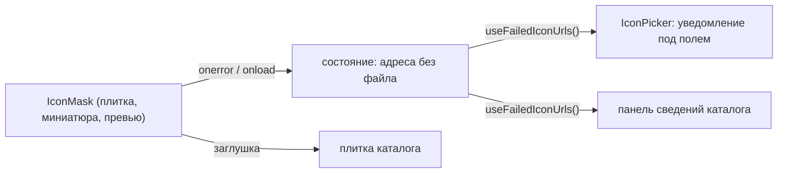

## Контекст

`IconMask` рисует иконку CSS-маской и проверяет файл скрытым `Image`: при ошибке подставляет заглушку. Состояние ошибки живёт внутри компонента и наружу не выходит, поэтому пикер и панель сведений не знают, что файл выбранной иконки недоступен. Общего механизма уведомлений в клиенте нет; инспектор использует встроенные блоки (`role="alert"`, `role="status"`).

## Цели / Вне целей

**Цели:**
- показывать причину рядом с выбранной иконкой, а не только заглушку;
- сбой одного файла не затрагивает остальные плитки и страницу;
- не добавлять запросов: сигнал берётся из проверки, которую `IconMask` уже выполняет.

**Вне целей:**
- общий механизм toast;
- повторная попытка по кнопке и автоматические повторы;
- уведомления в превью Compose;
- изменения бэкенда, CLI и формата значения `icon`.

## Решения

**Общее состояние по адресу файла.** Список адресов, которые не загрузились, хранится в небольшом хранилище на уровне модуля `modules/icons` с подпиской для React (`useSyncExternalStore`). Ключ — полный адрес SVG: он однозначно определяет иконку и размер, и его знают и плитка, и пикер, и панель сведений. Альтернатива — передавать колбэки ошибок через `IconGrid` и `IconPopover`: она связывает три компонента лишними свойствами, а миниатюра поля пикера получила бы сигнал только от собственной плитки.

**Сигнал даёт сам `IconMask`.** При ошибке скрытого `Image` компонент помечает адрес как недоступный, при успешной загрузке снимает пометку; заглушку он тоже показывает по общему состоянию, без отдельного локального. Миниатюра в поле пикера тоже `IconMask`, поэтому уведомление для сохранённого значения не требует отдельной проверки. Альтернатива — отдельный запрос `HEAD` при выборе: это лишний запрос и риск расхождения с тем, что реально показывает маска.

**Уведомление в пикере выводится из состояния, а не из события выбора.** Блок под полем показывается, пока адрес выбранной иконки помечен недоступным. Это покрывает и выбор из окна, и открытие карточки со значением, и исчезает само, когда выбрана другая иконка или файл загрузился. Выбор не блокируется: значение сохраняется через обычное автосохранение, потому что иконка есть в каталоге и бэкенд её примет (`IconValueGuard` проверяет каталог, а не файл).

**Вид уведомления.** Встроенный блок `role="alert"` в стиле инспектора, под полем-пикером, с цветами и отступами из существующих токенов `icons.css`; Поле и блок лежат в общей обёртке `icon-field-wrap`, поэтому строка свойства остаётся двухколонной без `:has`. В панели сведений каталога то же сообщение по смыслу, но без упоминания превью, в виде `role="status"`. Toast не вводится: в клиенте нет такого компонента, а сообщение должно оставаться рядом с полем, пока проблема актуальна.

**Заглушка в каталоге.** Остаётся прежней по виду; получает `role="img"` и название «Не удалось загрузить иконку». Внутри кнопки плитки это название скринридер не читает, поэтому `IconGrid` дополняет имя плитки пометкой «: не удалось загрузить иконку» по тому же набору адресов.



`IconMask` пишет в состояние, пикер и панель сведений только читают; плитка получает заглушку локально, так что сеть и сетка не зависят от подписчиков.

## Программное проектирование

```ts
// modules/icons/application/iconLoadFailures.ts
export const setIconFailed: (url: string, isFailed: boolean) => void;
export const useFailedIconUrls: () => ReadonlySet<string>;
```

`IconMask` вызывает `setIconFailed(url, true)` при `onerror` и `setIconFailed(url, false)` при `onload`, а заглушку показывает по `useFailedIconUrls().has(url)`. `IconGrid`, `IconPicker` и панель сведений читают тот же набор адресов.


## Риски / Компромиссы

- Уведомление не появится, пока скрытый `Image` не завершил загрузку: короткое окно после выбора показывает обычную иконку → ошибка приходит за доли секунды и уведомление появляется по подписке.
- Состояние держится в памяти вкладки и не сохраняется: после перезагрузки адреса проверяются заново, ложных «навсегда недоступных» иконок не остаётся. Пометка снимается при успешной повторной загрузке того же адреса.
- Список растёт только числом реально не загрузившихся файлов (виртуализация сетки ограничивает число проверок) → отдельной очистки не требуется.

## План проверки и развёртывания

Локальные проверки: модульные тесты `modules/icons` и `npm run build`. Внешняя проверка до архива: в локальном контуре заблокировать запрос одного SVG и убедиться на странице каталога и в пикере компонента, что заглушка и уведомление появляются, а остальные иконки рисуются. Наблюдений после выпуска нет.
