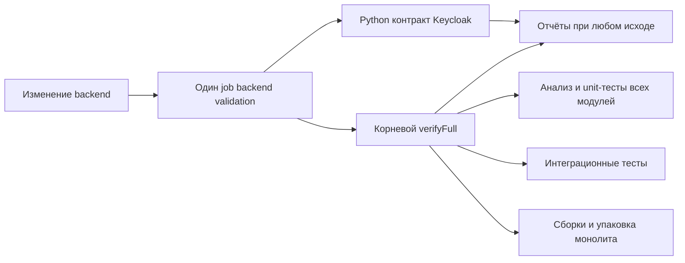

# Адресные редакции значений и единая проверка backend

## Контекст

См. proposal.md и diagnosis.md. Полный отчёт CI не сохраняет текст тайм-аута и XML.
В неизменённом коде merge-коммита `4ce21ee` один запрос чтения технических редакций
занимает около 40 секунд. На снятых данных при отсутствующей статистике EXPLAIN ANALYZE
показал 61,1 с и 741 млн отброшенных пар; после ANALYZE — 11,4 мс.

Исходный CI не сохранил собственный SQL-план. Диагноз воспроизведён на его merge-коммите
и данных того же теста в Linux, а не выдан за восстановленный план исторического runner.
Два отдельных запуска всего выбранного теста в Linux прошли за 48,8/48,9 с;
сам тайм-аут полного теста локально пока не повторился. Воспроизведён SQL, способный
самостоятельно превысить весь минутный бюджет Ktor.

## Границы

Права, контекст чтения, DTO, исторические границы, нулевая редакция при отсутствии
состояния, атомарность отката и все существующие проверки остаются прежними.
Изменение касается чтения редакций и backend validation; frontend/JS, деплои,
публикация образов, migrations и защищённые правила не меняются.

## Решения

### 1. Читать редакции по полному ключу уже выбранных значений

Сначала существующая проекция получает только значения разрешённой ДС/темы/границы,
с учётом определений, удаления и фильтров. Затем отдельное чтение получает редакции
именно этих UUID в той же транзакции и сопоставляет их с готовыми значениями.
Порог 200 определений и широкий JOIN больше не нужны.

Запрос опирается на существующий первичный ключ:

```sql
SELECT entity_id, revision FROM entity_edit_states
WHERE design_system_version_id = ?
  AND entity_type = 'token-value'
  AND entity_id = ANY(?::uuid[])
```

UUID берутся только из результата разрешённого чтения, не напрямую из параметров клиента.
Предыдущие проверки проекта/ДС/темы сохраняются. Принадлежность состояния владельцу
выбранной версии гарантирует существующий составной FK
`(design_system_version_id, design_system_id)`; этот же полный ключ уже используется
существующим `entityEditRevisions` для малого среза. Отдельная фильтрация метаданных по
владельцу не заменяет контроль доступа и здесь не требуется.

Важно выбирать полный ключ: generic prepared plan варианта с дополнительным owner-фильтром
выбирает индекс владельца и фильтрует 100 тысяч строк за ~892 мс. Вариант по первичному
ключу с UUID[] выполнился за ~4,8 мс и дал те же UUID/revision.

UUID передаются массивом порциями до 5 000 значений, массив освобождается после чтения.
Для пустого результата чтение редакций не выполняется. Отсутствующая редакция по-прежнему
равна 0. Общий core-helper и другие его потребители не меняются.
Увеличение тайм-аутов и добавление ANALYZE ради прохождения теста не входят в решение:
они оставили бы зависимость рабочего запроса от состояния статистики.

### 2. Один общий Gradle-граф backend CI

В validate-backend-kt.yml вместо Analysis + шести Tests + шести Build остаётся один job
на том же Ubuntu/JDK 17 с прежними событиями/фильтрами и contents:read.
Он выполняет Python unittest Keycloak bootstrap и существующий корневой
`./gradlew verifyFull --continue --stacktrace` с CI-настройкой журналирования.

verifyFull уже собирает статический анализ, все JVM unit/integration-задачи included builds,
корневые архитектурные проверки и buildAll, включая упаковку монолита. Одинаковые Gradle
задачи в одном графе выполняются один раз. Одного `app build` недостаточно: оно получает
JAR зависимостей, но не выполняет все проверки модулей. Старые самостоятельные launcher
артефакты и конфигурация Gradle-проектов этим Change не удаляются.



--continue сохраняет выполнение независимых Gradle-проверок после ошибки и возвращает
ненулевой код. Gradle-шаг запускается и после неуспеха Python-проверки, если job не отменён;
провал любого шага сохраняет неуспешный статус job. Фильтры категорий тестов, assertions,
ignoreFailures и состав verifyFull не ослабляются.

### 3. Отчётность при неуспехе

Отдельный init script в backend-kt/ci задаёт полный формат исключений Test-задачам,
включая included builds. Он не меняет фильтры тестов, budgets или результат выполнения.
CI всегда сохраняет test-results XML и reports/tests всех backend-модулей артефактом
с ограниченным сроком хранения. При отсутствии отчётов после раннего сбоя загрузка
предупреждает, но исходная ошибка шага не маскируется.

На момент исследования classic required status checks dev не включены, применяемые rulesets
пусты. Настройки GitHub-репозитория не меняются. Дополнительных разрешений job не получает.

## Риски и компромиссы

- Новый порядок получения редакций может потерять границу/ID → сравнительная PostgreSQL-
  регрессия для широкой и адресной выдачи, истории, чужой темы и отсутствующих состояний.
- Вариант SQL может быть быстрым только с custom plan → проверить force_generic_plan,
  холодную статистику и большой набор посторонних метаданных, а не только литеральный EXPLAIN.
- Один job уменьшает межмодульный параллелизм → не обещать сокращение wall-time без замера;
  выигрыш здесь — отсутствие повторных графов, подготовок runner и пробелов покрытия.
- Избыточные отчёты → сохранять только тестовые XML/HTML, без env, кешей и credentials.

## Проверка результата

Узкие проверки: новый SQL на настоящей схеме без ANALYZE, exact UUID/revision и default=0;
исторические/адресные HTTP-контракты; исходный упавший сценарий на точном merge-коде;
сопоставление объединённого графа с прежними CI-задачами и Python-контрактом;
контрольный неуспешный тест для полного исключения и ненулевого результата.

Общие проверки выполняются по workflow в конце, отдельными задачами Change не дублируются.
После публикации CI должен подтвердить результат на новом PR merge-коммите и приложить
отчёты даже при ошибке. Это наблюдение после публикации; новая публикация требует
отдельного явного запроса разработчика.

## Согласованное дополнение: независимые HTTP-сценарии журнала

Два общих FULL подряд превысили минутный лимит одного теста, объединявшего новую
и опубликованную темы со всеми переходами. Отдельный неизменённый сценарий прошёл
на Linux за 48,110 с; локальный узкий прогон обоих journal-тестов тоже прошёл.
Без полного профиля нельзя объявлять единственный SQL причиной этого тайм-аута.

По явному согласованию разработчика проверки новой и опубликованной темы разделяются
на два независимых @Test с общим helper, выбирающим ровно один тип темы. Каждый
сценарий получает отдельную изолированную БД и testApplication с прежним минутным
лимитом. Фикстура по-прежнему создаёт обе ДС для проверок чужой темы. Все изменения,
assertions, сравнения с legacy, публикация/история, откат и права сохраняются.
Сценарий JOURNAL_LIMIT_EXCEEDED и исходный literal batch не меняются.
