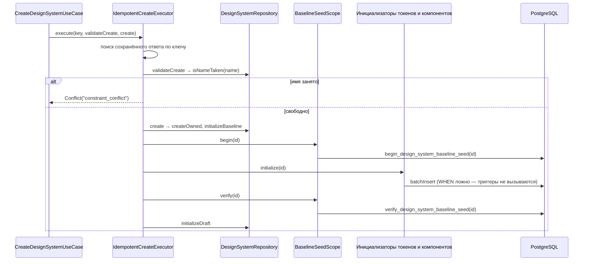

## Контекст

`CreateDesignSystemUseCase` выполняет в одной транзакции:

1. `createOwned` — строка `design_systems`;
2. `initializeBaseline` — базовая граница (`sequence_number = 0`) и редакция `design_system_revisions` с именем;
3. `tokenInitializer.initialize` — 24 группы и 1 335 токенов с редакциями;
4. `componentInitializer.initialize` — 90 компонентов со стилями, вариациями, оформлениями и значениями (≈33 тыс. строк);
5. `initializeDraft` — первый черновик (`sequence_number = 1`).

Пакетная запись уже есть: `ComponentSeedBatchWriter` и `batchInsert` в `GeneratedTokenDefinitionInitializer`. Время уходит не на команды из приложения, а на построчные триггеры на 17,7 тыс. строк `*_revisions`:

| Функция | Назначение | Что делает на базовой границе новой ДС |
|---|---|---|
| `touch_design_system_draft_revision` | запрет записи в опубликованное и базовое, блокировка от публикации | два чтения границы, `FOR UPDATE` строки границы и advisory-lock на каждую строку; запись разрешена, потому что черновика ещё нет |
| `track_subject_edit_revision` | учёт правок для конкурентного редактирования | читает границу и выходит: граница не черновик |
| `compact_subject_draft_revision` | схлопывание повторных редакций черновика | ничего: граница не черновик |
| `bump_design_system_draft_revision` (отложенный) | маркер транзакции черновика и `pg_notify` | выходит: граница не черновик |
| `collect_draft_invalidation_scope` | сбор областей сброса кеша клиента | дописывает настройку `ds.invalidation_scopes`, которую читает только `bump` для черновика |
| `clear_revision_integrity_checks`, `clear_palette_revision_integrity_checks` | кеш «до/после» для итоговых проверок | на каждую строку разбирает и заново сериализует JSON из настройки сессии |
| `enforce_resolved_revision_unique`, `enforce_resolved_state_set_coherence`, `enforce_palette_revision_integrity` (отложенные) | целостность разрешённого состояния | одно событие на строку в очереди COMMIT; для новых строк `revision_integrity_keys_unchanged` возвращает false, полная проверка выполняется один раз на границу и триггер, остальные вызовы отсекаются по памятке |

Производных данных, которые нужны чтениям, эти триггеры на границе 0 не пишут: `entity_edit_states`, `entity_edit_paths`, маркеры черновика и уведомления создаются только для черновика. Для первичного наполнения содержательна только итоговая наборная проверка целостности.

## Цели и не-цели

**Цели:**

- во время первичного наполнения функции построчных триггеров на `*_revisions` не вызываются, а отложенные события не ставятся в очередь;
- те же правила целостности разрешённого состояния, что и сейчас, и те же ошибки, включая `TENANT_NAME_CONFLICT`;
- занятое имя отклоняется до раскладки, а идемпотентный повтор успешного создания по-прежнему получает сохранённый `201`;
- для записей вне окна наполнения поведение триггеров не меняется;
- эффект подтверждается относительным сравнением образов без изменения и с ним из одного коммита на одном стенде и одной копии базы (порядок A–B–B–A). Абсолютные секунды локального стенда зависят от железа и нагрузки и на прод не переносятся, поэтому целью не служат. Расчётный потолок по пробному замеру — около 0,55 от исходного времени (без триггеров 1,27 с плюс ≈0,3 с итоговой проверки при исходных 2,9 с).

**Не-цели:**

- ускорение добавления компонента из шаблона в существующую ДС и импорта конфигураций: они пишут в черновик, и им нужна построчная защита;
- перевод построчных триггеров в наборные для всех записей;
- общий отказ от повторов транзакции при нарушении уникальности;
- оптимизация Kotlin-части раскладки (≈1,2 с после изменения) — разбираем по новым замерам.

## Решения

### 1. Окно наполнения в транзакции

Окно открывает функция `begin_design_system_baseline_seed(design_system_id uuid)`. Она проверяет, что:

- строка `design_systems` вставлена в текущей транзакции: `xmin = pg_current_xact_id()::xid`;
- у ДС есть только базовая граница `0` и нет черновика;
- окно ещё не открыто.

Затем она выполняет `set_config('ds.baseline_seed', id::text, true)`. При нарушении любого условия функция завершается ошибкой `P0001` с понятным сообщением. Это не класс `40`, поэтому повтора транзакции не будет.

Если строку `design_systems` вставили внутри SAVEPOINT, у неё `xmin` подтранзакции, и `begin` откажет. Отказ безопасный: сейчас ds-service не использует savepoint, а `autosave` у pgjdbc выключен.

Настройка локальна для транзакции, поэтому при откате и при встроенном повторе Exposed она сбрасывается сама.

У построчных триггеров на `*_revisions`, кроме таблицы `design_system_revisions`, появляется условие:

```sql
WHEN (COALESCE(current_setting('ds.baseline_seed', true), '') = '')
```

Условие не ссылается на `NEW` и `OLD`, поэтому допустимо для триггеров `INSERT OR DELETE` и `UPDATE`. Триггеры не делятся и не переименовываются, а порядок их срабатывания не меняется. У отложенных триггеров `WHEN` вычисляется в момент события, поэтому событие даже не попадает в очередь COMMIT.

Таблица `design_system_revisions` не затрагивается. В ней одна строка на создание, выигрыша нет, а отложенный `design_systems_name_unique` остаётся защитой от гонки имён.

Цена решения: пока окно открыто, пропуск действует на любые записи редакций в транзакции, а не только на строки этой ДС. Окно целиком принадлежит раскладке, а выход из него закрыт защитой из решения 3.

Рассмотренные альтернативы:

- *Условие по `NEW.design_system_id` и границе `0`.* Пропуск строже ограничен строками новой ДС. Но Postgres запрещает `NEW` в `WHEN` триггера, который срабатывает и на `DELETE`. Пришлось бы делить триггеры и переименовывать их. Шесть имён уже обрезаны до 63 байт, и суффикс давал бы совпадения. Ещё пришлось бы сверять порядок срабатывания. Отклонено как более хрупкое при той же защите.
- *Ранний выход внутри функций.* Остаются 17,7 тыс. вызовов каждого триггера и очередь отложенных событий. Отклонено.
- *`ALTER TABLE … DISABLE TRIGGER`.* Блокировка `ACCESS EXCLUSIVE`, действует для всех транзакций. Отклонено.
- *`session_replication_role = replica`.* Отключает внешние ключи, нужен суперпользователь. Отклонено.
- *Копирование из эталонной ДС через `INSERT … SELECT`.* Триггеры срабатывают так же построчно. Отклонено.
- *Ускорение самих построчных функций.* Выигрывают все записи, но по оценке не больше 0,6 с. Кандидат на отдельную задачу.

### 2. Однократная проверка целостности при закрытии окна

Тела отложенных проверок выносятся в обычные функции:

- `check_resolved_revision_unique(stable_table, revision_table, entity_column, key_fields, owner, boundary, constraint_name)`
- `check_resolved_state_set_coherence(owner, boundary)`
- `check_palette_revision_integrity(owner, boundary)`

Имя ограничения передаётся явно: ошибка уникальности MUST нести прежнее `MESSAGE`/`CONSTRAINT`, равное имени триггера. По имени `tenant_resolved_name_unique` `PostgresTransactionFailureMapper` отдаёт `TENANT_NAME_CONFLICT`. Проверку `revision_integrity_keys_unchanged` и памятку `ds.revision_integrity_checked` (её ключ содержит `TG_NAME`) оставляем в триггерных обёртках: они нужны только при построчной проверке. Логика, `SQLState` и сообщения не меняются.

`verify_design_system_baseline_seed(design_system_id uuid)`:

1. Проверяет, что `ds.baseline_seed` равна переданному id, иначе ошибка `P0001`.
2. Сбрасывает настройку.
3. Обходит `pg_trigger` по таблицам `*_revisions` с фильтром `NOT tgisinternal`:
   - для каждого триггера с функцией `enforce_resolved_revision_unique` разбирает аргументы из `tgargs` и вызывает `check_resolved_revision_unique` на границе `0` с именем триггера;
   - `check_resolved_state_set_coherence` и `check_palette_revision_integrity` вызывает по одному разу на границу;
   - если у триггера неизвестная функция проверки целостности (`enforce_*` вне известного списка, кроме `enforce_resolved_design_system_name_unique` на `design_system_revisions`), бросает исключение, а не пропускает её молча.

Почему не довериться проверке сидов в Kotlin: `validate` проверяет ссылки на токены и шаблоны, но не разрешённую уникальность и согласованность наборов состояний. Итоговая проверка стоит ≈0,3 с и сохраняет инвариант «база не принимает нарушенное состояние».

Ошибки `23505`/`23514`/`23503` из `verify` проходят через встроенный повтор Exposed, как и сейчас на COMMIT. Каждая попытка повторяет раскладку целиком. На корректность это не влияет, а из ресурсов-шаблонов такое нарушение не возникает.

### 3. Защита от незакрытого окна

Если `verify` не вызван, проверки целостности не запустятся: события не были поставлены в очередь. Две дешёвые защиты:

- **Черновик внутри окна запрещён.** `enforce_design_system_version_lifecycle` при `INSERT` границы со статусом `draft` отказывает (`P0001`), если `ds.baseline_seed` не пуста. Use case всегда создаёт черновик, поэтому пропущенный или переставленный `verify` падает сразу.
- **COMMIT с открытым окном запрещён.** Новый отложенный constraint-триггер на `INSERT` в `design_systems` при COMMIT отказывает, если `ds.baseline_seed` не пуста. Он срабатывает один раз на создание ДС.

### 4. Порт окна наполнения в приложении

Порт лежит в `core/application` рядом с `DesignSystemTokenInitializer` и `DesignSystemComponentInitializer`, реализация на Exposed — в `core/data`. Инициализаторы токенов и компонентов не меняются.

Проверка имени передаётся в `validateCreate` у `IdempotentCreateExecutor`. Тот вызывает её после поиска сохранённого ответа, и повтор с тем же `Idempotency-Key` получает сохранённый `201`, а не 409. Так уже устроены `CreateTokenValueUseCase` и другие создания.



### 5. Единое правило занятого имени

Правило `enforce_resolved_design_system_name_unique` (V10) выносится в SQL-функцию `design_system_name_taken(candidate text, except_id uuid)`:

- для каждой другой ДС берётся последняя редакция по `version_sequence_number` по всем границам, включая черновик;
- ДС занимает имя, если эта редакция не удалена;
- сравнение точное, с учётом регистра;
- проверка глобальная, по всем проектам.

Триггер и `DesignSystemRepository.isNameTaken` вызывают одну и ту же функцию, поэтому правило задано в одном месте. Отложенный триггер остаётся защитой от гонки двух одновременных созданий. Вторая транзакция получит `40001` или `23505`, повторится и получит уже ранний 409.

Ранний отказ — обычный `DsFailure.Conflict("constraint_conflict")` без `transactionFailure`. HTTP-тело прежнее, но исход в телеметрии (`outcome` в `http_request`) сменится с `transaction_failure` на `constraint_conflict`.

### 6. Многострочные пакетные вставки

`PostgresDatabasePool.create` выставляет свойство драйвера `reWriteBatchedInserts=true` через `HikariConfig.addDataSourceProperty`, поэтому оно действует во всех окружениях. Пакетные вставки в ds-service идут с `shouldReturnGeneratedValues = false`. Два места используют `ignore = true` (`ON CONFLICT DO NOTHING`): `InitialTenantValueWriter` и `ExposedTenantPaletteRepository`. Перепись работает и с ним, но драйвер вернёт `SUCCESS_NO_INFO` вместо числа вставленных строк.

Большинство SQL-тестов подключаются через `Database.connect(url)` в обход пула, поэтому флаг нужно проверить отдельным тестом на пуле, включая `batchInsert` с `ignore`. Бюджетные тесты числа обращений (`ComponentConfigImportCostIntegrationTest`) должны остаться зелёными: число команд к серверу при перепаковке уменьшается.

## Программное проектирование

```kotlin
// core/application
/** Окно первичного наполнения базовой версии новой дизайн-системы. */
interface BaselineSeedScope {
    /** Открывает окно для ДС, созданной в текущей транзакции; иначе бросает исключение. */
    suspend fun begin(designSystemId: UUID)

    /** Закрывает окно и один раз проверяет целостность базовой версии. */
    suspend fun verify(designSystemId: UUID)
}

// core/data
class ExposedBaselineSeedScope : BaselineSeedScope

// feature-design-systems/application
interface DesignSystemRepository {
    // ...
    /** Занято ли имя другой неудалённой дизайн-системой — по правилу design_system_name_taken. */
    suspend fun isNameTaken(name: String): Boolean
}

class CreateDesignSystemUseCase(
    private val accessPolicy: DsAccessPolicy,
    private val transactions: TransactionRunner,
    private val repository: DesignSystemRepository,
    private val versionBoundaries: VersionBoundaryRepository,
    private val tokenInitializer: DesignSystemTokenInitializer,
    private val componentInitializer: DesignSystemComponentInitializer,
    private val baselineSeed: BaselineSeedScope,
    private val repeatedCreates: IdempotentCreateExecutor,
)
```

DI: `ExposedBaselineSeedScope` регистрируется в модуле `core`, `DesignSystemsModule` передаёт его в use case.

## Безопасность и права доступа

`ds.baseline_seed` — не граница безопасности. Её может выставить любой код с доступом к соединению, но у роли ds-service и так есть прямые права на запись во все таблицы. Защищаемся от ошибки в собственном коде:

- `begin` отказывает для ДС, созданной не в этой транзакции;
- черновик внутри окна и COMMIT с открытым окном запрещены (решение 3);
- после `verify` все записи снова проходят через построчные триггеры, и `touch_design_system_draft_revision` запрещает запись в базовую версию при существующем черновике.

## Риски и компромиссы

- [Пропуск действует на всё окно, а не только на строки новой ДС] → окно содержит только вызовы инициализаторов; черновик и COMMIT внутри окна запрещены; тест проверяет, что запись после `verify` проходит через триггеры.
- [Новая таблица редакций получит триггер без условия `WHEN`] → ничего не сломается, она просто останется медленной. Тест сверяет: у каждого пользовательского триггера на `*_revisions`, кроме `design_system_revisions`, есть условие.
- [Новый триггер целостности не попадёт в итоговую проверку] → `verify` бросает исключение на неизвестную функцию `enforce_*`; тест создания ДС это ловит.
- [Итоговая проверка пропустит правило, которое срабатывало построчно] → SQL-тест: `begin` → ручная вставка дубля и несогласованного набора состояний → `verify` → прежние ошибки.
- [`reWriteBatchedInserts` изменит поведение пакетных записей] → отдельный тест на пуле, включая `ignore`; при проблемах флаг убирается независимо от остального.
- [Ранняя проверка имени разойдётся с триггером] → обе стороны вызывают `design_system_name_taken`.

## Миграция и откат

Одна новая Flyway-миграция в `ds-service`:

- функции `begin_…`, `verify_…`, `check_…`, `design_system_name_taken`;
- новые тела триггерных функций, которые делегируют проверки;
- защита черновика в `enforce_design_system_version_lifecycle` и отложенный триггер на `design_systems`;
- пересоздание триггеров на `*_revisions` с условием `WHEN`.

Блокировки:

- построчные триггеры только на `INSERT` пересоздаются через `CREATE OR REPLACE TRIGGER` (PostgreSQL 14+);
- для constraint-триггеров и триггеров с `DELETE`/`UPDATE` нужен `DROP TRIGGER`. Он берёт `ACCESS EXCLUSIVE` на таблицу до конца транзакции миграции и блокирует даже чтения работающего инстанса во время выкатки. Поэтому миграция ставит `SET LOCAL lock_timeout = '5s'`: при занятой таблице она падает и повторяется при следующем старте, а не висит.

На дев- и прод-стендах работает `postgres:17-alpine`, локально — `postgres:16-alpine`, тесты — PostgreSQL 17; `CREATE OR REPLACE TRIGGER` (14+) доступен везде.

Совместимость:

- миграция обратно совместима со старым кодом: настройка не задана, `WHEN` истинно, и триггеры работают как раньше. Поэтому откат образа backend без отката миграции безопасен;
- новый код без миграции не запустится: `begin_…` не будет найдена. Поэтому код и миграция выезжают одним образом;
- откат миграции — следующая миграция, которая возвращает триггеры без условий.

## План проверки

- SQL- и HTTP-тесты на PostgreSQL (Testcontainers, `JAVA_TOOL_OPTIONS=-Dapi.version=1.44`) по сценариям спецификации.
- Отдельная проверка, что при создании функции построчных триггеров на `*_revisions` не вызываются: `track_functions = 'pl'` и `pg_stat_user_functions` в тестовом контейнере.
- Замер на локальном стенде тем же сценарием (10 созданий подряд, медиана) до и после; результаты — в `performance/RESULTS.md`.
