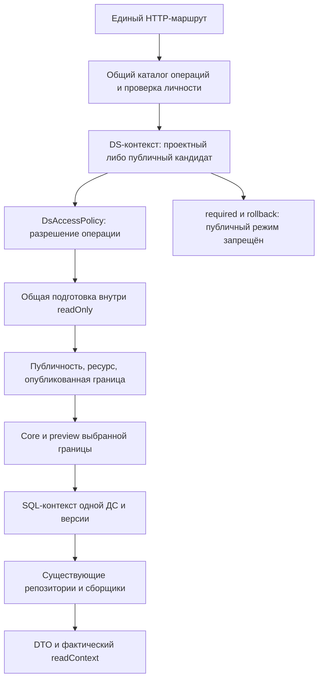

# Проектное решение

## Контекст

Мотивация и состав изменения описаны в `proposal.md`. Работа ведётся в `feature/public-ds`, worktree `.worktrees/feature-public-ds`, от `origin/dev` (`69d54e3c`). Публичным входом является Ktor-монолит `backend-kt/app`; исторические nginx-конфигурации не являются точкой реализации.

Сегодня шлюз требует доступ к проекту до предметного маршрута, `ProjectPrincipal` не представляет гостя, репозитории и транзакционный контекст проверяют проектную принадлежность. CLI/MCP разрешают ссылку без входа, но требуют PAT/OAuth до HTTP. Каталоги используют отдельный `UserSessionAccess`. `status` предварительно читает проект; MCP подставляет `draft`, а CLI-загрузки не проводят выбранную версию через все запросы.

## Цели и границы

Обеспечить одинаковый адресный доступ через веб, CLI и обе точки запуска MCP с серверным решением о правах. Каталоги проектов и ДС, сведения об участниках, документация и её поиск/связи кода, журнал предметных изменений, SSE и любые изменения остаются за пределами публичного доступа. Настоящее изменение не добавляет публичный поиск, секретные ссылки, новые сервисы или отдельное семейство публичных URL. Ограничение трафика относится к инфраструктурному прокси и находится вне этого Change: реализация/настройка лимитера и обязательная проверка его наличия не входят в задачи. Change остаётся единым для сервера, веба, CLI и MCP; реализацию допустимо поставлять несколькими последовательными PR без разделения контракта.

Опубликованная версия закрепляет Core-релизы по платформам и совместимые preview-сборки согласно `version-core-entities-and-preview` (#167). Описания компонентов, свойств, параметров и компонентных состояний берутся из закреплённого Core; глобальные interaction states остаются вне Core по его контракту. Техническая `base` не превращается в публичную пользовательскую ДС.

## Решения

### 1. Доступность хранится отдельно от версионированного содержимого

В устойчивой записи ДС хранится `visibility` со значениями `private` / `public`, ограничением допустимых значений и значением по умолчанию `private`. Новая Flyway-миграция не меняет существующие миграции. Все существующие системы становятся приватными; `projectId = null` сохраняет своё техническое значение.

Доступность действует на все опубликованные версии и не входит в их историческую границу. Иначе возврат старой версии мог бы восстановить ранее отозванную публичность. Публикация, откат черновика и импорт файла не должны непреднамеренно менять доступность; импорт и копирование создают приватную ДС. Перенос сохраняет доступность, но прежняя ссылка с прежним проектом перестаёт работать.

`PATCH /api/projects/{projectId}/design-systems/{designSystemId}` принимает необязательное поле `visibility`; его отсутствие сохраняет значение. Право — существующее `design-systems:write`, включая действующие ограничения изменяемости проекта и технической ДС. Для изменения одной доступности опубликованная версия или существование публикаций не требуются. Ответы карточки и списка расширяются полем `visibility`. PAT с существующим scope `design-systems:write` сохраняет возможность менять доступность по правам владельца. Отдельный аудит, записи в журнал содержимого и новые события изменения доступности не добавляются. Текущая вкладка получает сохранённое значение из ответа PATCH, остальные перечитывают его при следующей загрузке; свежесть интерфейса не заменяет серверную проверку каждого запроса.

### 2. Централизованная граница чтения внутри ds-service

Полная карта текущих операций, цепочек вызовов и исключений находится в [read-operation-map.md](read-operation-map.md). За основу взяты 91 чтение OpenAPI и реальные прикладные вызовы. Цель реализации — менять общую подготовку контекста, транзакционный вход и общие SQL-предикаты; предметные сценарии не вычисляют публичность самостоятельно.

#### Один каталог операций из существующего контракта

В source-of-truth OpenAPI добавляется расширение `x-ds-public-read`: `boundary`, `history`, `version-by-id`. Отсутствие расширения означает запрет публичного доступа к данным ДС. Отдельный явный перечень общедоступных GET preview и иконок сохраняет их независимость от ДС; для него не вводится новый вид `environment`. `OpenApiDocumentResource` уже загружает описание операций; он формирует один неизменяемый каталог при старте. Прикладной порт каталога не зависит от Ktor или YAML. Шлюз и вход `ds-service` получают одну реализацию через DI. Манифест и зарегистрированные маршруты проверяются против этого источника, а не содержат ещё один независимый список публичных URL.

Описатель определяет операцию, необходимое разрешение, вид чтения и извлечение целевого ресурса. Общий вход чтения до обработчиков один раз разбирает version/versionId, повторения, конфликт селекторов с учётом специальной совместимости проектного GET component-config и ID версии пути, сохраняя различие отсутствия выбора и draft. Он передаёт нормализованные метаданные через единый DS-источник контекста и mapper; это касается и старых обработчиков без modelReadContext. Для сохранения существующих сигнатур допускается внутренний адаптер метаданных, но внешние одноимённые заголовки удаляются и не являются источником разрешений. modelReadContext переиспользует результат, не разбирая выбор заново. Шлюз проверяет метод и канонический шаблон пути; неизвестный метод, несовпавшая форма или недопустимый вид отвергаются. ID конкретной ДС извлекается только из `pathParameters`, не из объединённого `call.parameters`. Одноимённый query-параметр не меняет выбранную систему и не открывает закрытый catalog; публичный контекст ДС из query не создаётся. Шлюз не читает БД ДС и не выбирает версию.

`POST .../component-config/export` и `POST .../component-config/web-adapter` описываются как чтение границы. Импорт, включая `dryRun`, публикация, журнал, SSE, проектные каталоги, документация и административные маршруты остаются закрытыми. Имя `policy.read` или факт вызова `readOnly` не доказывают публичную доступность: существующие помощники используются и в сценариях записи/предварительной проверки.

#### Проектная RBAC остаётся прежней

`ProjectPrincipal`, `TrustedProjectPrincipalFactory`, `ProjectActorType`, роли, scopes и `PolicyEvaluator` в `authorization-core` не расширяются гостями. Новый контекст доступа принадлежит `ds-service/core`: настоящая проектная авторизация либо кандидат на публичное чтение конкретной ДС с необязательной проверенной пользовательской идентичностью. Он не создаёт фиктивный principal, роль viewer или PAT.

`DsRequestContext` сохраняет проектные конструкторы и безопасные существующие проекции через адаптер своего контекста: `projectId` берётся из проверенной проектной авторизации либо из проверяемого адреса кандидата, `globalAdmin` и `composePreviewPublisher` у публичного режима всегда ложны. Доступ к `actorId` для мутаций требует настоящего проектного principal. Совместимый DS-адаптер позволяет сохранить чтения `context.principal.globalAdmin` без подстановки фиктивного `ProjectPrincipal`; тип этого представления принадлежит только `ds-service`. Общий `PolicyEvaluator` получает исходный `ProjectPrincipal` только из проектной ветки.

`DsAccessPolicy` для проектной ветки сохраняет существующее делегирование. Для публичного кандидата он проверяет описатель операции и конкретное запрошенное разрешение чтения, но лишь допускает начало разрешения ресурса; ни одно разрешение записи не выдаётся. Сходство permission у карточки, журнала и SSE не открывает последние: обязательна допустимая операция, а не только строка `design-systems:read`.

При отсутствии `Authorization` только адресная операция из каталога получает кандидатный контекст. Неверный PAT/JWT возвращает `401`; недоступная проверка — `503`. Действующий пользователь вне проекта может читать публичную ДС после достоверного отсутствия членства, но недостаточные разрешения участника или выбранного PAT не превращаются в гостевые права.

Для шлюза добавляется узкий прикладной сценарий, использующий JwtVerifier, PersonalAccessTokenVerifier и `ProjectContextResolver`. Уже имеющихся `ProjectContextResolution.Allowed/Denied/Unavailable` достаточно для членства; `projects-service` не получает модель публичности. Порт `JwtVerificationResult` внутри `identity-gateway` расширяется состоянием недоступности: сейчас у него только Valid/Invalid, а адаптер Keycloak сводит JwkException к неверному токену. Недоступный JWKS при отсутствии необходимого проверенного ключа в кеше должен давать `503`; неверная подпись, истёкший токен или неизвестный ключ при успешно полученном JWKS — `401`. При уже доступном проверенном кеше валидная проверка сохраняется. Адаптер учитывает также вложенную причину отказа получения ключа, а не только внешнюю оболочку JWTVerificationException; недоступность не считается отсутствием членства и не даёт гостевой переход. Нельзя переиспользовать любой `GatewayAuthDecision.Forbidden` как отсутствие членства: текущая ветка OAuth преобразует в него также недоступность проверки. Эта неоднозначность устраняется внутри сценария шлюза без изменения общей RBAC.

#### Одно разрешение в каждой транзакции чтения

Оба контекстных варианта `ExposedTransactionRunner.readOnly` используют общий механизм подготовки чтения до блока с данными. В одной транзакции он проверяет текущую доступность, точный проект и ДС, вид операции, принадлежность адресного ресурса и выбирает границу. Результат — неизменяемый подготовленный контекст и безопасные метаданные. Только после этого устанавливаются `ds.design_system_id`, `ds.project_id`, `ds.version_id` и режим чтения; `ds.system_admin` остаётся ложным для публичного режима.

Для простого `readOnly(context)` целевая ДС уже известна из контекста операции. Для перегрузки с `ModelReadTarget` дополнительно проверяется соответствие ресурса пути; вызов существующего resolver не должен второй раз выбирать последнюю публикацию. Для истории публикаций выбранной единственной версии нет; для `/versions/{id}` границу задаёт ID пути, а противоречащий query-селектор даёт `400`.

Простой вариант добавляет фактический `readContext` в `DsResult`, как сейчас делает только вариант с `ModelReadTarget`. Подготовленный контекст передаётся в блок там, где логика использует `context.versionId`: для размеров/типографики достаточно небольшого перехода на перегрузку с выбранным контекстом. Три общих помощника `ComponentModelUseCaseSupport` адаптируются вместе; их многочисленные потребители сохраняют предметную логику. Делегирующий `ListTenantPaletteLinksUseCase` сохраняет метаданные результата палитры вместо создания успеха без `readContext`.

Большинство репозиториев уже учитывают `ds.version_id` через `SelectedVersionBoundary`, `ResolvedRevisionTable` и связанные выборки. Они не получают собственных проверок публичности. Однако контекст не заменяет предметную проверку связи ресурса и не фильтрует глобальную таблицу автоматически: общие `ComponentOwnership` и адаптеры связанных определений должны ограничить читаемые ID выбранной ДС/границей, до пагинации. Политику записывающих SQL-предикатов не меняем.

`required(context)` и `rollback(context)` безусловно отклоняют публичного кандидата до блока, даже при ошибочно переданном описателе. Операции с данными публичной ДС не используют неконтекстные транзакционные перегрузки; независимые GET preview/иконок не входят в эту ветку и сохраняют собственное чтение общих ресурсов. Все настройки транзакции явно очищаются/устанавливаются при каждом входе и повторе. Не применяется обёртка вокруг целого HTTP-запроса с открытой JDBC-транзакцией; транзакция остаётся ответственностью прикладного сценария.



Каталог разрешает только попытку чтения; окончательное разрешение и выбор данных находятся внутри транзакции `ds-service`. Альтернативы с одной проверкой шлюза, общей гостевой ролью или массовым добавлением условий в предметные сценарии отклонены из-за расширения границы доверия и дублирования правил.

### 3. Разрешение версии и ошибки

| Режим запроса | Селектор отсутствует | Явная публикация | Явный `draft` |
|---|---|---|---|
| Участник с действующим правом чтения черновика | Черновик | Указанная публикация | Черновик |
| Публичное чтение гостя или пользователя вне проекта | Последняя опубликованная | Указанная публикация | `403` |

Последняя публикация выбирается по максимальному `sequence_number` среди поддерживаемых опубликованных границ данной ДС, а не строковым сравнением версий. `versionId` продолжает работать для доступной опубликованной границы. Совместные или повторные селекторы возвращают `400`, кроме сохраняемого устаревшего параметра проектного GET component-config, описанного ниже. Сначала проверяются существование ДС, принадлежность проекту и доступность: приватная/удалённая ДС или неверный проект дают `404` независимо от запроса draft. Только для уже доступной публичной ДС явный draft даёт `403`. Чужой вложенный ресурс, неизвестная версия или отсутствие публикаций возвращают `404` для публичного чтения без признаков существования ресурса. Каталоги и проектные операции без входа возвращают `401`; изменение публичной ДС гостем также требует входа. Участники с недостаточными правами не получают автоматического расширения проектных полномочий.

Отсутствие селектора сохраняется в модели запроса как отдельное состояние до серверного разрешения; клиент не превращает его в `draft`. `X-DS-Read-Context` содержит фактические `designSystemId`, `version`, `versionId` и безопасный `accessMode` (`project` / `public`). Публичный ответ не содержит актуальные `draftId`, `draftRevision` или журнал черновика. В существующих DTO nullable-поля черновика равны `null`; содержимое обзора, счётчики и preview строятся из выбранной публикации, включая случай удалённой позже темы. Поле `visibility` отражает текущую настройку доступа.

Многошаговый клиент получает фактическую границу из `X-DS-Read-Context` первого разрешённого предметного ответа. Предварительная карточка не обязательна: `components fetch` начинает с экспорта и не требует `design-systems:read` сверх прежнего `components:read`; `theme fetch` может начать со списка тем, веб — с карточки. Разрешение версии выполняется в транзакции этой операции, не отдельным запросом с новыми правами. Полученный опубликованный `versionId` закрепляется во всех следующих зависимых чтениях, включая web-адаптер и обе части `ds fetch`. Список версий остаётся историей нескольких публикаций. Каждый последующий публичный запрос заново проверяет текущую доступность.

Для проектного черновика ответ содержит `version=draft`, `draftId` и `draftRevision`, но не `versionId`. Клиент продолжает через `version=draft`, не использует `draftId` как исторический селектор и не обещает неизменный снимок между запросами. При конкурентной публикации следующий запрос читает уже новый активный черновик с фактическими метаданными. Ни прежний `draftId`, ни номер только что появившейся публикации не подставляются автоматически. Независимые чтения не требуют `expectedDraftRevision` и не вводят новый серверный отказ `DRAFT_CHANGED`. Для гарантии неизменной границы пользователь явно выбирает публикацию.

#### Совместимость GET component-config

Этот маршрут — явное исключение общего разбора селекторов. Для проектного доступа прежний query `version` сохраняется как устаревшая подсказка, которая не выбирает историческую границу. Без `versionId` он читает черновик, а с `versionId` — указанную публикацию; сочетание устаревшего `version` и `versionId` остаётся допустимым. Устаревшее поле становится необязательным: одного `versionId` либо отсутствия обоих селекторов достаточно. Остальные параметры `ds/component/appearance/platform` сохраняются, принадлежность проверяется относительно ДС пути.

Для публичного доступа `version` является обычным точным селектором публикации; отсутствие обоих селекторов выбирает последнюю публикацию, `draft` запрещён, совместное указание `version/versionId` даёт `400`. Различие ограничено совместимостью этого прежнего маршрута и зафиксировано в OpenAPI; оно не переносится на остальные чтения. Новые клиенты, включая участников, продолжают опубликованное чтение через один `versionId`. Общий парсер выбирает правила по проверенному режиму доступа и описателю операции, а обработчик перестаёт безусловно требовать `version`; предметный builder не вычисляет публичность.

### 4. Общие каталоги закрыты, данные доступны внутри выбранной ДС

Каталоги компонентов, свойств, параметров, зависимостей, состояний, наборов состояний, шаблонов и общей палитры сохраняют проектную авторизацию. Для них не добавляется query `designSystemId` и не реализуется публичное чтение через фильтр каталога. Шаблоны добавления компонентов гостевому просмотру не нужны и остаются закрытыми целиком, включая `dependsOn`.

Необходимые определения выдаются только внутри выбранной ДС после общей проверки её доступности и границы. Существующие `/{designSystemId}/components/{componentId}/properties`, `/deps` и `/editor-bundle` уже дают свойства, параметры и связанные компоненты. DTO системного списка `/components` совместимо дополняется полем `platform`, чтобы навигация веба не загружала общий каталог. Следующие адреса одинаковы для проектного и публичного режима. Деталь компонента, component-deps и states переиспользуются из #167; state-sets и palette добавляются при отсутствии эквивалентного системного чтения на базе реализации:

| Остаток после `/api/projects/{projectId}/design-systems/{designSystemId}` | Ответ и ограничение |
|---|---|
| `/components/{componentId}` | Существующий `ComponentResponse`; компонент должен быть подключён/использован в выбранной границе |
| `/component-deps` | Существующий массив зависимостей; только связи между компонентами выбранной границы |
| `/states` | Существующая форма массива состояний; только используемые конфигурациями выбранной границы |
| `/state-sets` | Существующая форма массива наборов состояний; только используемые наборы и доступные состояния внутри них |
| `/palette` | Существующая форма `PaletteItem[]`; только определения, необходимые выбранным токенам/темам и их вычислению |

Все пять маршрутов используют существующие разрешения соответствующего чтения и общий вид `boundary`, принимают обычные селекторы и возвращают `X-DS-Read-Context`. Системный `/component-deps` отличается от закрытого `/catalog/component-deps`; маршруты не перенаправляются друг в друга при отказе. Прикладные порты/адаптеры переиспользуют существующие SQL-проекции, но ограничивают ID выбранной ДС и её границей до пагинации. Обновление общих `ComponentOwnership` необходимо только для системных чтений; проектные глобальные и записывающие предикаты сохраняют контракт. Описания читаются из Core выбранной границы; импорт нового Core не меняет старую публикацию. Системные properties и property-platform-params из #167 также переиспользуются.

MCP `component_get` переходит на адрес детали компонента конкретной ДС. CLI `theme fetch` получает необходимую палитру через `/{designSystemId}/palette`. Веб получает список компонентов с платформой, системные зависимости и состояния; свойства/параметры — через системные детали или пакет компонента. Ни одна публичная ветка не загружает закрытый каталог и не повторяет отказ через другой маршрут.

#### Явные исключения: preview и иконки

GET `/catalog/web-preview/plugin`, `/catalog/compose-preview/plugin` и `/catalog/icons` доступны без входа на существующих URL и не требуют `designSystemId` либо опубликованной версии. `projectId` в унаследованном URL не предоставляет доступ к проекту; ответ содержит только общие ресурсы окружения. Каталог иконок уже добавлен в `origin/dev` после исходной базы карты и явно включён в приложение к ней. В этих трёх GET снимается обязательная проектная проверка на входе и в соответствующем сценарии чтения; фиктивный проектный principal или публичная ДС для вызова не создаются. Публикация/замена плагинов и загрузка/изменение иконок остаются защищёнными.

Это исключения доступности существующих маршрутов, а не новый публичный каталог ДС и не новый тип операции `environment`. Шлюз и предметный вход используют один явный перечень исключений; он отделён от транзакционной политики содержимого ДС. Существующее кеширование сохраняется, включая ETag/If-None-Match/304 каталога иконок. Заголовок `no-store` для данных публичной ДС на эти ответы не навешивается. Для просмотра ДС веб использует системное разрешение preview из #167 по ДС, версии и платформе. Этот GET включается в boundary с проверкой публичности. Общие preview GET остаются самостоятельными ресурсами окружения и не служат fallback для опубликованной ДС. Иконки сохраняют общий контракт.

### 5. Общий режим чтения клиентов

Общий механизм получает явное требование операции: `AUTHENTICATED` либо `READ_OPTIONAL`. В режиме `READ_OPTIONAL` и политике `auto` сохраняется порядок PAT → OAuth → анонимный запрос, если источники учётных данных отсутствуют. Принудительные `pat-env`, `user-session`, служебная авторизация, ошибки обновления найденной сессии и отклонённый сервером токен не превращаются в анонимность. Режим записи по умолчанию требует авторизацию.

Анонимный транспорт не отправляет `Authorization`, не обновляет токены, не открывает браузер и не создаёт сессию. Он не выбирает другой URL. Общие контракты используются CLI, JVM/native MCP и Node MCP; остальные потребители сохраняют прежний режим по умолчанию. Новое состояние учитывается в исчерпывающих ветках типов и диагностике `credentialType` без утечки секретов.

`status` проверяет карточку выбранной ДС, не требуя `GET /api/projects/{id}`. Имя проекта берётся из безопасного ответа карточки и не используется для навигации к закрытому проекту. Публичный успех явно означает доступ к опубликованной ДС, а не авторизацию в проекте.

### 6. Ссылки, init и MCP

`dsbuilder://projects/{projectId}/design-systems/{designSystemId}` допускает отсутствие `version` и `platform`; поддерживаются прежние ссылки с параметрами. Платформа не угадывается, API URL остаётся независимым, секреты и неизвестные параметры запрещены. Без версии ссылка означает серверное разрешение при каждом новом открытии, а не навсегда закреплённую публикацию.

`init --design-system <uri>` и явные два ID создают конфигурацию локально, без проверки публичности и без сетевых запросов. Конфликт ссылки с ID отклоняется. Для ссылки с явной версией конфигурация сохраняет необязательное корневое поле `version`; без версии оно отсутствует. Старые конфигурации без поля сохраняют прежнюю совместимость. Указанная в ссылке платформа сохраняется, явный конфликт `--platform` отклоняется. `credential.type=auto` и имя окружения сохраняются без секретов и API URL.

При анонимном `404` CLI и MCP сохраняют код NOT_FOUND и добавляют нейтральную подсказку: «Проверьте ссылку. Если для доступа требуется авторизация, выполните dsbuilder auth login». Для Node MCP указывается его собственная команда dsbuilder-mcp auth login. Подсказка не подтверждает существование приватной ДС и не запускает вход автоматически.

Без полного контекста гость получает сообщение с допустимыми явными параметрами и возможностью выполнить `auth login`; меню и запросы каталогов не запускаются. При наличии выбранной авторизации интерактивный сценарий сохраняется. Получение токена для этого сценария не означает разрешения каталогов: их проверяет сервер.

MCP стартует без входа и workspace, но инструмент чтения требует ссылку либо локальный конфиг. `design_system_versions_list` также принимает явную пару ID, как сейчас. Инструменты `projects_list` и `design_systems_list` остаются авторизованными. Описания показывают две цепочки: прямой адрес для гостя и каталоги для авторизованного пользователя. Выбор не хранится между вызовами. Результат сообщает фактическую версию, которую агент может передать дальше канонической ссылкой.

### 7. Веб-просмотр и управление доступностью

Текущие маршруты ДС и тем становятся доступными для адресного чтения; страницы проектов, списков и настроек сохраняют защиту. Гостевой просмотр не загружает проект, список систем, журнал или SSE и не запускает автосохранение. Все команды изменения и ссылки на закрытые настройки скрыты. Авторизованный пользователь вне проекта видит тот же режим чтения. Участник проекта сохраняет действующий редактор. На экране анонимного `404` показывается «Войти» без утверждения, существует ли приватная ДС; после успешного входа восстанавливается безопасный локальный исходный адрес, включая выбранную версию. Произвольный внешний return URL не принимается.

В разделе основных настроек сразу под именем размещается поле «Доступность» с вариантами «Приватная» / «Публичная». Используется существующая форма сохранения; клиент отправляет имя и доступность через PATCH, показывает ошибку и не выдаёт неудачное сохранение за успешное. Настройка доступна по существующему `design-systems:write` и ограничениям проекта.

Пояснение: «Опубликованные версии доступны без входа по прямой ссылке. Черновик доступен только участникам проекта с соответствующими правами». Для публичной ДС действие «Скопировать ссылку» копирует веб-URL без версии. Отдельное копирование ссылки для CLI/MCP выдаёт `dsbuilder://…` без версии, не заменяя существующее копирование точной версии. Публичность можно включить до первой публикации; UI объясняет, что до публикации ссылка вернёт отсутствие опубликованных данных.

### 8. Отзыв и кеширование

Публичность проверяется при каждом новом предметном запросе в транзакции чтения. Изменение доступности не меняет историю публикаций. Ответы с данными публичной ДС, включая экспорт и системные вспомогательные чтения, используют `Cache-Control: no-store`; промежуточные кеши не хранят решение о доступе. Клиентские кеши разделяются по API URL, системе, версии, Core/channel и режиму/сессии; кеш preview дополнительно учитывает buildId; смена сессии сбрасывает соответствующие записи; успешный PATCH доступности обновляет/инвалидирует их в текущей вкладке, в других вкладках новое значение получается при следующей загрузке без нового события. Переиспользование старого ответа не должно выдавать новые данные после отзыва. При входе в публичную или явно выбранную опубликованную версию корневое чтение заново разрешает границу, даже если карточка уже была в клиентском кеше; переход A → B → A не должен оставлять активной границу B. Существующий кеш черновика участника и общих preview/иконок сохраняется.

Уже начатое чтение может закончиться по своему транзакционному снимку. Уже загруженные или экспортированные файлы отозвать невозможно; гарантия относится к новым серверным запросам после фиксации приватности.

## Программное проектирование

Имена новых типов ориентировочные; контракты показывают границы ответственности. Серверные типы принадлежат `ds-service/core`, не `authorization-core`.

```kotlin
enum class DsPublicReadKind { BOUNDARY, HISTORY, VERSION_BY_ID }

sealed interface DsAccessContext
class ProjectAccess(val principal: ProjectPrincipal) : DsAccessContext
class PublicReadCandidate(
    val projectId: ProjectId,
    val designSystemId: UUID,
    val verifiedUserId: String?,
) : DsAccessContext

// application: неизменяемый описатель из общего каталога; транспортные пути остаются в presentation.
interface DsReadOperationCatalog {
    fun find(operationId: String): DsReadOperation?
}

// application: порт вызывается внутри уже начатой транзакции чтения.
interface DsReadScopeResolver {
    suspend fun resolve(
        context: DsRequestContext,
        target: ModelReadTarget?,
    ): DsResult<PreparedDsRead>
}

// core-application клиента: явный режим операции, без изменения HTTP-маршрута.
enum class CredentialRequirement { AUTHENTICATED, READ_OPTIONAL }
```

`PreparedDsRead` содержит неизменяемый выбранный `DsRequestContext`, вид операции и метаданные `ModelReadContext`; история не получает фиктивную единственную версию. Создание разрешённого контекста не является публичным конструктором произвольных полномочий: прикладной resolver проверяет его при каждом использовании. Объекты SQL-транзакции и Ktor не выходят в `application`.

Серверные `domain`-типы описывают доступность и виды доступа; `application` владеет политикой и портом подготовки, `data` реализует транзакционное разрешение и SQL-границы. `presentation` сопоставляет проверенный метод/путь описателю, разбирает селекторы и формирует DTO/заголовки. `runtime` загружает OpenAPI, `di` передаёт один каталог в `app` и предметный вход. `feature-design-systems` меняет хранение и управление доступностью; `feature-components/data` уточняет общие предикаты определения используемых сущностей. Остальные изменения предметных фич ограничены исключениями карты и тестами.

Клиентские `core-*` владеют общим разрешением доступа и версии; `feature-*` запрашивают нужный режим, не завися друг от друга. `cli` и `mcp-node` остаются представлением и точками сборки зависимостей. `ds fetch` передаёт обеим загрузкам один опубликованный `versionId` либо явный режим живого `draft`; дополнительного обязательного запроса карточки нет.

## Риски и компромиссы

- Ошибка в перечне чтений может открыть запись через POST → один каталог из OpenAPI с отказом по умолчанию, проверка полного покрытия карты и адресных дополнений и отрицательные тесты импорта, публикации и отката.
- Проверки только в HTTP оставят обход через репозиторий → транзакционная проверка системной принадлежности и версии, включая пакетные/пустые ответы и повтор соединения.
- Перемешивание публикаций и черновика → одна фактическая версия на многошаговое чтение, проверки конкурентной публикации и удаления темы в черновике.
- Несогласованные Core и preview → используем контекст #167 и закреплённую сборку без fallback на другой Core. Исторические технические снимки сохраняют ограничения provenance и доступности preview из #167.
- Старые клиенты явно запрашивают черновик → гостевое чтение требует обновлённых клиентов; сервер не подменяет явный `draft` публикацией.
- Сохранённая, но истёкшая сессия не становится гостевой автоматически → понятная ошибка и явный `auth logout`/повторный вход, без скрытой смены режима.

## Миграция и совместимость

База реализации — интегрированный `version-core-entities-and-preview` (#167); публичность не дублирует его миграции и resolver. Сначала совместимая миграция доступности и серверные контракты, затем клиенты. Старые запросы участников сохраняют черновик по умолчанию, прежние пути и формы тел; новые поля добавляются совместимо. В опубликованных ответах источником данных является граница публикации, а не актуальный черновик. Новые сервисы и настройки развёртывания не нужны. Откат выполняется предыдущей версией приложения без удаления колонки; старый сервер закрывает гостевые запросы. Возврат миграции удалением данных не требуется.

## План проверки и развёртывания

Локально: проверка покрытия исходной 91 операции карты, GET иконок из dev, системных чтений и preview из #167 и недостающих дополнений, единого каталога и запрета неописанных операций; тесты политики, сценариев, преобразователей DTO, репозиториев с реальным PostgreSQL, Ktor-маршрутов и публичного входа; тесты общего разрешения учётных данных/версии, CLI и обоих MCP; компонентные и браузерные проверки веба. Проверяется матрица private/public × гость/участник/пользователь вне проекта/PAT × отсутствующая/точная/draft-версия. Обязательны исключения preview/иконок с сохранением ETag/304, закрытость всех прочих catalog даже с query designSystemId, приватная ДС+draft→404 и публичная ДС+draft→403, предложение входа/подсказки при анонимном 404; неверный токен, недоступная проверка личности, подмена заголовков, чужой ресурс, отзыв, конкурентная публикация и отсутствие публикаций. FAST, независимое review и FULL выполняются по репозиторному workflow; архитектурные тесты, политика Strictacode и файлы процесса не изменяются.

До архивирования проводится внешняя проверка на реально поднятом контуре из этого worktree: подготовить два проекта, участника и пользователя вне проекта, публичную и приватную ДС с двумя публикациями и отличающимся черновиком. Проверить через публичный порт веб в чистом профиле, собранный CLI и оба MCP по stdio. Сохранить команды запуска, HTTP-коды, фактические версии, результаты инструментов и снимки UI без токенов. Отдельно подтвердить components fetch с PAT только на components:read и чтение draft участником при конкурентной публикации. После отключения публичности новый запрос с ранее полученным versionId должен вернуть `404`, участник продолжает работать. Отсутствие БД, браузера или учётных данных не считается успешной проверкой.

После развёртывания: убедиться, что миграция оставила прежние ДС приватными и статический сервер корректно отдаёт прямые вложенные ссылки; наблюдать частоту отказов публичного чтения без записи токенов и содержимого ДС в журнал. Эти наблюдения не заменяют проверки до архивирования.

### Согласование с контрактами Core

Зависимость: [PR #167](https://github.com/salute-developers/design-system-builder/pull/167), Change `version-core-entities-and-preview`, ревизия `fb252ed0`. Его файлы здесь не изменяются. Упоминание адресных catalog-чтений в зависимом Change не открывает их публично: публичный клиент использует системные пути.

Общий resolver сначала проверяет доступ и принадлежность версии ДС/проекту, затем разрешает Core механизмом #167. Оба readOnly-входа сохраняют `ModelReadContext.coreReleases`; он и `X-DS-Read-Context` описывают одну границу. Обязательного входного coreReleaseId и предварительной карточки нет. Черновик сохраняет выбранный по платформам режим Core (pinned/latest) из #167; публикация фиксирует разрешённый Core в своей границе. Выбор Core, ремонт и compatibility-диагностика не включаются в публичный перечень автоматически. Текущий coreSelectionRevision черновика публично не раскрывается.

Опциональный Core fingerprint сохраняет `409 CORE_CONTEXT_STALE` после проверки доступа. `CORE_COMPATIBILITY_CONFLICT` при экспорте остаётся ошибкой без частичного успеха или скрытого использования кеша; сохранённые настройки остаются читаемыми по контракту #167.

Системный preview возвращает закреплённый buildId или отсутствие совместимой сборки, без подмены другим Core. Пустой слот публикации может однократно заполниться первой совместимой сборкой по #167. Клиентские кеши метаданных учитывают Core по платформам и channel; preview и iframe дополнительно учитывают buildId. Смена контекста сбрасывает iframe и игнорирует запоздалые ответы. Публичный системный preview-дескриптор подчиняется no-store для данных ДС; кеширование общих дескрипторов, иконок и файлов сборок сохраняется.

CLI/MCP сохраняют Core-координаты и channel в метаданных снимка по #167. Локальная генерация из скачанных файлов остаётся автономной без повторной проверки публичности или авторизации.
