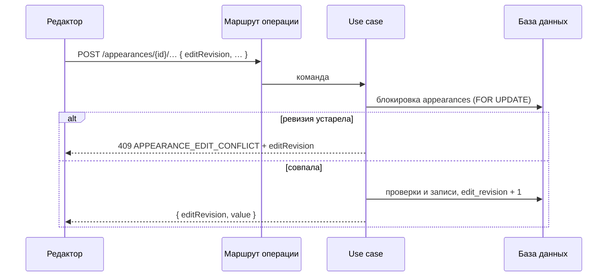

## Context

Редактор оформления компонентов, прототип которого описан в SDDS Portal, ведёт схему в браузере: оси с редактируемым именем, значения осей, ноды (значение свойства для стиля или сочетания) и наборы состояний у значения, например `hovered+pressed`, с порядком. Серверная модель `ds-service` (`appearances`, `appearance_variations`, `appearance_variation_values`, `variation_property_values`, `invariant_property_values`, `style_combinations`, `state_sets`, `component_style_references`) эти понятия покрывает, но:

- ось (`variations`) и стиль (`styles`) называются своими `name`, общими для всех оформлений компонента; `PATCH /variations/{id}` переименовывает их везде;
- записи идут отдельными запросами без общей транзакции и без контроля конкурентных правок, а `import` заменяет оформление целиком и сопоставляет оси по имени, так что переименование превращается в новую ось;
- `component_style_references` пишется только импортом и только для значений без состояний; CRUD, проверок цикла и глубины нет;
- создание состояний доступно лишь системному администратору.

Для токенов и палитры уже принят образец: сервер — источник истины, правка — отдельная операция с `editRevision`, конфликт — `409 TENANT_EDIT_CONFLICT`, локально хранятся только неотправленные правки. Этот change переносит образец на оформление компонента.

## Goals / Non-Goals

**Goals:**
- операции редактора над осями, значениями осей, значениями свойств с наборами состояний и ссылками на стили вложенных компонентов;
- переименование оси и значения, не затрагивающее другие оформления и публичные идентификаторы генерации;
- единый механизм ревизии и конфликтов, как у токенов и палитры.

**Non-Goals:**
- условия `instanceTarget` (булевы и строковые пропсы экземпляра): в контракте не резервируются, добавятся отдельным change;
- копирование оформления («Configuration copy» прототипа): операция `duplicate` не входит;
- создание, переименование и удаление состояний (остаются за системным администратором, словарь приходит из импорта меты);
- серверное хранение черновика и изменения клиента `js/apps/client`;
- изменение генераторов, использующих `authoredId`.

## Decisions

### 1. Операции над оформлением, а не документ целиком

Редактор вызывает адресные операции; ревизия, блокировка и транзакция — на оформлении. Модель читается одним запросом.



Альтернативы: `PUT` всего документа оформления (большая нагрузка и крупные конфликты, редактору нужно вычислять разницу) и прежний гранулярный CRUD (нет атомарности составных правок: «ось и значения», «значение, набор состояний и ссылка»). Выбрано по образцу токенов: мелкие операции и одна ревизия на оформление.

### 2. Действующее имя оси и значения — поле оформления

Новые колонки `appearance_variations.display_name` и `appearance_variation_values.display_name` (допускают `NULL`). Действующее имя — `coalesce(display_name, variations.name | styles.name)`. Переименование пишет только эти колонки. `variations.name`, `styles.name` и `authored_id` не меняются: они определяют имена стилей генерируемой библиотеки.

Новая ось или значение получает технический `variations.name` / `styles.name` (уникальный в компоненте или оси, например `axis-<8 hex>`) и заданное `display_name`. Так переименование не требует глобальной уникальности имён, а клонирование оси в другом оформлении остаётся ссылкой на ту же запись `variations`.

Альтернатива: менять `variations.name` и каскадировать. Отвергнута: затрагивает все дизайн-системы и ломает публичное API.

Следствие: все читатели конфигурации (`ComponentConfigBuilder`, экспорт, превью, `legacy/.../component-configs` в `db-service`) используют действующие имена. Импорт сопоставляет оси по действующему имени оформления и при замене записывает имена конфигурации в `display_name` только когда они отличаются от технических.

### 3. Область значения и набор состояний

Область операции записи значения — список `styleIds`: пустой — инвариантное значение, один — `variation_property_values`, несколько — `style_combinations` с каноническим ключом. Набор состояний — упорядоченный список имён; разрешение через существующий `StateRepository.resolve`. Неизвестное имя, а также состояние другого компонента — `422 unknown_state`. Позиция строки задаёт порядок «первое совпадение выигрывает».

Добавление состояния в редакторе создаёт строку, равную значению базы области (как в прототипе), поэтому отдельного объявления «свойство поддерживает состояния» не нужно, таблица состояний свойств не добавляется.

### 4. Ссылки на стиль вложенного компонента

Операция записи значения типа `component_style` принимает `{ targetAppearanceId, styleIds }`. Одна транзакция: проверка цели (та же дизайн-система, доступна для чтения), стилей (объявлены в осях цели, не более одного на ось), цикла и глубины (предел 5, как `MAX_STYLE_REFERENCE_DEPTH` клиента); запись значения; запись `component_style_references` и `component_style_reference_styles`; создание `component_deps` типа `reuse` при отсутствии. Ссылка привязывается к строке значения (база, стиль, сочетание), поэтому поддерживает состояния: ограничение `value.states.isEmpty()` импорта снимается.

Текст `reference` собирается из действующих имён целевого оформления и стилей. При переименовании значения или оси пересобираются `reference` и значение свойств ссылок на них, связи через `component_style_reference_styles` не меняются. Удаление значения, на которое есть ссылки, удаляет зависимые значения и возвращает их перечень (или `reference_in_use`, если вызывающий не подтвердил каскад).

### 5. Права

Чтение — право чтения компонентов. Запись — запись в дизайн-систему оформления (`writableAppearance`). Новые `variations` и `styles` создаются от имени пользователя в общем слое компонента, но только как технические записи с генерируемыми именами; остальные записи общего слоя не затрагиваются. Операции со словарём состояний остаются администраторскими.

### Программное проектирование

```kotlin
class AppearanceEditSession(val appearanceId: UUID, val editRevision: Int)

sealed interface AppearanceEditOutcome<out T> {
    data class Applied<T>(val editRevision: Int, val value: T) : AppearanceEditOutcome<T>
    data class RevisionConflict(val editRevision: Int) : AppearanceEditOutcome<Nothing>
    data class Rejected(val code: String) : AppearanceEditOutcome<Nothing>
    data object NotFound : AppearanceEditOutcome<Nothing>
}

interface AppearanceEditorRepository {
    suspend fun model(projectId: ProjectId, systemAdmin: Boolean, appearanceId: UUID): AppearanceEditorModel?
    suspend fun <T> edit(
        projectId: ProjectId, systemAdmin: Boolean, appearanceId: UUID, expectedRevision: Int,
        operation: AppearanceEdit<T>,
    ): AppearanceEditOutcome<T>
}

sealed interface AppearanceEdit<T> {
    data class AddAxis(val name: String, val values: List<String>, val position: Int?) : AppearanceEdit<AxisModel>
    data class RenameAxis(val axisId: UUID, val name: String) : AppearanceEdit<AxisModel>
    data class SetPropertyValue(
        val propertyId: UUID, val styleIds: List<UUID>, val states: List<String>,
        val value: PropertyValueInput, val reference: StyleReferenceInput?,
    ) : AppearanceEdit<PropertyValueModel>
    // RemoveAxis, ReorderAxes, AddAxisValue, RenameAxisValue, RemoveAxisValue,
    // ReorderStates, RemovePropertyValue, SetAxisDefault — по тому же образцу
}

class StyleReferenceInput(val targetAppearanceId: UUID, val styleIds: List<UUID>)
```

Use case на каждую операцию проверяет право (`DsAccessPolicy`), открывает транзакцию (`TransactionRunner`) и вызывает `AppearanceEditorRepository.edit`; сам репозиторий (слой `data`) блокирует оформление и сверяет ревизию. Маршруты (`presentation`) отображают `Applied` в `200`, `RevisionConflict` в `409`, `Rejected` в `422`.

## Risks / Trade-offs

- [Расхождение имён у разных читателей конфигурации] → инвентаризация читателей в tasks, общий метод действующего имени, контрактные тесты на экспорт и превью.
- [Импорт стирает правки имён: `clear()` удаляет объявления оси] → импорт сохраняет `display_name` по идентичности оси и значения, пока они остаются в конфигурации; зафиксировано в спецификации `component-appearance-model`.
- [Общий слой разрастается техническими `variations` и `styles`] → генерируемые имена, удаление не используемых оформлений записей вместе с осью; чистка сирот выносится отдельным change при необходимости.
- [Рассинхрон `reference` и имён] → пересборка в одной транзакции с переименованием, тест на цепочку ссылок.
- [Разные производители ссылок: импорт и операции] → одна функция записи ссылки в `data`, используемая обоими.
- [Последовательность миграций] → `V7` занят change `select-compose-preview-plugin-by-meta-version`; здесь `V8`, перед слиянием проверить порядок.

## Migration Plan

1. Применить `V8`: добавить `edit_revision integer not null default 0` и две колонки `display_name text null`; существующие данные не меняются.
2. Выкатить `ds-service` с новыми маршрутами и обновлённым чтением конфигурации (действующие имена совпадают с прежними, пока `display_name` пуст).
3. Откат: вернуть сборку `ds-service`; колонки с `NULL` прежним кодом игнорируются.

Редактор подключается отдельным change в `js/apps/client`.

## Open Questions

- Соответствует ли «Configuration» прототипа оформлению (`appearances.name`)? От этого зависит будущая операция `duplicate` (вне этого change).
- Нужен ли отдельный scope `components:write` для операций оформления или достаточно прав записи в дизайн-систему (в `application.yaml` `projects-service` каталог scope сверить при реализации).
- Какие читатели `legacy/.../component-configs` в `db-service` ещё работают, и должны ли они видеть действующие имена.
