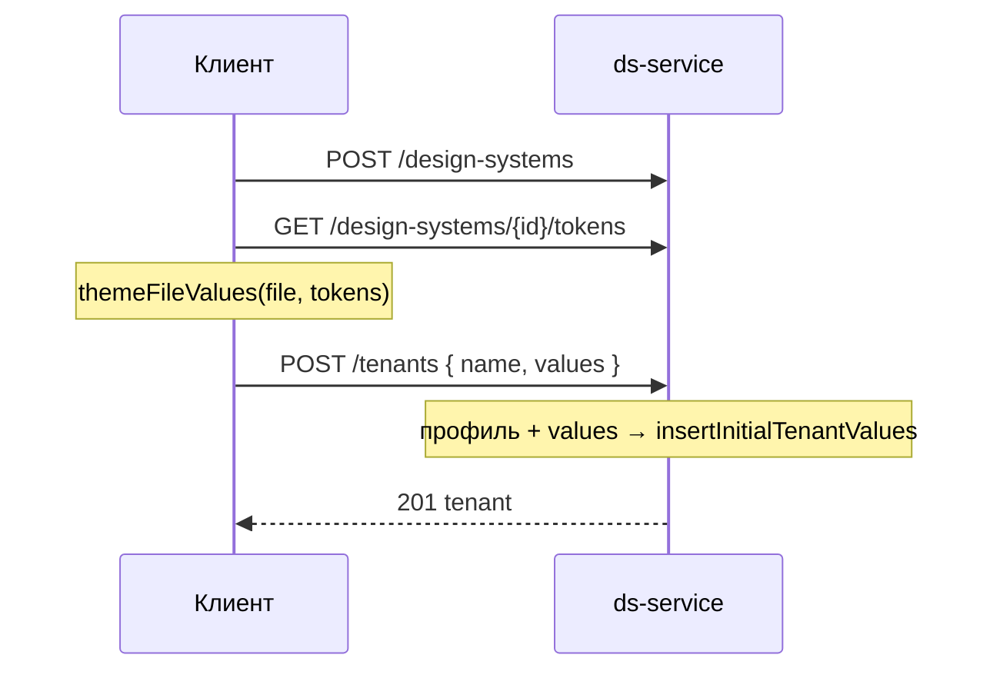

## Контекст

Импорт дизайн-системы в клиенте (`importThemeFile`) выполняет `POST /design-systems`, `POST /tenants`,
`GET /design-systems/{id}/tokens` и один `PUT /tenants/{id}/token-values` со всеми значениями файла (около 7,4 тыс. для
набора `base`).

`CreateTenantUseCase` в одной транзакции создаёт тему (`createOwned`) и вызывает
`TenantTokenValueInitializer.initialize`. `GeneratedTenantTokenValueInitializer` для темы без значений собирает карту
`InitialValueKey → InitialValuePayload` (значения ресурса `token-initial-values.json`, сплошные цвета для остальных
цветовых токенов, якоря профиля) и пишет её `insertInitialTenantValues`: пачками `batchInsert` по 250 сущностей,
редакций и базовых значений создания. Базовые значения создания позволяют журналу скрыть начальные значения за одной
записью о создании темы (`themeDraftChangePolicy`).

`PUT /tenants/{id}/token-values` затем перезаписывает те же значения поэлементно: удаление и вставка редакции,
параметры сессии для триггеров, проверка базовой редакции. Это и даёт 504.

## Цели / Вне целей

**Цели:**
- Импорт записывает значения темы один раз, быстрым путём создания.
- Журнал новой импортированной темы не содержит тысяч изменений значений.

**Вне целей:**
- Ускорение `PUT /tenants/{id}/token-values` для автосохранения редактора: его пакеты маленькие.
- Изменение импорта в CLI и других клиентах.
- Передача `overridden` в начальных значениях: при импорте он всегда `false`, как сейчас.

## Решения

### `values` в `POST /tenants`, а не отдельная ручка импорта

`CreateTenantRequest` получает необязательное поле `values` с элементами `BatchSaveTenantTokenValuesRequest.Value`
(`tokenId`, `platform`, `mode`, `paletteId`, `value`; `baseRevision` для создания не имеет смысла и игнорируется).
`CreateTenant` получает `initialValues: List<TenantTokenValueInput>` со значением по умолчанию `emptyList()`.

Отдельная ручка импорта дублировала бы создание темы целиком: проверку имени, профиль, палитру, группы токенов,
идемпотентность. Поле в существующей ручке переиспользует всё это и остаётся обратно совместимым.

### Значения подмешиваются в карту начальных значений до записи

`TenantTokenValueInitializer.initialize(tenant, overrides)` принимает переданные значения.
`GeneratedTenantTokenValueInitializer` строит карту профиля как сейчас и заменяет в ней записи по
`InitialValueKey(tokenId, platform, mode)`; комбинации, которых в карте нет, добавляются. Карта целиком уходит в
`insertInitialTenantValues`, поэтому значения файла попадают и в базовые значения создания, и журнал показывает только
создание темы.

Ветка инициализатора для темы, у которой значения уже есть (повторная инициализация), переданные значения не
принимает: для новой темы она не выполняется.

### Проверки общие с пакетной записью

Из `SaveTenantTokenValuesUseCase` в общий класс приложения выносятся:

- проверка повторяющихся комбинаций (`invalid_body`);
- приведение сплошных iOS и Android значений цветовых и градиентных токенов к хранимой форме (`storedForm`);
- проверка цветовых значений по правилу палитры темы (`colorViolation`).

`CreateTenantUseCase` проверяет повторы до создания, приводит значения к хранимой форме до инициализации, а проверку
цветовых значений выполняет после `paletteRepository.initialize`, потому что правило зависит от палитры темы. Отказ
любой проверки возвращает `DsResult.Failure` из транзакции, и создание темы откатывается.

Принадлежность токенов дизайн-системе проверяет инициализатор: у него уже есть карта токенов дизайн-системы. Чужой
`tokenId` превращается в отказ `invalid_tenant_token`, как в `PUT`.

### Клиент

`importThemeFile` выполняет `POST /design-systems`, `GET /design-systems/{id}/tokens`, `themeFileValues` и
`POST /tenants` с `values`. `PUT /tenants/{id}/token-values` из импорта уходит. Откат удалением дизайн-системы при
ошибке остаётся прежним.

## Риски / Компромиссы

- [Размер тела `POST /tenants` растёт до одного-двух мегабайт] → лимит шлюза для `/api/projects/{id}/ds/...` — 16 МБ,
  как у `PUT token-values`, который уже принимает такие пакеты.
- [Ключ идемпотентности хеширует всю команду вместе со значениями] → хеш считается один раз на запрос; проверить, что
  `RequestHash` поддерживает `JsonElement` в значениях, иначе хешировать исходное тело запроса.
- [Переданное значение с `paletteId` ссылается на палитру, которой нет] → проверяется так же, как в `PUT`, правилом
  палитры темы после её инициализации.

## План миграции

Сначала выкладывается `ds-service` (поле необязательное, старый клиент работает), затем клиент. После выкладки на стенд
разработки импортировать файл, на котором был 504, и убедиться, что дизайн-система открывается со значениями файла, а
журнал черновика не содержит изменений значений. Откат — возврат клиента; `ds-service` с новым полем совместим со
старым клиентом.
