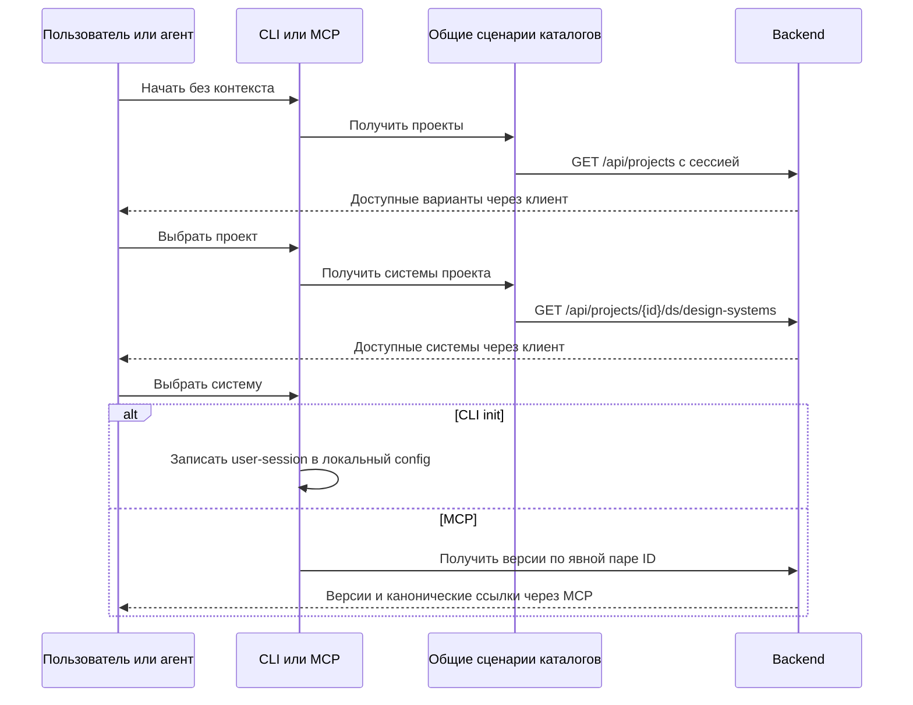

# Проектное решение

## Контекст и границы

См. proposal.md. `feature-projects` умеет читать проекты без контекста, IDE имеет собственный клиент списка систем. В MCP уже есть `design_system_versions_list`, однако его вход разрешается через выбранный контекст. Ссылка требует version; platform необязателен. Локальная конфигурация версии не требует.

## Архитектура и решения

Переиспользуем `feature-projects` для списка проектов. Сценарий получения дизайн-систем конкретного выбранного проекта размещаем в `feature-ds` и переиспользуем в IDE, CLI и MCP. Он принимает projectId и возвращает только системы этого проекта, а не общий каталог всех проектов. Принадлежность системы проекту является параметром запроса, а не причиной размещать сценарий в модуле проектов. Сохраняем feature → core, без зависимостей между feature-модулями. HTTP и DTO остаются в data, порты и сценарии — в application, подключение — в DI. Presentation координирует несколько независимых сценариев; `feature-init` только проверяет и записывает конфигурацию. Переносимая модель выбора авторизации записи располагается в core-domain; feature-init не зависит от feature-projects или feature-ds. Модули feature-projects и feature-ds также не зависят друг от друга.



### CLI

Мастер выполняет два последовательных интерактивных шага:

1. Загружает доступные пользователю проекты через feature-projects и показывает меню «Выберите проект». Стрелки ↑/↓ перемещают выделение, Enter подтверждает вариант.
2. Только после подтверждения проекта вызывает ListDesignSystemsUseCase(projectId) из feature-ds и показывает меню «Выберите дизайн-систему проекта …». Стрелки ↑/↓ и Enter выбирают систему.

Идентификаторы выбранных объектов передаются программно: пользователь не вводит и не копирует названия либо ID. Отображаются имена и описания, ID помогает различить одинаковые имена. Даже единственный вариант подтверждается Enter. Длинный список прокручивается в пределах доступной высоты терминала.

```text
Выберите проект (↑/↓, Enter — выбрать, Ctrl+C — отменить)
❯ Plasma
  Внутренний портал

Выберите дизайн-систему проекта Plasma
  SDDS
❯ Plasma B2C
```

Используем встроенное в терминал меню без полноэкранного режима. Clikt 5.0.3 уже экспортирует Mordant 3.0.1: это подтверждено локальными POM и исходниками из Gradle cache, а также каталогом версий Clikt (https://github.com/ajalt/clikt/blob/5.0.3/gradle/libs.versions.toml). В commonMain Mordant 3.0.1 есть interactiveSelectList; для JVM, macOS arm64/x64 и mingwX64 опубликованы реализации. Нового TUI-фреймворка не требуется; при прямом использовании API объявляем явную зависимость CLI на Mordant той же версии, сохраняя согласованность с Clikt.

Уточнение по Windows Native: в исходнике TerminalInterfaceNativeWindows.setStdinConsoleMode(dwMode) версии 3.0.1 переданное значение игнорируется и вызывается SetConsoleMode(handle, 0u). Поэтому восстановления режима библиотекой недостаточно. Windows-адаптер меню обязан сохранять исходные режимы консоли и восстанавливать их в finally, включая отмену и ошибку; корректность проверяется на реальном Windows. Это локальная компенсация известного дефекта, а не собственная реализация меню или разбора клавиш.

В журнале Mordant 3.1.0 исправление восстановления консоли уже отмечено, но там же указано обновление Kotlin до 2.4.10. Обновлять библиотеку вслепую при Kotlin 2.2.x проекта не следует: для этого Change сохраняем 3.0.1 с узким Windows-адаптером. Отдельно проверяем прокрутку и отображение длинных списков на текущем API; при необходимости используем ограниченное окно списка поверх готовых событий Mordant. Справка API: https://ajalt.github.io/mordant/api/mordant/com.github.ajalt.mordant.input/interactive-select-list.html; журнал: https://github.com/ajalt/mordant/blob/master/CHANGELOG.md.

Проверяем существование config до сетевых запросов. Оба ID заданы — прежний режим без сети с env credential; один отсутствует — пропускаем соответствующий уже заданный шаг. Неизвестный projectId проверяется backend при чтении систем. В интерактивном режиме явно заданный designSystemId проверяется на принадлежность выбранному проекту. Ctrl+C и EOF завершают мастер без записи config; после отмены и ошибок восстанавливаются режим ввода и видимость курсора. Пустые списки и ошибки авторизации завершаются с причиной. Скрытого login нет. Без интерактивного терминала или поддержки управления курсором мастер выдаёт понятную ошибку с предложением передать явные ID; ввод номеров не подменяет согласованный интерфейс.

После обнаружения сохраняется user-session; явный `--api-key-env` сохраняет прежний env-режим записи, но не меняет пользователя, от имени которого получены списки. Имена одинаковых систем различаются ID. Платформы задаются существующим --platform; отдельный обязательный вопрос о платформе не вводится. Терминальный ввод и определение интерактивности инъецируются через платформенный адаптер для JVM/macOS/Windows, что позволяет тестировать отмену без реального терминала.

### MCP

`projects_list` и `design_systems_list(projectId)` обращаются к пользовательской сессии backend из общего ApiUrlResolver, без чтения локального .env и без переключения на project key. Возвращают `{items:[{id,name,description}]}`; список систем также содержит projectId. Пустой результат успешен. Эти API возвращают полные массивы; клиент не выдумывает cursor.

Существующий `design_system_versions_list` получает альтернативную обязательную пару projectId/designSystemId. При ней workspace игнорируется, используется пользовательская сессия; пара вместе с designSystem URI запрещена. Старые вызовы по ссылке/config не меняются. В `feature-ds` добавляется явный вход обнаружения версий, не создающий фиктивную предварительную версию: контекст проекта/системы отделён от выбора версии. Пара ID не превращается в неполный URI; грамматика DesignSystemLink сохраняется. Опубликованные элементы обогащаются ссылкой через общий форматтер; limit/cursor и серверные метаданные сохраняются. Черновик не добавляется в список опубликованных версий искусственно.

Агент обсуждает варианты с пользователем и передаёт полученную ссылку последующим инструментам. MCP ничего не сохраняет в файлы и не запоминает выбранную систему глобально. Схемы и описания одинаковы в нативном CLI, JVM и mcp-node. Версия модели не подменяет версию документации.

## Программное проектирование

Контракты ниже показывают границы; существующие типы команды и результата расширяются совместимо.

```kotlin
// feature-ds.application
public class ListDesignSystemsUseCase {
    public suspend fun execute(projectId: String): DesignSystemsReadResult
}
public data class DesignSystemSummary(val id: String, val name: String, val description: String?)
public sealed interface InitCredentialSelection {
    public data object UserSession : InitCredentialSelection
    public data class Environment(val name: String) : InitCredentialSelection
}
public data class DiscoverDesignSystemVersionsCommand(
    val projectId: String,
    val designSystemId: String,
    val limit: Int?,
    val cursor: String?,
)
public class DiscoverDesignSystemVersionsUseCase {
    public suspend fun execute(command: DiscoverDesignSystemVersionsCommand): ModelReadResult
}
```

Адаптеры каталогов различают AUTH_REQUIRED/FORBIDDEN/NOT_FOUND/BACKEND_UNAVAILABLE/INVALID_BACKEND_RESPONSE. Ошибки парсинга не возвращают тела backend. Backend остаётся источником прав; ID и URI не являются подтверждением доступа.

## Риски и совместимость

- Истечение сессии → существующий общий механизм обновления и ошибка auth login без смены actor.
- Несовпадение списков между выбором и записью → проверка выбранной пары до интерактивной записи; последующие запросы всё равно проверяет backend.
- Сохранение старых тестов init → обновить ожидания только для терминального режима; оба явных ID сохраняют прежний контракт.
- Перенос IDE-клиента → сохранить показ имён/описаний и существующий сценарий выбора проекта/системы, не переносить IDE-зависимости в общий код.

## Проверка и развёртывание

Локально: use case и HTTP mock для каталогов и версий; CLI parsing/TTY/стрелки/Enter/Ctrl+C/EOF/прокрутка/пустые списки/частичные ID/credential; config round-trip; MCP одинаковые схемы, JSON-RPC без шума, независимые вызовы, pagination и ошибки доступа; IDE использует общий клиент. FAST, независимое review, FULL.

Внешняя проверка до архива: на локальном поднятом backend с двумя пользователями разных проектов проверить списки и запрет чужого проекта, выбор проекта и затем его системы стрелками/Enter, отмену с восстановлением терминала, интерактивную запись user-session и последующий status; без workspace пройти MCP проекты → системы → версии → чтение по возвращённой ссылке. Сохранить команды и обезличенный результат без токенов; отсутствие backend не считается успехом. Миграций сервера нет, CLI/MCP обновляются независимо от первого Change; старые конфигурации остаются читаемыми.
