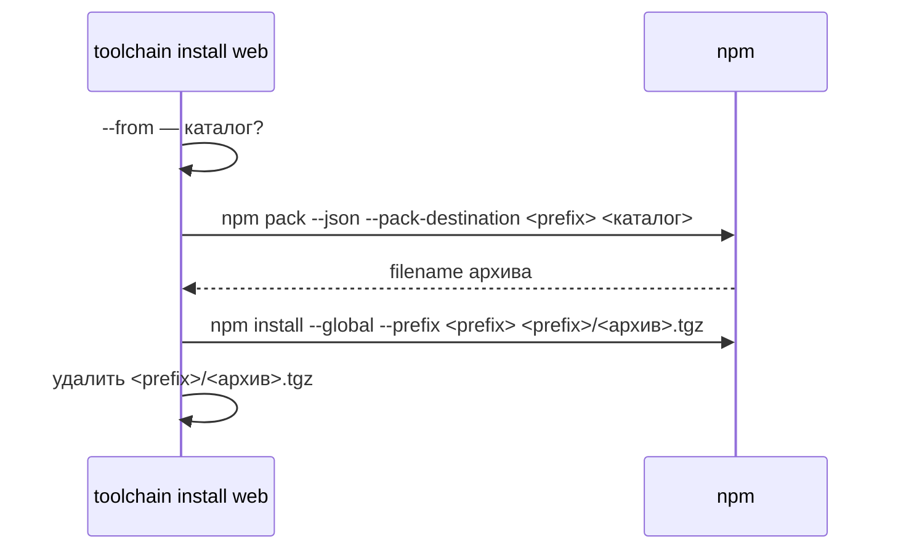

## Context

`WebToolchainInstaller` строит команду `npm install --global --prefix <prefix> <spec>`, где `<spec>` — имя
пакета из реестра либо путь из `--from`. npm обрабатывает пути по-разному: архив `.tgz` распаковывается и
получает зависимости, а каталог устанавливается ссылкой на исходник без установки его зависимостей. Тесты
установщика проверяли только аргументы npm с поддельным `ProcessRunner`, а живая проверка покрывала
реестр и `.tgz`, поэтому разница для каталога осталась незамеченной.

## Goals / Non-Goals

**Goals:**

- `--from <каталог>` ставит генератор со всеми зависимостями независимо от наличия `node_modules` в каталоге.
- Проверка, которая запускает установленный из каталога генератор, а не только смотрит на аргументы npm.

**Non-Goals:**

- Изменение установки из реестра, `--version`, `--from <.tgz>` и `--from <URL>`.

## Decisions

### Каталог упаковывается перед установкой

Для пути, который является каталогом, установщик выполняет
`npm pack --json --pack-destination <prefix> <каталог>` с захватом вывода и берёт имя архива из поля
`filename`. Затем ставится `<prefix>/<архив>` той же командой, что и архив из `--from`, и архив удаляется
при любом исходе. Отдельный временный каталог не создаётся: `WorkspaceFileSystem.deleteFile` на macOS
не удаляет каталоги, а prefix и так принадлежит установщику.

`npm pack` выполняет то же преобразование, что и публикация: в архив попадают файлы из `files`, а при
установке npm ставит зависимости из `package.json`. Поэтому установка из каталога совпадает с установкой
опубликованного пакета.

Рассмотренный вариант — флаг `--install-links`. Отклонён: он описан для зависимостей с протоколом `file:`,
а поведение для пути верхнего уровня в `npm install --global` не закреплено документацией npm.

## Risks / Trade-offs

- [`npm pack` запускает скрипт `prepack` каталога] → у генератора его нет; для чужого каталога это
  ожидаемое поведение npm при упаковке.
- [Вывод `npm pack` может содержать предупреждения] → имя архива берётся из поля `filename` JSON-вывода;
  без него или без файла установка завершается понятной ошибкой.

## План проверки и развёртывания

- Unit-тесты установщика с поддельным `ProcessRunner`: каталог упаковывается и ставится архив, ошибка
  `npm pack` возвращается с кодом, архив удаляется.
- `check-global-install.sh` с путём к собранному `dsbuilder`: каталог из распакованного `npm pack` без
  `node_modules` ставится через `dsbuilder toolchain install web --from`, после чего генератор
  выполняет `--version` и генерацию.
