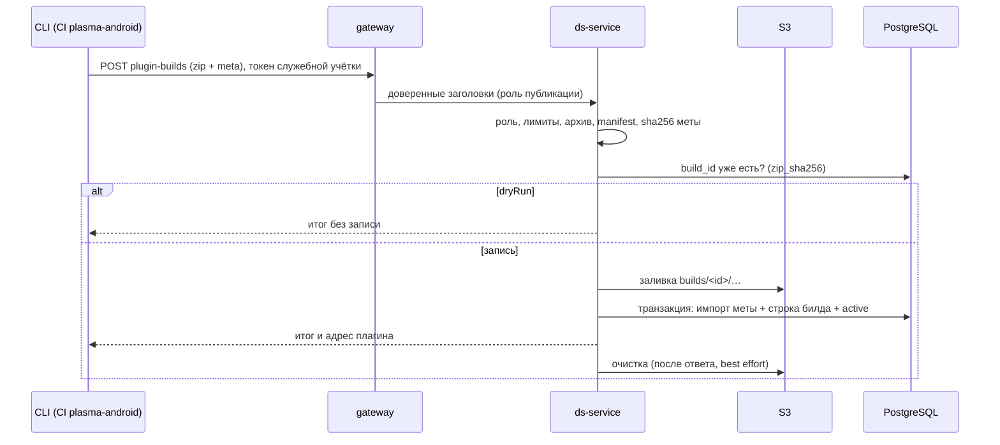

## Context

Плагин Compose-preview собирается в `plasma-android` и порождает фабрики стилей по `api-meta.json` библиотеки `uikit-compose`. Тот же файл определяет, какие Compose-компоненты и свойства видит редактор, после импорта в БД DSB. Для согласованного превью плагин и мета должны происходить из одного билда.

Что есть сегодня:

- Клиент (`js/apps/client/src/composePreview`) загружает плагин по `VITE_COMPOSE_PREVIEW_PLUGIN_URL` (`config.ts`), читает `preview-plugin.json` (`manifest.ts`), проверяет `protocolVersion`, платформу, сообщения моста и принадлежность entrypoint origin плагина, открывает плагин в `iframe` с `sandbox="allow-scripts allow-same-origin"`. Адрес плагина служит и условием включения Compose-режима (`themeEditorRepository.loadComposeComponents`).
- Импорт меты (`ds-service`, `POST /api/ds/admin/component-config/import-api-meta`) доступен только системному администратору, аддитивен, выполняется одной транзакцией. Он принимает уже нормализованный манифест: сырой файл разбирает CLI (нормализатор платформы), бэкенд файла не видит.
- Роли приходят из JWT Keycloak (`realm_access`) и сопоставляются с `GlobalRole` (`user`, `system_admin`); gateway передаёт `X-System-Admin`. `/realms/` проксируется в Keycloak, поэтому токен можно получить через gateway.
- CLI поддерживает два вида авторизации: ключ проекта (`DSBUILDER_API_KEY`, неинтерактивный, привязан к проекту и применяется в проектных командах) и сессию пользователя (интерактивный логин и пароль, `auth login`). Глобальные админ-операции, такие как `components import-api`, принимают только токен пользователя: ключ проекта на этих маршрутах отвергается намеренно (gateway отвечает `401`). Неинтерактивной авторизации для глобальных операций нет.
- S3 в бэкенде использует только `documentation-service` (AWS SDK v2, MinIO в локальном контуре, `DOCUMENTATION_S3_*`); `ds-service` S3 не использует. `ds-service` владеет Flyway-миграциями (`V1`–`V6`), таблицы вроде `token_groups` живут только там.

Контракт с `plasma-android` (change `publish-compose-preview-plugin`): CI собирает `preview-compose-plugin.zip` (manifest, `api-meta.json`, `index.html`, `*.js`, `*.wasm`, `composeResources/`) и отправляет его командой CLI. Manifest содержит `commit`, `version` (первые 12 символов `commit`), `uikitComposeVersion`, `apiMetaSha256`, `protocolVersion`.

## Goals / Non-Goals

**Goals:**
- Одна операция публикации: бэкенд принимает архив плагина, кладёт файлы в S3, импортирует мету из этого архива и записывает билд как активный, при этом БД остаётся согласованной.
- CI публикует автоматически служебной учёткой с узкой ролью, без прав системного администратора.
- Клиент узнаёт у бэкенда адрес активного билда; прямой адрес остаётся переопределением.
- Очистка старых билдов безопасна: бэкенд знает и билды, и какой из них активен.

**Non-Goals:**
- Сборка плагина и workflow CI (`plasma-android`).
- Версия меты и активный билд на дизайн-систему: они одни на окружение.
- Отдельная команда отката: откат — повторная публикация старого билда.
- Разделение origin плагина и клиента, подпись плагина.
- Автоматический импорт меты других платформ: `import-api-meta` остаётся ручным и только для сисадмина.

## Decisions

### 1. Функция живёт в `ds-service`

Публикация одной операцией импортирует мету и записывает билд, а мета и импорт уже принадлежат `ds-service`. В одной БД эти записи можно сделать в одной транзакции. Альтернативы: `documentation-service` (уже умеет S3 и загрузку бандлов, но не владеет компонентами, и согласованность «билд и мета» стала бы распределённой) и новый сервис (лишние Dockerfile, порт, healthcheck и маршруты ради одной функции). Цена выбора: `ds-service` получает зависимость от S3 (AWS SDK v2 той же версии, что в `documentation-service`), переменные окружения и секреты.

### 2. Модель данных

```sql
CREATE TABLE compose_preview_plugin_builds (
  build_id            text PRIMARY KEY,           -- первые 12 символов commit
  platform            <тип платформы, как у components.platform> NOT NULL,
  uikit_compose_version text NOT NULL,            -- из manifest
  meta_sha256         text NOT NULL,              -- apiMetaSha256 из manifest
  commit_sha          text NOT NULL,
  protocol_version    integer NOT NULL,
  zip_sha256          text NOT NULL,              -- отпечаток принятого архива
  size_bytes          bigint NOT NULL,
  file_count          integer NOT NULL,
  published_by        text NOT NULL,
  published_at        timestamptz NOT NULL DEFAULT now(),
  active              boolean NOT NULL DEFAULT false
);
CREATE UNIQUE INDEX compose_preview_plugin_builds_active_idx
  ON compose_preview_plugin_builds (platform) WHERE active;
```

Активный билд один на платформу. Таблица принадлежит `ds-service` (`V7`) по прецеденту `token_groups`; `schema.ts`, `drizzle/` и DBML не обновляются. Версия `uikit-compose` и sha256 меты хранятся у билда: отдельной таблицы версий меты нет, потому что мета и билд публикуются вместе.

### 3. Публикация: порядок и транзакция



Файлы заливаются в S3 до транзакции БД: транзакция не охватывает S3, зато откат БД не оставляет «активным» билд без файлов. Осиротевшие файлы (сбой между заливкой и фиксацией) убирает очистка. Импорт меты внутри транзакции использует существующую логику `ExposedApiMetaRepository` (вызывается в транзакции вызывающего кода, без второй транзакции).

### 4. Входные данные и проверки

Запрос `multipart/form-data` с частями `plugin` (zip) и `meta` (JSON тела `ImportApiMetaRequest`, `platform = compose`; `dryRun` берётся из параметра запроса, а не из тела) и параметром `dryRun` (по умолчанию `true`, как у CLI). Платформенный разбор меты остаётся в CLI (правило проекта: бэкенд получает готовые компоненты и свойства), поэтому нормализованная мета приходит рядом с архивом. Бэкенд проверяет:

- роль до чтения тела; размер тела по лимиту;
- архив: сжатый размер, суммарный распакованный размер, число файлов, размер файла; пути без `..`, абсолютных и обратных слэшей, без дублей; обязательные `index.html`, `preview-plugin.json`, `api-meta.json`;
- manifest: `schemaVersion = 1`, `platform = compose`, целое `protocolVersion`, непустые `commit`, `version`, `uikitComposeVersion` (семантическая версия), `apiMetaSha256`; `version` равна первым 12 символам `commit`; sha256 файла `api-meta.json` совпадает с `apiMetaSha256`; `entrypoint` существует в архиве.

Соответствие нормализованной меты файлу `api-meta.json` бэкенд проверить не может (нормализатор в CLI): он доверяет авторизованному публикатору, как доверяет импорту сисадмина.

### 5. Идемпотентность и активный билд

Идентификатор билда — `build_id`. Если строка уже есть и `zip_sha256` совпадает: билд не перезаливается, импорт меты выполняется повторно (аддитивен и идемпотентен), активным становится этот билд; итог `unchanged`, если он уже был активным, и `activated` иначе (повторная публикация старого билда — откат). Если `zip_sha256` отличается — конфликт `409` с кодом `build_content_changed`, ничего не меняется. Новый `build_id` — итог `published`.

### 6. Выдача адреса клиенту

`GET /api/projects/{projectId}/ds/compose-preview/plugin` с правом `components:read` возвращает `{buildId, uikitComposeVersion, metaSha256, protocolVersion, pluginUrl, publishedAt}` или `404`, если активного билда нет. `pluginUrl` строится как `<DS_PLUGIN_PUBLIC_BASE_URL>/builds/<build_id>/`. Маршрут лежит в проектном пространстве `/api/projects/{projectId}/ds/...`, которое gateway уже проксирует с проверкой доступа к проекту. Выбор среди версий и предупреждения о несовпадении не нужны: активный билд и мета опубликованы вместе. Клиент по-прежнему проверяет manifest (протокол, платформа, компонент).

Если мету позже изменили вручную (`import-api` без публикации плагина), мета в БД может опередить активный билд: это штатный аддитивный импорт, и он вне ответственности этого change.

### 7. Хранилище

Порт `PluginBuildStorage` (`put` с типом содержимого и `Cache-Control`, `list` префикса, `delete` префикса) и реализация на AWS SDK v2: endpoint, регион, path-style (для MinIO), бакет, ключи и префикс из `DS_PLUGIN_S3_*`, публичный адрес из `DS_PLUGIN_PUBLIC_BASE_URL`. Типы содержимого заданы явной таблицей расширений (`.wasm` → `application/wasm`, `.js` → `text/javascript`, `.html`, `.json`, шрифты, изображения; неизвестные — `application/octet-stream`). Все файлы билда получают `Cache-Control: public, max-age=31536000, immutable`: каталог содержит `build_id` и не меняется. Без настройки хранилища публикация отвечает `503` с кодом `storage_not_configured`, а выдача адреса — `404`.

Плагин лежит в собственном префиксе бакета, не вложенном в префикс клиента: выкладка клиента делает `s3cmd sync --delete-removed` в `.../client/` и удалила бы вложенные файлы. Ключ записи `ds-service` ограничен префиксом плагина.

### 8. Очистка

После успешной публикации `ds-service` оставляет активный билд и пять последних по `published_at`, остальные удаляет (объекты S3, затем строки). Дополнительно удаляются префиксы `builds/<id>/` без строки в БД старше 24 часов (осиротевшие). Количество хранимых билдов задаётся настройкой. Очистка не влияет на ответ публикации: ошибки пишутся в лог, следующая публикация повторит попытку.

### 9. Авторизация CI

Keycloak получает клиент `dsbuilder-preview-publisher` (confidential, `serviceAccountsEnabled`, без standard flow и direct grants) с audience mapper для API и роль realm `compose_preview_publisher`, назначенную его service account. Gateway:

- `GlobalRole` получает `COMPOSE_PREVIEW_PUBLISHER("compose_preview_publisher")`, `TrustedHeaders` — заголовок `X-Compose-Preview-Publisher`; входящий заголовок снаружи удаляется, как остальные доверенные;
- новый `location = /api/admin/compose-preview/plugin-builds` с лимитом тела под архив и `auth_request /_auth_user` (токен пользователя или служебный; ключ проекта получает 401);
- `ds-service` разрешает публикацию при `X-System-Admin = true` или `X-Compose-Preview-Publisher = true`.

Остальные маршруты роль не открывает: `import-api-meta` требует системного администратора, проектные маршруты требуют членства в проекте, которого у служебной учётки нет.

CLI получает токен командой `client_credentials` через gateway: `POST <apiUrl>/realms/<realm>/protocol/openid-connect/token`, `realm` по умолчанию `dsbuilder` (переопределяется `DSBUILDER_REALM`). Идентификатор и секрет приходят только из переменных `DSBUILDER_CLIENT_ID` и `DSBUILDER_CLIENT_SECRET` (аргумент командной строки для секрета запрещён, как для пароля); токен не сохраняется на диск. Без этих переменных CLI использует сохранённую сессию пользователя, поэтому системный администратор может публиковать вручную.

Альтернативы:
- **Ключ проекта.** Публикация меняет общий слой компонентов всех проектов, а ключ принадлежит проекту и создаётся его maintainer'ом. Проектный маршрут со scope публикации дал бы проектным ролям право менять глобальные данные; чтобы этого избежать, нужен глобальный тип ключа (новое хранилище, выдача только сисадмином, отдельный путь в gateway), то есть новая подсистема.
- **Personal access token** (токен пользователя с областью прав и сроком действия): общий механизм неинтерактивной авторизации для людей, но это отдельная подсистема (хранилище хешей, выпуск и отзыв, срок, области прав, проверка в gateway, поддержка в CLI). Для CI он хуже служебной учётки: токен привязан к жизненному циклу человека. Не входит в этот change; граница авторизации (`ds-service` проверяет доверенные заголовки ролей) позволяет добавить его позже без изменения `ds-service`: gateway сопоставит такой токен тем же заголовкам.

### 10. Клиент

Клиент запрашивает адрес активного билда у бэкенда вместо чтения `VITE_COMPOSE_PREVIEW_PLUGIN_URL`. Условие включения Compose-режима перенесено в `loadComposeComponents`: если задан прямой адрес, используется он; иначе выполняется запрос `GET .../compose-preview/plugin`, и при `404` или ошибке Compose-компоненты не запрашиваются (как при отсутствии адреса сегодня), React-preview остаётся. Результат запроса кешируется на время жизни страницы для проекта. Дальнейшая загрузка (manifest, protocol, iframe) не меняется.

Общий origin плагина и клиента (плагин в бакете клиента) принят как риск: `iframe` с `allow-same-origin` на общем origin мог бы читать токены клиента. Мера: плагины публикует только команда SDDS, загрузка чужих не поддерживается. Разделение origin остаётся будущим улучшением и не меняет контракт маршрутов.

### 11. Программное проектирование (ключевые сигнатуры)

```kotlin
// ds-service, application
data class PublishPluginBuild(
    val platform: String, val archive: PluginArchive, val meta: ImportApiMeta, val dryRun: Boolean, val actorId: String,
)

sealed interface PublishOutcome {
    data class Published(val build: PluginBuild, val report: ApiMetaImportReport) : PublishOutcome
    data class Activated(val build: PluginBuild, val report: ApiMetaImportReport) : PublishOutcome
    data class Unchanged(val build: PluginBuild, val report: ApiMetaImportReport) : PublishOutcome
    data class Conflict(val existing: PluginBuild) : PublishOutcome        // build_content_changed
    data class Invalid(val code: String, val message: String) : PublishOutcome
}

interface PluginBuildStorage {
    suspend fun put(key: String, bytes: ByteArray, contentType: String, cacheControl: String)
    suspend fun listPrefixes(prefix: String): List<String>
    suspend fun deletePrefix(prefix: String)
}

interface PluginBuildRepository {
    suspend fun find(buildId: String): PluginBuild?
    suspend fun active(platform: String): PluginBuild?
    suspend fun listByRecency(platform: String): List<PluginBuild>
    suspend fun publish(build: NewPluginBuild, meta: ImportApiMeta): PublishedBuild   // одна транзакция: мета, строка, active
}
```

```ts
// js/apps/client/src/composePreview
export interface PluginDescriptor { pluginUrl: string; buildId: string; uikitComposeVersion: string; }
export const resolveComposePreviewPluginUrl: (projectId: string, deps?: ResolverDeps) => Promise<string | undefined>;
```

```kotlin
// frontend-kt, application
class PublishPreviewPluginUseCase(credentials, apiUrlResolver, archiveReader, normalizers, remote) {
    suspend fun execute(command: PublishPreviewPluginCommand): PublishPreviewPluginResult
}
```

Слои Kotlin: presentation — маршруты публикации и чтения, модели запроса и ответа; application — use case публикации и чтения, порты хранилища и репозитория; domain — `PluginBuild`, `PublishOutcome`, правила проверки манифеста; data — распаковка с лимитами, S3-адаптер, Exposed-репозиторий; di — регистрация. `frontend-kt`: домен — результат публикации; application — use case, чтение zip и расчёт sha256; data — HTTP-источник multipart, получение токена `client_credentials`; presentation — команда `preview-plugin publish`.

## Risks / Trade-offs

- [Секрет служебной учётки живёт в секретах `plasma-android`] → роль только на публикацию (не сисадмин), секрет через переменные окружения, ротация и отзыв в Keycloak.
- [Загрузка до 50 МБ через gateway и разбор zip в памяти бэкенда] → лимиты размера, числа файлов и пути в zip (опыт `documentation-service`), потоковая обработка там, где возможно, лимит тела в nginx.
- [Нормализованная мета может не соответствовать `api-meta.json` из архива] → публикуют только авторизованные роли; sha256 архива и manifest сверяются; доверие тому же субъекту, что и у ручного импорта.
- [S3 вне транзакции БД] → заливка до транзакции, очистка сирот; активный билд всегда имеет файлы.
- [Одновременные публикации в одно окружение] → уникальный частичный индекс на активный билд и сериализация публикации блокировкой на платформу; конфликт активации разрешается порядком коммитов.
- [Общий origin клиента и плагина] → риск принят (плагин SDDS); описан в README клиента; разделение origin — будущее изменение.
- [Общий бакет: выкладка клиента с `--delete-removed` удаляет вложенные файлы, ключ плагина может задеть клиента] → не вложенные префиксы; ключ записи ограничен префиксом плагина.
- [Служебный токен принимается gateway на других маршрутах] → проверки ролей и членства на стороне сервисов; тесты на отказ.
- [JWT verifier может не принять токен служебной учётки (audience, отсутствие email)] → проверяется на первом шаге реализации, при необходимости добавляется mapper или настройка verifier.

## Migration Plan

1. Развернуть `ds-service` с миграцией `V7`, S3-конфигурацией и маршрутами (без настройки хранилища публикация отвечает `503`, адрес — `404`; клиент работает через прямой адрес как раньше).
2. Настроить Keycloak (клиент, роль), gateway (заголовок, маршрут) и бакет (префикс, публичное чтение, CORS).
3. Выпустить CLI с командой `preview-plugin publish`; выдать секрет учётки `plasma-android` для dev, проверить пробной отправкой, затем с `--apply`.
4. Выкатить клиент с получением адреса от бэкенда; повторить для prom.

Откат: удалить переменные S3 (маршрут публикации отвечает `503`, клиент возвращается к прямому адресу или без Compose-preview); таблица и файлы в S3 остаются без вреда.

## Open Questions

- Откат на произвольный билд без повторной сборки: достаточно повторной публикации старого билда или нужна команда активации.
- Как CLI узнаёт realm Keycloak: значение по умолчанию `dsbuilder` и переменная `DSBUILDER_REALM` или адрес token endpoint из конфигурации gateway.
- Формат поставки CLI для CI `plasma-android` (JVM-дистрибутив, архив релиза, образ).
- Разрешённые типы файлов в архиве: явный список расширений или только безопасные пути и лимиты.
- Количество хранимых билдов (по умолчанию 5) и срок удаления осиротевших префиксов (по умолчанию 24 часа).
- Кто настраивает бакет: префикс плагина, публичное чтение, CORS, ограниченный ключ записи.
