# Адресный пакетный откат

## Решение

Команда содержит адреса выбранных сущностей и ожидаемые редакции. Сервер отменяет их черновые правки напрямую. Журнал остаётся представлением изменений для пользователя. В адресном маршруте запрещены обход общего журнала, поиск `changeId` среди технических состояний и вызов полного `describe` с последующей фильтрацией.

Для обычного значения откат — удаление его ревизии выбранного черновика после проверок и блокировки. Чтение снова выбирает предыдущее состояние. Создание сущности, основа новой темы и зависимости сохраняют действующие специальные правила, но не требуют поиска цели через общий журнал.

Решение заменяет специализацию девяти литеральных значений и бюджет 13–15 JDBC-выполнений. Число SQL остаётся диагностикой. Основные критерии — независимость от нерелевантных записей, объём работы, задержки и поведение при конкуренции. Ранее внесённый эксперимент не считается реализацией нового проекта. Реализация адресного решения согласована разработчиком; метрики проверяются до общих проверок.

## Контракт команды

Добавляется `POST /api/design-systems/{designSystemId}/changes/revert-by-address` с проектной формой по действующим правилам маршрутизации. `Idempotency-Key` обязателен. Тело:

```json
{
  "draftId": "uuid",
  "targets": [
    {"entityType": "token-value", "entityId": "uuid", "expectedRevision": 42}
  ]
}
```

`entityId` — устойчивый предметный ID, не ID строки ревизии. `expectedRevision` соответствует нынешнему `editRevision` журнала. Клиент не выбирает таблицу или предыдущую версию: сервер разрешает их самостоятельно. `draftId` предотвращает применение старой команды к новому черновику после публикации. Общая редакция черновика не служит условием отмены: несвязанная правка сама по себе не создаёт конфликт.

Допускается 1–200 целей. Повтор `(entityType, entityId)`, неизвестный тип, неверное тело и превышение предела отклоняются до мутаций. Входной порядок определяет порядок предметных ошибок и зависимых операций. Пакет атомарен. Частичный откат параметров остаётся на существующем маршруте с прежним поведением.

Сохраняются действующие статусы и коды ошибок доступа, отсутствия изменения, устаревшей редакции, зависимостей и идемпотентности; позиция цели передаётся в `details.changeIndex`. Несовпадение `draftId` получает 409 `DRAFT_CHANGED` без поиска цели в новом черновике. Успех сохраняет `OkResponse`, метаданные и заголовки мутации. Новые ошибки тела фиксируются в OpenAPI при реализации.

Старые маршруты по `changeId` сохраняются для прежних клиентов. Новый маршрут не переходит на старый поиск при сложном случае: разрешён только адресный обработчик выбранной сущности и её действительных зависимостей. Перед переносом клиента по реестру проверяется поддержка всех действующих типов полного отката.

## Получение целей клиентом

**Журнал.** `DraftChangeDto` уже содержит `versionId`, `entityType`, `entityId`, `editRevision`. Из выбранных записей сразу строится команда. Дополнительный поиск и перечитывание общего журнала не нужны; `changeId` остаётся для отображения и совместимости.

**Инспектор токена.** Загруженный экран может не содержать удалённых значений, поэтому предусмотрено ограниченное чтение `POST /api/design-systems/{designSystemId}/changes/token-targets` с правом чтения:

```json
{"draftId":"uuid","tenantId":"uuid","tokenIds":["uuid"],"cursor":null}
```

Ответ: `draftId`, `scopeRevision`, `targets` с полями `entityType`, `entityId`, `expectedRevision`, `operation` и `nextCursor`. Отбираются определения только переданных токенов и их значения только указанной темы, включая удалённые значения и основу создания темы. Кандидаты находятся по ID токенов/темы и предметным ревизиям. Отбор всех записей `entity_edit_states` с последующей фильтрацией и загрузка полного журнала запрещены.

Принимается до 200 разных ID токенов, страница содержит до 200 целей. Курсор привязан к области, черновику и scopeRevision. Это отпечаток устойчивых адресов, предметных редакций и состояния определений/темы только выбранной области, включая появление и исчезновение значений. Он не вычисляется обходом журнала или подсчётом всех маркеров транзакций черновика. Если область изменилась между страницами, сервер возвращает 409 TARGET_SNAPSHOT_CHANGED, чтение повторяется до отправки первой мутации. Хранить снимок между запросами не требуется: следующая страница сверяет отпечаток области в своём согласованном чтении. После сбора целей команда проверяет адресные редакции, а не общую редакцию черновика. Пустой набор не вызывает мутацию.

Сохраняется запрет инспектора на сброс созданного в черновике определения токена: он мог бы удалить значения других тем. Полный откат создания из журнала остаётся доступен по прежним правилам. Больше 200 целей отправляются последовательными атомарными пакетами с прежней обработкой частичного успеха нескольких команд.

После отката сохраняется адресное обновление раздела 8. Неизвестный результат ответа сверяется чтением затронутых данных, без автоматической повторной мутации с новым ключом.

## Алгоритм

```mermaid
sequenceDiagram
    participant C as Клиент
    participant R as Адресный откат
    participant D as PostgreSQL
    C->>R: Черновик, адреса и ожидаемые редакции
    R->>D: Идемпотентность, область и выбранные сущности
    R->>D: Блокировки выбранных сущностей и зависимостей
    R->>D: Повторная проверка под блокировками
    R->>D: Применение плана отката
    R->>D: Зависимости, ограничения, ответ и COMMIT
    R-->>C: Результат и метаданные
```



1. Проверить тело и права; сериализовать ключ идемпотентности. Хэш включает дизайн-систему, `draftId` и упорядоченные адреса с редакциями. Повтор возвращает сохранённый ответ без мутации, другое тело с тем же ключом конфликтует.
2. Проверить текущий черновик и `draftId`. Прочитать устойчивые строки, прежнее/текущее состояния и технические редакции только указанных адресов. Тип выбирает зарегистрированный обработчик, а не таблицу из HTTP. Адрес не подтверждает владение. Общий лимит кандидатов журнала к команде не применяется.
3. Проверить видимость отменяемых изменений и редакции всего исходного пакета. Прямой адрес не открывает отмену скрытых служебных значений новой темы или производного типа. Чужая/отсутствующая сущность сохраняет прежнюю допустимую видимость ошибки без утечки данных.
4. Собрать уникальные зависимости и план блокировок, совместимый с записью значений, определений, созданием и публикацией. UUID сортируются внутри совместимых групп; один глобальный порядок UUID не заменяет предметный порядок между группами. SERIALIZABLE и повторы целой транзакции сохраняются.
5. Под блокировками повторно проверить границу, редакции и состав зависимостей. Передать согласованный набор последующим этапам. Данные до блокировок служат планированию, а не кешем изменяемого состояния. Изменение состава блокировок требует безопасного перезапуска, а не произвольного добора блокировок.
6. Построить операции: удалить черновую ревизию обычного значения; восстановить неизменяемую основу новой темы; применить прежние правила удаления созданной сущности и восстановления удалённой. Опубликованные ревизии не изменяются.
7. Выполнить независимые одинаковые операции наборами. Для смешанных зависимых целей сохранить входной порядок и правило: изменение, снятое предыдущим откатом пакета, не применяется повторно. Исходные редакции сверяются до всех мутаций, чтобы собственные действия пакета не считались чужой правкой. Группировка не меняет результат и первый отказ.
8. Один раз обработать каждое затронутое семейство и подготовить область зависимостей каждой темы. Передавать уже проверенные данные вместо повторного поиска в слушателях. Сохранить пересчёт типа по необходимым активным темам/платформам, старое и новое семейства при переименовании, проверки palette_id, градиентов, теней и удалённых зависимостей. Сокращение пересчёта по неизменности вида значений требует доказательства инвариантов, а не предположения по текущему типу.
9. Проверить итоговые зависимости и отложенные ограничения до успеха. Сохранить технические редакции, пути, триггеры, метаданные, инвалидирование и идемпотентный ответ в одной транзакции. Ошибка любой фазы, включая COMMIT, не оставляет частичного результата.

## Архитектура и совместимость

`presentation` добавляет DTO и маршруты; `application` владеет адресными целями и предметным планом; `data` выполняет ограниченные чтения, блокировки и мутации; `di` подключает реализации. Общие адресные контракты и транзакционные гарантии могут находиться в `core`, предметные правила остаются в фичах.

Существующий `describeEntity` нельзя считать адресным без проверки: его реализация по умолчанию может вызывать полный `describe`. Матрица всех обработчиков, политик и валидаторов должна доказать ограниченное чтение выбранных сущностей и их действительных зависимостей. При необходимости добавляются явные наборные методы. Инвариант относится ко всей команде, включая транзакционную обвязку, метаданные, триггеры и сохранение ответа. Скрытый общий подсчёт маркеров или обход технических состояний не исключается из измерения: при обнаружении для него требуется решение с сохранением семантики и ограниченным объёмом работы.

Клиент `js/apps/client` меняет репозиторий журнала и подготовку сброса инспектора. `frontend-kt` сохраняет совместимость через старые маршруты. При реализации обновляются `runtime/src/main/resources/openapi/documentation.yaml`, `contracts/route-manifest.json`, DTO и контрактные тесты. Для адреса команды не нужна новая схема хранения: используются существующие устойчивые ID. Индексы добавляются только по планам; старые миграции не переписываются.

Объединение контекстных SET, перенос идемпотентности или упаковка SQL не входят в решение без подтверждённой необходимости. Эксперимент прежнего проекта при реализации оценивается отдельно; его незавершённые изменения не принимаются автоматически и не удаляются во время перепроектирования.

## Критерии проверки

Фиксируем пакет и его зависимости. Добавляем 0, 1 000, 10 000 и 100 000 нерелевантных технических состояний и ревизий других сущностей, включая уже отменённые правки. Предел 200 относится к команде, не к журналу. Рост нерелевантного набора не вызывает переход на старый поиск или общий `LimitExceeded`.

В планах нет обхода общего журнала, чтения всех отслеживаемых ID и сортировки его записей. Возвращаемые и материализуемые предметные строки определяются целями и их зависимостями. Допускается естественная стоимость индексного поиска в выросших таблицах: абсолютная неизменность времени не обещается.

После пяти прогревов — минимум 20 повторов на вариант без фоновых тестов. Для фиксированного пакета медиана и p95 на максимальном нерелевантном наборе не ухудшаются более чем на 10% относительно минимального при одинаковых настройках. Отклонение требует анализа планов и повторного сопоставимого замера, а не удаления медленных запросов. Отдельно сравниваем с повторно измеренным третьим этапом на наборах, где прежний маршрут успешно отменяет тот же пакет: медиана и p95 не ухудшаются более чем на 10%. Быстрый отказ старого маршрута по пределу журнала не сравнивается по скорости с успешной адресной отменой.

Матрица размера команды: 1, 9, 50 и 200 целей; одно/несколько семейств, тем и типов. Измеряются задержки, JDBC, строки/буферы и длительность транзакции; ожидание блокировок — управляемым конкурентным сценарием. Количество SQL диагностическое, фиксированного бюджета нет. Права, изоляция и целостность не ослабляются ради метрики.

Матрица корректности: создание/изменение/удаление, основа новой темы, все типы полного отката, смешанные зависимые цели, скрытые изменения, неверный черновик, чужая/неверная сущность, устаревшая редакция в начале/середине/конце, повтор адреса, идемпотентный повтор и другое тело с тем же ключом. Проверяются публикация, параллельные запись/создание значения и переименование/удаление определения, отказ ограничения после мутации и потеря ответа после COMMIT. Сравниваются значения, редакции, пути, журнал, summary/token-ids, история и метаданные со старым алгоритмом на одинаковых копиях.

## Внедрение

После согласования артефактов: контракт и адресное разрешение целей → доказательство независимости от журнала → пакетная обработка → перенос клиента и измерения. Backend выпускается раньше нового клиента; старые маршруты позволяют вернуть прежний клиент без миграции данных. Новый клиент не маскирует ошибку адресного маршрута переходом на старый поиск.

FAST/FULL/review остаются отложенными до указания разработчика. Изменения и измерения выполняются в согласованном worktree и изолированном локальном контуре; основные спеки не синхронизируются, Change остаётся активным.
