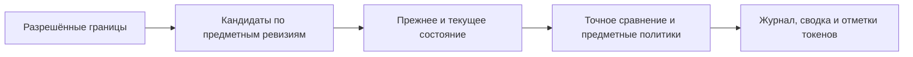

# Проектное решение

## Контекст и границы

Мотивация приведена в `proposal.md`. Планы PostgreSQL 17 на dev подтверждают: сравнение 9 639 значений ради пустого журнала за 4,17 секунды, 9 063 дополнительных поиска последней ревизии при чтении значений и 3 454 разрешения границы версии в выборке определений. Параметры и исходные выгрузки остаются вне Git. При `log_timing = off` нельзя приписывать индивидуальное время узлам плана. Диагностика на dev остаётся включённой по решению разработчика.

Оптимизируем чтение темы, значений, палитры, размеров и журнала. Измеряем команду отмены отдельно от последующих чтений. Сохраняем существующие API, права, изоляцию и предметные правила; раздел 9 добавляет совместимые адресные маршруты и DTO. Исключены общий кеш между запросами, новый формат `changeId`, отдельная таблица журнала и ослабление целостности. Изменения клиента описаны в разделах 8 и 9.

Изменения SQL располагаются в `data`; согласование потребности в данных остаётся в `application`. Exposed/JDBC не добавляются в прикладные интерфейсы. `presentation` сохраняет контракты; `di` подключает реализации при необходимости. Существующие общие помощники меняются только после инвентаризации потребителей, включая запись.

## Решения

### 1. Отбор кандидатов журнала до сравнения

В `ExposedDraftChangeHandler` сначала выбираем различные идентификаторы сущностей данной дизайн-системы с предметными ревизиями в интервале `(previousSequenceNumber, sequenceNumber]`. Затем сохраняем существующее чтение прежнего и текущего состояния и точное сравнение JSON только для кандидатов. Наличие ревизии не равно видимому изменению: возврат к исходному состоянию остаётся скрытым.

Отбор применяется согласованно в `describe`, `visit`, `hasChanges` и `describeEntity`. Сохраняются порядок, курсоры и текущие пределы. Ограничение страницы применяется к найденным отличиям, а не к необработанным кандидатам. Порционные summary/token-ids сохраняют независимость от предела полного журнала.

Для каждого обработчика проверяем полноту источника кандидатов: изменение любого отображаемого состояния должно оставлять предметную ревизию в интервале. Для зависимых источников используем объединение кандидатов либо сохраняем прежний путь. Политики создания темы, неизменяемых начальных значений и производного типа остаются поверх отбора. Их особая граница сравнения не заменяется обычной предыдущей версией. `entity_edit_states` не используется как единственный источник исторических изменений.

Один индекс не устраняет тысячи ненужных сравнений. Материализация готового журнала добавила бы отдельную модель согласованности. Полную переделку пагинации откладываем: сокращение кандидатов устраняет подтверждённую работу на неизменённых сущностях.

### 2. Однократное разрешение границы и получение ревизии

Используем существующие `ModelReadSelection`, `TransactionRunner` и доверенный контекст. В той же readOnly-транзакции получаем UUID и порядковый номер разрешённой границы один раз для каждой необходимой дизайн-системы. Следующие выборки используют параметры вместо поиска черновика для каждой строки. Общий слой и `base` сохраняют собственный контекст; граница проекта не применяется к ним автоматически.

Для ограниченных чтений темы ведущим набором становятся устойчивые строки нужных дизайн-системы, темы и токенов. Основной вариант — `JOIN LATERAL` с `ORDER BY version_sequence_number DESC LIMIT 1` по существующему индексу `(entity_id, version_sequence_number DESC)`. Он заменяет соединение подходящих ревизий и повторный коррелированный `max` одним поиском.

На одинаковых данных сравниваем основной вариант с пакетной выборкой `DISTINCT ON (entity_id)`. Выбираем по медиане, p95, обработанным строкам и буферам. Если основной вариант не проходит критерии, пакетный вариант остаётся в рамках решения. Глобальные настройки планировщика не меняются.

Удаление, тип и остальные предметные свойства фильтруются после выбора последней ревизии: ранний фильтр может воскресить старое состояние. Будущие ревизии исключаются. `latestRevision` глобально не заменяем: специализированные выборки сначала подключаются к исследованным путям чтения. Потребители общих помощников проверяются отдельно.

### 3. Сокращение объёма и повторов

- Определения выбранной границы переиспользуются в одном неизменяемом чтении; полные и отфильтрованные наборы различаются.
- Палитра передаёт известный `designSystemId` в чтение цветов и теней; типы ограничиваются после разрешения актуальных ревизий.
- Preview загружает только определения нужных цветовых имён, их значения и используемые строки общей палитры. Сохраняются правила регистра, режимов, платформ, выбора первого значения и запасных цветов.
- Редакция темы вычисляется агрегированием в SQL с прежней семантикой устойчивых значений и технических редакций. Её нельзя заменить редакцией строки tenant. Проверяем удалённые значения и возврат к исходному состоянию.
- Размеры сначала читают токены и значения. Полная палитра раскрытия цветов нужна только при наличии соответствующих ссылок в тенях. Проверки существования и прав темы сохраняются.
- В путях записи данные до мутации не переиспользуются после неё. Общего изменяемого кеша в singleton нет.

### 4. Индексы

Проверяем реальные индексы через системный каталог. Кандидаты: `(tenant_id, token_id)` на `token_values` и `(design_system_id, version_sequence_number, entity_id)` на таблицах ревизий с фактическим именем ключа. Существующие индексы последней ревизии не дублируются. Добавляем только подтверждённые планами индексы следующей Flyway-миграцией, учитывая размер и стоимость записи.

Старые миграции не переписываются. Номер новой определяется по актуальному дереву. Обычный `CREATE INDEX` блокирует запись: измеряем время на dev; production требует окна обслуживания либо отдельно согласованного неблокирующего создания. Публичный контракт не меняется, OpenAPI проверяется на неизменность без формального редактирования.

### 5. Отмена и диагностика

Сохраняем поиск `changeId`, порядок блокировок, проверки зависимостей, идемпотентность и отложенные ограничения. Новый индексируемый способ хранения `changeId` не вводим. Ускоряем подтверждённые чтения после отмены; ускорение самой команды заранее не обещаем. Связанные чтения команды используют оптимизированные выборки только после проверки семантики.

Измеряем получение соединения, число и время SQL, обработку, проверки ограничений, фактический COMMIT и повторы транзакции. Существующая диагностика дополняется только в недостающих местах с correlation ID; значения токенов, SQL-параметры и credentials не попадают в постоянные логи. Отдельно измеряется время до готовности интерфейса журнала и инспектора.

### 6. Keycloak

Меняется только `keycloak.healthcheck.start_period`: 40 → 120 секунд. Интервал 15 секунд, таймаут 5 секунд, 10 повторов и зависимость bootstrap от готовности сохраняются. Проверка выполняется разбором Compose с тестовыми переменными; отдельный сценарий замедленного запуска исключён по решению разработчика.

### 7. Дополнительный этап: все значения темы и использование размеров

Локальные измерения первого этапа сохранены отдельно. На наборе из 10 407 значений общий `token-values` сначала получает 9 804 цветовых значения для палитры, затем повторно читает их в составе полного набора. В разделе размеров два SQL-запроса использования токенов занимают примерно по 49 мс; в плане повторяется сканирование промежуточных наборов и разрешение границы версии. Эти запросы не выполняются общим маршрутом `token-values`, поэтому их улучшение оцениваем отдельно.

**Все значения темы.** Сначала загружаем хранимые значения темы, затем строим снимок палитры и раскрываем ссылки. В `data` разрешаем читать подмножество цветовых значений и теней из уже загруженного полного набора той же темы, дизайн-системы и границы. Повторно используются только строки в неизменяемой readOnly-транзакции; смена доверенного контекста сбрасывает их вместе с существующим кешем разрешённых строк. Не выполняем полную загрузку ради узкого запроса: если полного набора ещё нет, сохраняется ограниченная SQL-выборка. Пустые фильтры и фильтрация удалённых определений и тем сохраняют текущую семантику. Объём и формат HTTP-ответа не меняются.

Это продолжает существующее переиспользование данных внутри запроса и не вводит кеш между запросами или новые прикладные порты. Альтернатива — передавать полный набор через новый параметр порта палитры — отклонена: она расширяет контракт всех потребителей, хотя проблема находится в повторном чтении данных. Замена LATERAL на DISTINCT ON не является решением по умолчанию: сначала сравниваем обе стратегии на полной схеме и фактической выборке, без повторного чтения.

**Использование размеров компонентами.** В `ExposedSizeTokenUsageRepository` выделяем однократно вычисляемую границу выбранной дизайн-системы и материализуем повторно используемые наборы актуальных предметных ревизий до соединений. Сохраняем отдельную выборку границы в каждом SQL и существующий прикладной контракт; два прикладных обращения не объединяем новой моделью. Сравнение планов должно подтвердить устранение повторного сканирования наборов для каждого компонента. Сохраняем ссылки по UUID и имени, актуальный тип токена, видимость связей компонентов, удаления, историческую версию, приоритеты платформ и округление поправок. Путь `textReferences`, используемый записью, не получает кеш результатов. Общие SQL-помощники других разделов и типографики глобально не заменяются.

**Измерения и принятие результата.** До изменения кода сохраняем исполняемый образ первого этапа и неизменный снимок данных. Исходная и новая серии используют одну схему PostgreSQL 17, одинаковые индексы и настройки, прогрев и минимум 20 повторов. Отдельно измеряем SQL/JDBC, транзакцию, внутренний HTTP, получение тела ответа и разбор JSON измерительным клиентом. Для оставшихся расходов приложения используем профиль CPU/выделений памяти; не называем остаток между SQL и HTTP чистым временем сериализации. Новые постоянные логи не содержат SQL, параметров или значений токенов.

Относительно первого этапа медианы общего `token-values` и `size-tokens` должны снизиться минимум на 20 процентов; p95 не должен ухудшиться более чем на 10 процентов. Ответы и заголовки должны остаться эквивалентными, включая фильтры типов и опубликованные версии. Эти дополнительные пороги не заменяют исходное сравнение с `dev`. Если кандидат их не проходит, сохраняем результаты исследования и пересматриваем решение перед расширением объёма работ; новые индексы и настройки PostgreSQL без отдельного подтверждения планами не добавляются.

### 8. Пакетный откат цветового семейства и обновление клиента

На изолированной копии откат девяти значений даёт 401 SQL. В одном запросе обнаружены 14 полных чтений 1 835 определений, три чтения значений семейства во всех темах и полное чтение 9 804 цветовых значений для проверки ссылок. Это отдельный исходный сценарий; он не доказывает воспроизведение исходных 959 мс с неизвестным составом пакета.

В `data` ограничиваем свежие чтения семейства актуальным определением и конечным набором допустимых имён из предметного правила `ColorTokenFamily`. Фильтрация имени и типа остаётся после выбора последней ревизии. Не вводим кеш строк в транзакции записи. Сокращаем повторный пересчёт уже обработанного семейства в конце пакета, сохраняя прежнее и новое семейства при откате переименования, устойчивый порядок блокировок и свежий пересчёт после всех мутаций.

Прикладной `TokenRevertListener.beforeBatchRevert(designSystemId, tokenId): TokenRevertAction` возвращает ключ группы и отложенное действие; совместимая реализация по умолчанию использует ключ токена. Цветовой слушатель использует группу и базовое имя семейства независимо от производного типа. Первое действие захватывает всех исходных членов, затем после пакета пересчитывает каждое из их актуальных семейств: разделение при переименовании не теряется. Обработчик `feature-tokens` объединяет действия только внутри существующего `DraftRevertBatch`; singleton не хранит состояние транзакции.

Проверка зависимостей сначала разбирает восстановленное значение. Для значения без ссылок на палитру полный снимок не нужен; `palette_id`, ссылки градиента и слоёв тени требуют прежней полной проверки. Наличие действующего определения проверяется независимо от наличия ссылок. Проверки ограничений, редакций, атомарности и идемпотентности не ослабляются.

В `js/apps/client` сброс передаёт фактически затронутые записи существующему `ThemeEditorSession.refreshChanges`. Для цветового определения или значения обновляются токены, значения, палитра и отметки журнала; оболочка проекта, компоненты и группы не перечитываются, если их не затронуло отдельное событие. Завершение операции ожидает готовность обновления; ошибка перечитывания освобождает состояние занятости и явно показывается. Неизвестный результат команды и частичный успех нескольких пакетов требуют обновления всех попыток, без автоматической повторной отправки команды. Общий ограничитель частоты запросов и обработка независимых событий остаются.

Сохраняем исполняемый исходный вариант. На одинаковом наборе сравниваем минимум 20 откатов после прогрева: число SQL должно уменьшиться, медиана команды — минимум на 30 процентов, p95 не должен ухудшиться более чем на 10 процентов. Для клиента отдельно считаем запросы и время от клика до обновлённого значения; в изолированном сценарии не должно быть запросов оболочки и компонентов. Сначала подтверждаем эти метрики и узкие проверки, затем по команде разработчика возвращаемся к общим FAST/FULL/review.

### 9. Адресный пакетный откат без зависимости от общего журнала

Актуальное решение, DTO, ограниченное чтение целей инспектора, алгоритм и критерии приведены в [addressed-batch-revert.md](addressed-batch-revert.md). Команда передаёт draftId, entityType, entityId и expectedRevision; поиск changeId через общие технические состояния исключён. Поддерживаются прежние предметные варианты полного отката, сложный случай не переводится на старый поиск. Бюджет 13–15 JDBC-выполнений снят. Основной инвариант: работа определяется выбранными сущностями и их зависимостями, а не размером нерелевантного журнала. Предыдущий эксперимент оценивается отдельно при реализации. Сейчас обновляются только артефакты; FAST/FULL/review отложены.

## Риски

- Потеря исторического изменения или исходного значения новой темы → сравнение со старым алгоритмом и проверки всех предметных политик.
- Возвращение старой ревизии после удаления или смены типа → фильтрация после выбора актуальной ревизии.
- Быстрый результат на пустой БД → репрезентативный набор, прогрев, одинаковые диагностика и нагрузка.
- Регрессия записи из-за общего помощника → матрица потребителей и независимое review после реализации.

## Проверка и выпуск

### Локальные проверки

До изменения SQL фиксируем исходные ответы и планы на детерминированном PostgreSQL 17. Набор: минимум 120 000 значений в нескольких дизайн-системах, 9 000 в выбранной теме, 1 700 определений, несколько ревизий и две опубликованные границы; журнал с 0, 3 и 9 изменениями. Покрываем будущую ревизию, удаления, смену типа, начальные значения новой темы, возврат к исходному, градиенты, ссылки теней, чужой проект, полный и частичный откат, конфликт редакций и повтор команды.

После прогрева выполняем минимум 20 измерений сценария; сохраняем медиану, p95, число SQL, планы `EXPLAIN (ANALYZE, BUFFERS, FORMAT JSON)`, обработанные строки и буферы. Диагностика и нагрузка одинаковы. Критерий: медиана выбранных чтений уменьшается минимум на 30 процентов, p95 не ухудшается более чем на 10 процентов. Для команды отмены допускается не более 10 процентов ухудшения медианы и p95. Это критерии приёмки предложения, а не обещание по исходным логам.

Команда проверки производительности и её параметры документируются при реализации. Отсутствие БД или исходных измерений завершает проверку ошибкой. Общие этапы проверки выполняются по `dsbuilder-task-workflow`.

### Внешняя проверка до архивирования

На dev, изолированной копии или локальном контуре `setup-local.sh` до выкладки снимаем исходные HTTP/SQL-замеры. Для локального контура допускается отдельно созданный репрезентативный набор из раздела локальных проверок; реальные пользовательские данные не обязательны. Кандидат разворачивается на dev по отдельной команде разработчика либо запускается локально. Повторяем чтения темы, палитры, размеров, журнал/summary, полную отмену из журнала и частичную из инспектора. Для серверных сценариев — минимум 20 измерений с восстановлением одинакового состояния. Проверяем критерии и ответы, сохраняем обезличенный отчёт и планы; исходные параметры не коммитим. Для интерфейса отдельно фиксируем время до готовности. Отсутствие доступа, исходной серии или запущенного кандидата не считается успехом.

### Развёртывание и восстановление

Сначала новые индексы, затем код. Индексы совместимы со старым приложением; его откат не требует удаления индексов. На dev auto_explain остаётся включённым. После production-выпуска наблюдаем задержки, конфликты и повторы транзакций; наблюдения не блокируют архивирование до выпуска. Настройки PostgreSQL, публикация и deployment меняются только по отдельной команде разработчика.
