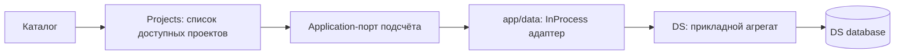

## Контекст и цели

Аудит обнаружил повторные обработчики сохранения, invalidate(all), независимые чтения одних данных, повтор журнала после revert и N+1 карточек проектов. Локальная запись часто быстрая; dev-revert около 2,4 с требует отдельного профиля и не объясняется только клиентом. Измерения: references/baseline.md.

Цель — уменьшить число, объём и время обязательных чтений с минимальными изменениями существующих механизмов. Не строим новую архитектуру синхронизации или кеширования.

## База после ребейса

Change опирается на `feature/backend-monolith`, commit `67515b2f`. Единственный прикладной процесс — backend-kt/app; nginx является историческим снимком и не изменяется. Ресурсы OpenAPI/миграций принадлежат runtime соответствующей подсистемы. Раздельные БД и явный выбор Exposed Database сохраняются.

В базе уже есть ModelReadSelection/ModelReadQuery, согласованное readOnly-чтение и X-DS-Read-Context, постраничные списки и обогащённые компонентные чтения. Новая проекция token-ids должна использовать существующее разрешение `version=draft|x.y.z`/`versionId`, project-scoped контекст и заголовок фактического чтения; конфликтующие селекторы отклоняются. Не создавать параллельный resolver границ. Summary по-прежнему вызывает полный repository.list, поэтому его оптимизация остаётся актуальной.

## Решения

### 1. Потребность определяет загрузку

Каждому чтению соответствует видимый потребитель или явно начатое действие. Загрузка проекта/ДС допускает только данные видимого экрана, навигации и проверки доступа; наличие вкладки или кнопки не является потребностью в её содержимом. Данные, без которых видимое превью действительно невозможно, считаются необходимыми зависимостями и перечисляются явно.

| Контекст | Когда читать | Что не читать заранее |
| --- | --- | --- |
| Каталог проектов | При показе каталога/видимой навигации, если нет свежего результата | Полные списки ДС каждой карточки |
| Проект | При открытии списка ДС проекта | Темы, токены и настройки всех ДС |
| Дизайн-система | Краткие сведения и доступ для оболочки; данные выбранного раздела | Все разделы токенов, конфигурации всех компонентов |
| Раздел токенов | При его открытии или потребности видимого превью | Остальные типы токенов |
| Компонент | При выборе, включая явные зависимости превью | Конфигурации невыбранных компонентов |
| Настройки | Данные открытой секции | Участники, ключи и зависимости удаления скрытых секций |
| Журнал | Полные строки и их обогащение при открытии | Полный changes и участников ради закрытого журнала |
| Счётчик/отметки | Компактный summary для видимого счётчика; tokenId для открытого раздела с отметками | Данные скрытых индикаторов |

Инвалидация скрытого ресурса только помечает его устаревшим. Его читают при следующей потребности. Истечение TTL само не запускает запрос. При уходе с экрана снимаются подписки; ненужный запрос отменяется, если его не ждёт другой потребитель. Смена контекста защищена от поздних ответов. Спекулятивный prefetch и периодический опрос не добавляются.

### 2. Исправить существующий путь сохранения

В subjectMutation и очередях оставить одно подтверждение операции; убрать повторный recordDraftSave и invalidate(all) по timestamp. Обновлять только затронутые области. Достаточный ответ команды применять к уже загруженной модели, сохраняя более новый локальный ввод. При недостаточном ответе выполнять одну сверку активной области после завершения её очереди. Скрытые области не читать.

Использовать существующие очереди, редакции и механизмы инвалидации; отдельный универсальный EditorReadCoordinator не вводить. Собственный SSE/повтор идемпотентного ответа не должен создавать вторую волну. Удалённая инвалидация во время GET не теряется; старый ответ не объявляет новую редакцию свежей.

После серии revert один явный путь обновляет открытый журнал и необходимые активные области. Убрать reload из-за смены идентичности designSystem. При частичном выполнении/неизвестном COMMIT сверять затронутые области, не повторять мутацию при повторе чтения.

### 3. Дополнить существующий кеш

Расширить существующие useLoad/readEditor: свежий результат не перечитывать при mount; одновременные одинаковые чтения объединять; общие проекты/ДС/участников и метаданные переиспользовать между экранами. Если требуется общий небольшой модуль хранения, он содержит только значения, состояние запроса, срок свежести и адресную инвалидацию. Новая библиотека, универсальный граф зависимостей и обязательный LRU на 200 записей не нужны.

Ключ включает сессию/субъект доступа, проект/ДС/тему/версию, HTTP-метод, URL, нормализованные параметры и тело для POST-чтений. Экспорт Card и Accordion по одному URL с разными телами не объединяется. Пустой успешный результат кешируется, ошибка не становится пустым успехом.

Свежесть каталогов и участников — 30 секунд, глобальной меты — 300 секунд; разделы редактора живут в существующей сессии до адресной инвалидации. По истечении срока повторное использование активным потребителем/возврат фокуса допускает одну ревалидацию. Неактивные ресурсы не читаются. Связанный CRUD обновляет/инвалидирует только свои записи и списки. Выход очищает сессионные данные; 401/403 удаляет соответствующие защищённые данные. Серверная проверка доступа обязательна.

Производные модели компонентов зависят от версии метаданных: успешное обновление/импорт меты инвалидирует соответствующие производные результаты. Открытый компонент пересобирается из актуальных данных, закрытый — при следующем выборе. Не добавлять бессрочный второй кеш поверх обновляемого справочника.

### 4. Каталог без N+1

Обычный GET /projects возвращает обязательное designSystemCount: Int? без include-параметра и отдельного старого варианта. Ноль означает известное отсутствие нетехнических ДС, null — недоступную сводку. Карточки не вызывают списки ДС ради числа.

Подсистема projects определяет доступные проекты и вызывает application-порт пакетного подсчёта. Адаптер в `backend-kt/app/data`, подключённый через `app/di`, вызывает прикладной интерфейс подсистемы DS в том же процессе, по существующему образцу InProcessProjectContext/InProcessDesignSystemOwnership. DS выполняет группировку в собственной явно выбранной БД; projects не импортирует DS data/таблицы. Пакеты до 500 ID ограничивают размер SQL, но не создают N отдельных выборок.

Новый внутренний HTTP-маршрут, межсервисный ключ, URL и сетевые таймауты не нужны. Отсутствие конфигурации адаптера — ошибка запуска, а не штатный режим отключённой сводки. При сбое DS-чтения проекты остаются доступны с null для неизвестных количеств; успешные пакеты сохраняются, CancellationException не превращается в успешный ответ. Автоматических повторов и резервного N+1 нет. Используются существующие настройки пула/SQL; фактическую задержку группировки измерить, произвольный HTTP-бюджет 1500 мс не переносить на JDBC как обещание отмены запроса.

Контракт списка обновляется в OpenAPI runtime projects и проверяется у frontend-kt/CLI/MCP. Сборка app связывает интерфейсы без DI override и без циклической проверки списка проектов.

### 5. Компактные данные журнала

Существующий changes/summary сохраняет {total}, но считает точный результат без загрузки полного журнала и previous/current JSON в приложение. Правила отображаемых изменений остаются общими; полный changes сохраняет 422 JOURNAL_LIMIT_EXCEEDED.

Для отметок добавить GET /api/ds/design-systems/{id}/changes/token-ids с обязательным tenantId и необязательным versionId, ответ {tokenIds: string[]}. Уникальные ID только видимо изменённых определений/значений выбранной темы; без авторов и старых/новых значений. Один ответ соответствует одному согласованному чтению БД. Курсоры, страницы и READ_SNAPSHOT_STALE не вводятся. Измерить объём на большом наборе; если компактный список окажется проблемой, расширение контракта требует отдельного решения.

Summary запрашивается только для видимого счётчика, token-ids — для видимых отметок, полный журнал — при открытии. После очереди по одному необходимому чтению каждого ресурса. Журнал переиспользует свежие имена/определения. 422 и сетевой отказ не отображаются как «0 изменений».

### 6. Разделы и компоненты

Сначала убрать повторные триггеры и сохранять уже полученные результаты разделов. Не требовать новых includeSource DTO или полной переделки модели темы. При первом открытии читать только необходимые выбранному разделу данные, документировать реальные зависимости превью. Проверить, можно ли использовать полученные определения/значения вместо второго независимого чтения; не синтезировать отсутствующие авторские overrides из производных значений.

Перед использованием глобальных массивов проверить имеющиеся `components/{id}/properties?include=platformParams`, `components/{id}/deps?include=reuseConfig`, `appearances/{id}/resolved-properties` и `token-references`: применять существующие адресные/обогащённые ответы, где они действительно заменяют старое чтение без потери семантики. Пагинацию списков использовать только для видимого списка с корректным продолжением, не усекать необходимые данные превью первой страницей.

Общий каталог и глобальные массивы метаданных компонента читаются один раз при первой реальной потребности и переиспользуются в пределах свежести. Конфигурация и явные вложенные зависимости — для выбранного компонента. Полные property-platform-params/property-variations на первом холодном открытии допустимы при нынешнем контракте; повтор при Accordion → Card при свежем кеше запрещён. Новые componentId-фильтры не являются обязательной частью change. Если остаточный холодный объём велик, зафиксировать отдельное обоснованное предложение, не расширять scope автоматически.

### 7. Сетевые и серверные задержки

Ktor-вход `backend-kt/app` (GatewayRequestHandler) возвращает Access-Control-Max-Age: 600 для разрешённого OPTIONS, сохраняя Vary: Origin и текущие ограничения/авторизацию фактических запросов. Ограничитель readEditor не ослаблять без замеров после удаления лишних чтений.

Использовать существующие correlation ID и инструменты профилирования для revert/size-tokens: отделять ожидание соединения, SQL, проверки и фактический COMMIT. Новую постоянную диагностическую инфраструктуру не делать обязательной. Устранять только подтверждённые повторные выборки/вычисления; не менять изоляцию, блокировки, идемпотентность и ограничения ради скорости. Индексы — только по планам и новой Flyway-миграцией.

## Проверка и границы

Исходный baseline снят до монолита и изменений API. Перед оценкой эффекта снять новый baseline на текущем HEAD в монолитном контуре; сравнение старых отдельных контейнеров с новым процессом не доказывает эффект данного change. Не запускать setup/reset поверх прежних данных ради пересмотра спеки. Профиль включает отдельные пулы projects/DS, CPU/heap/GC общего процесса и реальный COMMIT. Проверки публичного входа выполняются в app; при изменении публичного контракта синхронизируются его gateway-contract/resource-integrity артефакты по штатной процедуре, без ослабления тестов.

| Сценарий | Критерий |
| --- | --- |
| Обычная правка в прогретом разделе | 0 проектов/участников/неизменившихся справочников; 0 скрытых разделов; 0 GET раздела при достаточном ответе, иначе максимум 1 после очереди |
| Видимые индикаторы после серии | Не более 1 summary и 1 token-ids; для скрытых — 0 |
| Revert при открытом журнале | Не более 1 changes и 1 необходимого summary, свежие справочники не перечитываются |
| Возврат в неизменившийся раздел | 0 повторных предметных HTTP-чтений |
| Каталог 1/10/50 проектов | 1 публичное чтение, 0 полных списков ради счётчиков |
| Accordion → Card → Accordion | 0 повторов свежих глобальных справочников; только недостающая конфигурация/явные зависимости |
| Навигация при свежем каталоге | 0 повторов GET /projects |
| Скрытые секции/журнал | 0 предметных чтений до открытия; инвалидация и TTL не запускают их |
| Покой после сверок | 100 секунд без предметного polling |

Проверить production frontend и dev/StrictMode, одинаковые изолированные данные, большой журнал, две сессии, поздние ответы, отзыв доступа, импорт меты и отказ агрегата. Сохранить количество/байты/длительности обязательных запросов и корректность итоговых данных до/после. Полный журнал выше лимита должен показывать ограничение, а summary/отметки — работать. Dev-серверный revert повторить после выпуска на том же наборе; локальные замеры не доказывают устранение его двухсекундной задержки.

Порядок: клиентские дубли и отложенная загрузка → переиспользование кеша → необходимые серверные агрегаты → повторные измерения. OpenSpec strict, FAST, независимое review, FULL и внешние проверки обязательны до архивации. Production-код пока не изменяется.
