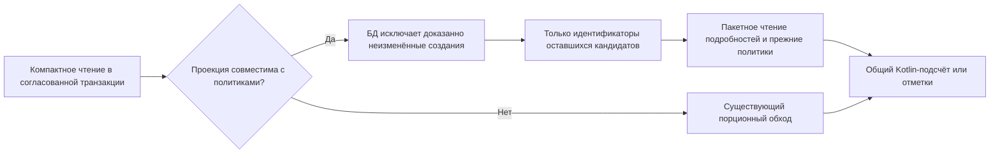

# Ранний отбор кандидатов компактного журнала

## Контекст

См. [proposal.md](proposal.md) и [evidence.md](evidence.md). `CompactJournalReader` уже читает
порции, но каждая порция содержит полные состояния технических созданий. Штатная политика
новой темы лишь после этого читает `token_value_creation_baselines`, строит предыдущее
состояние и скрывает нетронутые значения. Порционность ограничивает память одной порции,
но не суммарную работу, передачу данных и создание объектов.

Сводка использует `draftChangeDisplayCount`: одна запись может означать несколько строк
редактора. Подсчёт учитывает канонизацию значений и структуру массивов. `COUNT` ревизий
не эквивалентен этому контракту. Полный журнал остаётся эталоном предметной семантики.

## Цели и границы

- Для штатного набора политик исключить материализацию нетронутых начальных значений
  в компактных чтениях, сохранив точные результаты.
- Сохранить зависимость подробной обработки от оставшихся кандидатов, а не числа скрытых
  созданий. Это не обещание постоянного времени SQL: БД может сравнивать исходные строки.
- Оптимизировать `summary` и `token-ids`; полный журнал, его страницы, адресный откат,
  запись значений и клиентский протокол не переводить на новый путь.
- Не добавлять кеш результатов, отдельный механизм версии, новые API и зависимости.
  Таймер до окончания отправки ответа — отдельная задача, сюда не входит.

## Решения

### Узкая проекция перед существующими обработчиками

Предметная реализация в `feature-themes/data` отбирает идентификаторы значений,
которые ещё требуют проверки. Она понимает устойчивые адреса, предметные редакции,
начальные значения и условие создания родительской темы. Общий `core` не знает имён
таблиц темы и не содержит проверки строки `token-value` для реализации этого правила.

Проекция исключает только доказанно скрытые неизменённые создания. Затем
`feature-design-systems/data` запрашивает подробности оставшихся идентификаторов
пакетно через существующие предметные обработчики и применяет прежние политики.
Сводка вызывает тот же Kotlin-подсчёт; отметки выводят уникальные идентификаторы токенов
из уже проверенных отличий. Остальные типы сущностей сохраняют нынешний обход.

Для оставшегося значения новой темы прежняя политика по-прежнему подставляет состояние
создания как предыдущее. Нельзя считать такое пользовательское изменение обычным
созданием и нельзя терять изменения `palette_id`, `value` или `overridden`.



Проекция сокращает вход в подробную обработку, но не заменяет предметную семантику
приблизительным SQL-подсчётом. Такой вариант имеет меньшую область влияния, чем отдельная
реализация всех правил счётчика в SQL или изменение общего `differences` для всех потребителей.

### Консервативное сравнение с начальными значениями

Ранний отсев применим, когда выполнено то же условие родителя, что у штатной политики:
тема существует на выбранной границе и отсутствовала на предыдущей, значение является
её техническим созданием и доступно его исходное состояние. Удаление, отсутствие исходного
состояния или неподтверждённая эквивалентность не служат основанием удалить кандидата.

SQL-предикат должен быть не шире доказанного равенства нынешней Kotlin-политики.
Одного сравнения `jsonb =` недостаточно без проверки: числовые представления `1` и `1.0`,
SQL NULL, JSON null и строка с вложенным JSON могут иметь разные правила. При сомнении
строка остаётся для прежней проверки. Не следует менять нормализацию сохранённых данных.

Проверка проекции на реальной схеме предшествует подключению. Проверяются также порядок
массивов, порядок ключей объекта, строки и числа, нулевые/пустые значения, ссылки палитры
и собственные значения платформ. Подробное равенство и пользовательский счётчик по-прежнему
вычисляются существующим кодом для оставшегося набора.

### Явная совместимость и границы слоёв

В `core/application` размещается отдельная необязательная возможность отбора кандидатов.
Это не автоматически наследуемое дополнение `DraftChangeHandler by delegate`.
Штатная политика темы явно объявляет поддерживаемую семантику; наличие неизвестной или
несовместимой политики выбирает прежний путь до накопления результата.
Нельзя использовать ранний отсев, если последующая политика способна вернуть скрытую строку
или изменить условие её видимости. Ошибка SQL остаётся ошибкой чтения, а не незаметным
переходом к частичному результату.

Проекция выбирается в уже авторизованном `readOnly` и получает разрешённые границы
ModelReadSelection. Предыдущая граница, проект, дизайн-система и тема ограничиваются
до отбора идентификаторов. Данные разных границ не читаются в отдельных транзакциях.
`di` подключает предметную реализацию; Exposed/JDBC не переходят в `application`/`domain`.

## Программное проектирование

Предлагаемые внутренние контракты; HTTP DTO остаются прежними:

```kotlin
data class JournalProjectionScope(
    val designSystemId: UUID,
    val boundaryId: UUID,
    val sequenceNumber: Long,
    val previousSequenceNumber: Long,
    val tenantId: UUID?,
)

interface JournalCandidateProjection {
    val entityType: String
    fun supports(policies: List<DraftChangePolicy>): Boolean
    fun visit(scope: JournalProjectionScope, consume: (List<UUID>) -> Unit)
}
```

`supports` проверяет явно поддерживаемые контракты политик, а не имена анонимных классов.
`visit` передаёт только ограниченные порции оставшихся идентификаторов; скрытые начальные
значения не пересылаются списком всех UUID. `CompactJournalReader` гидратирует эти порции
через предметный `describeEntities`, сохраняя фильтры обёрток и контекст родителя.
Окончательные имена внутренних типов допускается уточнить без изменения этого контракта.

## Риски и компромиссы

- Ошибочное раннее исключение теряет правку → консервативный предикат, сравнительные тесты
  с прежним обходом и проверка восстановления исходного значения.
- Отличие счётчика от числа сущностей → прежний `draftChangeDisplayCount`, включая несколько
  полей, структуру массивов и канонизацию; авторы и технические редакции не входят в узкую проекцию.
- Скрытое изменение поведения расширений → явная совместимость, неизвестная политика и
  фильтрующая обёртка покрываются тестами совместимого пути.
- Перенос нагрузки в неудачное соединение SQL → планы `EXPLAIN (ANALYZE, BUFFERS)` на
  новой и опубликованной теме; индекс вводится лишь при доказанном выигрыше новой миграцией.
- Большое число действительных изменений → подробности всё ещё нужны; ограниченные порции
  и прежние пределы полного журнала сохраняются. Ускорение измеряется отдельно для этого случая.

## Проверка результата

### Локальные узкие проверки

Сравнивать новый и прежний компактный путь, а для доступного размера — также полный журнал
на одной границе. Матрица: новая и опубликованная темы; 0/1/9 видимых правок; реальные
изменения начального значения и возврат к нему; разные платформы/режимы; удаление;
производный тип цвета; компоненты; права и чужой проект; опубликованная версия;
границы порций; журнал больше полного лимита; несовместимая политика.

При фиксированных пользовательских изменениях увеличить число нетронутых созданий
с 1 000 до 10 000 и 50 000. Для штатного случая число полных декодированных состояний
таких значений должно оставаться нулевым; число подробных порций не должно расти из-за них.
Чтение строк внутри БД не объявляется постоянным и проверяется планами отдельно.

### Сравнение до архивирования

Использовать одинаковый синтетический снимок с не менее 7 407 значениями новой темы и
отдельную опубликованную тему. Исходная версия включает P3-исправления PR #164 и не включает
этот Change. В каждом варианте подтвердить SHA сборки, образа и контейнера до измерений.
Оба режима — все CPU, затем общие два CPU для backend/PostgreSQL — сравниваются на равных
ресурсах, с одинаковой диагностикой и без конкурирующей измерительной нагрузки.

После прогрева собрать не менее 20 измерений каждого маршрута на вариант. Цель:
минимум 30% снижения медианы HTTP `summary` и `token-ids` для новой темы в обоих CPU-режимах,
без ухудшения медианы опубликованной темы более чем на 10%. Вариативный или неполный
результат не считается подтверждением. Ответы и точные счётчики должны совпасть.
Количество SQL — диагностический показатель, не целевая константа.

Сохранить HTTP/correlationId, `ds_transaction`, планы, число возвращённых/декодированных
кандидатов, размер ответов, короткий JFR по тем же окнам и методику прогрева. Эти числа
объясняют результат, не превращают выборку стеков в проценты wall-time.
При отсутствии окружения проверка остаётся незавершённой. Общие проверки репозитория
выполняются по workflow после достижения результата и не дублируются задачами Change.

## Выкладка и наблюдение

Публичные контракты и формат сохранённых данных совместимы; обычный выпуск backend.
Если нужен новый индекс, оценить блокировку записи и окно обслуживания до применения.
Откат приложения не требует удаления индекса. На dev после выпуска наблюдать те же
маршруты на новых и опубликованных темах, сравнивая одинаковые наборы данных. Это план
наблюдения после выпуска, а не блокирующая задача до архивирования.
