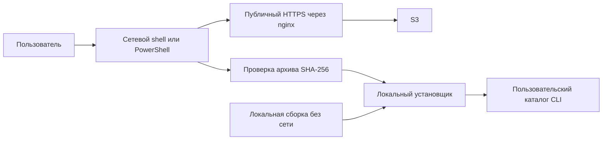

# Проектное решение

## Контекст и границы

См. proposal.md. Задачи упаковки четырёх дистрибутивов уже существуют; текущий workflow публикует JVM/Windows в GitHub Releases. В этом Change меняются доставка, версия и установка. Настройка nginx и пользовательская инструкция исключены по договорённости. backend-kt и js не затрагиваются.

## Решения

### Два адреса доставки

Workflow переиспользует GitHub secrets публикации клиента: `AWS_ENDPOINT`, `AWS_S3_BUCKET_2`, `AWS_REGION`, `AWS_ACCESS_KEY_ID` и `AWS_SECRET_ACCESS_KEY`. Новые дублирующие настройки endpoint, bucket, региона и credentials не вводятся. Отдельный префикс артефактов задаётся через GitHub vars `CLI_S3_PREFIX`, поскольку у клиента путь сейчас указан непосредственно в workflow. Существующий совместимый с S3 способ подписи сохраняется. `CLI_DOWNLOAD_BASE_URL` задаёт публичный HTTPS-корень через nginx независимо от S3. Workflow проверяет обязательные значения до загрузки; URL не содержит credentials.

Под публичным корнем находятся `releases/X.Y.Z/`, `stable.json`, `install.sh`, `install.ps1`. Конкретный домен и префикс определит разработчик в окружении; проверка nginx не входит в задачу. Backend-посредник не нужен для публичных файлов.

### Полный неизменяемый выпуск

Проверенный тег задаёт единственную версию сборки, включая `--version`; локальная сборка сохраняет определённую версию разработки. Существующие имена ZIP сохраняются. SHA-256 записываются в `SHA256SUMS`; дополнительно версия имеет `release.json` с `schemaVersion=1`, `version` и `artifacts` по ключам `macos-arm64`, `macos-x64`, `windows-x64`, `jvm`. Каждый элемент задаёт относительное имя архива и SHA-256. `stable.json` содержит `schemaVersion=1` и `version`.

Публикации сериализуются одной группой concurrency без отмены выполняющейся публикации. Совпадающие файлы разрешают повторный запуск; несовпадающие запрещают изменение версии. После загрузки проверяются удалённые SHA-256 всех архивов. JVM публикуется в GitHub Releases под прежним именем; только после успешного завершения всех шагов заменяется stable.json. При ручной публикации старой версии указатель не понижается; сравниваются числовые X/Y/Z. Удаление релизных каталогов и синхронизация с удалением запрещены.

### Два уровня установки

`distribution/bootstrap/install.sh` и `install.ps1` загружают манифест и архив во временный каталог, проверяют формат версии, допустимое имя архива без переходов по каталогам и SHA-256, распаковывают только ожидаемую структуру и вызывают локальный скрипт. Адрес в них подставляет workflow; env может его переопределить. Shell использует curl либо wget, PowerShell — Invoke-WebRequest. Отдельные скрипты нужны из-за разных оболочек; общий исполняемый установщик добавил бы требование предварительной установки среды.

Локальные скрипты остаются в `distribution/`: существующие macOS/Windows и новый JVM shell. Они входят в архивы и переиспользуются локальными сценариями. Параметры сетевого уровня: `--version X.Y.Z`, `--target jvm` (PowerShell: `-Version`, `-Target`); по умолчанию версия stable и нативная платформа. JVM поддерживается shell на macOS/Linux и требует Java 17+. Неподдерживаемая архитектура не переключается молча на JVM.

Локальный уровень хранит JVM bin/lib целиком, сохраняет права macOS, корректно экранирует пути, создаёт пользовательскую ссылку/PATH без дубликатов. Распаковка, валидация и подготовка выполняются до замены CLI; ошибка установки восстанавливает прежнюю установку. Повторный запуск обновляет только файлы CLI.

## Риски и компромиссы

- SHA-256 подтверждает целостность, а доверие к манифесту обеспечивается HTTPS; отдельная криптографическая подпись не вводится.
- Корпоративная политика PowerShell может запрещать запуск: выдаётся понятная ошибка, системная политика не меняется.
- Совместимость GitHub Releases сохраняется для plasma-android без изменения соседнего репозитория.

## Проверка и развёртывание

Автоматически: формат тега/манифеста, локальный HTTP-сервер с тестовыми архивами, неверная SHA-256/404, повторный запуск, пути с пробелами, сохранение установленной версии при сбое, отсутствие Java. Сборки и запуск --help/--version: macOS на обеих архитектурах, Windows x64 и JVM Linux. Изменённый frontend проходит FAST, независимое review и FULL.

Внешние проверки до архива: полученные в локальной сборке ZIP запускать на реальной целевой ОС либо доступном runner, сохраняя команду, exit code и версии. Отсутствие Windows/macOS x64 не является успехом.

После развёртывания разработчик задаёт `CLI_S3_PREFIX` и публичный URL, проверяет доступность существующих AWS secrets для релизного workflow, проверяет доступ через nginx и выполняет первый релиз. Эта проверка не блокирует архив Change и не разрешает агенту публикацию. Откат — восстановление stable.json на предыдущий полный выпуск без изменения версионных файлов.
