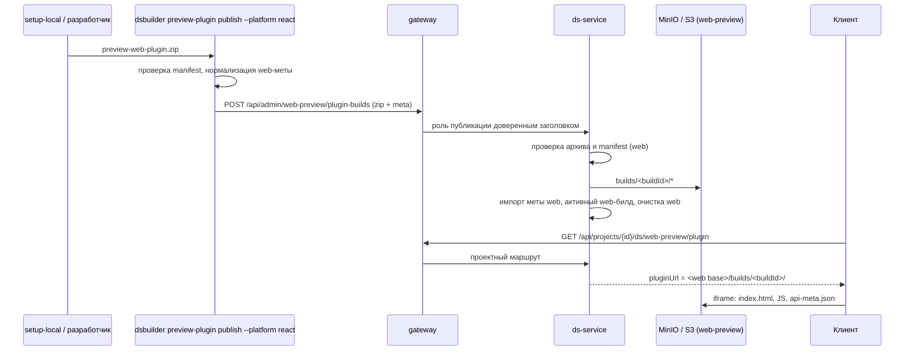

## Контекст

Публикация Compose-плагина (`host-compose-preview-plugin`) устроена так:
- CI plasma-android вызывает `dsbuilder preview-plugin publish --platform compose`;
- CLI проверяет zip, нормализует мету и отправляет multipart в `POST /api/admin/compose-preview/plugin-builds`;
- ds-service проверяет архив и manifest, кладёт файлы в S3 (`<префикс>/builds/<buildId>/`), импортирует мету в глобальный слой, отмечает билд активным и чистит старые;
- клиент спрашивает `GET /api/projects/{id}/ds/compose-preview/plugin` и грузит плагин из `pluginUrl`, файлы браузер берёт прямо из бакета.

Локально `setup-local.sh` публикует архив `local-dev/compose-preview/preview-compose-plugin.zip` той же командой под тестовой служебной учёткой, бакет — `compose-preview` в MinIO.

Вся цепочка привязана к `compose`:
- `PluginManifestParser` требует `platform: compose` и `uikitComposeVersion`;
- маршрут требует мету `compose`, а `PublishPluginBuildUseCase.PLATFORM` используется и для записи, и для очистки, и для выдачи активного билда;
- ключи S3 не содержат платформы, а очистка «сирот» идёт по всему `builds/`, поэтому очистка одной платформы удалила бы файлы другой;
- колонка `uikit_compose_version` обязательна, ответ назван по Compose;
- CLI пропускает только `compose`, имя части и платформа меты захардкожены.

База уже готова к нескольким платформам: `platform` — enum `component_platform`, один активный билд на платформу обеспечен частичным уникальным индексом, методы репозитория принимают платформу.

Web-плагин собирается в этом репозитории (`js/apps/preview-web-plugin`, Vite, `base: './'` — работает из любого каталога), его `preview-plugin.json` содержит `platform: web`, `protocolVersion`, `entrypoint`, `plasmaNewHopeVersion` и `apiMetaSha256`, но не `commit` и `version`. Адрес клиент берёт только из `VITE_WEB_PREVIEW_PLUGIN_URL`, мету web импортировали вручную `components import-api --platform react`.

## Цели / Вне целей

**Цели:**
- web-плагин публикуется и выдаётся ds-service тем же способом, что Compose, с импортом web-меты в той же операции;
- билды платформ не мешают друг другу при хранении и очистке;
- клиент берёт адрес web-плагина у бэкенда;
- локальный контур поднимает web-превью из MinIO без отдельного контейнера плагина.

**Вне целей:**
- workflow CI, публикующий web-плагин на DEV и PROM: команда и маршруты готовы, запуск из CI — отдельный шаг;
- отдельный origin для плагинов: риск общего origin с клиентом уже принят в `host-compose-preview-plugin`;
- изменение формата или маршрутов Compose, совместимость с CI plasma-android сохраняется;
- перевод генератора `js/cli` на мету и код плагина.

## Решения

### 1. Параллельные маршруты `web-preview` вместо обобщённого маршрута с платформой

Web получает свои маршруты: `POST /api/ds/admin/web-preview/plugin-builds` и `GET /api/ds/web-preview/plugin`, рядом с Compose. Внутри они вызывают те же use case с параметром платформы.

Альтернатива — общий `/api/ds/preview-plugins/{platform}` и перевод на него Compose. Отклонена: маршрут Compose вызывают CLI в CI plasma-android и опубликованный клиент. Пришлось бы держать старый маршрут как синоним, а правила gateway, роли и лимиты описывать для трёх путей. Два явных маршрута проще проверить контрактными тестами и описать в gateway.

### 2. Хранилище web — отдельный бакет или префикс

Билды web лежат в `<DS_WEB_PLUGIN_S3_PREFIX>/builds/<buildId>/` бакета `DS_WEB_PLUGIN_S3_BUCKET`, публичный адрес — `DS_WEB_PLUGIN_PUBLIC_BASE_URL`. Адрес S3, ключи и лимиты общие (`DS_PLUGIN_*`). Локально это бакет `web-preview` рядом с `compose-preview`. На стендах — тот же бакет, что у Compose, с префиксом `design-system-builder/web-preview`, не вложенным в префикс клиента.

`S3PluginBuildStorage` создаётся по одному на платформу со своими бакетом и префиксом. Очистка «сирот» перебирает только своё хранилище, поэтому файлы Compose для неё не видны.

Альтернатива — общий бакет и ключи `builds/<platform>/<buildId>/`. Отклонена: адреса уже опубликованных Compose-билдов изменились бы. Остались бы и старые ключи без платформы, которые новая очистка считала бы сиротами.

### 3. Правила manifest по платформе

`PluginManifestParser.parse(archive, platform)` проверяет общие правила и поле версии библиотеки своей платформы: `uikitComposeVersion` для `compose`, `plasmaNewHopeVersion` для `web`. `PluginManifest` получает поля `platform` и `libraryVersion` вместо `uikitComposeVersion`.

Web-плагин получает `commit` и `version` при упаковке (решение 6). `buildId` по-прежнему — первые 12 символов коммита. Первичный ключ `build_id` остаётся общим: коммиты двух репозиториев не пересекаются на практике. Совпадение `buildId` с билдом другой платформы отклоняется `409`, как подмена содержимого.

### 4. Колонка версии библиотеки

Миграция Flyway переименовывает `uikit_compose_version` в `library_version`. Ответ Compose-маршрута сохраняет поле `uikitComposeVersion`, заполненное из неё. Ответ web-маршрута отдаёт `platform: web` и `libraryVersion`.

Альтернатива — отдельная колонка `plasma_new_hope_version`. Отклонена: на каждую платформу добавлялась бы своя обязательная по условию колонка.

### 5. Импорт меты и роль публикации — как у Compose

Маршрут web принимает мету только с `platform: web` и импортирует её тем же `importMeta`, что и `import-api-meta`, в транзакции публикации. Роль публикации (`compose_preview_publisher`, заголовок `X-Compose-Preview-Publisher`) и служебная учётка `dsbuilder-preview-publisher` общие для обеих платформ. Публикатор и так управляет глобальным слоем Compose, а для web права те же. Gateway получает второй `location` с теми же правилами, что у Compose.

Альтернатива — отдельная роль для web. Отклонена: публикует одна команда, а вторая учётка в Keycloak и вторая роль в gateway ничего не ограничивают.

Имя роли и заголовка остаётся с `compose`. Переименование затронуло бы Keycloak, gateway и CI plasma-android. Это отмечено как долг.

### 6. Архив — zip, упаковка в репозитории плагина

Архив web-плагина — `local-dev/web-preview/preview-web-plugin.zip`, а не tar.gz: ds-service и CLI читают только zip (`PluginArchiveReader`, `PreviewPluginZipReader`). Второй формат добавил бы второй разборщик с теми же проверками безопасности путей.

Команда `npm run package` в `js/apps/preview-web-plugin`:
1. Проверяет, что в каталоге плагина нет незакоммиченных изменений.
2. Собирает `dist`.
3. Дописывает в `dist/preview-plugin.json` `commit`, `version` и `apiMetaSha256` (sha256 `dist/api-meta.json`).
4. Упаковывает `dist` в zip и обновляет блок происхождения в `local-dev/README.md`.

`public/preview-plugin.json` в Git не меняется: `commit` описывает исходники, а не файл с самим собой.

Архив хранится в Git, как архив Compose. Он лёгкий (около 1 МБ, а Compose — 5,8 МБ), и обновлять его нужно, когда меняются story, мета или резолвер плагина.

### 7. Клиент: прямой адрес, иначе бэкенд

`getWebPreviewPluginUrl` становится асинхронным разрешением по образцу `resolveComposePreviewPluginUrl`:
- непустая `VITE_WEB_PREVIEW_PLUGIN_URL` имеет приоритет;
- иначе клиент делает запрос `web-preview/plugin` с кешем на проект и без кеширования ошибок;
- при `404` или ошибке показывается «Превью недоступно» с причиной.

Запрос делается при входе в раздел компонентов, если в нём есть web-компоненты, — там же, где сейчас прогревается плагин.

В `js/docker-compose.dev.yml` у клиента `VITE_WEB_PREVIEW_PLUGIN_URL` по умолчанию пустая, а сервис `preview-web-plugin` удаляется. Для разработки самого плагина его запускают из каталога (`npm run build && npm run preview`, порт 3011) и задают клиенту прямой адрес `http://localhost:3011/`.

### 8. Локальный контур

- `minio-init` создаёт бакет `web-preview` с анонимным чтением.
- ds-service в `docker-compose.local.yml` получает `DS_WEB_PLUGIN_S3_BUCKET=web-preview` и `DS_WEB_PLUGIN_PUBLIC_BASE_URL=http://localhost:${MINIO_PUBLIC_PORT:-9000}/web-preview`.
- `publish-compose-plugin.sh` переименовывается в `publish-preview-plugin.sh` с параметром `--platform compose|react`. Старое имя остаётся тонкой обёрткой для обратной совместимости инструкций.
- `setup-local.sh` и `setup-local.ps1` после Compose публикуют web. Архив по умолчанию — `local-dev/web-preview/preview-web-plugin.zip`, переопределяется `--web-plugin-zip` / `WEB_PREVIEW_PLUGIN_ZIP`, `--skip-plugin` пропускает оба.

### Поток публикации и загрузки



## Программное проектирование

Kotlin, `ds-service/feature-components`. В `application` появляется платформа билда, `data` получает по хранилищу на платформу, `presentation` — маршруты web, `di` связывает хранилище с платформой.

```kotlin
// domain / application
enum class PreviewPluginPlatform(val wire: String, val libraryVersionField: String) {
    COMPOSE("compose", "uikitComposeVersion"),
    WEB("web", "plasmaNewHopeVersion"),
}

data class PluginManifest(
    val platform: PreviewPluginPlatform,
    val version: String,
    val commit: String,
    val libraryVersion: String,
    val apiMetaSha256: String,
    val protocolVersion: Int,
    val entrypoint: String,
)

object PluginManifestParser {
    fun parse(archive: PluginArchive, platform: PreviewPluginPlatform): PluginManifestResult
}

class PluginBuildStorages(private val byPlatform: Map<PreviewPluginPlatform, PluginBuildStorageBinding>) {
    fun configured(platform: PreviewPluginPlatform): PluginBuildStorageBinding?
}

data class PluginBuildStorageBinding(val storage: PluginBuildStorage, val settings: PluginBuildSettings)

class PublishPluginBuildUseCase(/* storages, builds, transactions, importMeta, policy */) {
    suspend operator fun invoke(platform: PreviewPluginPlatform, command: PublishPluginBuildCommand): PublishPluginBuildResult
}

class GetActivePluginBuildUseCase(/* storages, builds, policy */) {
    suspend operator fun invoke(platform: PreviewPluginPlatform, actor: Actor): ActivePluginBuildResult
}
```

```kotlin
// presentation: ответ web-маршрута; ответ Compose не меняется
@Serializable
data class ActiveWebPluginBuildResponse(
    val buildId: String,
    val platform: String,        // "web"
    val libraryVersion: String,  // plasmaNewHopeVersion
    val metaSha256: String,
    val protocolVersion: Int,
    val pluginUrl: String,
    val publishedAt: String,
)
```

frontend-kt, `feature-components`:

```kotlin
interface PreviewPluginRemoteSource {
    suspend fun publish(platform: TargetPlatform, archive: ByteArray, meta: NormalizedApiMeta, dryRun: Boolean): PublishOutcome
}
// PublishPreviewPluginUseCase выбирает ApiMetaNormalizer по платформе: COMPOSE → ComposeApiMetaNormalizer, REACT → WebApiMetaNormalizer
```

Клиент:

```ts
export const resolveWebPreviewPluginUrl: (projectId: string) => Promise<string | undefined>;
export const fetchWebPreviewPluginDescriptor: (projectId: string) => Promise<WebPreviewPluginDescriptor | undefined>;
```

## Риски / Компромиссы

- **[Риск] Переименование колонки ломает откат ds-service на прежнюю версию.** → Миграция только переименовывает колонку без потери данных. Откат требует обратной миграции, она описана в плане.
- **[Риск] На стендах web-превью остаётся недоступным, пока web-плагин не опубликован.** → Публикацию можно сделать вручную той же командой CLI под служебной учёткой. Workflow CI — следующий шаг.
- **[Компромисс] Роль и заголовок публикации названы по Compose, а действуют на обе платформы.** → Записано как долг, переименование согласуется с plasma-android отдельно.
- **[Риск] Архив в Git расходится с исходниками плагина.** → `commit` в manifest и блок происхождения в README показывают, из какого коммита собран архив. Упаковка отказывается работать с незакоммиченными правками.
- **[Риск] Разработчик плагина забывает пересобрать архив, и локальный контур показывает старую версию.** → Для работы над плагином его запускают из каталога с прямым адресом. README описывает, когда обновлять архив.

## План миграции

1. Выкатить ds-service с миграцией и маршрутами web и gateway с новым `location`.
2. Завести на стендах `DS_WEB_PLUGIN_S3_BUCKET`, `DS_WEB_PLUGIN_S3_PREFIX` и `DS_WEB_PLUGIN_PUBLIC_BASE_URL` в Coolify. Это шаг выкладки, файлы `.env.*` в изменении не правятся.
3. Опубликовать web-плагин на DEV командой CLI под служебной учёткой.
4. Выкатить клиент.

Откат: клиент с прямым адресом работает без бэкенда. ds-service откатывается вместе с обратной миграцией, которая переименовывает `library_version` обратно в `uikit_compose_version`.

## Открытые вопросы

- Кто и когда публикует web-плагин на стенды: workflow в этом репозитории при изменении `js/apps/preview-web-plugin` или ручной запуск. Решается в изменении про CI.
