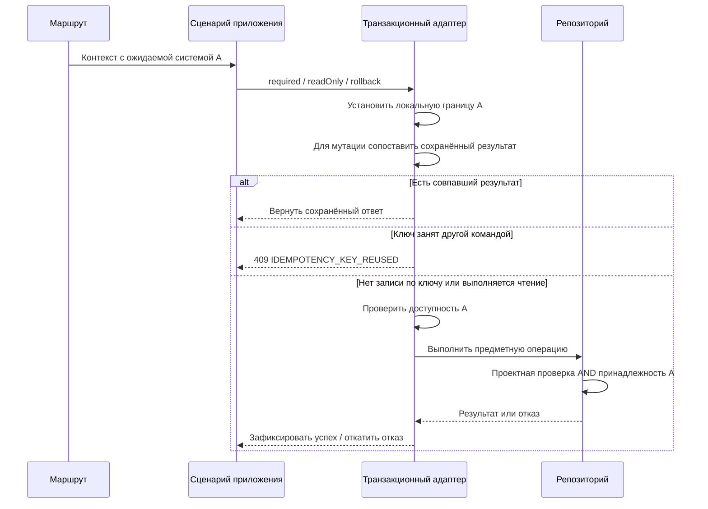

## Контекст

Исследование выполнено на `7d948d60` ветки `feature/ds-routes`. Полная карта маршрутов и обходных путей — в [coverage.md](coverage.md). Это статическое исследование: эксплуатация дефекта и тесты с PostgreSQL пока не выполнялись.

`DsRequestContext` и `TransactionRunner` уже отделяют приложение от Exposed. `ExposedTransactionRunner` передаёт в PostgreSQL проект, участника и версию; общие запросы собирают состояние на этой границе. `ExposedModelReadSelectionResolver` определяет систему по ресурсу, но не сравнивает её с системой, выбранной клиентом. Поэтому выбранная система должна стать дополнительным ограничением, а не ещё одним источником разрешений.

## Цели и границы

Все операции над системными сущностями ограничиваются системой из пути, в том числе списки, создание, пакетные записи, связанные UUID и повтор ранее завершённой команды. Сохраняются разделение слоёв, проектная авторизация, существующие предметные ошибки, конкурентность, история, уведомления и форматы локальных файлов.

Новые MCP-мутации, новая модель ролей, PostgreSQL RLS, смена модели компонентов, переписывание всех портов репозиториев и изменение архитектурных тестов не входят в работу. Служебные заполнения `base`, административный импорт глобальной модели и операции сборок плагинов не получают искусственную привязку к одной системе.

## Решения

### Явный контекст приложения и локальный контекст транзакции

В `DsRequestContext` добавляется `designSystemId: UUID?` с отсутствующим значением по умолчанию для глобальных и служебных операций. Для системного публичного или внутреннего маршрута значение обязательно и извлекается только из path-параметра. Дублирующий `designSystemId` удаляется из входных DTO и query системных маршрутов. Тело и query не могут переопределить систему пути; некорректный UUID даёт `400`, отсутствие зарегистрированного системного пути — `404`. Клиентские заголовки не являются источником этой границы.

Presentation разбирает путь и DTO; application передаёт явный контекст и вызывает порты; data проверяет проект и систему в той же транзакции, где читает или пишет. Domain и зависимости Gradle не меняются. DI продолжает связывать существующие реализации.

В начале контекстной транзакции адаптер устанавливает `ds.design_system_id` через транзакционный `set_config(..., true)`, не связывая установку границы с проверкой существования системы. Существующие проектная авторизация и проверка разрешения операции сохраняются. Для мутации сначала сопоставляется сохранённый идемпотентный результат с проектом, ключом и командой, включая систему пути; совпавший результат возвращается без требования существования уже удалённой системы, а занятый несовпадающей командой ключ даёт `409 IDEMPOTENCY_KEY_REUSED` до проверки существования. Только при отсутствии записи по ключу (`IdempotentRequestLookup.New`) выполняется проверка доступности системы перед новым предметным выполнением, а для чтений — до выдачи предметных данных. Откатываемая транзакция применяет тот же порядок, если использует идемпотентность. Для несистемной операции устанавливается пустое значение явно; каждый повтор транзакции конфигурируется заново. Ограничение не должно переживать возврат соединения в пул. `systemAdmin` не отменяет сравнение с системой из пути; существующая административная политика доступа к самой системе сохраняется.



Сравнение системы применяется и при административном доступе. Проверка разрешения на конкретное действие остаётся обязанностью существующего сценария приложения.

### Общие SQL-предикаты и явные исключения

Общий предикат слоя data сопоставляет колонку владельца с транзакционной границей. Он используется в `selectedVersionBoundary`, общих запросах тем и токенов, `resolvedRevisionSql` и проверках `ComponentOwnership`. У глобального объекта нет единственного владельца: фильтруется принадлежащая системе конфигурация или связь, а не глобальная таблица компонентов/свойств.

Нельзя просто сузить `readableDs` во всех случаях: через него вычисляется доступность глобальных компонентов. Системные предикаты и глобальная проектная видимость остаются различимы; несистемный вызов сохраняет прежнюю семантику.

Создание устойчивых строк, чтение истории, сырой SQL журнала и обращения к устойчивым таблицам не всегда используют разрешённые редакции. Для них нужны явные проверки того же общего ограничения до первой записи или раскрытия данных. `lockDraftSubject(s)` и выбор черновика проверяют границу дополнительно, но блокировка не становится единственным механизмом авторизации. Пустой пакет и пустой список также проверяют доступность самой системы.

`ExposedModelReadSelectionResolver` сначала определяет доступного владельца и сравнивает его с ожидаемой системой, затем выбирает черновик/версию. Метаданные фактического чтения и курсор страницы остаются привязаны к этой системе и версии. Запрос версии B из пути A возвращает `404`, без замены черновиком A или B.

### Запись, импорт и пакетные операции

При создании сущности внутри существующей дизайн-системы её владелец берётся из пути. Дублирующий `designSystemId` удаляется из входных DTO системных операций создания, изменения, импорта, выгрузки, публикации и прочих системных команд, а также из системных query-параметров. Presentation формирует внутреннюю application-команду из DTO данных и ID пути либо передаёт ID через `DsRequestContext`; внутренние поля команд/портов, необходимые бизнес-логике, не удаляются. Создание самой дизайн-системы выполняется через `POST /api/projects/{projectId}/design-systems` и не требует заранее существующего ID системы. Удаление дубля не относится к идентификаторам других сущностей внутри пакета и не меняет `designSystemId` в ответах. Новая обязательная проверка равенства тела и пути не вводится: поля в новом входном контракте нет; для неизвестных JSON-полей сохраняется действующая политика десериализации, без использования их для выбора системы. Для доступа к ресурсу по UUID из другой системы возвращается `404`. Проверки связей и разрешённых глобальных определений сохраняются.

Перед записью проверяются все адресованные системные элементы пакета: UUID токенов/тем, осей/значений/стилей/оформлений, групп, редакций и ссылок. Фильтрация чужих UUID с последующим успешным частичным сохранением недопустима. Отказ границы откатывает предметные редакции, служебные устойчивые строки, журнал, результаты повторяемости и уведомления всей операции. Существующие предметные отчёты импорта о неподдерживаемых элементах сохраняются; это не разрешает частичный успех при нарушении границы системы.

`ImportComponentConfigUseCase.dryRun` использует новый `rollback(context, block)`. Отсутствие сохранения не отменяет ограничения чтения и ссылок. `ComponentConfigImporter` проверяется вместе с `ComponentConfigImportSync`, разрешением ссылок, отложенными действиями и удалением отсутствующих элементов. Импорт по имени системы не может выбрать другую систему вместо указанной в пути. Имена и переносимые идентификаторы файла сохраняют текущую семантику импорта; они не трактуются автоматически как UUID серверных сущностей.

Импорт уже создаёт глобальные `component_deps` и интернирует `state_sets`. Эти существующие побочные эффекты сохраняются при прежней авторизации импорта; новая граница не даёт новых прав на глобальные изменения. Их общий доступ и откат `dryRun` проверяются отдельно. Изоляция всех глобальных последствий импорта была бы отдельным изменением поведения.

Публикационная транзакция сравнивает ожидаемую систему и аргумент публикации до получения её блокировки, затем использует общий контекст транзакции. Порядок и тип блокировок не меняются. Откат журнала проверяет принадлежность каждого `changeId`, включая пакет с записями двух систем, до изменений. SSE проверяет ожидаемую систему при подключении и повторной проверке курсора и фильтрует события по ней.

### Идемпотентность

Существующее поведение идемпотентности сохраняется. При сопоставлении системной команды учитывается дизайн-система из пути, чтобы запрос к B не получил сохранённый ответ запроса к A. Для `repeatableMutation` система уже присутствует в полном пути операции; в `IdempotentCreateExecutor` и специализированных обработчиках импорта/публикации она учитывается там, где операция задаётся фиксированным именем.

Область уникальности ключа остаётся проектной. Повтор той же команды возвращает сохранённый ответ без повторной записи; тот же ключ для другой системы обрабатывается существующим конфликтом `409 IDEMPOTENCY_KEY_REUSED`. Повтор успешного удаления самой дизайн-системы также возвращает сохранённые статус, тело и метаданные: повторно искать удалённую систему перед выдачей сопоставленного результата нельзя. Результат сопоставления обрабатывается до проверки существования системы: `Replayed` возвращает сохранённый ответ, `PayloadMismatch` возвращает `409 IDEMPOTENCY_KEY_REUSED`, и только `New` (нет записи по ключу) допускает новое предметное выполнение. Для этой новой команды отсутствие системы даёт `404`. Занятый несовпадающей командой ключ сохраняет приоритет `409`, даже если система уже удалена. Отдельные правила обработки старых результатов, миграция хранилища повторов и новый механизм идемпотентности не вводятся.

### Маршруты и совпадения адресов

Канонический публичный корень — `/api/projects/{projectId}/design-systems/{designSystemId}`. Для отдельного запуска сервиса — `/api/design-systems/{designSystemId}`. Глобальные публичные маршруты публикуются под `/api/projects/{projectId}/design-systems/catalog/...` без ID конкретной системы, административные — под `/api/admin/...`. Внутренний каталог доступен по `/api/design-systems`, глобальные внутренние ресурсы — под `/api/design-systems/catalog`: например, `/api/design-systems/catalog/components` и `/api/design-systems/catalog/palette`. Внутренние административные операции используют `/api/admin/...`, как публичные административные операции. Префикс `/api/ds` полностью удаляется, без параллельных маршрутов или перенаправлений. Клиент проверки принадлежности `documentation-service` переводится со старого `/api/ds/design-systems/{id}` на `/api/design-systems/{id}` вместе с сервером; прежний внутренний системный путь больше не обслуживается.

Глобальные ресурсы выделены в статическую ветку `catalog`: публично `/api/projects/{projectId}/design-systems/catalog/...`, внутри `/api/design-systems/catalog/...`. Например, глобальные компоненты доступны по `/design-systems/catalog/components`, а компоненты системы — по `/design-systems/{designSystemId}/components`. Только сегмент `catalog` резервируется рядом с ID системы и не интерпретируется как UUID. Регистрация отдаёт ему приоритет над `{designSystemId}` в обоих входах; каталог не устанавливает ожидаемую систему. Контрактные тесты проверяют глобальные список/детали, системные список/детали и ошибочный UUID. Список дизайн-систем остаётся по `/design-systems` и не объединяется с глобальным каталогом.

Вместо неявной эвристики по первому сегменту URL используются отдельные помощники регистрации системных и глобальных маршрутов. В манифесте фиксируется категория и однозначное соответствие публичного/внутреннего пути. Нормализация пути для OpenAPI/политик использует канонические `/api/design-systems/...` и `/api/admin/...`. Прежнее преобразование `dsLegacyPath` в `/api/ds/...` заменяется; старый префикс не используется даже как промежуточный адрес, ключ контракта или резервный путь. Регистрация, source-of-truth OpenAPI, манифест и его поля префиксов обновляются согласованно. В `backend-kt/app` новая ветка путей включается в кэш тела, лимит 16 MiB и классификацию подсистемы; проектная авторизация продолжает извлекать только `projectId`.

Сводные и обычные списки после переноса совпадут по `GET /tokens`, `/tenants`, `/appearances`. Для каждого адреса остаётся один обработчик. Для токенов каноническим становится существующий `DesignSystemTokenSummaryResponse`: он уже содержит все поля обычного TokenResponse и используемые редактором `groupId`, `position`, `publishedIn`. Для тем используется существующий полный `TenantResponse`, включая `colorConfig.profile`, `customPalette`, `preview`, даты и `editRevision`. Нового объединённого DTO не требуется; детали и результаты мутаций не расширяются ради спискового контракта. Полная матрица полей и потребителей — в [list-contracts.md](list-contracts.md).

В списке тем `editRevision` не читается для записи существующими клиентами: редактор получает её из отдельного предметного чтения. Поле оставляется ради повторного использования существующего DTO. Даты нужны Kotlin-декодерам, а preview и профиль действительно читаются веб-карточками/настройками. Текущий сводный DTO тем этих полей не отдаёт полностью; переход на TenantResponse устраняет это расхождение без дополнительного HTTP-запроса каждой темы.

Единственный список токенов остаётся на существующем агрегирующем сценарии `feature-design-systems`. Единственный список тем реализуется существующим сценарием `feature-themes` и его `TenantResponse`; ожидаемая система, фильтры и пагинация применяются до расчёта редакций/preview выбранных элементов. Агрегирующий обработчик тем в `feature-design-systems` снимается с регистрации. Новых зависимостей между фичами, импорта DTO одной фичи другой и копии полного DTO не вводится. Конфигурации сохраняют необходимые поля существующих представлений; их отдельная унификация этим исследованием не расширяется. Существующие фильтры, выбор версии и необязательная пагинация сохраняются.

Глобальное чтение свойств/зависимостей компонента переносится под `/api/projects/{projectId}/design-systems/catalog/components/{componentId}/...` без ID системы. Чтение с `include=platformParams` или `include=reuseConfig`, привязанное к системе, переносится под системный корень; глобальный маршрут без ID системы отклоняет системные параметры с `400`. Оси компонента всегда читаются внутри одной системы. Удаляются дубли `/by-design-system/{designSystemId}` из вложенных маршрутов. Полная карта — в `coverage.md`.

## Программное проектирование

Дополнение существующих контрактов, без новых зависимостей на транспорт/БД:

```kotlin
// Дополнительное поле существующего DsRequestContext:
val designSystemId: UUID?

// Дополнительный метод существующего TransactionRunner:
suspend fun <T> rollback(
    context: DsRequestContext,
    block: suspend () -> DsResult<T>,
): DsResult<T>
```

Проверка ожидаемой системы является обязательной частью контракта контекстных транзакций; новая перегрузка не должна по умолчанию терять контекст. Поддельные реализации портов обновляются и проверяются на передачу границы. Сигнатуры большинства предметных use case и репозиториев сохраняются. SQL-предикат и чтение локальных параметров доступны только в data.

## Альтернативы и риски

- Передать систему параметром каждого метода репозитория: явно, но затрагивает почти все порты, реализации и поддельные репозитории. Текущий контекст транзакции уже решает аналогичную задачу выбора версии.
- Проверять только в Ktor: проверка окажется вне предметной транзакции, обойдётся другим адаптером и не охватит ссылки внутри пакета.
- Проверять только при блокировке: пропустит чтения, повторы и вставки до получения блокировки.
- PostgreSQL RLS или новые триггеры на все предметные таблицы: требуют смены политики БД, ролей и служебных сценариев; ради этой задачи не вводятся.
- Неявный контекст в SQL может быть пропущен отдельным запросом → карта охвата, проверки устойчивых таблиц и интеграционные отрицательные сценарии для каждой категории. Это не защита произвольного SQL и не замена существующим ограничениям целостности.
- Объединение списков может увеличить стоимость чтения → сохранить существующую пагинацию, не добавлять покомпонентные/потокенные сетевые запросы, проверять набор полей и не вычислять ненужные детальные значения сверх действующих DTO.
- Доступ к глобальным `base`-данным необходим → сохранять нынешнюю политику чтения глобальной системы; системный путь `base` не даёт права записи.

## Миграция и совместимость

Это согласованное несовместимое обновление сервера и собственных клиентов. Старые системные и глобальные публичные маршруты под `/api/projects/{projectId}/ds` перестают обслуживаться; новые клиенты не откатываются на них при ошибке. Глобальные публичные ресурсы переносятся под `/api/projects/{projectId}/design-systems/catalog` без ID системы. Локальные URI выбора дизайн-системы не меняются. Внешним клиентам предоставляется карта замены. Откат выпуска выполняется согласованно для сервера и клиентов; данные предметной модели не конвертируются.

Исходные Flyway-миграции не редактируются. По правилу `openspec/config.yaml` для изменения маршрутов планируется новая поступательная Flyway-миграция небольшой SQL-функции сопоставления ожидаемой системы (`ds_request_matches_design_system(uuid)`), используемой общим предикатом data. Она читает только транзакционную настройку; предметные таблицы, роли и RLS не меняются. Это позволяет выполнить правило репозитория без фиктивной миграции и без расширения модели данных.

Обновляются source-of-truth OpenAPI `ds-service` и агрегирующая адаптация, манифест, HTTP-клиенты Kotlin, веб-редактор, SSE и ключи кэшей. Тест сверяет регистрацию маршрутов, OpenAPI и манифест с учётом известных устаревших записей; неподдерживаемые методы не восстанавливаются из старого манифеста.

## План проверки

Локальные проверки реализации: целевые тесты mapper/use case/репозиториев/маршрутов, PostgreSQL через Testcontainers, договорённости HTTP-клиентов и MCP, затем `tools/verify fast --change scope-design-system-routes`, независимое review и `tools/verify full --change scope-design-system-routes`. FULL включает сборки, форматирование, статический анализ и сравнение Strictacode всех трёх контуров. Прямые изменения архитектурных тестов, политик Strictacode и агентского процесса не разрешены.

PostgreSQL-проверки не пропускаются без Docker: отсутствие необходимого окружения считается ошибкой проверки. Нужны A/B одного проекта, C другого проекта, глобальная система, администратор и обычный участник; черновики и опубликованные версии; списки, детали и все семейства пакетов из карты охвата. Снимки предметных и служебных данных до/после подтверждают полный откат отказа и отсутствие повторных уведомлений. Для пула проверяются последовательные A → глобальная операция → B, откат и повтор транзакции.

Отдельная обязательная внешняя проверка до архива: на локальном полном контуре выполнить через публичный вход положительные и отрицательные чтения/мутации, импорт `dryRun` и сохранение, публикацию, идемпотентный повтор и SSE; сохранить HTTP-статусы, контексты ответов и сравнение состояния БД. После развёртывания наблюдать отсутствие обращений собственных клиентов к удалённым путям; это наблюдение не блокирует локальную разработку.
