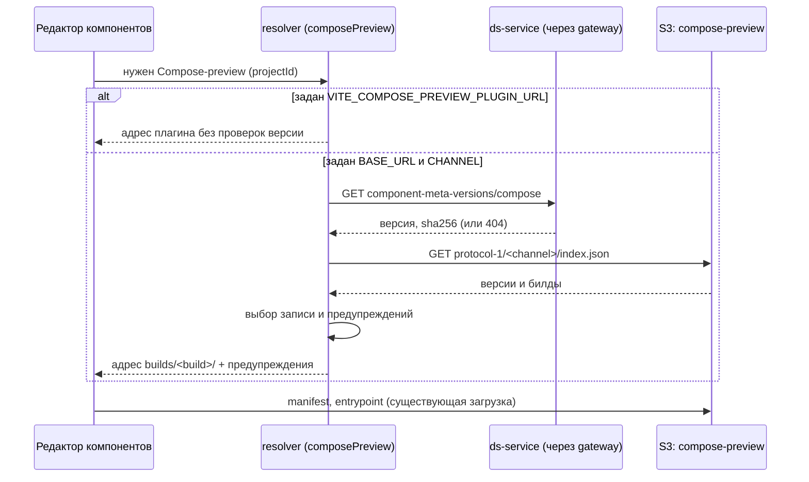

## Context

Плагин Compose-preview собирается в `plasma-android` и порождает фабрики стилей по файлу API-меты `uikit-compose` (`api-meta.json`). Тот же файл администратор импортирует в БД DSB командой `dsbuilder components import-api`: он определяет, какие Compose-компоненты и свойства видит редактор. Для согласованного превью плагин и мета должны происходить из одной версии `uikit-compose`.

Что есть сегодня:

- Клиент (`js/apps/client/src/composePreview`) загружает плагин по адресу `VITE_COMPOSE_PREVIEW_PLUGIN_URL` (`config.ts`), читает `preview-plugin.json` (`manifest.ts`), проверяет `protocolVersion`, платформу, сообщения моста и то, что entrypoint принадлежит origin плагина, и открывает плагин в `iframe` с `sandbox="allow-scripts allow-same-origin"`. Адрес плагина также служит условием включения Compose-режима (`themeEditorRepository.ts`: пустой адрес, значит Compose-компоненты не запрашиваются).
- Импорт меты (`ds-service`, `POST /api/ds/admin/component-config/import-api-meta`) доступен только системному администратору, аддитивен, выполняется одной транзакцией, пишет запись в журнал изменений. Он принимает уже нормализованный манифест: сырой файл разбирает CLI (`ImportApiMetaUseCase`, нормализатор платформы), а бэкенд файла не видит.
- CLI `import-api` умеет читать только локальный файл и работает по сессии пользователя; non-interactive авторизации нет, пароль в аргументах запрещён.
- `ds-service` владеет Flyway-миграциями (`V1`–`V6`); таблицы вроде `token_groups` живут только там и в `schema.ts` не дублируются.

Контракт публикации плагина (change `publish-compose-preview-plugin` в `plasma-android`), на который опирается этот change:

```
<base>/compose-preview/
  builds/<build-id>/                          неизменяемый билд: preview-plugin.json, api-meta.json, index.html, *.js, *.wasm, …
  protocol-<N>/<channel>/index.json           {versions: [{uikitCompose, build, apiMetaSha256, publishedAt}], по убыванию версии}
```

`preview-plugin.json` содержит `version`, `uikitComposeVersion`, `apiMetaSha256`, `commit`. Каналы: `dev` (билды `develop`) и `current` (релизные теги).

## Goals / Non-Goals

**Goals:**
- Хранить в БД DSB версию `uikit-compose` и sha256 мета-файла, импортированные последним успешным импортом платформы.
- Клиент выбирает билд плагина по этой версии и индексу канала, при несовпадении откатывается на меньшую версию с предупреждением.
- Прямой адрес плагина сохраняется для локальной разработки.

**Non-Goals:**
- Публикация плагина в S3 и формат индекса (change в `plasma-android`).
- Автоматизация импорта: роль `system_admin` остаётся у человека, non-interactive авторизации в CLI не добавляется.
- Версия меты на дизайн-систему: слой компонентов общий, версия одна на платформу и окружение.
- Откат меты в БД и удаление компонентов: импорт остаётся аддитивным.
- Подпись и trust policy плагина.
- Разделение origin плагина и клиента: плагин размещается в бакете клиента, общий origin принят как риск.

## Decisions

### 1. Версия меты хранится отдельной таблицей, а не в журнале и не в компоненте

```sql
CREATE TABLE component_meta_versions (
  platform            <тип платформы, как у components.platform> PRIMARY KEY,
  meta_version        text NOT NULL,     -- версия библиотеки, из которой собрана мета (для compose: версия uikit-compose)
  meta_sha256         text NOT NULL,
  source              text NOT NULL,     -- имя файла, как в журнале импорта
  imported_by         text NOT NULL,     -- идентификатор администратора
  imported_at         timestamptz NOT NULL DEFAULT now()
);
```

Колонка называется `meta_version`: таблица рассчитана на любую платформу, а «версия uikit-compose» — смысл значения для Compose. В запросе, ответе и маршруте чтения поле называется `uikitComposeVersion`; для других платформ в нём передаётся версия соответствующей библиотеки (при необходимости поле переименуется отдельным change).

Альтернативы:
- **Читать из журнала изменений** (`design_system_changes`, `components:import-api-meta`): журнал не рассчитан на поиск «последнего значения по платформе» и пишется и для dry run; отдельная таблица проще и надёжнее.
- **Колонка в `components`**: версия относится к платформе, а не к компоненту, и дублировалась бы на каждой строке.
- **Хранить на стороне клиента** (`VITE_...`): пин привязан к данным БД и должен меняться вместе с импортом, без деплоя клиента.

Таблица принадлежит `ds-service` (миграция Flyway `V7`) по прецеденту `token_groups`; `schema.ts`, `drizzle/` и DBML не обновляются.

### 2. Запись версии — часть импорта, в той же транзакции

`ImportApiMetaRequest.meta` получает необязательные `uikitComposeVersion` и `sha256` (обе заданы или обе опущены). При `dryRun = false` и успешной фиксации данных репозиторий записывает или заменяет строку платформы в той же транзакции. Правила:

| Состояние | Результат |
|---|---|
| Записи нет | вставить, итог `recorded` |
| Версия и sha256 совпадают с записанными | не менять, итог `unchanged` |
| Версия другая | заменить, итог `replaced`, в ответ — предыдущее значение |
| Версия та же, sha256 другой | отклонить импорт целиком (`409`, код `meta_changed_without_version`), данные не меняются |
| Поля опущены (старый CLI или платформа без пина) | запись не меняется, итог `not_provided` |

При `dryRun = true` итог считается так же, но ничего не пишется (в том числе конфликт `409` сообщается). Допущение: понижение версии (новая версия меньше записанной) в этом change разрешено как `replaced`: импорт аддитивен и данные меты в БД уже отражают более новую версию, но пин осознанно понижается администратором. Решение по запрету понижения вынесено в открытые вопросы.

sha256 считает CLI от байтов исходного файла (до нормализации): бэкенд файла не видит и значение не проверяет, а клиент сравнивает его с `apiMetaSha256` из `preview-plugin.json` (там то же значение от того же `api-meta.json`).

### 3. Маршрут чтения версии

`GET /api/projects/{projectId}/ds/component-meta-versions/{platform}`, право `components:read` проекта, ответ `{platform, uikitComposeVersion, sha256, importedAt}` либо `404`, если версия не записана. Маршрут лежит в проектном пространстве `/api/projects/{projectId}/ds/...`, которое gateway уже проксирует в `ds-service` с проверкой доступа к проекту. Редактор компонентов всегда работает в контексте проекта, поэтому отдельный глобальный маршрут не нужен.

Альтернатива — добавить версию в ответ существующего `component-configs`: это смешивает данные разных ресурсов и ломает кеширование по странице.

### 4. CLI: версия и sha256 приходят явно

`dsbuilder components import-api` получает опции `--uikit-compose-version <v>` и `--plugin-manifest <путь к preview-plugin.json>` (взаимоисключающие). Для `--plugin-manifest` CLI читает `uikitComposeVersion` и `apiMetaSha256`; sha256 всегда считается заново от файла `--from`, и расхождение с `apiMetaSha256` манифеста завершает команду ошибкой (администратор подал мету не из этого билда). Для платформы `compose` при `--apply` одно из значений обязательно, чтобы не оставить пин устаревшим; при dry run достаточно предупреждения. Для остальных платформ опции допустимы и необязательны.

Чтение меты по URL билда (`--from https://…/builds/<id>/`) в этот change не входит: ручное скачивание файла плюс `--plugin-manifest` закрывает сценарий, URL можно добавить отдельным небольшим изменением.

### 5. Клиент: выбор билда



Правило выбора записи индекса (версии сравниваются по semver):

| Пин из бэкенда | Индекс | Выбор | Предупреждение |
|---|---|---|---|
| есть, в индексе версия равна | точное совпадение | эта запись | нет; при расхождении sha256 с manifest — «мета изменена без смены версии» |
| есть, в индексе есть меньшая | наибольшая ≤ пина | эта запись | «плагин собран для версии X, мета импортирована для Y» |
| есть, в индексе только большие | подходящей нет | последний билд канала | «подходящего билда нет, используется последний» |
| нет (404) | любой | последний билд канала | «версия меты не записана» |
| ошибка запроса к бэкенду или индексу, индекс не проходит проверку | | Compose-preview недоступен, React остаётся | сообщение о причине |

Предупреждения показываются в области Compose-preview (над вьюпортом) и перечисляют версию плагина и версию меты. Индекс и версия кешируются на время жизни страницы, как manifest сегодня; смена версии в БД подхватывается при перезагрузке страницы.

Конфигурация: `VITE_COMPOSE_PREVIEW_PLUGIN_BASE_URL` (корень, содержащий `compose-preview/`, без значения по умолчанию) и `VITE_COMPOSE_PREVIEW_CHANNEL` (`dev` или `current`, значение по умолчанию `current`). Протокол в пути берётся из константы клиента `PREVIEW_PROTOCOL_VERSION`: клиент со старым протоколом читает только свой индекс. `VITE_COMPOSE_PREVIEW_PLUGIN_URL` сохраняется и имеет приоритет: так локальная разработка (`serve-compose-plugin.mjs`, feature-сборки плагина) не зависит ни от бэкенда, ни от S3.

Условие включения Compose-режима (`themeEditorRepository.loadComposeComponents`) заменяется функцией `isComposePreviewConfigured()`: истинно, если задан прямой адрес или базовый адрес с каналом.

### 6. Общий origin с клиентом принят как риск

Плагин лежит в том же бакете, что и клиент, поэтому их origin может совпасть. Плагин запускается в `iframe` с `sandbox="allow-scripts allow-same-origin"`, и при общем origin его код мог бы читать `localStorage` клиента с токенами. Риск принят: плагин публикует только команда SDDS, загрузка чужих плагинов не поддерживается. Клиент не проверяет совпадение origin и не блокирует загрузку. Раздельные хосты остаются будущим улучшением; формат индекса и manifest от него не зависит. README клиента заменяет прежнее требование «отдельный origin» описанием принятого риска и мер: только плагин SDDS, раздельные префиксы бакета, ограниченный ключ записи.

### 7. Программное проектирование (ключевые сигнатуры)

```kotlin
// backend-kt/ds-service/feature-components, application
data class ComponentMetaVersion(val platform: String, val version: String, val sha256: String,
                                val source: String, val importedBy: String, val importedAt: Instant)

sealed interface MetaVersionOutcome {
    data class Recorded(val current: ComponentMetaVersion) : MetaVersionOutcome
    data class Unchanged(val current: ComponentMetaVersion) : MetaVersionOutcome
    data class Replaced(val previous: ComponentMetaVersion, val current: ComponentMetaVersion) : MetaVersionOutcome
    data class Conflict(val current: ComponentMetaVersion) : MetaVersionOutcome   // та же версия, другой sha256
    data object NotProvided : MetaVersionOutcome
}

interface ComponentMetaVersionRepository {
    suspend fun find(platform: String): ComponentMetaVersion?
}
// ApiMetaRepository.import получает (version, sha256) и возвращает MetaVersionOutcome в составе ImportAttempt.
```

```ts
// js/apps/client/src/composePreview
export type PluginSelectionWarning =
    | { kind: 'no-pin' }
    | { kind: 'older-build'; pluginVersion: string; metaVersion: string }
    | { kind: 'no-matching-build'; pluginVersion: string; metaVersion: string }
    | { kind: 'meta-mismatch'; version: string };
export interface ResolvedPlugin { pluginUrl: string; warnings: PluginSelectionWarning[]; }
export const resolveComposePreviewPlugin: (projectId: string, deps?: ResolverDeps) => Promise<ResolvedPlugin>;
export const isComposePreviewConfigured: () => boolean;
```

Слои Kotlin: presentation — маршрут чтения и расширенные модели запроса и ответа импорта; application — use case чтения и расширение `ImportApiMeta`; domain — `ComponentMetaVersion`, `MetaVersionOutcome`; data — таблица Exposed и логика записи в `ExposedApiMetaRepository`; di — регистрация. `frontend-kt`: домен — `MetaVersion` (версия, sha256), application — расчёт sha256 и чтение manifest плагина (порт чтения файла), data — HTTP-источник передаёт новые поля.

## Risks / Trade-offs

- [Общий origin клиента и плагина: код плагина мог бы читать токены клиента] → риск принят (только плагин SDDS); описан в README клиента; разделение origin — будущее изменение.
- [Пин и мета расходятся: админ импортировал мету, но не передал версию] → для `compose` при `--apply` версия обязательна; без неё запись остаётся прежней, и это видно в выводе CLI.
- [Администратор указал версию вручную с опечаткой] → `--plugin-manifest` берёт версию из билда и сверяет sha256; опция `--uikit-compose-version` остаётся запасным путём.
- [Клиент выбирает билд, которого уже нет в индексе канала (индекс хранит десять версий)] → откат на меньшую или последнюю с предупреждением; после выпуска десяти новых версий пин «уезжает» из индекса, это сигнал импортировать свежую мету.
- [Предупреждение пользователю непонятно] → текст называет обе версии и подсказывает, что превью может отличаться от свойств; не блокирует работу.
- [Новая зависимость клиента от S3 в рантайме и от доступности бэкенда для версии] → недоступность превращается в сообщение «Compose-preview недоступен», React-preview не затрагивается (существующее поведение отказоустойчивости).
- [Тихое понижение пина] → итог `replaced` с предыдущим значением в ответе и журнале; запрет вынесен в открытые вопросы.

## Migration Plan

1. Развернуть `ds-service` с миграцией `V7` и расширенным контрактом (старые CLI продолжают работать: новые поля необязательны).
2. Выпустить CLI с новыми опциями; администратор повторно импортирует текущую мету с версией (идемпотентно по данным компонентов, записывается только пин).
3. Включить в workflows выкладки клиента переменные канала (после появления индексов от `plasma-android`); до этого клиент работает через прямой адрес.

Откат: удалить значения переменных канала (клиент возвращается к прямому адресу или отключает Compose-preview); таблица остаётся без вреда.

## Open Questions

- Запрещать ли понижение версии меты (сейчас допускается как `replaced`) или требовать явного флага CLI.
- Где хранить канонические схему индекса и фикстуры: копия в клиенте с проверкой отпечатка (как у `preview-contract`) или чтение из репозитория `plasma-android`.
- Соответствие канала окружению (dev, prom) и значение `VITE_COMPOSE_PREVIEW_PLUGIN_BASE_URL` для каждого: бакет общий с клиентом, различие только в префиксах; конкретные значения определяет владелец инфраструктуры.
- Нужен ли `--from` по URL билда (ручное скачивание сейчас считается достаточным).
