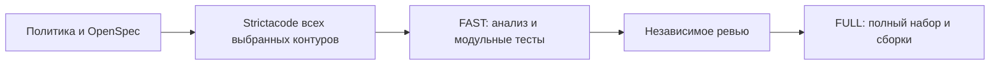

## Порядок проверок

После политики защищённых файлов, проверки случайных артефактов и OpenSpec tools/verify определяет затронутые контуры. Для FAST и FULL сначала запускаются все их compare-команды в порядке манифеста. Ошибка в любом контуре останавливает выполнение до Gradle/npm-проверок остальных контуров. Затем FAST запускает fast-команды, FULL — самодостаточные full-команды. Audit остаётся отдельным анализом без сравнения.

При самостоятельном FULL его общий предварительный этап также проверяет актуальные исходники; full-команды Gradle зависят от verifyFast. Кеш Gradle сохраняет результаты модульных тестов, выполненных FAST. Отдельного хранилища отпечатков исходников не вводится.

## Тестовые группы

JVM-тест с внешней БД/контейнером, настоящим HTTP-сервером, сокетом или дочерним процессом получает JUnit4 Category с общим тестовым маркером com.dsbuilder.testing.IntegrationTest. Нейтральный маркер подключается как общий тестовый исходник из build-system/src/testFixtures/kotlin, без production-модуля. Отбор не зависит от имени класса: ConsentHistoryTest тоже относится к FULL.

Conventions разделяют test/jvmTest и integrationTest/jvmIntegrationTest на одном скомпилированном наборе тестовых классов. Основная JVM-задача исключает категорию, интеграционная включает только её и использует тот же classpath/JVM launcher и зависимости подготовки исходной test-задачи (включая IDE test sandbox). check и полные агрегаторы включают интеграционные задачи; unitTestAll выбирает только test/jvmTest. Нативные, KMP JS/Node.js, упаковочные и установочные тесты не входят в unitTestAll, но сохраняются в прежних allTests/build и FULL. Корневой frontend test также сохраняет обе JVM-группы; JavaScript-контур продолжает запускать свою npm-сборку и быстрые CLI-тесты.

Небольшие проверки временных файлов и подменённого HTTP остаются быстрыми. Ktor test host без внешней инфраструктуры остаётся в FAST. Тесты не удаляются и не превращаются в успешный пропуск при недоступном Docker.

## Проверка изменения процесса

Регрессионный shell-тест проверяет порядок и раннее завершение tools/verify с двумя контурами на изолированном Git-интерфейсе. Gradle dry-run доказывает отсутствие PostgreSQL/нативных/установочных задач в FAST и наличие их в FULL. Выбранные unit и integration задачи проверяются реальным запуском. Известный красный compare текущей аналитики не скрывается и теперь останавливает FAST раньше сборок.
