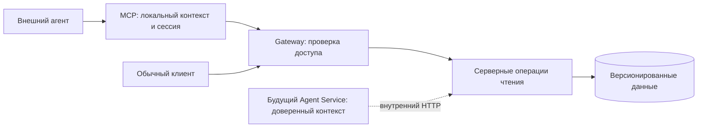

# Проектное решение

## Контекст

Мотивация описана в proposal.md. В системе уже существуют серверные черновики, публикации и события ревизий. Отсутствие `versionId` выбирает черновик; UUID выбирает опубликованную границу новой модели, архивные snapshot не поддерживаются.

Архитектурный источник — предоставленный разработчиком `agent-architecture-handoff.md` («DS Builder Agent — краткая архитектурная выжимка»). Его существенные решения зафиксированы ниже, поэтому реализация не зависит от наличия файла в Downloads. Сведения документа о localStorage не заменяют фактическую серверную модель.

## Цели и границы

Обеспечить одинаковые предметные операции для внешнего MCP, обычного клиента и будущего встроенного агента. Не создавать Agent Service, чат, SSE, историю диалога или операции записи. Не вводить проверки `expectedDraftRevision` при чтении, автоматическую публикацию, преобразование платформ либо миграции предметных данных.

## Архитектура



Будущий Agent Service не использует `frontend-kt feature-*`, локальный конфиг, API URL или пользовательские credentials MCP. Идентификатор проекта, scopes и actor приходят из доверенного контекста, а не из аргументов LLM. Выбранная дизайн-система проверяется сервером. Внешний MCP сохраняет `designSystem` URI и передаёт credential через Gateway.

HTTP presentation и внутренний вход вызывают одинаковые application use cases. Предметные правила и порты находятся в application/domain, БД и HTTP-адаптеры — в data, сборка — в di. Общие примитивы размещаются в существующих core-модулях без зависимостей feature-to-feature. MCP SDK остаётся в `mcp-server-core`; frontend feature-модули содержат тонкие gateway-адаптеры. Допустимо дублировать схемы инструментов и преобразование ошибок между MCP и будущим агентом; предметные алгоритмы не дублируются.

Альтернатива с переносом frontend-use-case в Agent Service отклонена: она привносит локальные credentials и клиентскую оркестрацию во внутренний сервис. Новый микросервис для чтения не требуется.

## Выбор версии и публикации

Каждый инструмент имеет необязательный `designSystem`. При его отсутствии используется ближайший локальный конфиг. Некорректная явная ссылка не приводит к переходу на локальный контекст. API URL и credential policy сохраняют действующие правила, включая принудительную пользовательскую сессию для явной ссылки.

Для предметного чтения `version` — `draft` или точный `major.minor.patch`: аргумент перекрывает контекст, отсутствие обоих означает черновик. Номер разрешается на бэкенде внутри выбранных проекта и дизайн-системы. Не вводятся диапазоны и `latest`. Неизвестная, архивная или чужая версия возвращает `NOT_FOUND`; перехода на черновик нет. Публичные расширенные операции принимают `version`; существующий `versionId` сохраняется. Одновременная передача обоих отклоняется. Сервер нормализует выбор в единый внутренний контекст версии.

Составная операция разрешает выбор один раз и выполняет связанные чтения в согласованной read-only транзакции с необходимым уровнем изоляции. Между независимыми вызовами черновик может измениться, как при работе обычного клиента. Публикация модели неизменяема.

Документация и CodeBinding используют самостоятельные публикации: точную версию и платформу из аргументов/контекста либо явный `publicationId`. При ID метаданные определяются публикацией; явно заданные несовместимые версия/платформа отклоняются. Для явного ID унаследованные значения контекста не должны препятствовать чтению другой публикации той же дизайн-системы. Без ID отсутствие версии/платформы возвращает `AMBIGUOUS_CONTEXT`; `draft` возвращает `INVALID_QUERY`. `documentation_publications_list` допускает отсутствие фильтров; `documentation_fetch` получает селектор из `kbUrl`. Документация не требует существования одноимённой публикации модели: существующие выпуски документации остаются читаемыми.

Повторное издание документации не меняет продолжение уже начатого чтения: ответ и cursor содержат ссылку на конкретную опубликованную публикацию. Cursor привязан к фильтрам, порядку, дизайн-системе и версии/публикации; несовместимое повторное использование возвращает `INVALID_QUERY`. Пагинация черновика не обещает снимок между запросами.

## Реестр из 26 инструментов и HTTP-контракты

Обозначения: `!` — обязательное поле; остальные поля необязательны. `DS=/api/projects/{projectId}/ds`, `DOC=/api/projects/{projectId}/documentation`, `{dsId}` берётся из контекста. Внутренние пути исключают внешний префикс проекта и используют доверенные заголовки. Все 26 инструментов принимают `designSystem`; в таблице это поле опущено.

`V` означает общий параметр `version` для чтения модели. `P` означает `version`, `platform`, `publicationId` по правилам выше. `L` означает `limit`, `cursor`: предметные списки по умолчанию 50, максимум 200; документационные сохраняют действующие 20/100, чтобы не менять глобальную политику существующих клиентов. `limit` — положительное целое, превышение максимума отклоняется новыми операциями; cursor для MCP — непрозрачная строка. `name` — точное совпадение, `query` — подстрока; совместная передача запрещена.

| № | Инструмент | Параметры | Используемый публичный HTTP API | Изменение бэкенда |
|---|---|---|---|---|
| 1 | `design_system_get_context` | V | Новый `GET DS/design-systems/{dsId}/read-context` | Разрешённая версия и метаданные; локальный путь добавляет MCP, credentials не возвращаются |
| 2 | `project_get_status` | — | `GET /api/projects/{projectId}` и `GET DS/design-systems/{dsId}` | Поведение не меняется; версия не выбирается |
| 3 | `design_system_versions_list` | L | `GET DS/design-system-versions/by-design-system/{dsId}` | Постраничный режим, порядок по sequenceNumber убыванию, без архивных snapshot |
| 4 | `design_system_version_get` | V | Новый `GET DS/design-systems/{dsId}/version` | Метаданные выбранной версии/черновика; существующий `GET DS/design-system-versions/{id}` сохраняется |
| 5 | `design_system_changes_list` | V, L | `GET DS/design-systems/{dsId}/changes` | Выбор по номеру и постраничный журнал, без сравнения произвольной пары версий |
| 6 | `tenants_list` | V, name, query, L | `GET DS/design-systems/{dsId}/tenants` | Фильтры и пагинация |
| 7 | `tokens_list` | V, type, name, query, groupId, L | `GET DS/design-systems/{dsId}/tokens` | Серверные фильтры, группа и пагинация |
| 8 | `token_get` | V, tokenId! | `GET DS/tokens/{tokenId}` | Проверка выбранной дизайн-системы и версии |
| 9 | `token_values_get` | V, tokenId!, tenantId, mode, platform | `GET DS/tokens/{tokenId}/values` | Выбор версии/дизайн-системы; фильтры сохраняются |
| 10 | `token_groups_list` | V, kind=color, parentId, L | `GET DS/design-systems/{dsId}/token-groups` | Фильтр непосредственного родителя, пагинация; без parentId все группы с parentId в ответе |
| 11 | `palette_get` | V, tenantId!, groupId, type, shade | `GET DS/tenants/{tenantId}/palette` | Серверные фильтры групп и шкал; shade требует type |
| 12 | `components_list` | V, name, query, platform, L | `GET DS/design-systems/{dsId}/components` | Реальный фильтр platform, точное имя и пагинация |
| 13 | `component_get` | V, componentId! | `GET DS/components/{componentId}` | Проверка связи с выбранной дизайн-системой и версией |
| 14 | `component_styles_get` | V, componentId!, name, L | `GET DS/design-systems/{dsId}/components/{componentId}/styles` | Фильтр и пагинация |
| 15 | `component_variations_get` | V, componentId! | `GET DS/components/{componentId}/variations` | Сохранить оси и допустимые значения модели, доступные defaults; не выдавать варианты опубликованного кода |
| 16 | `component_properties_get` | V, componentId! | `GET DS/components/{componentId}/properties` | Добавить платформенные параметры в расширенный ответ |
| 17 | `component_dependencies_get` | V, componentId! | `GET DS/components/{componentId}/deps` | Добавить метаданные целей и настройки переиспользования |
| 18 | `component_config_get` | V, componentId!, style, selection | Новый `POST DS/design-systems/{dsId}/components/{componentId}/config/query` | Серверная конфигурация по ID, проверка и выбор вариаций |
| 19 | `component_tokens_get` | V, componentId!, style, selection! | Новый `POST DS/design-systems/{dsId}/components/{componentId}/tokens/query` | Извлечение проверенных ссылок, стабильных ID и мест использования |
| 20 | `documentation_publications_list` | version, platform, L | Новый `GET DOC/publications` | Опубликованные публикации выбранной DS, включая переизданные, без candidate; новые первыми |
| 21 | `documentation_search` | P, query!, subjects[], L | `GET DOC/search` | Явная публикация и привязанный cursor; subjects[] передаётся повторяющимся subject |
| 22 | `documentation_fetch` | kbUrl! | `GET DOC/kb/fetch` | Компактный режим без searchText, проверка DS дополнительно к проекту |
| 23 | `documentation_get_navigation` | P | Новый `GET DOC/navigation` | Разрешить селектор и прочитать navigation одной серверной операцией |
| 24 | `documentation_get_page` | P, path! | Новый `GET DOC/pages/{path}` | Аналогичная серверная операция чтения страницы |
| 25 | `code_binding_search` | P, subject, kind, name, L | Новый `GET DOC/bindings` | Серверное разрешение публикации и компактные результаты |
| 26 | `code_binding_get` | P, bindingId!, detail, appearanceNames[], variationNames[] | Новый `GET DOC/bindings/{bindingId}` | Серверные проекции и фильтры; summary по умолчанию |

Во все предметные адреса без `{dsId}` MCP передаёт `designSystemId` как query; сервер проверяет принадлежность token/component/tenant/группы выбранной DS. Для POST запросов селектор версии остаётся в query, тело содержит style и selection. Новые документационные маршруты принимают `designSystemId` и селектор P. Существующие маршруты по publication ID остаются доступными старым клиентам и вызывают те же прикладные операции.

### Формы ответов и специальные параметры

Расширенный серверный режим запрашивается `view=agent`; он возвращает `{context, data}`, где context содержит projectId, designSystemId, source и разрешённую версию либо publicationId/platform. Для модели публикация содержит version/versionId, черновик — version=draft, draftId/draftRevision; для документации — её собственные version/publicationId, без выдуманного versionId модели. MCP не передаёт API URL в предметных ответах; вспомогательный context tool сохраняет безопасные локальные метаданные. Списки содержат `data={items,nextCursor}`. Старые запросы без нового режима сохраняют форму массива/DTO и действующие defaults. Новые маршруты сразу используют расширенный ответ.

Текущие типы токенов сохраняются: color, gradient, typography, fontFamily, spacing, shape, shadow. `mode=light|dark`; отсутствие tenant/platform/mode не выбирает их неявно и возвращает все доступные строки. `kind=color` — единственный поддержанный вид групп. `platform` токенов остаётся web/android/ios, компонентов — web/compose/xml/ios. Документация сохраняет собственные канонические платформы действующего контракта, включая compose, android-view и swiftui; другие значения сохраняются там, где они уже поддержаны; её enum нельзя заменять enum компонентов.

`selection` — JSON-объект вида `{"size":"s","view":"accent"}`. Неполный выбор допустим для config и сохраняет оставшиеся оси. Для component_tokens_get выбираются все оси каждого выбранного оформления; неизвестные оси/значения и неоднозначность отклоняются. Возвращаются только проверенные ссылки с ID и путями использования; значения токенов не вычисляются этим инструментом. Прежний экспорт по имени остаётся для генераторов, но MCP больше не собирает результат из экспорта и каталога.

`detail=summary|variations|full`: без detail и variationNames — summary, с variationNames — variations. Явный summary вместе с variationNames отклоняется. appearanceNames/variationNames — точные непрозрачные имена без интерпретации осей. kind привязки — component-style|token. Сервер возвращает необязательный componentId только при доказуемом соответствии компонента выбранной версии; сопоставление по одному похожему имени запрещено.

## Ошибки и безопасность

Ошибки API сохраняют различие AUTH_REQUIRED, FORBIDDEN, NOT_FOUND, PUBLICATION_NOT_FOUND, INVALID_QUERY, BACKEND_UNAVAILABLE. MCP проверяет синтаксис и возвращает INVALID_ARGUMENT; отсутствие контекста сохраняет CONTEXT_REQUIRED/INVALID_CONTEXT. Нельзя превращать 401/403/503 разрешения публикации в PUBLICATION_NOT_FOUND. Не раскрываются чужие ресурсы, секреты, stack trace и адреса внутренних сервисов. Ключ проекта и пользователь не заменяют друг друга после отказа. Авторизация применяется и к серверным POST query: они не мутируют данные.

Встроенному агенту не передаются projectId, scopes, credentials и внутренние URL через LLM-аргументы. Внешний MCP сохраняет существующую семантику ссылки на проект и дизайн-систему; это иной доверенный вход, ссылка не доказывает доступ.

## Authorization Code + PKCE

CLI и MCP переиспользуют существующий публичный OAuth-клиент `dsbuilder-studio-plugin` вместе с IDE-плагином: S256 обязателен, secret отсутствует, Direct Access Grants отключён, access token содержит audience `dsbuilder-api`. Новая регистрация OAuth-клиента не создаётся; действующие настройки web/IDE сохраняются. Отдельная регистрация для CLI отклонена как ненужное усложнение: существующий клиент уже поддерживает PKCE и loopback redirect. Общий clientId не означает общее хранилище или общий refresh token с IDE: каждый вход создаёт самостоятельную сессию.

Общий сценарий feature-auth генерирует криптографически стойкие verifier/state через платформенные порты, запускает listener на 127.0.0.1 со свободным портом и callback `/callback`, затем открывает системный браузер через существующий gateway authorize URL. Callback проверяет state, ошибку OAuth, единственность кода, путь; обмен идёт через gateway `/auth/token` с тем же redirect_uri и code_verifier. Loopback redirect URI регистрируется с переменным портом в поддерживаемой Keycloak форме, проверяется внешним сценарием. Listener закрывается при успехе, отмене, ошибке и таймауте 180 секунд. Браузер открывается только по явной команде auth login; MCP serve и tools не начинают интерактивный вход.

JVM, macOS arm64/x64 и Node имеют платформенные адаптеры браузера, криптографии и listener; общий сценарий не зависит от JVM. IDE сохраняет собственное защищённое хранилище через отдельный адаптер полученной сессии; clientId у IDE и CLI/MCP общий — dsbuilder-studio-plugin. Повторно используются пригодные порты и проверки существующего PKCE, а не JVM-only реализация в Node/macOS. Если браузер недоступен, команда завершается диагностикой; в CI остаётся project key. Парольный резервный путь не вводится.

Общий CLI/MCP CredentialStore остаётся в `~/.sdds/sessions/<hash API URL>.json`, с нормализацией URL, режимами каталога 0700/файла 0600 и атомарной заменой. Обновлённая схема хранит clientId=dsbuilder-studio-plugin; пароль, access/ID token, роли и контекст DS не записываются. Старые сессии dsbuilder-api не обновляются новым clientId: возвращается AUTH_REQUIRED с предложением повторного входа, старые секреты не отправляются другому OAuth-клиенту. Имя пользователя берётся из проверенного ответа userinfo, не запрашивается в терминале.

Access token и expiresAt хранятся в памяти, повторные чтения до expiry с запасом 30 секунд не выполняют refresh. Одновременные обновления одного процесса объединяются; межпроцессный lock сохраняет ротацию и перечитывание refresh token. После 401 один forced refresh и один повтор, после 403 повтора нет. invalid_grant/повторный 401 очищает сессию; транспортная ошибка её сохраняет. Logout отзывает refresh token соответствующим clientId, удаляет файл и кеш процесса; status показывает только локальные безопасные метаданные, не обещает удалённую проверку сессии.

## Программное проектирование

Имена ниже обозначают целевые роли контрактов; конкретные пакеты определяются существующими границами модулей.

```kotlin
interface ReadSelectionResolver {
    suspend fun resolve(context: TrustedReadContext, selection: VersionSelection): ReadSelectionResult
}
interface ComponentReadQueries {
    suspend fun config(context: TrustedReadContext, query: ComponentConfigQuery): ComponentConfigResult
    suspend fun tokens(context: TrustedReadContext, query: ComponentTokensQuery): ComponentTokensResult
}
interface PublicationReadQueries {
    suspend fun page(context: TrustedReadContext, query: PublicationPageQuery): PublicationPageResult
    suspend fun binding(context: TrustedReadContext, query: PublicationBindingQuery): PublicationBindingResult
}
interface PkceChallengeProvider {
    fun generate(): PkceChallenge
}
interface OAuthSessionSink {
    suspend fun accept(session: OAuthSession)
}
```

Серверные контракты не зависят от MCP и frontend runtime. OAuth-порты принадлежат общему клиентскому слою; платформенные адаптеры предоставляет composition root без переноса use case в CLI presentation.

## Миграция и совместимость

Сначала выпускаются серверные расширения и проверяется существующая регистрация dsbuilder-studio-plugin в целевом окружении, затем новые CLI/MCP. Действующие HTTP-маршруты, формы старых ответов и параметры сохраняются; MCP получает новую версию пакета и README с заменой subject/name/selection/projection и ограниченными списками. После обновления требуется один браузерный вход, project keys продолжают работать. Старый MCP может читать старые API во время перехода. При откате клиента нужны повторный вход старым способом и действующий прежний OAuth-клиент; автоматической обратной миграции токенов нет. Новые маршруты можно оставить при откате, они не меняют данные.

## Риски и проверки

- Несогласованное составное чтение → единая серверная операция и тест конкурентного изменения, подходящий уровень изоляции, а не только факт транзакции.
- Новый формат ответа ломает web-клиент → явный расширенный режим и контрактные тесты старых ответов.
- Межпроцессная ротация теряет сессию → блокировка, перечитывание и атомарное сохранение; неизбежная авария между выдачей и сохранением требует нового входа.
- PKCE работает только на JVM → проверки адаптеров Node и обеих сборок macOS плюс внешние браузерные входы.
- Документация и модель имеют разные истории и платформы → независимые селекторы, явное происхождение, отсутствие автоматического преобразования.

После реализации: FAST → независимое review → FULL по tools/verify. Проверяются сборка, тесты, Detekt и Spotless обоих Kotlin-контуров, граф MCP, упаковка npm и совместимость OpenAPI. Внешние проверки: реальная Keycloak авторизация/refresh/logout, 26 tools через оба launcher, доступ по пользовательской сессии и ключу, историческая модель и переизданная документация. Задачи и измеримые критерии приведены в tasks.md.
