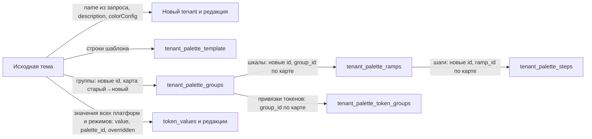

## Context

Тема — это tenant дизайн-системы. Определения токенов общие для дизайн-системы, а значения, палитра и группы
токенов палитры принадлежат теме. Текущие ограничения:

- редактор открыт на одном `tenantId` из маршрута; переключения тем в нём нет, крошка «Тема» ведёт в раздел цветов
  текущей темы;
- значения другой темы уже можно прочитать: `GET /tenants/{id}/token-values` работает для любой темы дизайн-системы;
- новая тема создаётся только из профиля (`POST /tenants`, профиль и необязательные `values`); копирования нет ни в
  API, ни в клиенте;
- палитра темы хранится в `tenant_palette_template`, `tenant_palette_groups`, `tenant_palette_ramps`,
  `tenant_palette_steps` и `tenant_palette_token_groups` с редакциями черновика. Значения токенов ссылаются на общую
  таблицу `palette` через `palette_id` и раскрываются по палитре и группе токена конкретной темы;
- шестерёнка редактора открывает `ThemeSettingsPage` с одним полем названия и удалением; настройки дизайн-системы
  (`DesignSystemSettingsPage`) живут отдельно и о темах не знают.

## Goals / Non-Goals

**Goals:**

- видеть значение того же токена в другой теме за одно действие из редактора;
- создавать вторую тему копией существующей, без повторной настройки;
- управлять всеми темами дизайн-системы из одних настроек;
- сравнить значение одного токена во всех темах, не уходя из текущей;
- сделать начертания стиля типографики видимыми: сейчас выбор начертания в выпадающем списке незаметно переключает
  три разных токена.

**Non-Goals:**

- правка значений других тем из блока сравнения: всё остальное на экране показывает текущую тему, и правка «не
  той» темы была бы незаметной;
- раздельные размер, высота строки и трекинг у начертаний одного стиля: модель данных это позволяет, но в этой
  задаче у начертаний различается только вес;
- копирование темы между дизайн-системами и копирование из опубликованной версии;
- изменение профиля или `colorConfig` существующей темы в интерфейсе;
- импорт нескольких тем из файла в существующую дизайн-систему.

## Decisions

### 1. Переключатель — в крошке «Тема», а не в инспекторе

Крошка «Тема» становится кнопкой со всплывающим списком тем (поиск, превью, клавиатура). Выбор темы меняет
`tenantId` в маршруте, а раздел, `versionId` и `tokenId` выбранного токена переносятся в новый адрес. Поэтому
пользователь остаётся на том же токене и видит его значение в другой теме.

Альтернативы:

- чипы тем, как фильтр платформ в компонентах: не помещаются, когда тем больше трёх-четырёх;
- выбор темы в инспекторе токена с показом чужого значения рядом: требует отдельного чтения значений второй темы,
  отдельной модели «чужого» значения и правил, как его показывать для платформ и подтем. Это больше работы, а
  задачу «посмотреть значение в другой теме» переключатель уже решает;
- стрелки «предыдущая/следующая тема»: не масштабируются и не дают поиска.

Переключение использует существующий механизм смены `tenantId` (`tenant-aware-theme-editor`): незавершённые
сохранения прежней темы дожидаются или фиксируются, устаревшие ответы игнорируются.

Экраны размеров и типографики получают тот же адрес `tokenId`, что уже есть у цветов, иначе после переключения
выбор токена терялся бы на этих экранах.

### 2. Копирование темы выполняет сервер

`POST /tenants/{id}/duplicates` копирует тему в одной транзакции активного черновика.

Альтернатива — копия на клиенте: прочитать значения исходной темы и создать тему через `POST /tenants` с `values`.
Отклонена по трём причинам:

- палитра темы (группы, шкалы, шаги, привязки токенов к группам) не передаётся через `POST /tenants`; клиентская
  копия получила бы палитру профиля, и ссылки на палитру раскрывались бы в другие цвета;
- создание и копирование не были бы атомарными для палитры;
- `GET token-values` отдаёт раскрытые значения, а не хранимые ссылки, и клиенту пришлось бы восстанавливать форму
  хранения.

Отдельный маршрут, а не поле `sourceTenantId` в `POST /tenants`, потому что у копии нет профиля, `customPalette` и
`values`: в одном запросе пришлось бы описывать взаимоисключающие поля.

### 3. Что копируется и как



- Читается состояние активного черновика исходной темы: последние неудалённые редакции.
- `palette_id` значений ссылается на общую таблицу `palette`, поэтому копируется как есть; пересчитываются только
  идентификаторы групп, шкал и шагов палитры темы.
- Значения пишутся тем же писателем начальных значений, что и при создании темы (`InitialTenantValueWriter`), с
  базовой линией создания. Поэтому изменений значений копии в журнале нет, как у темы из профиля. Пользовательские
  группы палитры и привязки токенов к ним базовой линии не имеют и видны в журнале отдельными записями создания;
  системные группы журнал скрывает, как при создании из профиля.
- Название нормализуется и проверяется на уникальность под той же блокировкой имени, что и в `CreateTenantUseCase`.
- Идемпотентность — как у создания темы: ключ `Idempotency-Key` хеширует исходный `id` и название.

### 4. Настройки дизайн-системы вместо настроек темы

`DesignSystemSettingsPage` получает раздел «Темы» и режим встраивания в оболочку редактора. Дочерний маршрут
`settings` редактора показывает настройки дизайн-системы. Отдельный маршрут
`projects/:projectId/design-systems/:designSystemId/settings` остаётся для входа с обзора.

`ThemeSettingsPage` удаляется. Маршрут `.../themes/:tenantId/settings` теперь показывает настройки дизайн-системы:
это тот же адрес, что у шестерёнки, поэтому без параметров открывается «Основное». Прежняя ссылка «Удалить» карточки
темы (`?section=delete`) переписывается в `section=themes&theme=<tenantId>&confirm=delete` и открывает удаление этой
темы. Удаление самой дизайн-системы поэтому получает отдельный раздел `danger`: иначе прежняя ссылка темы вела бы к
удалению всей дизайн-системы.

Переименование — прямо в строке списка: тем мало полей, отдельная страница ради одного названия не нужна.
Удаление сохраняет подтверждение вводом названия, как сейчас.

### 5. Сравнение тем — блок инспектора, данные одним запросом

В инспекторе под значениями текущей темы появляется свёрнутый блок «В других темах»: строки «тема → значения».
Переключатель в шапке решает задачу «перейти», блок — «сравнить». Отдельной отметки отличия нет: на демо знак «≠»
признали лишним (разница видна по самим значениям) и двусмысленным (его читали как «Light ≠ Dark»).

Альтернативы:

- временно перекрасить доску в другую тему без перехода: почти то же, что переключиться, только без правки;
- читать значения клиентом через `GET /tenants/{id}/token-values` каждой темы: N запросов, и каждый возвращает все
  токены раздела. На 9 темах это девять ответов по несколько сотен значений ради одного токена.

Поэтому чтение значений дизайн-системы `GET /token-values` получает фильтр `tokenIds`: один запрос, только нужные
токены. Этот маршрут уже отдаёт значения всех тем с цветами, разрешёнными по палитре темы значения, поэтому отдельный
маршрут не нужен: он перекрыл бы существующий. Название темы клиент берёт из списка тем. Список токенов, а
не один `tokenId`, нужен типографике: сравнение открытого таба требует токена начертания, а смена таба не должна
давать новый запрос, поэтому клиент запрашивает сразу три токена стиля. Блок загружается только при раскрытии и
кэшируется в `readEditor` по адресу запроса.

### 6. Начертания — самостоятельные токены без изменения модели

Каждое начертание стиля — отдельная строка дерева и карточка доски; выбор строки задаёт тот же `variant`, что раньше
выбирал список, поэтому модель данных не меняется. Поля, общие для стиля, подписываются как общие, чтобы правка у
Medium не выглядела правкой одного Medium. Адрес хранит `tokenId` токена открытого начертания, а не всегда `normal`,
поэтому переключение темы сохраняет начертание.

Проверка имени нового стиля отсекает окончание названием начертания после той же нормализации, что строит имя
токена: иначе «M normal» превращается в размер `m-normal` и токены `m-normal.normal`, `m-normal.medium`,
`m-normal.bold`.

### 7. Доработки после демо

- **Следующая тема — только копией.** Тема из профиля строится по базовому шаблону и не содержит токенов, которые
  добавили в дизайн-систему после первой темы, поэтому темы начали бы отличаться составом. Ограничение живёт в
  форме, а не в `POST /tenants`: импорт файла темы и `bootstrap-base.sh` создают темы этим маршрутом и должны
  работать по-прежнему. Пока список тем не загружен, форма не даёт создавать: иначе на медленной сети можно было бы
  успеть создать тему из профиля.
- **Dark по умолчанию** в превью формы: интерфейс конструктора тёмный, светлое превью на нём слепит.
- **Поиск тем по кнопке**, как в шапке дерева токенов: поле не занимает место, пока тем мало или поиск не нужен.
  Переключатель и блок «В других темах» ведут себя одинаково.
- **Подтемы свёрнуты по умолчанию.** Подтемы меняются по связи с режимами, а открытые поля подталкивали править их
  вручную и рвать связь. Состояние раскрытия хранится в `localStorage`, как у блока «В других темах». Ошибка
  значения подтемы отмечается в заголовке, чтобы не потеряться в свёрнутой секции.
- **Сдвиг содержимого группы в дереве.** Строки группы стояли на одной линии со стрелкой её заголовка, и было
  непонятно, где кончается группа. Сдвиг на шаг 16 px — осознанное отступление от Figma; лесенка при глубокой
  вложенности не критична: уровней всего два.

### 8. Отключение токена без изменения API

Признак `enabled` есть у определения токена с самого начала: генератор пакета и экспорт в Figma пропускают
отключённые токены, инспектор компонентов прячет их из выбора, журнал версий подписывает поле «Используется». Не было
только интерфейса на экранах токенов, и экран цветов показывал 496 выключенных в сидах определений (семейства promo,
gradient и другие) как обычные: пользователь правил токены, которых нет в пакете.

- **Чтение.** Признак берётся из модели темы клиента (`theme.getToken(…).getEnabled()`), откуда экраны уже читают
  описание токена. Ответы `size-tokens` и `typography-styles` поэтому не меняются.
- **Запись.** `PATCH /tokens/{id}` с `{ enabled }` по каждому определению, как правка описания: ревизия не нужна, с
  очередями автосохранения значений запрос не конфликтует — их базовые ревизии относятся к `token-value`, а запрос
  меняет только сущность `token`. Правки значений, перенос и переименование признак не сбрасывают.
- **Состав.** Цвет — всё семейство, размер — один токен, стиль типографики — девять токенов (три экрана × три
  начертания), как у описания. Отключать часть семейства (только OnDark) нельзя: на встрече решили отключать токен
  целиком.
- **Подтверждение** только при отключении используемого токена: список компонентов цветам даёт
  `componentsUsingToken`, размерам и типографике — поле `components` ответа их раздела.
- **Неатомарность.** Определения меняются отдельными запросами. Сбой посередине оставляет семейство смешанным; клиент
  показывает ошибку и «Повторить», повтор идемпотентен. Атомарный маршрут семейства отложен: его не было и для
  описания, а смешанное состояние исправляется повтором.

## Программное проектирование

```kotlin
// application
data class DuplicateTenant(
    val sourceTenantId: UUID,
    val name: String,
    val idempotencyKey: String?,
)

class DuplicateTenantUseCase(
    private val policy: DsAccessPolicy,
    private val transactions: TransactionRunner,
    private val tenants: TenantRepository,
    private val palette: TenantPaletteRepository,
    private val values: TenantTokenValueCopier,
) {
    suspend fun execute(context: DsRequestContext, command: DuplicateTenant): DsResult<Tenant>
}

// application port, реализация в data
interface TenantTokenValueCopier {
    suspend fun copy(source: Tenant, target: Tenant)
}

// TenantPaletteRepository: новый метод
suspend fun copy(sourceTenantId: UUID, targetTenantId: UUID)

// feature-tokens: фильтр значений дизайн-системы по токенам
class ListTokenValuesUseCase(/* … */) {
    suspend fun execute(context: DsRequestContext, tokenIds: Set<UUID> = emptySet()): DsResult<List<TokenValue>>
}
```

```ts
// js/apps/client/src/modules/themes/data/themesApi.ts
duplicate(projectId: string, designSystemId: string, sourceId: string, name: string): Promise<Theme>;

// js/apps/client/src/components/BuilderShell/ThemeSwitcher.tsx
type ThemeSwitcherProps = {
    context: EditorContextKey;
    currentName: string;
    canCreate: boolean;
};

// js/apps/client/src/api/tokenRepository.ts
loadValuesByTenant(context: EditorContextKey, tokenIds: string[], signal?: AbortSignal): Promise<Map<string, TenantTokenValueDto[]>>;

// js/apps/client/src/components/tokenWorkspace/OtherThemesSection.tsx
type OtherThemesSectionProps<T> = {
    context: EditorContextKey;
    tokenIds: string[];
    current: T;
    toRow: (values: TenantTokenValueDto[]) => T;
    equals: (left: T, right: T) => boolean;
    render: (row: T) => ReactNode;
};
```

Слои ds-service: маршрут и DTO `DuplicateTenantRequest` в `presentation`, сценарий и порт в `application`,
копирование строк Exposed в `data`, регистрация в `di`. Домен темы не меняется.

## Risks / Trade-offs

- [Тема с большой палитрой и тысячами значений копируется долго] → копирование пакетными вставками в одной
  транзакции, как инициализация темы; интеграционный тест на теме из профиля с переопределёнными значениями
  платформ.
- [Новый столбец в таблицах палитры или значений забудут добавить в копирование] → интеграционный тест сравнивает
  ответы `GET token-values` и `GET palette` исходной темы и копии целиком.
- [Пользователь с закладкой на настройки темы] → перенаправление со старого маршрута.
- [Editor видит раздел «Основное» настроек дизайн-системы, но не может его менять] → раздел показывается только для
  чтения с подсказкой о нужной роли.
- [Клиент API создаст вторую тему из профиля в обход формы] → допустимо: правило защищает пользователя формы, а не
  целостность данных; серверный запрет сломал бы импорт тем.

## Migration Plan

Миграции схемы нет. Новый маршрут API добавляется без изменения существующих. Клиент и ds-service выкатываются
вместе: кнопки дублирования без нового маршрута вернут `404`, поэтому сначала выкатывается ds-service. Откат —
предыдущие образы клиента и ds-service; созданные копии остаются обычными темами.

## Open Questions

- Нужны ли раздельные размер и высота строки у начертаний одного стиля. Сейчас решено нет: у начертаний различается
  только вес.
