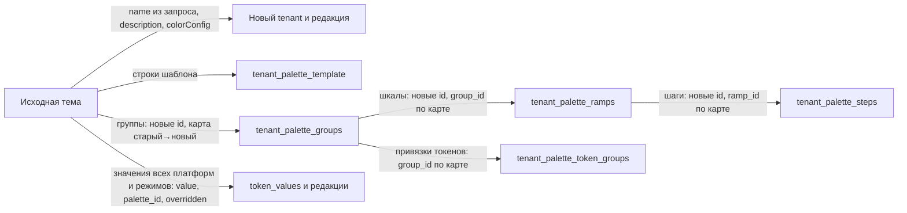

## Context

Тема — это tenant дизайн-системы. Определения токенов общие для дизайн-системы, а значения, палитра и группы
токенов палитры принадлежат теме. Текущие ограничения:

- редактор открыт на одном `tenantId` из маршрута; переключения тем в нём нет, крошка «Тема» ведёт в раздел цветов
  текущей темы;
- значения другой темы уже можно прочитать: `GET /tenants/{id}/token-values` работает для любой темы дизайн-системы;
- новая тема создаётся только из профиля (`POST /tenants`, профиль и необязательные `values`); копирования нет ни в
  API, ни в клиенте;
- палитра темы хранится в `tenant_palette_template`, `tenant_palette_groups`, `tenant_palette_ramps`,
  `tenant_palette_steps` и `tenant_palette_token_groups` с редакциями черновика. Значения токенов ссылаются на общую
  таблицу `palette` через `palette_id` и раскрываются по палитре и группе токена конкретной темы;
- шестерёнка редактора открывает `ThemeSettingsPage` с одним полем названия и удалением; настройки дизайн-системы
  (`DesignSystemSettingsPage`) живут отдельно и о темах не знают.

## Goals / Non-Goals

**Goals:**

- видеть значение того же токена в другой теме за одно действие из редактора;
- создавать вторую тему копией существующей, без повторной настройки;
- управлять всеми темами дизайн-системы из одних настроек.

**Non-Goals:**

- сравнение значений нескольких тем рядом в одном инспекторе: переключатель решает задачу просмотра, а сравнение
  можно добавить отдельно по отзывам дизайнеров;
- копирование темы между дизайн-системами и копирование из опубликованной версии;
- изменение профиля или `colorConfig` существующей темы в интерфейсе;
- импорт нескольких тем из файла в существующую дизайн-систему.

## Decisions

### 1. Переключатель — в крошке «Тема», а не в инспекторе

Крошка «Тема» становится кнопкой со всплывающим списком тем (поиск, превью, клавиатура). Выбор темы меняет
`tenantId` в маршруте, а раздел, `versionId` и `tokenId` выбранного токена переносятся в новый адрес. Поэтому
пользователь остаётся на том же токене и видит его значение в другой теме.

Альтернативы:

- чипы тем, как фильтр платформ в компонентах: не помещаются, когда тем больше трёх-четырёх;
- выбор темы в инспекторе токена с показом чужого значения рядом: требует отдельного чтения значений второй темы,
  отдельной модели «чужого» значения и правил, как его показывать для платформ и подтем. Это больше работы, а
  задачу «посмотреть значение в другой теме» переключатель уже решает;
- стрелки «предыдущая/следующая тема»: не масштабируются и не дают поиска.

Переключение использует существующий механизм смены `tenantId` (`tenant-aware-theme-editor`): незавершённые
сохранения прежней темы дожидаются или фиксируются, устаревшие ответы игнорируются.

Экраны размеров и типографики получают тот же адрес `tokenId`, что уже есть у цветов, иначе после переключения
выбор токена терялся бы на этих экранах.

### 2. Копирование темы выполняет сервер

`POST /tenants/{id}/duplicates` копирует тему в одной транзакции активного черновика.

Альтернатива — копия на клиенте: прочитать значения исходной темы и создать тему через `POST /tenants` с `values`.
Отклонена по трём причинам:

- палитра темы (группы, шкалы, шаги, привязки токенов к группам) не передаётся через `POST /tenants`; клиентская
  копия получила бы палитру профиля, и ссылки на палитру раскрывались бы в другие цвета;
- создание и копирование не были бы атомарными для палитры;
- `GET token-values` отдаёт раскрытые значения, а не хранимые ссылки, и клиенту пришлось бы восстанавливать форму
  хранения.

Отдельный маршрут, а не поле `sourceTenantId` в `POST /tenants`, потому что у копии нет профиля, `customPalette` и
`values`: в одном запросе пришлось бы описывать взаимоисключающие поля.

### 3. Что копируется и как



- Читается состояние активного черновика исходной темы: последние неудалённые редакции.
- `palette_id` значений ссылается на общую таблицу `palette`, поэтому копируется как есть; пересчитываются только
  идентификаторы групп, шкал и шагов палитры темы.
- Значения пишутся тем же писателем начальных значений, что и при создании темы (`InitialTenantValueWriter`), с
  базовой линией создания. Поэтому журнал черновика показывает одну запись «создание темы», как для темы из профиля.
- Название нормализуется и проверяется на уникальность под той же блокировкой имени, что и в `CreateTenantUseCase`.
- Идемпотентность — как у создания темы: ключ `Idempotency-Key` хеширует исходный `id` и название.

### 4. Настройки дизайн-системы вместо настроек темы

`DesignSystemSettingsPage` получает раздел «Темы» и режим встраивания в оболочку редактора. Дочерний маршрут
`settings` редактора показывает настройки дизайн-системы. Отдельный маршрут
`projects/:projectId/design-systems/:designSystemId/settings` остаётся для входа с обзора.

`ThemeSettingsPage` удаляется. Маршрут `.../themes/:tenantId/settings` перенаправляет в
`.../design-systems/:designSystemId/settings?section=themes&theme=<tenantId>` и переносит `section=delete` в
подтверждение удаления этой темы, чтобы старые ссылки из меню и закладок продолжали работать.

Переименование — прямо в строке списка: тем мало полей, отдельная страница ради одного названия не нужна.
Удаление сохраняет подтверждение вводом названия, как сейчас.

## Программное проектирование

```kotlin
// application
data class DuplicateTenant(
    val sourceTenantId: UUID,
    val name: String,
    val idempotencyKey: String?,
)

class DuplicateTenantUseCase(
    private val policy: DsAccessPolicy,
    private val transactions: TransactionRunner,
    private val tenants: TenantRepository,
    private val palette: TenantPaletteRepository,
    private val values: TenantTokenValueCopier,
) {
    suspend fun execute(context: DsRequestContext, command: DuplicateTenant): DsResult<Tenant>
}

// application port, реализация в data
interface TenantTokenValueCopier {
    suspend fun copy(source: Tenant, target: Tenant)
}

// TenantPaletteRepository: новый метод
suspend fun copy(sourceTenantId: UUID, targetTenantId: UUID)
```

```ts
// js/apps/client/src/modules/themes/data/themesApi.ts
duplicate(projectId: string, designSystemId: string, sourceId: string, name: string): Promise<Theme>;

// js/apps/client/src/components/BuilderShell/ThemeSwitcher.tsx
type ThemeSwitcherProps = {
    context: EditorContext;
    themes: Resource<Theme[]>;
    currentTokenId: string | null;
};
```

Слои ds-service: маршрут и DTO `DuplicateTenantRequest` в `presentation`, сценарий и порт в `application`,
копирование строк Exposed в `data`, регистрация в `di`. Домен темы не меняется.

## Risks / Trade-offs

- [Тема с большой палитрой и тысячами значений копируется долго] → копирование пакетными вставками в одной
  транзакции, как инициализация темы; интеграционный тест на теме из профиля с переопределёнными значениями
  платформ.
- [Новый столбец в таблицах палитры или значений забудут добавить в копирование] → интеграционный тест сравнивает
  ответы `GET token-values` и `GET palette` исходной темы и копии целиком.
- [Пользователь с закладкой на настройки темы] → перенаправление со старого маршрута.
- [Editor видит раздел «Основное» настроек дизайн-системы, но не может его менять] → раздел показывается только для
  чтения с подсказкой о нужной роли.

## Migration Plan

Миграции схемы нет. Новый маршрут API добавляется без изменения существующих. Клиент и ds-service выкатываются
вместе: кнопки дублирования без нового маршрута вернут `404`, поэтому сначала выкатывается ds-service. Откат —
предыдущие образы клиента и ds-service; созданные копии остаются обычными темами.

## Open Questions

- Нужен ли дизайнерам показ значения другой темы прямо в инспекторе, а не переключение? Решаем после первых отзывов
  на переключатель.
