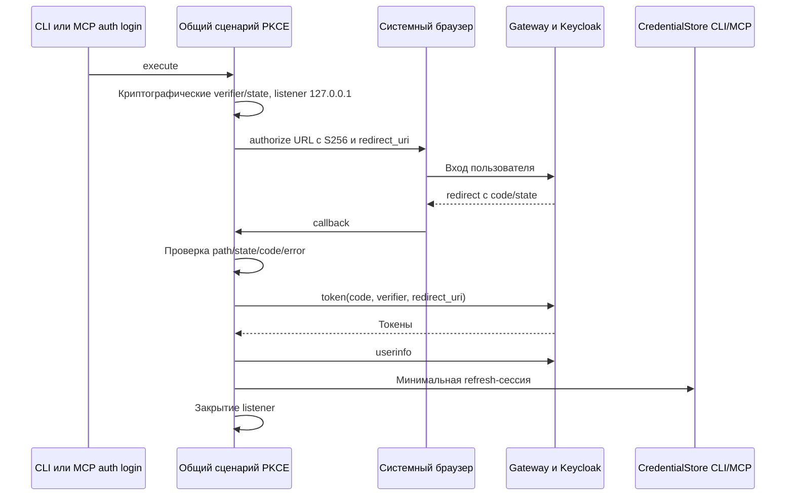

# Проектное решение

## Контекст и независимость

Этот Change выделяет авторизацию из unify-read-tools-and-pkce и не зависит от двух Change чтения. Можно реализовать и выпустить PKCE с текущим реестром MCP; нельзя требовать 26 tools для проверки входа. Мотивация — в proposal.md. Операции модели, платформы и HTTP-форматы данных не меняются.

## OAuth-клиент и Gateway

CLI/MCP переиспользуют существующий публичный dsbuilder-studio-plugin вместе с IDE. Новая регистрация OAuth-клиента не создаётся. S256 обязателен, client secret отсутствует, Direct Access Grants отключён, audience access token — dsbuilder-api. Проверяются пригодность текущей конфигурации и поддержка loopback redirect со свободным портом используемой версией Keycloak; меняются только необходимые настройки без нарушения web/IDE.

Все обращения authorize/token/userinfo/logout идут через существующий публичный Gateway. Local/prod nginx и актуальные OpenAPI описывают фактические параметры. HTTPS обязателен вне localhost/127.0.0.1. Общий clientId не означает общий refresh token с IDE: каждый вход создаёт самостоятельную сессию. Отдельный OAuth-клиент и парольный резервный путь отклонены как ненужное усложнение и сохранение пароля в клиентском сценарии.

## Общий сценарий и платформенные порты



Общий сценарий feature-auth получает криптографически стойкие verifier/state, challenge S256, браузер, listener и session sink через платформенные порты. Не допускается JVM-зависимость common-кода. Платформенные адаптеры поставляют composition root JVM, macOS arm64/x64 и Node; IDE может использовать общий обмен с собственным PasswordSafe без файлового хранилища CLI.

Listener слушает только 127.0.0.1 на свободном порту, callback /callback. Проверяются state, точный путь, отсутствие OAuth error, единственность и корректность code; verifier и redirect_uri при обмене совпадают с исходным запросом. Неверные path/state/code не сохраняют сессию. При ошибке, отмене, таймауте 180 секунд и успехе ресурсы закрываются. Отсутствие браузера завершается диагностикой; CI использует существующий project key.

Сохраняются границы core/feature/presentation, SDK MCP не нужен общему auth-коду. Каждый новый или изменённый UseCase имеет только публичный execute; криптография, слушатель, транспорт и кеш — сервисы/порты. CLI и Node auth login вызывают один сценарий; serve и tools никогда не запускают браузер. Stdout stdio MCP остаётся протокольным, секреты не выводятся в журналы.

## Хранение и миграция сессии

CLI/MCP используют существующий CredentialStore: ~/.sdds/sessions/<hash нормализованного API URL>.json. Схема хранит только schemaVersion, apiUrl, clientId=dsbuilder-studio-plugin, безопасный username из проверенного userinfo, refreshToken, refreshExpiresAt и updatedAt. Пароль, access/ID token, роли и контекст DS не записываются. Каталог 0700, файл 0600, атомарная замена после полной записи временного файла, нормализация API URL и межпроцессная блокировка сохраняются.

Старая сессия dsbuilder-api не обновляется новым clientId автоматически: возвращается AUTH_REQUIRED с повторным браузерным входом, её refresh token не отправляется другому клиенту. Общий clientId с IDE не меняет её отдельный защищённый session sink.

## Жизненный цикл токенов

Access token и expiresAt находятся только в памяти процесса. До expiry с запасом 30 секунд запросы переиспользуют токен; конкурентные refresh одного процесса объединяются. Межпроцессный lock защищает ротацию: refresh token перечитывается под lock и атомарно заменяется. Авария после ротации до сохранения может требовать повторного входа и не маскируется успешным восстановлением.

После 401 допустимы один forced refresh и один повтор запроса. Повторный 401 или invalid_grant очищает файл/кеш и возвращает AUTH_REQUIRED. После 403 нет refresh и смены actor; после транспортной ошибки сессия сохраняется, возвращается BACKEND_UNAVAILABLE. Project-key policy сохраняется и не переключается на пользователя после отказа.

Status сообщает только безопасные локальные метаданные, не обещает удалённую проверку. Logout пытается отозвать refresh token соответствующим clientId и удаляет файл/кеш даже при ошибке отзыва. Механизм обновления не должен вновь записать удалённую сессию из параллельного запроса; это проверяется совместно с блокировкой и отменой/инвалидацией кеша.

## Программное проектирование

```kotlin
interface PkceChallengeProvider {
    fun generate(): PkceChallenge
}
interface AuthorizationBrowser {
    suspend fun open(url: String): BrowserOpenResult
}
interface LoopbackCallbackListener {
    suspend fun awaitCallback(timeoutMillis: Long): CallbackResult
    fun close()
}
interface OAuthSessionSink {
    suspend fun accept(session: OAuthSession)
}
```

Это роли контрактов, конкретные пакеты выбираются по существующим границам. Получение безопасного имени идёт через userinfo, не через ввод username в терминале или неподтверждённое декодирование JWT.

## Риски, выпуск и проверки

Проверяется существующая регистрация и Gateway, затем выпускаются CLI/MCP с миграционным README/help. Требуется один новый браузерный вход. Откат клиента требует его прежней совместимой сессии/повторного входа; обратная миграция refresh token не выполняется. Существующие web/IDE и project keys должны продолжать работу.

Риски: работа только на JVM → common-граф и реальные платформенные адаптеры; потеря ротации → два процесса и атомарное сохранение; случайная утечка → тест stdout/logs/файла; неподдержанный redirect → проверка фактического Keycloak, а не только шаблона конфигурации.

Локально проверяются state/path/code/error, таймаут/отмена, ошибки браузера и обмена, освобождение listener, права файла и миграция старой сессии, время кеша и конкурентный refresh, 401/403/invalid_grant/transport, status/logout. Затем FAST → независимое read-only review → FULL, граф JVM/Node/macOS arm64/x64 и установленный Node tarball.

Обязательные внешние проверки до архивирования: настоящий login через оба executable с PostgreSQL/Keycloak, audience/userinfo/refresh/logout и общий файл; неверный verifier/state/redirect с отказом сохранения; браузерный вход и закрытие listener на JVM, Node и macOS arm64/x64; два процесса с общей ротацией и сохранение IDE/web. Сохраняются команды, exit codes и обезличенные результаты, недоступная архитектура не считается успехом. Текущий запрос разрешает только OpenSpec, не реализацию, архивирование или публикацию.
