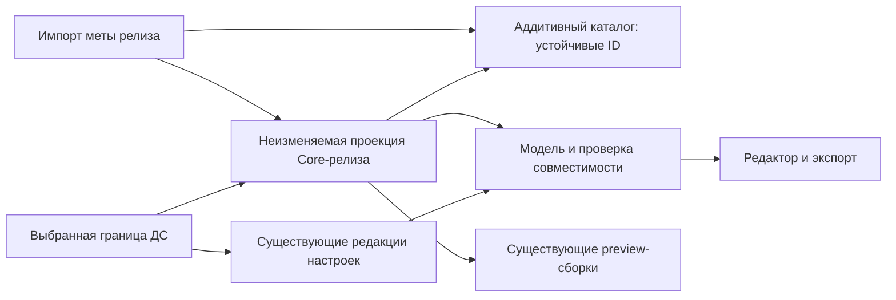

## Контекст

Исследование базы `d508f04e` выявило разную временную семантику:

- `ExposedDesignSystemVersionRepository.publish` фиксирует предметные редакции через существующую границу versionId и создаёт следующий черновик. Core и preview к ней не привязаны.
- `ComponentsTable`, `PropertiesTable`, `ComponentStatesTable`, `PropertyPlatformParamsTable` являются общими. API-импорт аддитивен, но обновляет deprecated у платформенных имён.
- `ExposedComponentEditorBundleRepository`, `AppearanceEditorModelReader`, `ComponentConfigBuilder`, `ComponentConfigImporter` и `PlatformParamOffsets` смешивают версионированные настройки и общий API. Прямая фильтрация новых свойств скрыла бы несовместимые сохранённые значения.
- `EditorPropertyValue` уже хранит id, propertyId, kind, styleIds, stateSetId/states, литерал/tokenId, alpha, adjustment, ссылку вложенного стиля и revision. Оси и значения осей позволяют восстановить расположение проблемы. Отдельного хранилища старых значений не требуется.
- Preview-реестр уже хранит platform/libraryVersion/metaSha256/buildId/commit. Активная сборка сейчас выбирается независимо от версии ДС; web-кеш также привязан к проекту, а не к Core.

## Цели и границы

Один Change вводит релизные описания Core, закрепление preview, автоматический переход черновика, проверку совместимости, серверные ограничения публикации/экспорта и UI «Проблемы». Документация, code binding и автоматическая отправка результатов генерации относятся к зависимому `separate-core-documentation-sources`.

Не создаются новая система предметных версий, второй реестр preview или отдельная активация Core-релиза. Не требуется полный справочник платформенных методов: сохраняются используемые моделью сущности и исходная мета для происхождения. Не гарантируется побайтовая воспроизводимость бинарного кода при разных версиях внешних генераторов.

## Решения

### Устойчивый каталог и неизменяемое описание релиза

Общие таблицы сохраняют ID и аддитивное накопление. Их поля больше не являются авторитетным API для чтения ДС. `CoreReleaseRef = {libraryId, platform, version}`, уникальный внутри каталога релизов. Библиотека определяется серверным соответствием платформе; существующее различие `web/react`, `xml/android-view`, `ios/swiftui/uikit` преобразуется явно на границе, а не меняется массово в БД.

Идентичность существующего компонента остаётся `(name, platform)`, свойства — `(componentId, name)`. Удаление из нового Core не удаляет общую запись. Переименование API библиотеки не угадывается и рассматривается как удаление прежней сущности и появление новой. После включения записи в Core административные операции не могут менять её ключевые поля идентичности (`name`, платформу, принадлежность свойства компоненту); редактируемые описания не являются импортными ключами. При появлении библиотек с разным смыслом одной пары name/platform нужна отдельная миграция пространства имён; текущий Change не объединяет такие конфликты молча.

Предварительная схема:

| Таблица | Содержание |
|---|---|
| `core_releases` | ID, libraryId/platform/version, исходный объект меты, SHA-256, время импорта, происхождение |
| `core_release_components` | releaseId/componentId и релизные имя/описание |
| `core_release_properties` | releaseId/propertyId/componentId, тип/default/описание, используемые ограничения |
| `core_release_platform_params` | releaseId/platformParamId/propertyId, имя, deprecated/message |
| `core_release_states` | releaseId/stateId/componentId и описание состояний, объявленных компонентом |
| `core_release_component_dependencies` | Определённая Core вложенность и ограничения вложенных свойств из нормализованной меты |
| `design_system_version_core_releases` | Существующий versionId/platform → releaseId; у публикаций фиксировано |
| `core_release_preview_builds` | Ссылки на существующие buildId и проверенный релиз, без копии сборок |
| `design_system_version_preview_builds` | versionId/platform → выбранный buildId либо ожидающий слот релиза |

Наборы состояний и ссылки значений сохраняют прежние ID. Общие состояния взаимодействия (`hovered`, `pressed`, `focused` и другие записи с `componentId=null`) остаются предустановленным системным набором, не частью меты или состава Core-релиза. Их отсутствие в мете не означает удаления; проверка разрешает их по системному набору. Состояния, объявленные конкретным компонентом, проверяются по релизной проекции с сохранением прежних ID.

Поля API компонентов, влияющие на модель/экспорт, читаются через релизную проекцию; новые ручные правки общего каталога не меняют старые проекции. Данные, принадлежащие ДС (оси, значения, поправки, переиспользование), остаются в существующих предметных редакциях. Поправки по platformParamId проверяются на принадлежность релизу, а не теряются из-за фильтрации.

Вложенность компонентов определяется Core и не изменяется настройками ДС. Нормализованный контракт сохраняет доступное в исходной мете описание вложенности, целевых компонентов/типов и ограничений вложенных свойств; отсутствие сведений не дополняется предположениями из пользовательских назначений. Для миграционного технического снимка допускаются существующие доказуемые сведения каталога с явным происхождением. Полный граф внутренних компонентов, не представленный метой, не восстанавливается и не является целью Change.

Выбор оформления и стилей для предусмотренного Core вложенного свойства принадлежит ДС и читается из её предметных редакций. Технические `REUSE`-связи, создаваемые при таком выборе, не расширяют состав Core и не являются доказательством разрешённой вложенности. Существующий смешанный `component_deps` нельзя целиком копировать в релиз или использовать вместо выбранной предметной границы. Для чтения и web-адаптера отдельно разрешаются вложенность Core (включая известный порядок `COMPOSE`) и назначения оформлений ДС. Проверяются только ограничения, доказуемо заданные Core.

JSON-описания допустимы для редких платформенных подробностей, но принадлежность сущностей и поля фильтрации должны быть доступны SQL. Альтернатива — хранить только исходную мету: это потребовало бы разбирать её при каждом чтении и не решило бы существующие SQL-связи. Копирование всего каталога для каждой ДС не нужно.



### Импорт и автоматический переход черновиков

Исходный мета-файл сохраняет прежний формат массива компонентов. Координаты `coreRelease: {libraryId, platform, version}` передаются отдельно в запросе импорта и manifest preview; CLI получает их из явных параметров либо метаданных артефакта, без угадывания версии. В административный DTO входят координаты, нормализованные данные и исходная мета с проверяемой суммой. `metaSha256` вычисляется по точным байтам исходного файла, без повторной сериализации, нормализации или включения координат. В web-архив включается тот же файл `api-meta.json`: его байты должны совпадать с переданным исходником импорта. Оболочка JSON вокруг массива не вводится; читатели React-меты в preview и js/cli сохраняют существующий формат. Импорт обновляет каталог и сохраняет полное описание состава нового релиза одной транзакцией. Пустой массив или исчезнувшие компоненты/свойства — допустимый состав, а не команда физического удаления общих ID. Некорректная схема, неизвестный нормализованный тип и противоречащие дубликаты отклоняют весь релиз до изменения каталога/указателя. Прежнее частичное принятие с `rejected` не применяется к релизному импорту: диагностика разрешена, активация неполной проекции — нет. Исправленный повтор после отказа допускается под теми же координатами, поскольку отклонённый релиз не зарегистрирован. Известное намеренное преобразование исходного формата определяется контрактом нормализации и не считается ошибкой само по себе; смена известного типа между релизами сохраняется в проекции, не переписывая тип общей записи.

Неизменность проверяется по исходной мете и полному нормализованному составу, включая вложенность; совпадения только SHA-256 исходного файла недостаточно. Повтор тех же координат и содержимого идемпотентен; другое содержимое — `409 CORE_RELEASE_IMMUTABLE`. Пробный импорт не изменяет таблицы/указатели. Успешный новый импорт становится текущим Core соответствующей библиотеки/платформы без отдельной активации. Повтор старого уже известного релиза не откатывает указатель. Атомарная регистрация меты не ждёт Markdown или preview.

Черновик динамически следует текущему Core. Настройки не переписываются и не удаляются, после смены Core строится новый отчёт. Отчёт и кеш имеют ключ `(draftId, draftRevision, coreReleaseIds, validatorVersion)`: смена Core инвалидирует их даже без изменения draftRevision. Опубликованные границы используют сохранённые ссылки.

Импорт Core — техническое обновление каталога DS Builder, а не публикация ДС. Он не создаёт версии ДС или следующий черновик, не меняет её номер/статус публикации и не запускает публикацию пакета. Смена Core сама по себе не создаёт предметную запись журнала или изменение draftRevision. Версия ДС появляется только при отдельном явном запросе публикации с непустым предметным журналом; пустой журнал по-прежнему блокирует публикацию, даже если Core сменился.

### Единая проверка и правила блокировки

Сервер сравнивает сохранённые назначения ДС с API выбранного Core. Он читает настройки до фильтрации по релизу. Область блокирующей проверки определяется активными связями компонентов выбранной границы ДС: собственные настройки скрытых компонентов сохраняются, но не входят в экспорт и не блокируют публикацию/экспорт. Ссылки из активных компонентов на скрытые проверяются и при недоступной цели блокируют операцию; скрытие цели не устраняет проблему у активного источника. Восстановление связи сохраняет прежние настройки и снова включает их в проверку; само восстановление разрешено и не публикует ДС. Counts и пагинация отчёта относятся к одной и той же области проверки. Проверяются: существование используемого компонента/свойства/состояния/платформенного параметра, совместимость типов литерала или токена, доступность зависимого компонента и ссылок вложенных стилей в выбранной модели. Проверка не требует существования preview-бинарника.

| Ситуация | Результат |
|---|---|
| Добавлена неиспользуемая сущность | Нет конфликта |
| Используемая сущность deprecated | Предупреждение, публикация разрешена |
| Удалена неиспользуемая сущность | Нет конфликта, Core-релиз разрешён |
| Удалена сущность с сохранёнными настройками | Блокирующая проблема затронутой ДС; настройки сохранены |
| Тип изменён, сохранённое значение совместимо | Нет блокировки только из-за различия номеров/типов |
| Значение/токен не подходит новому типу | Блокирующая проблема |
| Сборка preview ещё не поступила | Превью недоступно, конфигурационная публикация не блокируется |

Публикация повторяет проверку актуальных Core и draftRevision в одной согласованной операции с фиксацией границы. Проверка и фиксация текущих Core сериализуются с импортом на уровне строк указателей релизов; используются единый порядок блокировок и короткие транзакции. Нельзя проверить A, а закрепить B. Предварительный отчёт клиента не является разрешением на публикацию. Конфликты дают `409 CORE_COMPATIBILITY_CONFLICT`, без публикации или нового черновика. Остальные существующие проверки версии/прав/пустого журнала сохраняются.

Получение нового экспорта для генерации возвращает тот же отказ при блокирующих конфликтах Core выбранной версии или черновика. Эта проверка выполняется при fetch/export и не распространяется на последующее использование ранее сохранённого снимка.

Локальная генерация использует выбранный сохранённый снимок ДС и его метаданные происхождения Core без обязательного обращения к серверу. Она не требует актуального серверного контекста, совпадения отпечатка с текущим черновиком или совпадения Core снимка с локальной версией библиотеки. Импорт нового Core, изменение или появление конфликтов серверного черновика и недоступность сервера не запрещают генерацию из сохранённого снимка и не вызывают автоматического обновления данных.

Например, данные ДС закреплены за опубликованным Core A, а в том же репозитории разрабатывается ещё не выпущенный Core B: CLI генерирует код из снимка A. Совместимость результата с локальными исходниками и зависимостями B проверяется локальной сборкой и тестами; одно различие версий не доказывает несовместимость. Сервер проверяет конфигурацию относительно Core выбранной границы, но не гарантирует совместимость с произвольными локальными исходниками. Если запрошено получение нового экспорта и оно отклонено, операция завершается явной ошибкой без незаметной подстановки старого снимка; отдельная генерация из явно выбранного сохранённого снимка остаётся доступной.

### DTO проблем и расположение сохранённых значений

Единый отчёт: `reportId`, `designSystemId`, `draftId`/`versionId`, `draftRevision?`, `coreReleases`, `validatorVersion`, `blockingCount`, `warningCount`, `items`, `nextCursor` для списка. Counts относятся ко всему отчёту, не к одной странице. Отчёт без Core имеет явную диагностическую причину, а не выдуманный последний релиз.

Элемент: устойчивый `issueId`, `code`, `severity`, `message`, `componentId/name`, `appearanceId/name?`, `propertyId/name?`, старое описание из предыдущего известного Core при наличии, `targetCoreRelease`, `valueKind`, `valueId`, `styleIds`, подписи осей/значений, `stateSetId/states`, `storedValue`, `entityRevision`, допустимые действия. Для удалённого компонента проблема может относиться к связи ДС с компонентом целиком и содержать дочерние затронутые значения; идентификаторы не выдумываются.

`storedValue` повторяет реальные данные: literal/tokenId/tokenName, alpha, adjustment и вложенную ссылку. Отдельно DTO содержит дочерние платформенные поправки: их ID/revision, platformParamId, смещение и template; скаляр adjustment их не заменяет. Это сохранённая настройка в текущем черновике, не обещание восстановить вычисленное значение токена до обновления Core. Если старое описание неизвестно, показываются сохранённые ID/имена с соответствующим признаком.

Проблемы одного назначения с разными причинами можно группировать визуально; location остаётся точным для invariant/variation/combination и состояния. Отчёт всей ДС не требует загружать все editor-bundle в браузер. Фильтр componentId возвращает те же issueId в секции компонента.

### Обычная запись и исправления

Обычное создание/изменение значения проверяет тип, токен, компонентные состояния, платформенные параметры и известные ограничения вложенных ссылок по текущему Core черновика. `PropertiesTable.type` общего каталога не является правилом валидации. Общие состояния остаются системными. Разрешение Core и запись согласуются с импортом: смена Core после чтения редактором требует повторной проверки сервером; несовместимая запись отклоняется без изменений. Проверяется записываемое назначение, а не отсутствие всех остальных конфликтов ДС, чтобы исправления оставались доступны. Удаление старого назначения допускается и после исчезновения его свойства из Core.

### Исправления и UI

В разделе публикации показываются блокирующие проблемы и предупреждения: компонент, оформление, вариации/сочетания и состояния, причина и значение. Переход открывает компонент, оформление и секцию «Проблемы». Эта секция находится рядом со «Стилизацией» и «Структурой», поддерживает фильтрацию и переход к месту настройки. Удалённый из Core, но настроенный компонент остаётся в списке ДС как недоступный с доступом к проблемам; отказ export не должен делать editor-bundle целиком недоступным. Нормальная модель и диагностическая модель разделяются в ответе.

Удаление проблемы адресуется сохранённому valueKind/valueId и существующим предметным ID; не требует наличия свойства или состояния в новом Core. Используются прежние права, согласование правок, revision, журнал, откат и сигналы. Удаляется назначение с принадлежащими ему ссылками/поправками, не общий каталог и не опубликованные данные.

Перенос: сервер принимает источник и целевой propertyId, проверяет совместимость типа, токена, состояний, области и ссылок вложенного компонента, а также отсутствие назначения в целевой ячейке. Создание новой записи и удаление старой выполняются атомарно с проверкой entityRevision и текущего Core. При конфликте назначения — отказ без перезаписи; автоматического выбора похожего имени нет. В первой реализации перенос назначения с отдельными `*_platform_param_adjustments` запрещён: без сопоставления параметров нельзя гарантировать сохранение смещений и шаблонов. Сервер проверяет их наличие в той же операции и отказывает без изменения источника/цели; автоматического удаления или копирования старых platformParamId нет. Такие назначения исправляются вручную, удаление остаётся доступным с обычным журналом и откатом. Если перенос невозможен, UI объясняет причину и предлагает удалить или подготовить замену вручную. После исправления отчёт обновляется, а запоздалый старый отчёт не возвращает уже устранённую проблему.

### Preview в рамках того же Change

Реестр `compose_preview_plugin_builds` сохраняется. Его libraryVersion/metaSha256 связываются с Core-релизом после проверки platform, библиотеки и точного файла меты. Если новый preview поступает вместе с метой, существующая публикация использует общий релизный импорт; отдельный глобальный импорт без координат не выполняется.

Черновик выбирает последнюю успешно зарегистрированную совместимую сборку своего Core, а не глобально активную сборку другой версии. При публикации фиксируется точный buildId каждой доступной платформы вместе с releaseId. Если сборки ещё нет, фиксируется ожидающий слот этого релиза; первая поздняя совместимая сборка заполняет его однократно атомарно. Следующие сборки того же Core не заменяют закреплённую у опубликованной ДС. Бинарные артефакты и мета, на которые есть ссылки версий, защищены от существующей очистки старых сборок.

Системный маршрут выдаёт pluginUrl/buildId/coreRelease/metaSha256 для выбранной версии ДС; без обязательного coreReleaseId во входе. Кеш клиента включает проект/ДС/границу/Core/buildId; смена контекста сбрасывает iframe и игнорирует запоздалые ответы. Manifest/protocol/платформа/поддержка компонента проверяются как раньше. Прямой VITE_*_PREVIEW_PLUGIN_URL сохраняется только как явный режим разработки с пометкой неподтверждённого соответствия; это не воспроизводимое превью опубликованной версии. При отсутствии сборки недоступно только превью, редактор и проблемы продолжают работать. Получение списка Compose-компонентов, editor-bundle, диагностики и исправлений не зависит от наличия pluginUrl; `404`, ошибка разрешения или несовместимая сборка не скрывают доступные компоненты. Контракт выбора синхронизирован с активным `host-compose-preview-plugin`: глобальный адрес и кеш только по проекту заменяются выбором по ДС/границе/Core/buildId.

## Границы API и архитектуры

Предлагаемые операции уточняются в source-of-truth OpenAPI при реализации:

| Операция | Контракт |
|---|---|
| Существующий административный импорт меты | Координаты, нормализованный состав, исходная мета/сумма, dryRun; отчёт с releaseId |
| Существующие системные чтения и export | Прежние DS/version селекторы; сервер разрешает Core; в метаданных ответа добавляются coreReleases |
| `GET /api/projects/{projectId}/design-systems/{designSystemId}/compatibility` | Прежний выбор черновика/версии, componentId/severity/cursor; единый отчёт |
| Системное чтение preview выбранной платформы | DS/version → pluginUrl/buildId/coreRelease либо явное отсутствие |
| Удаление проблемного назначения | valueKind/valueId, expectedRevision и существующий контракт согласования правок |
| Перенос проблемного назначения | Источник, targetPropertyId, expectedRevision/Core-контекст; атомарный результат |

Системные данные проверяют принадлежность проекту и версии; глобальный catalog остаётся отдельным административным/справочным входом. Его ответы нельзя использовать как историческую модель ДС. Нет обязательного coreReleaseId в обычных клиентских запросах. Между несколькими запросами можно передать необязательный отпечаток разрешённого контекста, чтобы сервер выявил смену Core и потребовал повторное чтение, а не смешивал данные.

Применяются существующие права чтения компонентов/версий и записи значений; новые права не обходят их. `400` — синтаксис/неверный селектор, `403` — права, `404` — неизвестный/чужой объект, `409` — устаревшая ревизия/несовместимость/занятое назначение, `422` — неверная мета. Ответы не раскрывают данные чужих проектов.

В Kotlin presentation разбирает DTO, application разрешает контекст/проверяет/оркестрирует, domain определяет идентичность/совместимость, data реализует SQL/HTTP/хранилище, di связывает реализации. Общий Core-контекст размещается в ds-service/core с портами, не импортируя feature-components в feature-design-systems. Frontend core-* содержит только общий контекст/порты; feature-* не зависят друг от друга; CLI и MCP остаются оболочками общих use case.

## Программное проектирование

```kotlin
// domain
 data class CoreReleaseRef(val libraryId: String, val platform: String, val version: String)
 data class CompatibilityScope(val designSystemId: String, val versionId: String, val draftRevision: Long?)
// application
 interface CoreContextResolver {
     suspend fun resolve(scope: CompatibilityScope): ResolvedCoreContext
 }
 interface CompatibilityChecker {
     suspend fun check(context: ResolvedCoreContext): CompatibilityReport
 }
 interface VersionCoreBinder {
     suspend fun bindForPublication(context: ResolvedCoreContext): CoreBindingResult
 }
 interface PreviewBuildResolver {
     suspend fun resolve(context: ResolvedCoreContext, platform: String): PreviewSelection
 }
 interface ProblemRepairService {
     suspend fun remove(command: RemoveProblemValue): RepairResult
     suspend fun transfer(command: TransferProblemValue): RepairResult
 }
```

## Миграция и зависимые изменения

Добавляются Flyway-миграции, существующие ID и предметные редакции сохраняются. Сначала выделяется снимок текущего каталога на момент миграции как технический источник с явным происхождением, без объявления его исторической версией библиотеки. Для старой опубликованной ДС при наличии доказуемых артефактов закрепляется соответствующий релиз/preview; иначе используется технический снимок с диагностикой «историческое происхождение не установлено». Он фиксирует поведение с момента миграции, а не восстанавливает утраченную историю. Подставлять будущий latest таким версиям запрещено. Отсутствующий исторический preview показывается как недоступный.

Далее переводятся все системные чтения/проверки, export и preview; общий каталог сохраняется для идентичности. Несопоставленные legacy-поля и вручную созданные сущности должны попасть в миграционный отчёт и технический снимок, а не исчезнуть. Все опубликованные ссылки учитываются очисткой. Откат приложений не удаляет новые таблицы/объекты; на время отката новые импорты останавливаются. Старый код, читающий глобальный API, не обеспечивает новую изоляцию — откат означает временную потерю этой гарантии, а не успешное сохранение нового поведения.

Производитель меты/preview в plasma-android оформляется отдельным Change; здесь фиксируются контракт, тестовые примеры и внешняя проверка. В js/cli и публикации preview передаются координаты релиза отдельно от неизменённого формата массива React-меты; проверяется совпадение исходных байтов при упаковке web-архива.

`separate-core-documentation-sources` начинается после завершения этого Change и использует CoreReleaseRef, сохранённый исходник меты, DS-контекст и фиксацию публикации. Он не повторяет импорт релизов, совместимость или выбор preview.

## Риски и проверка

- Неполный перевод чтений оставит влияние общего каталога → проверять bundle, списки, модель оформления, импорт/экспорт, поправки, вложенные ссылки и MCP одним набором сценариев A/B.
- Проверка до фильтрации обязательна → тесты удалённого свойства/состояния/компонента с сохранёнными invariant/variation/combination и токенами.
- Смена Core не меняет настройки → отдельная инвалидация отчётов, кеша редактора и preview по Core-контексту. Сохранённые локальные снимки CLI сохраняют своё происхождение и пригодность для генерации; их обновление выполняется явно.
- Гонки импорта/публикации/исправления → единые блокировки указателей и проверка revision/Core; нельзя закрепить другой релиз после проверки.
- Значения типа value могут не иметь полной информации о допустимом enum в нормализованной модели → проверять только доказуемые ограничения; не выдавать предположения за установленный конфликт.

Локальные проверки охватывают domain/use case, SQL-репозитории и миграции, Ktor/OpenAPI/route manifest, frontend-контекст, CLI/MCP, web-навигацию и кеш preview. По workflow выполняются FAST, независимое review и FULL, без изменения защищённых тестов архитектуры и baseline.

До архивирования нужна проверка реального PostgreSQL/S3 и Compose-плагинов A/B: зафиксировать ДС на A, импортировать B с удалением используемого deprecated свойства, убедиться в успешном Core-импорте, сохранённых значениях и блокировке только затронутого черновика; исправить проблему, опубликовать и проверить независимость A/B preview. Сохраняются команды, HTTP-коды, идентификаторы и контрольные суммы без секретов. Недоступная инфраструктура или Android-артефакты не считаются успехом.

После развёртывания наблюдаются длительность проверки, число конфликтов и недоступных совместимых preview; эксплуатационные наблюдения не включаются в блокирующие задачи до архивирования.
